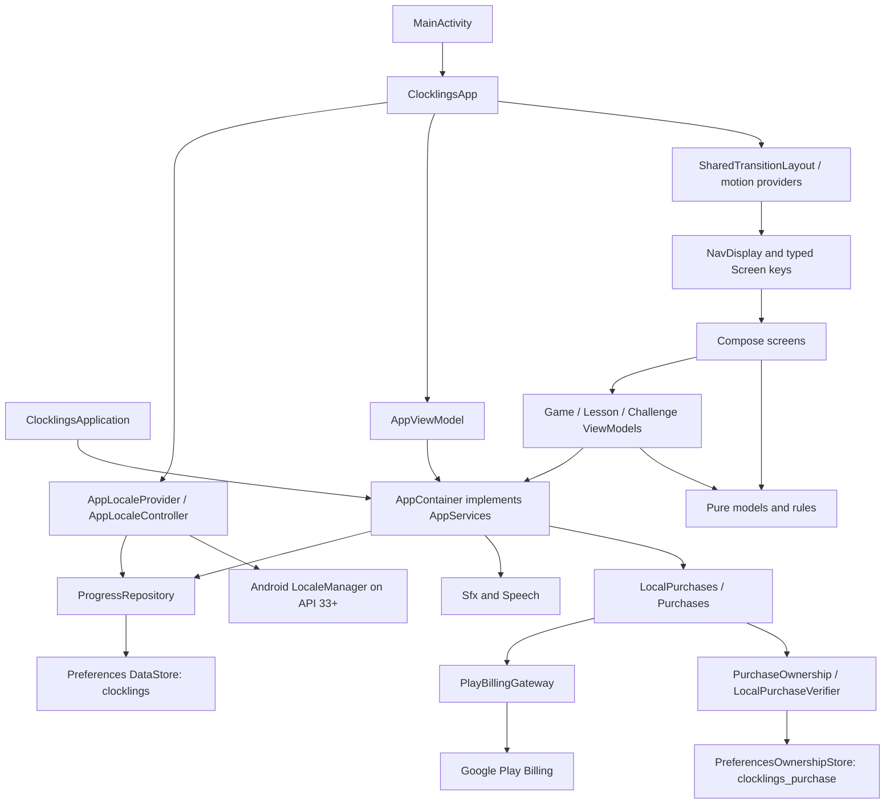
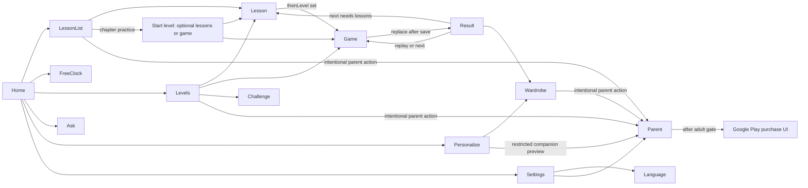

# Clocklings — Technical Reference and Development Handoff

**Repository snapshot:** 10 November 2026 (Europe/Helsinki), branch `codex/full-unlock`, inspected HEAD `021d86c6b269d6427d418e522b9cc715ad261fba` (`021d86c`) **plus the existing working-tree changes**. Those changes include narration/audio integration, game/challenge ordering, companion rendering, purchase-verifier handling, the Part 01–08 reviews and subsequent corrections/tests, stability baselines, scanner exceptions and STATUS. Narration resources, their resource test, five further JVM test files, three further Android test files, all eight review reports and `docs/audio/` are untracked at this checkpoint. They are present locally but are not established as part of HEAD or a remote build. The pre-existing `.codex-remote-attachments/` directory is outside this documentation task. This task changes only root `PROJECT.md` and preserves the other work. No commit, remote-state check or application build is implied by the snapshot.

**Purpose:** A repository-specific guide to the complete application: product behavior, screens, architecture, data, rendering, localization, platform boundaries, tests, build tooling, review priorities, and unresolved decisions. It is an orientation reference, not a replacement for inspecting code or an authorization to implement proposals.

**Current implementation:** Seven-language learning, adaptive layouts and the one-time full-unlock model are implemented. The current working tree also integrates fourteen recorded narrator lines in every language, alongside the existing effects, companion voices and optional installed-voice TTS. Free/full access applies to navigation, actions, rewards and displayed saved choices; section I documents the exact contract. Live Play setup, production licensing/signing and transactions remain deferred; `UNCONFIGURED` in the public-key resource prevents production purchases. Historical test results retain their original revision boundaries.

**Authority:** Owner instructions and [AGENTS.md](AGENTS.md) govern scope and working rules. Current source governs implemented behavior. [CONSOLIDATED-STATUS.md](docs/implementation/CONSOLIDATED-STATUS.md), updated 8 November, summarizes the audit/adaptive work, monetization, subsequent corrections and bounded verification. [MONETIZATION.md](docs/implementation/MONETIZATION.md) records the approved commercial model and deferred Play setup. [STATUS.md](docs/implementation/STATUS.md) contains dated decisions and a later 9 November narration entry despite its older top-level date/branch text. [TESTING_HISTORY.md](TESTING_HISTORY.md) consolidates earlier campaigns through its stated cutoff. None is a fresh pass for this documentation task. The [product plan](docs/superpowers/plans/2026-10-20-public-clock-learning-app.md) distinguishes requirements from proposals; detailed specifications do not automatically approve features.

**Latest review evidence:** All eight 10 November result ledgers are now present, covering questions **001–640**. Their later continuations matter: Part 01 adds API 26/36 startup checks, Part 03 adds 55 Android executions, Part 06 adds 75 API 36 UI/input executions, and Part 08 records the Detekt corrections and two explicitly authorized Pixel 9 clipboard tests. These are separate checkpoints with different selections and artifacts. The full JVM suite is reported passing at 489 executions/89 suites; a targeted ParentScreen follow-up passed five cases. No single final command certifies every current source file, runtime cell or release boundary. See [the review ledger index](#10-november-review-ledgers-and-superseding-continuations) for exact scope and remaining gaps.

**Language scope:** The owner expanded the release languages on 4 November to **English, Finnish, shared Swedish, German, French, Spain Spanish and Brazilian Portuguese**. This supersedes the older three-language product plan; current AGENTS and source use seven. The [seven-language audit](docs/localization/2026-11-04-language-audit.md), including its emulator continuation, contains evidence not consolidated into TESTING_HISTORY or earlier STATUS entries. Native-speaker review is unverified; it is not a newly imposed release dependency.

**Window and completion scope:** The 6 November owner decision includes small/large Android phones, tablets, Chromebooks and Googlebook devices. Adaptive implementation and the scoped audit corrections are complete according to the consolidated record. That record also reports an owner-authorized Pixel 9 exception on 8 November; it does not authorize physical-device testing in a new task. Actual Chromebook/Googlebook runtime and final adaptive TalkBack listening remain unverified, and later TalkBack work was explicitly deferred. These limits are not an instruction to obtain hardware or reopen completed audits. Publication/signing/provenance/privacy/store work is deliberately deferred until requested. Additional profiles, timers, widgets and specialized fold/external-display features remain unselected proposals.

### Using this reference for review, tests and UI work

| Question | Start here | Evidence to request or inspect |
| --- | --- | --- |
| What does the app do, and what must a change preserve? | B feature inventory, D screens, E journeys, G stored data | Current implementation and owner decisions; distinguish an implemented behavior from an approved future requirement |
| Is a reviewer finding valid? | R review map, then the owning source and callers | Concrete trigger, affected state/lifecycle, existing guard and relevant test; a possible risk is not a reproduced defect |
| Which tests should cover a change? | N test map and validation boundaries, O commands | Smallest relevant suite and realistic failure path; source test counts, executed tests and passing tests are different facts |
| How should a UI change fit the app? | D design system, M accessibility, S source links | Existing tokens/components, normal layout plus 320 dp, 200% font and their combination, affected languages and states; distinguish Robolectric from device evidence |
| What is free, what requires payment, and what must remain earned? | I access/ownership, G stores, E navigation | `AccessPolicy`, current purchase state, signed-receipt reconciliation and display-only fallbacks; distinguish fake entitlements from live Play transactions |
| Which audio is automatic, optional or language-dependent? | H effects/narration/TTS, D screen timing, N tests | Packaged per-language recordings versus installed offline TTS; readiness, preference/lifecycle gates, cue ordering and actual listening are separate boundaries |
| Is it ready to publish? | J privacy, O release configuration, T unresolved work | Exact artifact/commit and current release evidence; historical debug checks or a test-signed profiling APK are insufficient |

When using this file as context for a question, include the relevant code/diff and the current commit if available. Ask for findings tied to actual source and tests, with uncertainty stated explicitly. This file is not a substitute for the code, a full test report or screenshot evidence.

## Contents

- [A. Identity, scope, and evidence](#a-identity-scope-and-evidence)
- [B. Complete feature inventory](#b-complete-feature-inventory)
- [C. Architecture and initialization](#c-architecture-and-initialization)
- [D. UI and UX reference](#d-ui-and-ux-reference)
- [E. Navigation and user journeys](#e-navigation-and-user-journeys)
- [F. State, concurrency, and lifecycle](#f-state-concurrency-and-lifecycle)
- [G. Models, storage, and recovery](#g-models-storage-and-recovery)
- [H. Platform integrations and audio](#h-platform-integrations-and-audio)
- [I. Monetization and entitlements](#i-monetization-and-entitlements)
- [J. Permissions, security, and privacy](#j-permissions-security-and-privacy)
- [K. Stack and dependency configuration](#k-stack-and-dependency-configuration)
- [L. Localization and teaching language](#l-localization-and-teaching-language)
- [M. Accessibility and device compatibility](#m-accessibility-and-device-compatibility)
- [N. Tests and validation evidence](#n-tests-and-validation-evidence)
- [O. Development, CI, and release procedures](#o-development-ci-and-release-procedures)
- [P. Error and edge-case reference](#p-error-and-edge-case-reference)
- [Q. Known limitations and documentation discrepancies](#q-known-limitations-and-documentation-discrepancies)
- [R. Critical code review map](#r-critical-code-review-map)
- [S. Navigable source reference](#s-navigable-source-reference)
- [T. Current development state and unresolved questions](#t-current-development-state-and-unresolved-questions)
- [U. Instructions for future assistants](#u-instructions-for-future-assistants)

## A. Identity, scope, and evidence

### Application identity

| Property | Implemented or documented value | Evidence |
| --- | --- | --- |
| Launcher/app name | Clocklings | `app/src/main/res/values/strings.xml`, manifest |
| Intended Google Play title | Clocklings: Learn to Tell Time | Owner requirements and product plan; not a verified live listing |
| Namespace/application ID | `fi.clocklings` | `app/build.gradle.kts` |
| Version | `versionCode = 1`, `versionName = "1.0"` | `app/build.gradle.kts` |
| Platform | Android, minimum API 26; compile and target API 37 | `app/build.gradle.kts` |
| UI | Kotlin, Jetpack Compose, one production activity, resizable/orientation-unlocked windows, authored light theme | `MainActivity`, manifest, `ClocklingsTheme`, adaptive components |
| Languages | English, Finnish, shared Swedish, German, French, Spain Spanish (`es-ES`), Brazilian Portuguese (`pt-BR`); device-language option | `AppLanguage`, locale resources/configuration |
| Runtime data | Local learning/settings DataStore plus separate signed-purchase DataStore; no accounts or separate learner profiles | `ProgressRepository`, `PreferencesOwnershipStore` |
| Release status | Development implementation with historical debug checks and scoped test-signed R8 profiling; publication and production-signed release readiness not established | `STATUS.md`, `TESTING_HISTORY.md` and the scoped evidence described in N; no Play Console evidence inspected |

Clocklings teaches analog time through short demonstrations, multiple-choice reading questions, hand-setting exercises, free clock manipulation, and shared play. Best practice results earn up to fifteen stars that unlock companion clothing. The complete catalog has nine companions plus no-companion mode, clock artwork, per-companion names, 12/24-hour display, effects and recorded narration, and optional installed offline speech. Free access includes whole-hour learning/practice, Explore, Together, all clock styles and HUMAN/CAT/NONE. Other learning levels/challenge require full access; other companions also require three earned stars. Buying access never awards learning progress or unearned clothing. See I for the full mapping.

The intended audience is children learning to tell time, with optional adult/shared participation. The plan's approximate age range is a proposal, not a confirmed Play age declaration. There is no implemented age collection, parental identity, school curriculum mapping, or Teacher Approved flow.

### Evidence categories and investigation limits

- **Implemented:** Derived from inspected production code/configuration. A static trace establishes control flow, not that every device renders or behaves correctly.
- **Historical validation:** Explicitly attributed to dated entries in `STATUS.md` or language-review documentation. Those checks were not rerun merely to create this document.
- **Potential concern:** A concrete code boundary requiring further investigation; not a reproduced defect unless explicitly stated.
- **Planned/unresolved:** Supported by planning/decision documents but not present in the implementation.
- **Unavailable:** Cannot be established from this repository investigation, such as current Play Console configuration or actual speech quality on a physical device.

This update reconciles the existing reference with `021d86c`, the current working tree, all eight 10 November result ledgers and their available continuations. It checks the changed navigation/clock/Together, completion/persistence, purchase-recovery, audio and test contracts against their owners and relevant test source; rechecks build/manifest/tooling declarations; and recalculates source/test/resource inventories. Unchanged domain and UI descriptions remain a source-oriented reference, not a new line-by-line audit or visual acceptance. Historical results are attributed to their records. Original logs, traces, APKs, screenshots, remote CI and Console state were not independently revalidated. Private machine configuration, signing material, external dashboards and the original application's workspace were not inspected.

The production tree contains **132 Kotlin files**. JVM tests contain **96 Kotlin files**, of which 89 declare **483 `@Test` methods**; instrumentation contains **50 Kotlin files**, of which 42 declare **198 `@Test` methods**, plus two Java native-provider fixtures (source counts checked on 10 November 2026, including untracked source). Kotlin totals include helpers; methods include conditional/opt-in tests and are not passing-test counts. SDK-expanded execution totals can exceed source-method totals: the reported 489 JVM executions and 483 source declarations are different units. Counts use the three app source sets, excluding build output/report snapshots. There are nine companion catalogs with **146 items**, **116 packaged OGG files** (18 shared clips plus 14 narration lines × 7 languages), six TTF weights and seven UI languages. Six Maestro YAML journeys exist outside the Kotlin source sets. Detailed inventories and evidence boundaries follow below.

Validation for this documentation update is limited to source/inventory checks, local secret scans, resource parity and document link/diff checks; actual results are recorded in N. No Gradle build, JVM test suite, instrumentation suite, Maestro journey, emulator session, vulnerability audit, Sonar source upload or release validation is implied by this reference. No application implementation is changed by this task.

## B. Complete feature inventory

Learning and settings use local state/storage and require no app-requested dangerous permission. Billing additionally uses Google Play and a separate private receipt store. Speech depends on a suitable installed Android TTS voice; its availability is optional. Tests listed are existing coverage, not results from this documentation task. Test paths are mapped in [N](#n-tests-and-validation-evidence).

| Feature and access | Processing and persistence | States, restrictions, recovery | Main implementation and tests |
| --- | --- | --- | --- |
| Launch introduction | Branded vector clock mascot, staggered title, localized greeting, optional INTRO jingle and recorded greeting; session-saveable completion/voice request flags | Tap/accessibility skip; covered UI semantics/focus blocked; reduced motion uses a still image without jingle but permits narrator greeting; not persistent first-install onboarding | `IntroScreen.kt`, `IntroTimeline.kt`, `LogoMascot.kt`; `IntroTimelineTest`, `IntroOverlayTest` |
| Home | Real local time read on entry and every ten seconds while lifecycle is STARTED or above; immediate return refresh; localized time, eligible companion stage and total stars | Flexible stage/menu, compact scroll fallback; NONE removes character while customization remains reachable; root waits for locale/settings/progress/purchase initialization | `HomeScreen.kt`; `HomeTimeTest`, `AppFlowTest`, `PersonalizationFlowTest` |
| Lesson library | Nine authored lessons, demos/quizzes; chapter path with five direct practice entries; stable completion IDs persisted | Free first three lessons and optional day lesson; later chapters need full access. Day hidden in 12-hour mode; wrong choices disabled; progression waits for successful save | `LessonScreens.kt`, `LessonCatalog.kt`, `LessonViewModel`, `AccessPolicy`; lesson/access/localization tests |
| Automatic pre-level lessons | `introPlan` selects incomplete lessons for a level and optional day lesson | Intro-shown markers saved when starting the route, before completing the lessons; top-bar skip enters game | `Lessons.kt`, `AppViewModel.startLevel`, `Navigator`; `LessonsTest`, `GameViewModelTest` |
| Explore/free clock | Drag hands in five-minute steps, randomize, read words/digits, listen, toggle guides | No scoring; saveable time; 24-hour conversion retains an afternoon representation when enabled | `FreeClockScreen`, `ClockFace`; `AppFlowTest`, `ClockSurfaceStateTest`, `LanguageSettingsTest` |
| Practice level selection | Five path nodes from whole hours to exact minutes; best stars, current marker and lesson shortcuts | Level 0 is free; levels 1–4 require full access. Within full access there is no sequential mastery gate | `LevelsScreen`, `Levels`, `AccessPolicy`; access and navigation tests |
| Practice round | Ten distinct tasks alternating READ/SET; two-stage error feedback; best-of-level star update | First wrong answer gives hint; second reveals answer; correct answer advances after delay; final-save failure offers Retry without discarding the round; active round not durably saved | `GameScreen`, `GameViewModel`; `GameViewModelTest`, `ActiveLocaleStateTest` |
| Result/rewards | Three-star display, preserved best, newly unlocked items, companion celebration, replay/next/dress | One to three stars per completed round; aggregate best max 15; previewing new clothes does not equip them | `ResultScreen`, `Progress`, `Wardrobe`; `VisibleUnlocksTest`, `AppFlowTest`, `ComposeStabilityRegressionTest` |
| One-minute challenge | Full-access sixty-second reading-choice round; questions generated from levels 0–3; best score persisted | Reserved choices, END save-error Retry, narrated start/end; no stars/item unlocks or persisted active countdown | `ChallengeScreen`, `ChallengeViewModel`; `ChallengeViewModelTest`, `ChallengeScreenTest`, `ActiveLocaleStateTest` |
| Play together | Setter chooses time, hands over hidden-answer question, reveals answer, swaps player number | No recorded answer, score, player name, or correctness judging; time/phase/player are saveable | `AskScreen`; `AppFlowTest`, `LanguageSettingsTest`, `ClockSurfaceStateTest` |
| Companion choice | Doll (stored as HUMAN), cat, dog, robot, dragon, dinosaur, bunny, unicorn, car, none; choice persisted | HUMAN, CAT and NONE are free; other companions require full access and three earned stars. Previous names/outfits are retained per species | `AppearanceScreen`, `Personalization`, `AccessPolicy`; personalization/access tests |
| Companion color | Four color options per non-human kind; dragon replaces purple with orange; dinosaur replaces green with orange; settings persisted per kind | Human uses its own artwork/clothing colors; `NONE` has no wardrobe | `WardrobeScreen`, `PersonalizationPreferences`; `PersonalizationTest` |
| Clothing and names | 146 items across nine catalogs; star thresholds; per-kind outfit/name persisted | Required human slots cannot be removed; optional slots toggle; name input capped at 16 UTF-16 units without splitting a surrogate pair, then trimmed for saving | `WardrobeScreen`, `NameField`, `Wardrobe`, `CompanionItems`; `WardrobeTest`, `CompanionItemsTest`, `NameFieldEdgeCaseTest`, `PersonalizationStorageTest` |
| Clock styles | Seven named styles plus custom; custom has 48 combinations; persisted settings | All styles share clock geometry, red hour hand, blue minute hand; no unlock cost | `AppearanceScreen`, `ClockThemeArt`, `ClockAppearance`; `PersonalizationFlowTest`, galleries |
| Settings | Language entry, 12/24-hour choice, guides, effects switch, speech status, reset | Pending writes disable affected controls; IOException shown; persisted state drives UI | `SettingsScreen`, `AppViewModel`; `AppSettingsTest`, `SettingsErrorTest` |
| Language choice | Device/default plus seven languages; platform storage on API 33+, DataStore on older Android | Loading/error/retry at initial migration; a known platform choice stays usable during legacy-cleanup failure; failed selection remains retryable; locale changes stop speech | `LanguageScreen`, `AppLocaleController`; controller, locale and active-state tests |
| Reset progress | Confirmation clears progress, names, clothing, best challenge and lesson markers | Preserves display/audio/help/language/appearance settings; no undo/import recovery; IO failure retains dialog/error | `ResetProgressDialog`, `AppViewModel.resetProgress`, repository; `AppSettingsTest`, `LanguageSettingsTest` |
| Optional read-aloud | Local offline-eligible voice reads localized clock/lesson text; engine calls run serially on a background dispatcher | Hidden when unavailable; stale queued requests invalidated by stop/language/refresh/shutdown; stopping an already running engine call is asynchronous | `Speech`, `Texts.kt`; JVM `SpeechTest`, Android `OfflineVoiceTest` |
| Recorded narration | Fourteen narrator lines in seven languages: intro greeting, READ/SET instructions, hand hints, Together question, result/reward and challenge boundaries | Follows sound-effects setting and foreground gate; independent of installed TTS; finite delays/cancellation, no challenge-question or lesson/Explore narration | `Sound`, `Sfx`, intro/game/result/challenge/Together callers; `NarrationResourcesTest`, `SoundTest`, ViewModel ordering tests |
| Sound effects | Generated POP PCM and 18 shared intro/feedback/reward/companion clips, plus localized narration; IO loading and foreground/sound-setting gates | Clips require registered IDs and successful decode; unloaded cues stay silent without delayed replay; force bypasses the setting but not pause | `AppContainer`, `Sfx`, `Sound`, `ToneSynth`; `AppAudioLifecycleTest`, `SfxTest`, `SoundTest`, `ToneSynthTest` |
| Full Unlock / parent area | One non-consumable `clocklings_full_unlock`; adult reverse-digit gate; Play price, Buy/Restore/Retry and reactive ownership | Public licensing key is `UNCONFIGURED`; production buying unavailable. Signed cache and fresh query handle ownership, retries and confirmed loss; no learning rewards granted by buying | `billing/`, `AccessPolicy`, `ParentScreen`; billing/access/parent tests, `MonetizationDeviceTest`, `ReceiptStorageDeviceTest` |

Not implemented: account management, authentication, multiple learner profiles, ads, cloud sync, analytics, crash reporting SDK, user-visible history/log, import/export, backup UI, notifications, widgets, everyday timers/routines, achievements beyond current star/clothing progression, or a persistent parent PIN. A reverse-code adult gate, parent screen and Play Billing integration are implemented. Absence is based on source/configuration inventory, not on a claim about transitive library internals.

## C. Architecture and initialization

### Modules and layers

[`settings.gradle.kts`](settings.gradle.kts) includes only `:app`. There are no separate feature, domain, data, or shared Android modules. Package separation supplies the boundaries:

| Directory | Responsibility |
| --- | --- |
| `app/src/main/java/fi/clocklings/` | Activity/application, app composition, typed routes, navigator |
| `domain/` beneath that root | Clock mathematics, language rules, task generation, lesson models, progress and wardrobe rules |
| `data/` | Preferences DataStore serialization and compatibility fallbacks |
| `audio/` | Android speech adapter, generated PCM effects, recorded clip playback |
| `billing/` | Replaceable Play transport, local signed-receipt verifier, serialized ownership reconciliation, separate durable cache and reactive purchase UI state |
| `ui/` | App state owner, text adapters, screens and screen ViewModels, locale bridge, shared controls, Canvas art and theme |
| `app/src/main/res/` | Seven-language UI/narration resources, 116 OGG files, fonts, launcher/splash/theme XML, backup and locale declarations |
| `app/src/test/` | JVM domain/repository/ViewModel/math tests, Robolectric Compose/rendering/audio tests (default API 37, some API 33 overrides) and fakes |
| `app/src/androidTest/` | Compose UI, real activity/storage/locale and Android audio-adapter tests |
| `config/`, `tools/`, `.github/`, `.deepsec/` | Development checks and automation, not runtime features |
| `docs/` | Decisions, historical evidence, language review and proposals |

The implementation is a pragmatic Compose/ViewModel/repository design with manual service construction. It has unidirectional state updates in its ViewModel-backed screens, but does not impose a single reducer or a use-case/interactor layer everywhere. Small screens use local Compose state. There is no Hilt/Koin, Room, Retrofit, Firebase, LiveData, or XML-layout screen architecture in the inspected source.



### Initialization trace

1. [`ClocklingsApplication`](app/src/main/java/fi/clocklings/ClocklingsApplication.kt) lazily creates `AppContainer`, using application context and the `Context.preferencesDataStore` delegate named `clocklings`. The protected `preferencesStore()` factory is overridden by `TestClocklingsApplication` for host-side UI tests; production still uses real DataStore.
2. Production `ClocklingsApplication.purchases()` calls `createPlayPurchases`: a gateway, verifier built from the public-key resource/package name, separate purchase DataStore, and `SupervisorJob + Dispatchers.Main.immediate` scope. `AppContainer` receives that service, owns the learning repository, Sfx, Speech and a `SupervisorJob + Dispatchers.Default` scope, and observes sound settings eagerly. Its direct-constructor default is `UnconfiguredPurchases`, not production's factory result. `AppServices` exposes repository, purchase state/actions and audio to ViewModels/fakes.
3. [`MainActivity.onCreate`](app/src/main/java/fi/clocklings/MainActivity.kt) enables edge-to-edge with transparent light system bars and disables navigation-bar contrast enforcement on API 29+, and calls `setContent { ClocklingsApp(...) }`.
4. [`ClocklingsApp`](app/src/main/java/fi/clocklings/ClocklingsApp.kt) obtains `AppViewModel`, wraps composition in locale/theme providers and collects settings/progress/purchase state with lifecycle awareness. The locale provider handles its own pending/error states; root content waits for non-null progress/settings and `purchase.loading == false`. `LoadingScreen` is centered within safe drawing insets. Initial purchase-cache failure publishes a failed, non-owned state rather than an endless loading state. Initial ownership loading precedes restored-route checks. Root copies filter displayed outfits/companion through `AccessPolicy`; they do not rewrite stored choices.
5. The root provides app state, personalization/current outfit and confetti hosts, creates a saveable Navigation 3 back stack starting at Home, and supplies saveable-state and ViewModel-store entry decorators. `SharedTransitionLayout` surrounds navigation and provides the shared-motion scope. A session introduction overlays the content until complete/skipped.
6. Language effects call `setSpeechLanguage`, updating both TTS and recorded-narration resource selection. Resume refreshes voice availability; top-destination changes stop TTS. `MainActivity.onResume` increments the container's resumed-Activity count; its first owner foregrounds purchases. `onPause` decrements/clamps it; the final owner backgrounds purchases and stops audio/speech. Pausing one of two resumed instances preserves ownership. `force` bypasses only the effects preference. Billing keeps a launched purchase connection while Play pauses the app, then reconciles its result on return; see I. Lifecycle callers use Main, not a general concurrent ownership API.

The application scope and audio engines are deliberately longer-lived than a destination. A screen ViewModel belongs to its navigation entry. The locale bridge supplies localized resources without replacing the activity's ViewModel/lifecycle owners. These ownership distinctions matter for recreation, navigation, and cleanup.

## D. UI and UX reference

### Screen inventory and composition

All feature screens are Compose functions; there are no XML activity/fragment layouts. `ScreenScaffold` in [`Layout.kt`](app/src/main/java/fi/clocklings/ui/components/Layout.kt) bounds content width, applies safe top/horizontal insets and IME padding, and keeps an optional bottom action bar outside scrolling content. The header is pinned in normal-height windows and joins the scrolling content when the available body height is below 360 dp. Normal scroll fades are 28 dp at the top (first 45% opaque) and 16 dp at the bottom; they are omitted with scrolling chrome. `ClockFit.NONE`, `FIT` and `KEEP`, now owned by `ScaffoldClockSizing.kt`, select normal sizing, fit to other content, or retention of the preceding clock size. Home has its own height-allocation layout. `AdaptiveContent` pairs a visual and controls; `ClockTaskScaffold` provides normal and short-window task arrangements. There is no bottom navigation, navigation rail or drawer. Appearance has two local tabs, not independent navigation destinations.

| Route / composable | Visible hierarchy and actions | State owner |
| --- | --- | --- |
| `Screen.Home` / `HomeScreen` | Colored wordmark, total stars and Settings; current clock/words and optional named companion on a sky/ground stage; four Learn, Explore, Practice, Together cards; stage opens customization | Root progress/settings; local current-time loop |
| `Screen.LessonList` / `LessonListScreen` | Back/title; winding lesson/practice path; accessible current marker, disabled full-version nodes, parent-area action while free; day lesson conditional on 24-hour setting | Root progress/settings/access and localized catalog |
| `Screen.Lesson` / `LessonScreen` | Back or skip; page progress dots; demonstration clock; explanatory panel and changing caption; replay/listen; previous/next or quiz options/feedback | `LessonViewModel` per entry |
| `Screen.Levels` / `LevelsScreen` | Back/title; five sample-clock path nodes, descriptions, best stars and lesson shortcuts; locked full-version levels/challenge and parent-area entry while free | Root progress/settings/access |
| `Screen.Game` / `GameScreen` | Back/help; ten outcome dots; clock; READ options or SET instruction and Done; companion hint/praise/reveal/Next or save Retry | `GameViewModel` per entry; remembered clock state |
| `Screen.Result` / `ResultScreen` | Result heading; animated three stars; companion; score/best explanation; newly unlocked item previews; replay/next/dress/levels actions | Route snapshot plus current personalization; local celebration state |
| `Screen.FreeClock` / `FreeClockScreen` | Back/help; interactive clock; words and numeric time; companion hand legend (text fallback for NONE); round Listen when possible; pinned random-time button | Saveable time and mode transition state |
| `Screen.Challenge` / `ChallengeScreen` | START score/best/instructions and pinned Start; RUN timer, fitted clock and reserved choices; END headline/score/best, save error and pinned Back + Play again/Retry | `ChallengeViewModel` per entry |
| `Screen.Ask` / `AskScreen` | Player instruction; SET editable clock/random; ASK hidden answer; REVEALED words/digits/listen; pinned phase action; revealed answer scrolls into view before swap resets scroll | Saveable phase, setter number and time |
| `Screen.Personalize` / `AppearanceScreen` | Companion/clock tabs; companion pager or clock grid/zoomed custom-clock preview; wardrobe link; pinned save-error Retry | Root settings; saveable selected tab; local RetryableSave |
| `Screen.Wardrobe` / `WardrobeScreen` | Companion/name field; stars; colors; slot headings; uniform clothing grid with isolated previews, selection/lock/threshold state; error/Retry pinned without IME, in scrollable content with IME | Root progress/settings; saveable name draft/selection/failure; independent color/per-slot retry owners |
| `Screen.Settings` / `SettingsScreen` | Language panel; 12/24-hour radio group/example; guides/effects switches; speech status; reset panel and error text | `AppViewModel.settingsAction`, root settings, locale controller |
| `Screen.Language` / `LanguageScreen` | Device-language option plus seven named language radio rows; pending/failed selection | `AppLocaleController.selection` |
| `Screen.Parent` / `ParentScreen` | Cancellable reverse-digit gate, then localized Full Unlock explanation/status, Play-priced Buy if not owned, conditional Retry and Restore; no fixed fallback price | Reactive `PurchaseUiState`; non-saveable gate/answer state |

The intro is an overlay, not a route. Reset uses a Material 3 `AlertDialog`. The adult gate leads to `ParentScreen`; the purchase screen is supplied by Google Play. No implemented bottom sheets, overflow menus, account login forms or runtime-permission dialogs were found.

### Adaptive window contract

Layout is driven by available constraints and font scale, not device marketing categories. Values come from `SkDimens`, `AdaptiveContent`, `Layout` and `ClockTaskScaffold`; content width is normally smaller than window width after gutters/insets.

| Rule | Current implementation | Review/test implication |
| --- | --- | --- |
| Reading/wide container | Maximum outer widths 640 / 1120 dp; horizontal gutter 16 dp each side; clocks capped at 400 dp | Do not stretch prose or artwork to a laptop's full width |
| Ordinary visual/control pairing | Content width at least 720 dp **and** at least `320 + 360 * fontScale + 18` dp | At 200% the second threshold is 1058 dp; 720 dp alone is insufficient |
| Ordinary visual pane | `min(400 dp, (contentWidth - 18 dp) * 0.43)` | Controls receive remaining space; two composition slots retain editor/focus identity when rearranged |
| Compact task | Outer height below 480 dp; width after gutters at least 720 dp and at least `160 + 360 * fontScale + 18` dp | This is a different threshold from ordinary pairing; test both sides, including font changes |
| Compact task allocation | Visual column at most one third of content width, further limited to leave `360 * fontScale` dp for controls plus 18 dp gap | Clock uses remaining left-column height; right instructions scroll independently above a reserved action row |
| Scrolling chrome | `ScreenScaffold` body height below 360 dp when scrolling is enabled | Header moves with content; bottom actions remain separately measured, including when IME reduces height |
| Top-bar title | Separate row when `availableWidth / fontScale < 320 dp` | This differs from the grid's fixed 1.3 font-scale cutoff |
| Home/choice grid | One column below 320 dp content width or above 1.3 font scale | Grid and pane decisions must not be conflated |
| Clock fit | Ordinary stacked challenge uses 160 dp FIT floor and KEEP for END; side-by-side/scrolling-chrome paths use their own bounded base size | Compact task clock instead fits its actual width/height; 160 dp is not a universal minimum for every path |

Home pairs scene/menu when room permits. Explore, practice, lesson, challenge, Together and personalization use visual/control arrangements; lesson lists, levels, results and settings remain sequential. `ClockTaskScaffold` is used for lesson, challenge and Together: movable content retains visual/control/action composition across the compact threshold, separate normal/compact scroll states retain their offsets, and `TaskActionFocus` restores the particular focused action after relocation. Compact lesson playback sits beside Previous/Next. Compact Together puts Random time beside Pass to partner and uses plain instruction text without the decorative companion. The phase action keeps its identity across SET/ASK/REVEALED.

`ScreenScaffold.restoredScrollInsetsReady` waits only on initial restored nonzero scroll until Compose top/bottom safe insets catch up with platform insets (or platform insets are unavailable). Its one-way readiness latch prevents later inset growth from disposing already displayed content. `SpeechAvailabilityInfo` reserves the larger of the available/unavailable messages and removes the hidden alternative from semantics, preventing voice refresh from clamping Settings scroll. Wardrobe moves its error/Retry block into scrollable content while IME is open; `NameField.keepEditorVisible` requests visibility after the IME changes size. These contracts need state/focus assertions as well as screenshots.

For visual review, compare each control's unclipped bounds with the usable viewport; a visible primary button does not prove replay, Listen, Random time or instructions remain reachable. The first short-window polish was rejected for that reason. The consolidated record identifies the accepted compact correction and superseded screenshots. This task did not render or inspect new screenshots.

### Launch identity and introduction

The adaptive launcher foreground is the branded clock character: six-color rim, white face/limbs, purple eyes and pink smile. `ic_launcher_monochrome.xml` supplies its themed-icon silhouette. API 31+ window styling uses `ic_splash_animated.xml`, the dark purple icon background and a declared 900 ms animation duration. The base pre-31 theme supplies a light window background without a custom splash drawable declaration. These Android resources precede the Compose introduction and have their own platform lifecycle.

[`LogoMascot.kt`](app/src/main/java/fi/clocklings/ui/intro/LogoMascot.kt) reads the actual launcher vector, extracts its nested body group, and animates named `right_hand`/`eyes` groups with the shared companion pose mathematics. This is a branding mascot, not a tenth selectable companion. Changing the vector hierarchy or group names can break the Compose animation even if the standalone launcher drawable still renders. The Compose crop intentionally differs from launcher padding.

`IntroOverlay` shows the mascot, a measured-to-fit staggered Clocklings title and a greeting based on remembered local time/current teaching language. Mascot size is limited by available width and 45% of available height. The timeline fades in the mascot, performs its greeting motion, reveals the title from 1,350 ms and greeting from 1,900 ms, then fades content/background from 2,700 ms to completion at 3,150 ms. The legacy callback name `onTick` now requests `Sound.INTRO` (`clocklings.ogg`), not a synthesized tick. It runs once after the mascot's entry/jump in the normal timeline. Reduced motion shows a still pose for 1,200 ms without that callback. Tap or the accessible skip action ends the overlay; `introDone` is session-saveable, not a persisted first-install preference. An unloaded intro clip is skipped and never replayed just because loading later completes.

`IntroGreetingVoiceEffect` is a sibling of the overlay. It requests the recorded time-of-day greeting after `TICK_AT_MS + 1,800 ms`, or after 300 ms with reduced motion. A separate saveable `greeted` flag consumes the request; skipping the overlay does not cancel this sibling effect. The effect captures teaching language/time at its own start; resource playback uses Sfx's current language selection. The completion flag is set when requesting playback even if effects are disabled, the app is paused or the clip is unready. It is not a durable first-install flag or a guarantee of exactly-once audible playback across every recreation. Reduced motion suppresses the jingle/movement, not this recorded greeting. See H for cue sequencing and evidence limits.

### Lesson content and interaction

[`LessonCatalog.kt`](app/src/main/java/fi/clocklings/ui/lesson/LessonCatalog.kt) creates localized lesson content over the pure models in [`Lessons.kt`](app/src/main/java/fi/clocklings/domain/Lessons.kt). Persistent IDs remain Finnish identifiers for compatibility; user-visible titles are resources.

| ID | Topic | Explanation pages | Quiz clock time | Automatic level association |
| --- | --- | ---: | ---: | --- |
| `viisarit` | Hour and minute hands | 3 | 04:00 (identify short red hand) | 0 |
| `kierros` | Full revolution and hour progression | 3 | 03:00 (one-hour concept) | 0 |
| `tasan` | Whole hours | 3 | 09:00 | 0 |
| `puoli` | Half hours and language-specific reference | 4 | 05:30 | 1 |
| `vartti` | Quarter hours | 3 | 06:45 | 2 |
| `ylivaille` | Past/to reasoning | 3 | 04:10 | 2 |
| `viisi` | Five-minute increments | 3 | 08:40 | 3 |
| `minuutit` | Individual minutes | 2 | 03:07 | 4 |
| `vrk` | Day and 24-hour context | 3 | 19:00 | Added when 24-hour mode requires it |

There are 27 explanation pages plus nine quizzes. The demo DSL supports waits, clock moves, highlights, under/over overlays and captions. `DemoStep.Say` updates the caption; it is not automatic TTS. Listen reads lesson text and current caption when available. Replay cancels/restarts the demo and stops speech.

Quiz choices are shuffled; the authored first correct choice is tracked separately from visual order. Wrong answers are disabled and produce a hint. Correct answers start saving completion and provide immediate answer feedback, but the learned/praise panel requires `quizDone && !savePending`, so it does not announce persisted completion early. While `savePending`, previous/next navigation is disabled. Success permits continuing; `IOException` restores the pre-answer choice state and clears `quizDone`, so answering again retries the save. Save-error copy yields to a later wrong-answer hint. Previous-page navigation otherwise resets page/quiz state. A language change reconstructs localized content and restarts an active explanation demo; an active quiz retains choice ordering and wrong-answer state.

The half-hour demonstration points to the next hour in Finnish, Swedish and German, and to the current hour in English, French, Spanish and Brazilian Portuguese. This is teaching behavior, not just translated labels. German past/to lesson copy distinguishes counting from the full hour from expressions relative to half past, such as `fünf nach halb vier` at 03:35. Spanish and Portuguese 24-hour lesson copy restricts adding twelve to hours 1–11 between noon and midnight. The five-minute counting demo reaches each numbered position before showing its matching caption. Follow the catalog and formatter together when changing content.

### Practice and result behavior

[`Levels.kt`](app/src/main/java/fi/clocklings/domain/Levels.kt) defines five levels with minute steps 60, 30, 15, 5 and 1. A round targets ten distinct times with alternating READ and SET tasks. Task generation weights newly introduced minute positions: half-hour, quarter-hour, non-quarter five-minute, then non-five-minute values. Reading questions target three distinct choices. Confusions include nearby hours, past/to mirrors and swapped-hand interpretations; 24-hour choices may include the other half of the day. `makeTasks` stops after 500 draw attempts and returns the collected list without a fill-to-ten fallback; `optionsFor` limits its random fallback to 300 attempts. Other random helpers use rejection sequences without these guards. The normal ten-task/three-choice contract is tested, but should not be described as a hard guarantee for every injected Random implementation.

`GameViewModel` handles answer state centrally. A first READ error disables that choice and gives a hint; a second reveals the correct answer and exposes Next. SET compares hands modulo twelve hours, so 03:30 and 15:30 are equivalent hand positions. A first error identifies the problematic hand; a second moves the clock to the answer over 1,400 ms and permits Next. Correct answers play OK, choose praise, trigger celebration and advance after 1,500 ms. Repeated disabled/busy input is ignored.

While SET is interactive, `onClockChange` stores the answer both in the ViewModel's comparison value and in `GameUiState.clock` with zero movement duration, preserving the command ID. The screen remembers the command by ID so each drag update does not restart the live clock animation; a recreated composition initializes from the latest retained answer. Callbacks after interaction is disabled are ignored. This is an activity-recreation mechanism, not durable process-death recovery.

Completed-task `DotOutcome` values distinguish FIRST_TRY (green check), WITH_HINT (amber check) and SHOWN (grey ring). The current successful answer is previewed before advancement; the stored outcome is appended once when advancing, so final-save retry does not add another dot. Moving to the next task clears its confetti.

A completed round earns three stars for at most one mistake, two for at most three, otherwise one. Only each level's best result counts toward the total, capped at fifteen. Completion captures the previous level best and total stars **inside the same `updateProgress` transform** that writes the best-preserving result, then emits result navigation after success. It no longer takes those comparison values from a separate `progress.first()` that could return read-fallback defaults. An `IOException` retains the completed round and exposes `SaveFailed`/Retry; result navigation waits for a successful retry. The result route carries the level, earned stars, previous best and total stars before completion. `ResultScreen` derives the after-total and newly unlocked items from that snapshot. Newly shown clothing appears in a temporary companion celebration; it is not automatically equipped. `StorageReadRecoveryTest.gameResultUsesTheCommittedSnapshotWhenItsOneShotReadFallsBack` covers the read-fallback regression.

There is no persisted question history, response-time history or adaptive mastery model. Full-version levels are commercially restricted; within full access, levels have no sequential mastery lock. Game construction requires current level access. Active rounds are not continuously revoked by a purchase-state subscription; future starts/navigation are checked again. Each task requests recorded READ/SET instructions; the first hand-specific hint is scheduled 1,250 ms after BAD and cancelled by a later accepted answer or task instruction. See H/P for timing, lifecycle and completion-write boundaries.

### Challenge and shared play

The challenge requires full access at navigation and `start()`. It uses `START`, `RUN`, `END`, a monotonic `System.nanoTime` deadline and a sixty-second timer job. It generates READ tasks from levels 0–3, avoiding immediately repeated times. Correct answers advance after 380 ms; wrong answers reveal the answer and advance after 1,300 ms. Busy guards suppress duplicates. Ending cancels pending advancement and saves a better best before END. `savePending` blocks overlapping starts/retries. An `IOException` still reaches END with the completed score, old best and Retry. Start requests CHALLENGE_GO; after completion's save attempt, CHALLENGE_OVER precedes RECORD/WIN by 1,500 ms. A positive persisted record selects RECORD; other completions select WIN. Save retry repeats only the fanfare, and starting another run cancels the pending fanfare. It has no star/clothing rewards or per-question narration.

`pick` also rejects answers at or after the monotonic deadline even if the timer coroutine has not yet dispatched. The initial best-score read uses `maxOf` so a delayed emission cannot lower an already displayed best. When a result appears to beat the in-memory best, completion re-evaluates the record against the latest progress inside `updateProgress`; an older initial snapshot must not announce a lower score as a record. The initial read remains a one-shot `first()`, not a continuous subscription to later best-score changes. These distinctions are covered by focused deadline-ordering and delayed-read tests.

START shows a dimmed clock (alpha 0.45) and pinned Start. Ordinary stacked RUN uses `ClockFit.FIT` with a 160 dp fitting floor and no bottom action bar; compact/wide sizing follows the adaptive contract above. `AnswerRoom.kt` estimates all 144/288 five-minute time labels (12/24-hour mode), ranks candidates by text height, measures six candidates as actual answer rows, and reserves the tallest three rows. Warm-up is spread over roughly 4 ms frame chunks during START; early start/restored RUN has a synchronous fallback. Process-local caches key language, mode, density/font scale, font-weight adjustment and width. `AnswerRooms` retains at most **16 configuration keys** across estimates/candidates/heights, evicting the oldest retained key together from all three maps; mutations refresh retention order. These are layout strategies, not measured frame-rate guarantees. Ordinary END uses `ClockFit.KEEP`, puts its headline before the score and pins Back + Play again/Retry. The primary action is rightmost or bottom when stacked. Confetti uses a clipped score anchor or the visible action area, once per run.

The timer exposes a localized `challenge_time_remaining` content description and `ProgressBarRangeInfo(fraction, 0f..1f)`. The fraction uses the fixed sixty-second duration, so a deadline thirty seconds away yields at most 0.5; it is not renormalized to the time remaining when the composable is first created. `clearAndSetSemantics` replaces child semantics with this progress information; it no longer makes the timer decorative. This is a semantic progress value, not a tested spoken seconds countdown. Finnish, Swedish and Spanish result strings use count-neutral labels so a score of one does not produce a plural-only sentence.

Together uses `SET`, `ASK`, `REVEALED`, starting at 03:00 or 15:00 through `ClockTime.start`, like Explore. The setter selects a five-minute time; handover requests recorded QUESTION_READ, while the question phase removes time-answer semantics and Listen. Revealing restores words/digits/speech and celebrates. The next action swaps setter 1/2 and returns to setting, retaining the current time. A retained Swap callback changes the setter only if the current phase is still REVEALED, so a duplicate callback cannot swap back. A retained clock accessibility callback rechecks current interactivity before changing time, so an action captured in SET cannot alter the handed-over answer in ASK. A pinned bottom action advances each phase. Reveal brings the readout clear of the bottom fade; swapping players stops TTS and resets scrolling. The app does not hear, grade or store a player's spoken response. `AskScreenTest` and `Part03DeviceTest` cover stale setter actions, duplicate swaps and restoration at their respective host/device boundaries.

### Personalization and artwork

[`Personalization.kt`](app/src/main/java/fi/clocklings/domain/Personalization.kt) defines `CompanionKind`, `CompanionColor`, `ClockTheme`, `CustomClock` and `Personalization`. Defaults are human companion and rainbow clock. Named themes are Classic, Rainbow, Space, Forest, Ocean, Garden and Workshop, plus Custom. Custom combines four palettes, three frames, two numeral styles and two hand styles (48 combinations); geometry remains unchanged.

Human clothing has 18 items: three zero-star required defaults and fifteen positive-star items. Each of eight non-human catalogs has 16 items: one zero-star item and fifteen positive-star items. Across nine catalogs this is **146 items: 11 at zero stars and 135 with positive thresholds**. These catalog counts do not describe free-version eligibility: only ten HUMAN/CAT items belong to free content, and each still requires its earned threshold (I). Non-human companions start without optional clothing. Human required slots are HAIR/DRESS/SHOES; HEAD/EXTRA are optional. Other kinds use HEAD/NECK/EXTRA except the car's optional ROOF/FRONT/WHEELS/MODEL. Car race/fire-engine/rocket models require 5/10/15 stars plus full access and combine with other slots; they are outfit selections, not automatic growth. Stable item IDs drive selection; stars are thresholds, never spent. See [`Wardrobe.kt`](app/src/main/java/fi/clocklings/domain/Wardrobe.kt) and [`CompanionItems.kt`](app/src/main/java/fi/clocklings/domain/CompanionItems.kt).

| Companion / stored kind | Items | Zero-star catalog IDs (access also applies) | Slot contract |
| --- | ---: | --- | --- |
| Doll / HUMAN | 18 | `hair-letit`, `dress-perus`, `shoes-tossut` | HAIR/DRESS/SHOES required, HEAD/EXTRA optional |
| Cat / CAT | 16 | `cat-neck-scarf` | HEAD/NECK/EXTRA optional |
| Dog / DOG | 16 | `dog-neck-bandana` | HEAD/NECK/EXTRA optional |
| Robot / ROBOT | 16 | `robot-head-antenna` | HEAD/NECK/EXTRA optional |
| Dragon / DRAGON | 16 | `dragon-neck-pendant` | HEAD/NECK/EXTRA optional |
| Dinosaur / DINOSAUR | 16 | `dinosaur-extra-backpack` | HEAD/NECK/EXTRA optional |
| Bunny / BUNNY | 16 | `bunny-neck-ribbon` | HEAD/NECK/EXTRA optional |
| Unicorn / UNICORN | 16 | `unicorn-neck-lei` | HEAD/NECK/EXTRA optional |
| Car / CAR | 16 | `car-front-plate` | ROOF/FRONT/WHEELS/MODEL optional |
| No companion / NONE | 0 | None | No wardrobe |

The wardrobe computes one uniform column count (3/2/1) using all labels, with item text fitting from 14 to 10 sp in 0.5 sp steps. Locked items use grey art at 0.55 alpha, retain the star threshold and have no click action. Selection has a corner marker; `WardrobeHints` presents the optional-removal hint once, with separate doll wording. Clicking an equipped optional item removes it; required human items remain equipped. Names use `BasicTextField` with `TextFieldValue`, word capitalization and IME Done. `NameField` caps input at sixteen UTF-16 code units, cutting at fifteen if needed to avoid splitting a surrogate pair. Saving trims whitespace; there is no separate Save button. Saveable draft, selection and failed-name flag support recreation; IME composition is transient. `rememberNameSave` rebuilds Retry from the current draft rather than serializing a closure. Name, color and each clothing slot retain independent failure ownership; color/item retry closures remain composition-owned. A failed name exposes error semantics on its editable node. Exact Ctrl+Z and Ctrl+Shift+Z combinations are routed before IME handling to the Compose host view's normal key dispatch, preserving Compose undo/redo without a separate history store. Surrogate-safe truncation is not grapheme-aware, and the repository imposes no name-length limit. See N for native input, Activity recreation and provider-fixture boundaries.

Art is generated in Compose Canvas, not downloaded, stored as 3D models or played as video. `CompanionView` fits a species rig into the requested canvas or item crop. Human art uses a 200×340 design grid; the shared non-human frame (including the car) uses 240×300. `CompanionRig`, `ItemArt`, `ArtPart` and `ItemLayer` attach clothing to animated body/head/wing/hand/antenna transforms. Layering supports behind/front/over-ear/screen art, including ear clipping. Full-character views and cropped wardrobe previews deliberately have different clipping needs. The 76 dp `ItemArtWindow` uses `previewFor` to strip other optional items while preserving required doll clothing. Per-item `crop(item)` overrides and `grownTo` expansion prevent large hats/accessories from being clipped by a slot-only crop.

`CompanionPose`/`CompanionMotion` drive blink, breath, sway, head tilt and species motion. Celebration uses a spin then hop sequence, while reduced motion uses static/immediate state. Shared vinyl rendering uses elliptical unit-matrix gradients with five stops, core/bounce light, highlight/shade tones, shadows and cached brushes; animated pose reads happen in the draw phase. Source-derived appearance is pastel, rounded and shaded; no new visual screenshot review was performed for this document.

The visible human label is Doll / Nukke / Docka, while HUMAN and existing data keys remain stable. Bunny adds floppy-ear motion. The current uncommitted unicorn rig uses a three-quarter standing body/neck/four-leg silhouette, shaded far legs/hooves, a moving tail and horn-preserving headwear. The current car is a low three-quarter sports-car body with a long hood, spoiler, side wheels and headlights as eyes; wheel accessories follow its hubs and model backs remain behind the body. Car/unicorn item art/crops and shared `softRim` shading have local changes; older screenshots do not establish acceptance of these revisions. All nine kinds have registered art and companion voices; NONE has neither, but recorded narrator cues still apply.

Color options are ORIGINAL/BLUE/GREEN/PURPLE except dragon (ORIGINAL/BLUE/GREEN/ORANGE) and dinosaur (ORIGINAL/BLUE/PURPLE/ORANGE). Unsupported persisted color choices normalize through `styleFor` to ORIGINAL; the codec also writes normalized styles. Robot blue has a distinct body pigment. `SwatchColorsTest` checks CIE76 color separation, not text contrast or color-vision accessibility.

Appearance keeps `rememberCompanionPager` and its settled-page observer at screen scope, outside the tab branch. With unchanged eligibility, a failed choice survives a clock-tab visit and Retry; older storage emissions must not scroll over a newer requested preview. Preview and committed choice can differ during a save/failure. `CompanionPagerState.kt` keys the pager by full access and the three-star eligibility boundary, initializes from the displayed eligible choice, drops the initial settled emission and persists only later eligible choices. Access/threshold changes deliberately recreate it. Thumbnails disable restricted choices; swiping can preview them with requirement text, without saving them or playing a selection voice. Current `AppViewModel.personalize` also checks changed companion selections against the latest access/stars. Display-only fallback and unrelated clock/color edits preserve the saved restricted companion. `ScreenshotReviewUiTest`, access/reward tests and device fixtures cover different parts of this contract.

### Home, learning paths and shared guidance

`rememberHomeTime` reads the local clock on initial composition and polls every 10,000 ms inside `repeatOnLifecycle(STARTED)`. Polling stops below STARTED and reads immediately when that state resumes; this is not an exact wall-clock-minute alarm. `HomeStage` remembers each `ClockCommand` by the displayed time. Passive mini clocks with zero-duration commands render that command's normalized time directly in their hands and semantics, avoiding an extra draw just to synchronize interaction state. Animated or interactive clocks retain the existing `ClockState` path. See N for the limited before/after profiling evidence.

`HomeScreen` allocates its header before the scene/menu. With side-by-side room the scene and menu share the remaining width; otherwise the menu follows the scene vertically. `HomeStage`/`HomeStageMath` bound the artwork, with stage content capped at 360 dp and a 200 dp minimum where the non-compact allocation permits it. Compact layouts use content-height scrolling; NONE centers the remaining group. Background sky/cloud/ground art is non-clickable; the stage content opens Appearance with `pressScale = 1`. The wordmark starts at 28 sp with a density-based 14 dp floor. The four menu cards use two columns only at their content width at least 320 dp and font scale at most 1.3.

Learn groups the eight standard lessons into five chapters, each followed by a practice entry; the optional ninth day lesson is last without another practice node. There is no separate visible chapter heading: the first lesson carries chapter context. The first incomplete lesson is current; inserted practice nodes are never marked current; completed items remain accessible. Practice uses the first level below three stars as current. `PathNode` draws the winding pebbles, current pulse and completed checks with explicit state semantics. `CompanionTip` places the currently dressed companion beside guidance; NONE retains text guidance without an empty character slot.

### Shared design system

| Area | Implementation and behavior |
| --- | --- |
| Theme | `ui/theme/Theme.kt`: custom light Material 3 theme; no dark/dynamic-color branch |
| Color | `SkColors`: sky-to-blush section gradient (`#E4F1FF` to `#FFF0F6`) and green `#D7F2DC` Home ground; pale pink `#FFF5FA` base token remains, but the old dotted screen background is gone; dark purple `#3A2453` text, white surfaces, pink line, red `#E64980` hour hand, blue `#228BE6` minute hand; gold/positive/hint tokens |
| Typography | `Type.kt`: Fredoka medium/semibold/bold display and Nunito semibold/bold/extrabold body; `SkType` includes 17 sp body, 22 sp title, 28 sp clock words, 26 sp question, 19 sp lesson, 21 sp button, 34 sp result |
| Spacing | `SkDimens`: 16 dp gutter, 10 dp screen gap, 8/12/16/18 dp recurring gaps, panel/card padding, 2/3 dp borders |
| Shapes | `SkShapes`, `components/Shapes.kt`: rounded cards/buttons/options/item tiles, authored cloud/rainbow geometry |
| Controls | `Buttons.kt`: `SkButton`, chips/options and `DepthSurface` use spring-driven pressed offset/shadow and default 0.96 scale treatment; appearance is not a stock Material button/ripple skin |
| Panels/display | `Panels.kt`, `Display.kt`: content cards, clock words/digits, stars, progress dots, feedback; timer bar is local to `ChallengeScreen.kt` |
| Icons | `Icons.kt`: authored UI icons; launcher icons are separate resource XML |
| Feedback | Hint/praise panels, disabled/selected styling, wrong-answer shake, star pop, confetti and companion celebrations |

Clock sizing and `TopBar` follow the adaptive contract above. `SettingsSwitch` moves supporting text below the label/switch row at font scale above 1.3, giving long localized descriptions the full width. Home/appearance grids reduce columns for narrow or large-font layouts; wardrobe uses all-label fitting and color rows follow their own layout rules. `ActionPair` measures labels at half width and stacks when either cannot fit one line. Round buttons are normally 48 dp, with a 64 dp large variant; `FlatPanel` is informational. These thresholds use available content width, which is narrower than device width after insets/padding.

`WordSafeText` can shrink selected titles/tiles/pills to 68% of the nominal size in 0.5 sp steps. Lesson prose wraps. Answer words also use `WordSafeText` fitting and can wrap; the digital value moves below when needed. Wardrobe labels have their own 14–10 sp fit policy. Do not describe the app as universally preserving nominal text size at 200% font scale. Artwork numeral sizes are resolved in the fixed clock drawing grid and scaled with Canvas, not ordinary body-text layout.

### Input, transient states and motion

The clock's pointer input selects a hand by touch position, ignores the center dead zone, follows circular drag and snaps to the active minute step. Hour movement remains continuous with minute position. Accessibility custom actions nudge time without drag. An interactive clock is keyboard-focusable: Right/Up nudge forward, Left/Down backward on key-down through `ClockState.nudge`; disabled interaction rejects keys. It has a visible circular focus border and a grab hover cursor. Shared depth/icon controls also draw visible focus. The clock can hide its time description for unanswered questions. Answer options expose localized Correct/Incorrect state and a polite live region only after feedback. Help includes colored sectors, minute markers and 24-hour inner numbers; explicit past/to guide labels are English-only.

`ClockSpec` uses a 400×400 design coordinate system centered at (200, 200). The full view extends from -34 over 468 units to leave room for outer minute labels; the mini view starts at 12 over 376 units. `ClockFace` layers the themed rim, face/help sectors, lesson underlays, ticks/numbers/day context, hands/pin and lesson overlays. Hands are 86 (hour) and 150 (minute) design units long; the numeral radius is 110. Numerals within 16 degrees of the **minute hand** are redrawn above it with a six-unit halo matched to the underlying sectors/help/glows; midpoint coverage can include two neighboring numerals. `ClockSpec.numeralsUnder` does not detect hour-hand coverage. The redraw explicitly resets to Fill when not stroking to avoid cached text retaining halo paint. The day icon is at y=229, text baseline 260, and 24-hour inner numerals at radius 82. English day-part text changes its arc placement between 12/24-hour modes and fades near hands. Lesson highlight ticks are reinforced. Custom-clock zoom shows the upper rim, 11/12/1 and hand tips; miniature previews force round hands. The hour angle advances continuously at half a degree per minute; the minute angle advances six degrees per minute. Mini clocks omit the full help/day presentation. Theme changes replace rim/motif/numeral/hand styling without changing task mathematics or hand-angle correctness. This shared renderer is used by live Home clocks, lessons, tasks, previews and screenshots, so changes can affect all of them.

Dragging produces haptic ticks on distinct snapped steps; this is separate from the sound-effects switch. Settings radio/switch rows expose roles and whole-row interaction with a 48 dp minimum. Pending setting writes disable controls; read failures may show a locale retry screen before app content. Missing speech removes Listen and explains availability in Settings. No companion is an intentional selection, not an error/empty collection. Quiz and clothing disabled states prevent unsupported actions.

Reset confirmation is local `remember(language)` state. Activity recreation or language change can dismiss it; this does not cancel a submitted write. While the current dialog is shown and reset is pending, Cancel and Reset are disabled and `onDismissRequest` ignores dismissal. Success closes it after persistence; IOException shows error text and permits retry. Do not confuse blocking user dismissal with durable dialog/session restoration.

[`Motion.kt`](app/src/main/java/fi/clocklings/ui/Motion.kt) observes the system animator-duration scale with a live `ContentObserver`, unregistering on disposal, and centralizes reduced-motion information. Navigation normally combines 300 ms fades and quarter-width slides; predictive back also scales to 0.92. Reduced motion uses an 80 ms fade and disables shared transitions. Companion, clock and level-clock keys coordinate shared motion. The intro timeline is about 3.15 seconds normally and 1.2 seconds in reduced motion; tap skips it. Confetti is decorative, with bounded particle lifetime and clamped alpha; reduced motion omits particle/flight effects. The challenge timer remains a real-time progress display even with reduced motion. These behaviors do not establish full vestibular accessibility or spoken-feedback usability; see [M](#m-accessibility-and-device-compatibility).

## E. Navigation and user journeys

### Typed destination contract

[`Screen.kt`](app/src/main/java/fi/clocklings/Screen.kt) defines serializable `NavKey` implementations and an explicit `ScreenSavedState` polymorphic registration. The complete route payloads are:

| Destination | Payload |
| --- | --- |
| Home, Settings, Language, Parent, FreeClock, LessonList, Levels, Challenge, Ask, Wardrobe, Personalize | None |
| Lesson | `queue: List<String>`, `thenLevel: Int?` |
| Game | `level: Int`, `round: Long` |
| Result | `level: Int`, `stars: Int`, `previousBest: Int`, `starsBefore: Int` |

The round identifier is based on `System.nanoTime` to make a new game entry distinct. The lesson queue contains stable IDs; it is not serialized rendered prose. `HomeDestination.kt` still uses inherited enum names (`KOULU`, `VAPAA`, `PELAA`, `KYSY`, `NUKKE`, `SETTINGS`) to map home actions; those names are not visible translations.



### Stack operations and back behavior

[`Navigator.kt`](app/src/main/java/fi/clocklings/Navigator.kt) wraps the mutable back stack. `push` adds entries; `pop` retains the bottom Home; `replace` replaces the top while preserving a root; `popTo` returns to the last matching entry or reconstructs a route above Home. `startLevel` selects lessons or a game based on the supplied queue.

Its constructor checks every restored key against current `AccessPolicy` before restricted ViewModels are created. `push`, `replace`, `popTo` and the destination exposed by `pop` check again: restricted Game/Challenge fall back to Levels; restricted lesson IDs are filtered, empty queues fall back to LessonList, and inaccessible `thenLevel` is removed. `startLevel` rejects an inaccessible level and filters the queue. This is operation-time enforcement, not continuous rewriting of the active stack on every entitlement change. `GameViewModel`/`LessonViewModel` enforce initial access; challenge rechecks at each start. Active lessons may finish their current content, then recheck the next queued lesson. Results filter newly visible rewards and replay/continue eligibility without showing purchase prompts.

`Navigator.ifCurrent(screen)` executes a callback only when the stack top equals its source route. `ClocklingsApp` applies it to ordinary `go`, toolbar `back`, `playLevel`, lesson leave/start-game, game finish and result replay/dress/levels actions. Once the first action changes the top route, repeated or delayed outgoing-route callbacks are ignored, including their enclosed sounds/writes. System Back still follows `NavDisplay`'s own pop path. Raw `push`/`pop`/`replace` methods are not automatically guarded. This is route-value equality, not time-based debouncing or a unique lifecycle-generation token: a later equal route is not distinguished by the guard alone. `NavigationFlowTest` covers repeated/stale ordinary actions, practice starts, repeated lesson Back and saved navigation restoration; it does not individually exercise every guarded result callback.

- **Fresh launch:** Locale/data initialize, Home becomes available, introduction runs or is skipped. There is no mandatory setup form. Default preferences apply until changed.
- **Learn:** Home → lesson/practice path → lesson or chapter practice (using the same intro-plan/start-level flow as Levels). Previous/next moves within the lesson ViewModel; completing the queue returns to the list unless a level continuation is present.
- **Practice:** Home → levels → optional introductory lessons → game → result. Game-to-result uses replacement so Back does not revive the finished game. Replay/next also replace the result entry; next may first insert required lessons.
- **Lesson skip distinction:** A pre-game lesson's explicit top-bar skip starts its game. System Back uses `NavDisplay`'s ordinary pop instead. These are distinct implemented actions.
- **Dress reward:** Result replaces itself with wardrobe; returning to levels uses `popTo`. Clothing selection changes persistent progress; celebration preview alone does not.
- **Appearance entry:** Home stage enters the payload-free Personalize route, initially on companions. The clock tab is local saveable state; the former `clocks` route argument and Home clock-style shortcut no longer exist. Wardrobe Back returns through the actual stack.
- **Settings/language:** Home → settings → language; selection may recreate activity on modern Android. The navigation stack and per-entry state are saveable; settings reset confirmation intentionally is not.
- **Parent/purchase:** Intentional entry from Settings, learning/practice lists or customization → reverse-digit gate → product/status/Buy/Restore/Retry. Gate success, generated code and answer use `remember`, so recreated/restored composition requires entry again. Buy launches Play's external UI; its successful launch is not ownership. Returning reconciles store results (I); cancellation also performs a fresh query.
- **Leaving a screen:** Top destination changes stop speech. Removing a destination clears its ViewModel and cancels its `viewModelScope` work.

There is no authored deep-link graph, external navigation argument parser, browser route, or notification route. Incoming launcher access does not provide arbitrary serialized `Screen` payloads.

### Interruption and restoration contract

Navigation 3 saves destination keys; entry decorators preserve Compose saveable state and ViewModel ownership. This supports activity recreation and retained active ViewModels. It is **not** a complete session snapshot after process death: Game/Lesson/Challenge ViewModels have no `SavedStateHandle` persistence for their active task list, timer or demo position. Restoring a route can create a fresh ViewModel while preserving some saveable UI values. The consolidated audit records accepted restart behavior for unfinished sessions and scoped process-death observations. This is an accepted contract, not an unresolved requirement to implement seamless durable resume; individual pending writes and future changes still require boundary-specific evidence.

## F. State, concurrency, and lifecycle

| State | Owner/lifetime | Update and observation |
| --- | --- | --- |
| Durable progress/settings | `ProgressRepository` / application | DataStore flow with per-collector IO retry, `distinctUntilChanged`, atomic `edit` |
| Signed ownership cache | `PreferencesOwnershipStore` / separate application DataStore | Receipt JSON, signature and acknowledgement; verified on initial load; learning reset never touches it |
| Purchase state/ownership work | `LocalPurchases`, `PurchaseOwnership` / application | Main-immediate scope; one refresh cycle, mutex around query/reconcile, bounded retries, buffered purchase result across pause |
| Adult-gate state | `ParentScreen` / current composition | Non-saveable success, code and answer; no persistent authentication/session |
| Root models | `AppViewModel` | Eager `stateIn`, initially null; lifecycle-aware Compose collection |
| Settings write status | `AppViewModel.settingsAction` | Pending guard for Settings/reset; shared IOException failure flag also used by other writes |
| Appearance/wardrobe retry intent | `RetryableSave`; saveable name draft/failure flag | Latest request generation per owner; name Retry rebuilt on restoration, appearance/color/slot closures composition-owned; no durable queue |
| Language readiness/choice/error | `AppLocaleController` | DataStore or platform locale bridge; serialized pending selection |
| Practice tasks/index/mistakes/reveal | `GameViewModel` / navigation entry | StateFlow and `viewModelScope`; delayed advance and save before result |
| Lesson page/demo/quiz | `LessonViewModel` / entry | Cancellable demo job, immutable UI snapshots, locale update handling |
| Challenge score/deadline/phase | `ChallengeViewModel` / entry | Timer job, next-question job, monotonic deadline, run identity |
| Explore/together time and phase | Screen `rememberSaveable` | Local Compose updates; not a DataStore session |
| Clock raw position/animation | `ClockState` / clock composition | Remembered state and cancellable animation; commands synchronize target |
| Intro/result celebration consumption | Saveable Compose state | Avoid repeated event effects on supported recreation paths |
| Home wall-clock time | `rememberHomeTime` / composition lifecycle | Initial read; ten-second polling only while STARTED or above; immediate read on lifecycle return |
| Audio availability/engine state | `Speech`, `AppContainer` / application | StateFlow; serialized background engine work; generation/revision checks; activity resume/pause gates new playback |

### Update flow and failures

[`AppViewModel.kt`](app/src/main/java/fi/clocklings/ui/AppViewModel.kt) exposes user actions and current-model fallbacks. Its guarded settings write helper rejects another write while pending, performs the repository operation in `viewModelScope`, rethrows cancellation, catches `IOException`, and publishes failure without pretending the preference changed. `setSound`, `setHelp`, `setH24` and reset use this path. Enabling sound can bypass the newly observed sound flag for the immediate confirmation sound.

Other paths now also handle IO failures: `updateSettings` (including help/personalization) and `updateProgress` catch `IOException`, set the shared failure flag and call an optional Boolean result callback. They do not use the Settings pending guard. A successful generic write only reports success to its own callback; it does **not** clear `settingsAction.failed`, which may belong to a different Settings operation. That error is cleared by the guarded Settings action/dismissal path. `AppSettingsTest.delayedCustomizationSuccessDoesNotDismissAnUnrelatedSettingsFailure` controls delayed name/color completion across an independent failed setting write. Non-IO failures and cancellation propagate. Appearance and wardrobe show errors from their own retry owners, not from the shared flag, so unrelated failures do not appear on those screens. Help shortcuts and intro-shown writes have no corresponding local retry presentation. Starting a level returns its lesson plan immediately while the intro marker saves asynchronously; marker-save failure does not block navigation.

`startLevel` merges `it.introShown + plan.introShown` inside the progress transform. It does not replace the latest stored marker set with the earlier planning snapshot, so interleaved level starts preserve the union. This fixes lost markers without changing the policy of recording an intro before completion. Appearance and wardrobe error text/Retry share a vertical `Column`, avoiding overlapping scaffold children. Wardrobe uses the bottom bar without IME and scrollable content with IME.

`RetryableSave` stores a retry closure and request generation. Starting a newer request clears that owner's older error; a late callback can only update retry state if its generation is still current. It does not cancel older writes or provide a transaction across UI and storage. Appearance uses one latest-transform owner. Wardrobe keeps separate name/color owners and a map keyed by slot; Retry handles name, then color, then the first failed slot. Success in one owner cannot erase another owner's failure. `rememberNameSave` separately saves its failed flag and rebuilds a name Retry from the restored draft; it does not persist the closure. Appearance/color/item retry closures are not saveable. Game, lesson and challenge own their separate completion recovery described in D/P.

DataStore `edit` transforms the latest stored preferences, which prevents independent updates from blindly replacing stale snapshots when callers use transforms correctly. ViewModel UI state and a DataStore edit are not a cross-layer transaction. For example, result navigation depends on successful completion of a save; no durable pending-result event exists.

### Clock motion and cancellation

[`ClockState.kt`](app/src/main/java/fi/clocklings/ui/clock/ClockState.kt) separates raw floating-point minute position from snapped integer time. `ClockCommand` carries target, duration, exact-duration flag and a unique ID so repeated targets can still represent distinct commands. Period changes normalize state and cancel incompatible animation. A drag cancels animation; a new command replaces prior motion. Circular movement uses the shortest delta; the `exact` flag controls duration rather than selecting another movement path.

Tiny/no-motion commands can settle directly without firing the same completion callback as an actual animation. Callers must not treat every command as guaranteed to emit an animation event. Accessibility nudge actions and pointer interaction share the clock-state machinery. The pointer loop rechecks current interaction eligibility on each event, so disabling interaction also ends a drag that already started. `GameViewModel.onClockChange` independently rejects late changes once its state is non-interactive.

`rememberClockState` applies a command in `LaunchedEffect(command.id)`, not an effect keyed by the entire command value. During an active drag, the ViewModel echoes the snapped answer using the same ID while `ClockState.raw` retains the precise pointer position; that echo must not restart motion or snap the rendered hand. A new command ID still applies even when its target equals the previous one. Retained custom accessibility actions independently check `currentInteractive` at execution and return false after disabling. `ClockStateOwnershipTest` checks cancellation among command, drag and period owners; `ClockFaceUpdateTest` checks rendered versus submitted time and disabled-drag behavior. Its native-frame capture has the environment limitation recorded in N.

`ClockFace` has a narrow direct-render path for `mini && !interactive && command.ms == 0`: normalized command time drives semantics, hands, numeral coverage and rim calculations without awaiting the state effect. Do not generalize this to interactive/full-size clocks or animated lesson commands. `ClockFaceUpdateTest` verifies the immediate mini update and one draw in its Robolectric setup.

### Lifecycle limitations

`collectAsStateWithLifecycle` pauses UI collection according to lifecycle; it does not pause a ViewModel job. The challenge has no explicit background pause policy, foreground service, alarm, wake lock or saved deadline recovery. Its monotonic deadline supports elapsed-time calculation during an existing process, but device suspension/process termination is not a durable countdown service. App pause stops audio; it does not serialize the current game.

ViewModels and local UI use immutable model replacement. [`config/compose-stability.conf`](config/compose-stability.conf) marks domain types and Kotlin collections as stable for compiler/analyzer purposes. This is an assumption that collections are not mutated after publication, not automatic runtime enforcement.

## G. Models, storage, and recovery

### Significant models

| Model/source | Meaning and invariants |
| --- | --- |
| `ClockTime.kt` functions | Minute normalization, snapping, angle/hand geometry, circular equivalence, drag calculations; no locale prose |
| `Levels.kt` task/level models | READ/SET tasks, minute-step levels, distinct choices and star calculation |
| `Lessons.kt` lesson/page/quiz/demo models | Stable lesson IDs; `Text.Res`, `Text.Plural`, `Text.Time`, `Text.Plain`; demo commands independent of rendering |
| `Progress` in `Progress.kt` | Five best-star entries, challenge best, completed lessons, intro-shown markers, outfits/names |
| `Settings` in `Progress.kt` | Sound/help/24-hour settings and personalization |
| `Outfit`, `Slot`, `Wardrobe` | Stable equipped item IDs; mandatory/default/optional slot rules |
| `CompanionKind`, `CompanionStyle`, `ClockAppearance`, `CustomClock` | Current companion, per-kind colors and clock configuration |
| `AppLanguage`, `TimeLanguage` | Supported language resolution and language-specific time contract |
| `Screen` | Serializable navigation identity/payload; not the full feature state |

### Preferences schema

[`ProgressRepository.kt`](app/src/main/java/fi/clocklings/data/ProgressRepository.kt) owns learning/settings persistence; [`PersonalizationPreferences.kt`](app/src/main/java/fi/clocklings/data/PersonalizationPreferences.kt) holds the appearance codec. The DataStore delegate is named `clocklings` (`clocklings.preferences_pb`). Billing has a separate DataStore described below. No Room database, SQL schema, learning-data JSON export, server synchronization or general migration framework exists.

| Preference keys | Type and interpretation | Read default/validation |
| --- | --- | --- |
| `stars_0` … `stars_4` | Int, best result per level | Zero; clamp to 0–3 |
| `challenge_best` | Int | Zero; nonnegative |
| `lessons_done` | String set of lesson IDs | Empty |
| `intro_shown` | String set of level markers and `h24` | Empty; separate from lesson completion |
| `sound`, `help`, `h24` | Boolean | True, true, false respectively |
| `app_language` | String language tag on API 26–32 | Absent means device choice; legacy value handed off/cleared on modern Android |
| `outfit_<slot>` | Human item IDs; lowercase slot suffix | Validate slot/kind; required slots use free defaults |
| `doll_name` | Human custom name | Empty/default display name when absent |
| `outfit_<kind>_<slot>` | Non-human item IDs; lowercase kind/slot | Unknown/incompatible IDs removed; empty string represents removed optional item |
| `companion_name_<kind>` | Non-human name, lowercase kind | Default display name when absent |
| `companion` | `CompanionKind` enum name | HUMAN on invalid/missing value |
| `companion_<KIND>_color` | Color enum, uppercase kind in key | ORIGINAL |
| `clock_theme` | Clock theme enum | RAINBOW |
| `clock_palette`, `clock_frame`, `clock_numerals`, `clock_hands` | Custom enum values | BLUE, ROUND, ROUNDED, ROUND |
| `companion_<KIND>_accessory` | Legacy Boolean compatibility input | Consulted only when no saved outfit keys exist for that kind |

Default model maps omit redundant default values. Item IDs must belong to the correct kind and slot when read. The repository does not enforce a star entitlement check when accepting an otherwise valid outfit ID; unlocking is an application/UI rule. Names are not encrypted or validated for length by the repository. Current name limits belong to the wardrobe field.

### Writes, compatibility and deletion

`updateProgress` and `updateSettings` serialize transformed models inside DataStore `edit`. Best-star updates preserve a higher prior score. A first progress write creates explicit outfit slots, including empty optional entries; this prevents the old accessory Boolean from restoring a removed accessory. Legacy accessory keys can remain on disk but no longer win over explicit outfit keys. Unknown enum values fall back safely to defaults; this is compatibility parsing rather than a versioned migration system. Bunny/unicorn/car use the same per-kind keys, with car-specific slot suffixes. Per-kind color normalization also handles removed dragon-purple/dinosaur-green choices through ORIGINAL; no new datastore or schema-version key was added for these features.

Reset writes a new `Progress()` and clears/replaces progress-owned values: stars, challenge best, completed lessons, intro markers, names and outfits. It preserves sound, help, 12/24-hour choice, language and appearance settings, including selected companion/color/clock. It is not a complete `Preferences.clear()`. There is no undo, export, recycle bin, retention schedule or multi-profile delete operation.

Reset preserves ownership. Falling below three stars may temporarily display HUMAN for a saved paid companion even while full access remains owned; the saved kind/color is retained. Earning enough stars makes an otherwise eligible saved choice available again. Reset and restore-purchases are separate operations with separate stores.

The DataStore read wrapper retries consecutive `IOException`s after **1, 2, 4, 8, 16, then 30 seconds**, capped at 30 seconds without an attempt limit while collected. A successful read resets the delay to one second. Before the first successful read it emits empty preferences so defaults can render; after success it emits no replacement defaults on failure, preserving the observer's last known value. `progress`, `settings` and `legacyLanguage` derive from this cold flow, so read history/backoff is per collector, not one shared recovery coordinator. A consumer using `first()` can complete on startup fallback and does not keep retrying after collection ends. Non-IO exceptions propagate. There is no repository read-error UI state, corruption-replacement handler or guarantee that corrupt bytes are repaired or later writes succeed. `StorageReadRecoveryTest` checks fake-store recovery/backoff; Android storage fixtures and historical interruption observations supply separate, scoped real-file evidence.

`legacyLanguageForMigration` is deliberately different: it reads `store.data` directly, without empty-default fallback, so migration cannot confuse an unreadable store with an absent language. `AppLocaleController` handles that error and exposes retry; an already known platform choice can remain ready while cleanup fails. See L for the authority and handoff contract.

### Backup and privacy boundary

The manifest disables backup/full backup and references extraction rules excluding app data from cloud backup and device transfer. There is no application backup/restore UI or import format. Storage relies on Android's app sandbox; there is no app-layer encryption or authentication around local progress. Clearing app data/uninstalling can remove local progress; the application supplies no user recovery channel. Names and progress are not sent to a runtime backend by this code.

### Purchase-store schema and recovery

[`OwnershipStore.kt`](app/src/main/java/fi/clocklings/billing/OwnershipStore.kt) operates on the separate delegate `clocklings_purchase` (`clocklings_purchase.preferences_pb`). `verified_receipt` and `verified_signature` are strings; `acknowledged` is Boolean. `read()` needs receipt JSON, returns an empty signature if absent and defaults acknowledgement to false. Cryptographic validation belongs to `PurchaseOwnership.load`, not to the codec; an acknowledgement flag or stored ownership claim alone grants nothing. `write(null)` removes only these three keys.

Learning/settings and ownership edits are not a cross-store transaction. Purchase read failures propagate as IO to `LocalPurchases`, which publishes FAILED and retries under its own foreground policy; they do not use the learning repository's empty-preferences/backoff wrapper. A verified grant is durably written before acknowledgement/access publication. Confirmed loss clears in-memory access before attempting cache removal, so a failed removal can leave an old signed cache usable offline after process restart until reconciliation succeeds. Restore purchases queries Play for ownership; it does not recreate names, stars, outfits or lessons from another installation. Full verification and offline/revocation limits are in I.

## H. Platform integrations and audio

### Runtime integration inventory

| Integration | Data/action | Failure boundary |
| --- | --- | --- |
| Android TextToSpeech | Localized time or lesson text, selected language/voice, playback commands; serialized background engine work | Optional; handled engine/voice failures make speech unavailable; an in-flight blocking engine call can delay queued stop/shutdown |
| Android AudioTrack and SoundPool | Generated POP, 18 shared clips and 14 narration IDs with seven localized recordings each; resource loads run on IO | Unready cues skipped; failed/partial PCM writes release tracks; rejected loads do not abort later clips. Pool construction/play are not comprehensively exception-wrapped |
| Android LocaleManager (API 33+) | Application locale selection and legacy handoff | Controller exposes failed/pending state; external changes reconciled on refresh |
| Android Preferences DataStore | Local progress, appearance and settings | Initial IO fallback, later last-known-value retention, 1–30-second exponential retry while collected; caller-dependent write recovery |
| Google Play Billing | One-time product/price, owned purchases, external Buy UI and acknowledgements | Replaceable transport; local signed-receipt verifier; distinct purchase cache; missing key disables production purchasing. Query/connection failure preserves verified access; confirmed absence removes it |
| Android system clock | `LocalTime.now()` for Home and introduction | Device-local time; no time server or calendar integration |

There is no authored runtime HTTP client, API endpoint, Firebase configuration, analytics SDK, remote crash reporting, Google sign-in, ad SDK or backend credential. Play Billing is an external runtime service accessed through `PlayBillingGateway`. Development integrations such as SonarCloud, GitHub Actions, vulnerability feeds and DeepSec belong to build/review tooling and can communicate externally when invoked; they are not features embedded in the application.

### Speech selection and lifecycle

[`Speech.kt`](app/src/main/java/fi/clocklings/audio/Speech.kt) separates an engine adapter from speech orchestration. Production uses `SupervisorJob` with `Dispatchers.IO.limitedParallelism(1)` for engine creation, configuration, speak, stop, shutdown and callback handling. Engine operations do not suspend and execute serially. A lock protects only short request-state changes; it is not held while calling the engine. Availability is a StateFlow. Initialization callbacks are dispatched to the same scope, including callbacks delivered during engine construction; configuration reads the latest requested language.

`setLanguage` and `refresh` immediately mark availability false and increment configuration revision and request generation. Only the current revision may publish a configuration result. `speak` captures the generation, then rechecks generation/availability/closed state before calling the engine. `stop` and `shutdown` invalidate queued requests immediately; shutdown also marks closed/unavailable before scheduling stop, engine shutdown and scope cancellation. This prevents stale queued text from replaying in the covered cases, but does not interrupt a synchronous engine call already in progress. Stop/shutdown may wait behind it; this is not a timeout/recovery mechanism for a hung TTS service.

An eligible voice must match the supported primary language, report that it does not require a network connection, and not advertise the not-installed feature. Selection prefers an exact locale match, then a deterministic name order. **For `pt-BR`, the voice must also have country `BR`; a `pt-PT` voice is not a fallback**, even though device `pt-PT` selects Brazilian UI content. Both voice selection and speech-rate setup (0.9) must succeed. Other supported languages, including Swedish and Spanish, can consider regional voices of the same primary language; content variants do not change with that choice. `SpeechTest` covers the Brazilian filtering with constructed voice metadata, not installed-engine listening.

Speech uses `TextToSpeech.QUEUE_FLUSH` and unique `clocklings-...` utterance IDs. Errors for the current utterance can disable availability; stale callback identity is considered. Missing voices do not cause the application to choose a mismatched teaching language. Requests made while unavailable are not queued for later replay. There is no microphone input, speech recognition or answer transcription. The effects switch gates Sfx, not TTS; Settings shows speech availability, and reading is explicitly requested through Listen rather than a separate persisted speech-enable preference.

Root lifecycle/locale effects, destination changes, lesson replay and together-player changes stop speech as appropriate. Resume refreshes voice availability. The application container permits `speak` while `resumedActivities > 0`; the final pause closes that gate and requests stop. Availability and foreground eligibility are separate states. The adapter supports shutdown for owned/test instances; the application container retains its engine across activity recreation. Historical real-provider/listening observations are summarized in N; metadata/fakes alone do not prove acoustic output or the behavior of every installed TTS service.

### Sound effects

[`ToneSynth.kt`](app/src/main/java/fi/clocklings/audio/ToneSynth.kt) generates 44.1 kHz, 16-bit mono PCM; its helper supports sine/triangle waves, while the current POP score uses a sine tone. [`Sfx.kt`](app/src/main/java/fi/clocklings/audio/Sfx.kt) prepares static `AudioTrack` instances on a background scope and keeps them by sound. **POP is the only synthesized effect.** Sounds with a `clip` ([`Sound.kt`](app/src/main/java/fi/clocklings/audio/Sound.kt)) use packaged OGG files through SoundPool:

| Sound | Packaged file / trigger |
| --- | --- |
| INTRO | `clocklings.ogg`, normal-motion intro greeting callback |
| OK / BAD | `correct.ogg` / `wrong.ogg`, answer feedback |
| WIN / RECORD | `success.ogg` / `record.ogg`, round completion or challenge record |
| STAR | `star.ogg`, result stars at rates 1, 1.26 and 1.498 |
| UNLOCK | `unlock.ogg`, newly unlocked clothing celebration |
| LESSON_COMPLETE | `lesson_complete.ogg`, leaving an answered lesson quiz |
| EQUIP | `equip.ogg`, putting on an item; removing one retains POP |
| HUMAN, CAT, DOG, ROBOT, DRAGON, DINOSAUR, BUNNY, UNICORN, CAR | `companion_<kind>.ogg`, corresponding companion voice |

There are **33 Sound values: one synthesized effect, nine shared intro/feedback/reward clips, nine companion voices and fourteen narrator lines**. `companionVoice()` maps kinds to clips (NONE returns null). Companion and narrator entries have `voice = true`; a new recorded voice stops previously tracked recorded voices. SoundPool permits four streams and restarts repeated instances of the same clip. This exclusivity is within Sfx; it does not coordinate the separate TextToSpeech engine or prevent overlap with non-voice effects. Result stars/unlock/narration/companion cues use first-visit consumption state. Drag ticks are haptics, not a `Sound.TICK` entry.

Historical audio records report most earlier shared clips near −20 LUFS integrated, the 0.48 s correct clip matched by maximum momentary loudness, and EQUIP near −29.65 LUFS after attenuation. These are dated preparation measurements, not measurements of all new narration or listening in this task. `Clocklings-sounds/` contains development originals/drafts outside Android source sets. Current runtime OGG inventory is **32 in `res/raw`** (18 shared + 14 English narration), plus **14 in each of `raw-fi`, `raw-sv`, `raw-de`, `raw-fr`, `raw-es`, `raw-pt-rBR`**: 116 physical files, 32 recorded resource IDs. All added narration files were untracked when this documentation task began.

SoundPool itself is constructed with `Sfx`, while resource-descriptor opening through `pool.load` runs on the injected dispatcher (production default `Dispatchers.IO`). Each accepted nonzero sample ID is published into a volatile immutable-map snapshot; decoding success is tracked separately under a lock. A thrown load or zero ID is logged and omitted, and the loop continues with later clips. A ready early clip can play while a later clip is loading; failed decoding never enters the loaded set. For synthesized PCM, thrown, partial or negative `AudioTrack.write` results release the newly allocated track. This does not move every audio call off its caller thread or comprehensively guard pool construction/playback.

Effects require `resumedActivities > 0 && (force || soundOn.value)`. Enabling effects can force immediate confirmation through the setting gate, but not through the Activity gate. The final Activity pause stops tracks/streams and speech, so delayed game/challenge callbacks cannot start new sound while the app has no resumed Activity. Pausing only one of multiple resumed instances leaves playback available. `onResume` increments ownership; missed cues are not queued. `AppAudioLifecycleTest` covers ownership and forced cues using a SoundPool shadow; `MultiWindowDeviceTest` supplies a separate Android split-screen boundary.

If a track or clip is not ready, the effect is silent; `SfxTest` specifically covers an early INTRO request being skipped, no replay on load completion, and a fresh post-load request playing. `Sfx` has no explicit production release API; the bounded track set has application lifetime. The audio tests release their owned pool/tracks and cancel scopes themselves. Whether production needs a disposal path is a resource-management question, not a demonstrated growing leak. Current clip loudness and audible quality were not remeasured for this documentation task.

### Recorded narration: resources, triggers and ordering

Narration is packaged audio, not generated-at-runtime TTS and not dependent on an installed voice. It follows the **sound-effects setting** and resumed-Activity gate. The recording script is [voice-lines.md](docs/audio/voice-lines.md); STATUS records integration on 9 November. That script describes recording/generation guidance, not proof of the provenance, pronunciation or loudness of every delivered asset. The app requires no external speech-generation service at runtime.

| Sound values / resource names | Current trigger and ordering |
| --- | --- |
| `GREETING_MORNING/DAY/EVENING/NIGHT` / `voice_greeting_*` | `IntroGreetingVoiceEffect`: normal delay `TICK_AT_MS + 1,800 ms`, reduced-motion delay 300 ms; separate saveable consumption flag, independent of overlay skip |
| `QUESTION_READ/SET` / `voice_question_read/set` | Initial practice task and each subsequent task, selected from READ/SET type; Together handover also requests QUESTION_READ. The SET line is a generic instruction, not a spoken target time |
| `HINT_HOUR/MINUTE` / `voice_hint_hour/minute` | First accepted practice mistake with `ReadHour/SetHour` or `ReadMinute/SetMinute` hint, delayed 1,250 ms after BAD. `HandsRight` has no narrator line. Another accepted answer cancels the pending hint; success and new-task instruction cancel it too |
| `RESULT_3/2/1` / `voice_result_3/2/1` | Result without newly eligible items: headline line after 1,100 ms. Three-or-more stars map to RESULT_3, two to RESULT_2, otherwise RESULT_1 |
| `RESULT_REWARD` / `voice_result_reward` | Result with newly eligible items: UNLOCK after 1,100 ms, then reward line after another 1,200 ms; replaces headline narration |
| Companion voice | After result narrator request, wait another 2,000 ms, then request the current kind's voice; NONE has no companion clip. Narration remains possible with NONE |
| `CHALLENGE_GO/OVER` / `voice_challenge_go/over` | GO on an accepted start; OVER after the end/save attempt, then RECORD/WIN after 1,500 ms. Retry-save requests only the fanfare; both a new run and a repeated end/save attempt cancel the previous pending end-sound job |

Lessons, Explore and individual challenge questions have no automatic narrator line. Optional Listen remains TTS and uses complete dynamic localized time/lesson text. None of these recordings captures or grades the learner's voice.

`AppServices.setSpeechLanguage` updates both `Speech.setLanguage` and `Sfx.setLanguage`. Sfx loads shared clips independently of language; narration loads through a context configured with the canonical app tag. A mutex serializes shared/narration load loops. A queued obsolete language request is skipped before starting; replacement removes previous narration IDs, unloads their samples and loads the fourteen replacements. This is asynchronous replacement, not an atomic user-selection/decoded-audio transaction or a guaranteed mid-clip language switch. New samples require decoding before use, and missed lines are not replayed. Timing constants order requests; they do not prove acoustic non-overlap, duration, mixing quality or TTS coordination on a device.

`NarrationResourcesTest` reads every line through all seven localized contexts, checks minimum byte size and distinct content hashes. `SoundTest` checks flags/mappings; game/challenge tests check selected cue ordering/cancellation. These are structural/controlled tests, not listening, native-speaker review or live SoundPool language-switch evidence. The 9 November STATUS entry reports JVM/build/static checks but explicitly no emulator/device run or listening for narration; this task does not extend that evidence.

## I. Monetization and entitlements

### Approved product and access matrix

One non-consumable **Clocklings Full Unlock**, centralized as `FullUnlockProduct.ID = clocklings_full_unlock`, grants full access through Billing 9.1.0. The owner-confirmed price is **EUR 6.99**; the app displays Play's localized price, with no hardcoded price fallback. See [MONETIZATION.md](docs/implementation/MONETIZATION.md) for the owner decisions and deferred Console work. Stars/thresholds are learning rewards, never spent or sold.

| Content/action | Free access | Full access |
| --- | --- | --- |
| Level 0, `viisarit`, `kierros`, `tasan` | Available without repetition quotas | Available |
| Levels 1–4 and their lessons/practice | Disabled/full-version label | Available without sequential mastery gate |
| Optional `vrk` day lesson; Explore; Together | Available (day lesson visible in 24-hour mode) | Available |
| One-minute challenge | Restricted | Available; start rechecks ownership |
| All seven named clock styles + Custom; languages/general preferences | Available | Available |
| HUMAN, CAT, NONE | Available | Available |
| DOG/ROBOT/DRAGON/DINOSAUR/BUNNY/UNICORN/CAR | Restricted regardless of stored stars | Available together at **three total earned stars** |
| HUMAN/CAT items with thresholds 0–3 | Content available; still earn each item's stars | Same earning rule |
| Remaining catalog items | Restricted | Earn item stars and satisfy companion eligibility; buying alone equips/earns nothing |
| Learning reset | Clears only learning progress/names/outfits; preserves purchase and appearance preferences | Same |

Exactly ten items belong to free content: HUMAN `hair-letit`, `dress-perus`, `shoes-tossut` (0), `dress-pilkku` (1), `head-rusetti` (2), `shoes-punaiset` (3); CAT `cat-neck-scarf` (0), `cat-head-bow` (1), `cat-extra-yarn` (2), `cat-neck-bell-collar` (3). Full-access non-human companions still require three total stars even when an item has a zero-star catalog threshold.

`AccessPolicy` is shared by navigation, action checks and display filtering. `AppViewModel.toggleItem` additionally verifies catalog identity, kind and current stars inside the progress transform. Personalization checks changed companion selections against current access/stars while preserving an unchanged saved kind. Root/personalization/wardrobe display fallbacks show HUMAN or default/empty outfit slots for unavailable saved choices without erasing them. Ownership/earning recovery can reveal them again. A deliberate new eligible selection replaces the saved choice normally. Results show only newly earned, currently eligible items for the displayed companion and contain no purchase prompt.

### Ownership state and verification contract

`Purchases` exposes a `StateFlow<PurchaseUiState>` plus Buy/Restore/Refresh and foreground/background hooks. `PurchaseUiState` separates `loading`, `fullAccess`, localized price, busy state, `canPurchase` and status. Status values are READY, UNAVAILABLE, PENDING, CANCELLED, VERIFYING, OWNED, RESTORED, NOT_OWNED, FAILED and ACKNOWLEDGEMENT_PENDING. A status message and entitlement are different facts: a cancelled/failed operation can coexist with retained verified access.

`LocalPurchaseVerifier` decodes the application's **public licensing RSA key** and verifies the exact purchase JSON bytes/signature using Play's `SHA1withRSA` receipt protocol. It then requires expected package, exactly the sole expected product, nonblank token, quantity one and explicit signed wire `purchaseState == 0`. Callback records must also say PURCHASED, list only that product and match the signed token. Missing/malformed/altered/pending/cancelled/wrong-app/wrong-product/wrong-key evidence cannot grant. `VerifiedPurchase.acknowledged` is read from the signed JSON with false as the default; an unsigned callback's acknowledgement flag does not replace that evidence. The public key is not an APK signing key. `PurchaseReceipt.toString()` is redacted, and transport records avoid autogenerated receipt/token dumps.

| Event | Current processing / observable contract |
| --- | --- |
| Initial cache load | Separate signed receipt is revalidated before root restored-route checks; invalid cache grants nothing. Read IOException becomes FAILED, not destructive deletion or verified access |
| Buy | Requires configured verifier, nonblank loaded price, no existing ownership/busy state and READY/NOT_OWNED/CANCELLED. Launch success grants nothing; Play UI is external |
| Completed callback | Verify relevant completed records, then request a fresh ownership query; when unowned, the expected callback token must appear in the verified query. Old valid callback evidence alone cannot restore revoked ownership |
| Successful ownership query | Reject invalid/unspecified expected-product records or multiple distinct verified tokens as FAILED, retaining prior verified state. A valid expected purchase grants; confirmed absence of a completed expected purchase clears entitlement/cache. Pending-only results grant nothing |
| Grant/acknowledgement | Write signed evidence before publishing ownership/acknowledging. Persist acknowledgement success; known acknowledged token avoids repetition. Ack failure retains verified access and ACKNOWLEDGEMENT_PENDING |
| Cancellation / already-owned | Cancellation performs a fresh query and can therefore reconcile a completed or revoked purchase; it is not a blanket ownership-preservation rule. Transient/invalid-query failure preserves prior verified access. Already-owned triggers Restore, never consumption |
| Connection/query/product failure | Query/connection failure does not prove revocation. Product/price failure disables purchase; it need not remove verified ownership. Retry/Restore/foreground entry can reconcile again |
| Background during ordinary work | Cancel refresh cycle and close gateway. While a launched purchase is in progress, retain the connection for its callback; a result delivered while paused is buffered, the gateway closes, and return processes the result through a fresh query |
| Resume without callback | Clear the purchase-in-progress marker and refresh ownership; neither a missing callback nor resume grants access |
| Bounded retry | Refresh attempt immediately, then delays of 2, 10 and 60 seconds for FAILED/UNAVAILABLE/ACKNOWLEDGEMENT_PENDING while foregrounded. Delays are successive waits, not exact wall-clock attempt timestamps. Explicit Retry/Restore/foreground entry starts another cycle |

`LocalPurchases` runs on Main.immediate, waits for initial load, replaces its current refresh job and serializes query/reconcile work with a mutex. `PurchaseOwnership` requires a serialized caller. Transport methods switch to Main and use a connection mutex/15-second request timeout; offer state is cleared on disconnect/close. `PlayBillingGateway` queries INAPP, chooses exactly one permanent base Buy offer with no rental/preorder/offer ID/limited quantity, and never consumes. Missing/ambiguous product/offer/token or blank price prevents purchase. Not every transport or ownership branch has a live Play test; fake-gateway assertions are mapped in N.

### Parent UI and verification limits

`ParentScreen` is reached intentionally from Settings, learning/practice lists or customization. The gate generates a four-digit number from 1000–9999, accepts at most four digit characters and requires reverse order; numeric keyboard/IME Done and Cancel are supported. Incorrect submission exposes polite error feedback. Gate success/code/answer use non-saveable state, so recreated content requires the gate again. This is a usability boundary, not legal age verification or authentication. Product/status text explains permanent access, separately earned rewards and restoration versus local learning data. Purchase is hidden when owned; unavailable/failed/ack-pending status exposes Retry, and Restore stays available when not busy. No lesson/result paywall, urgency, timer, subscription, ad or paid-star mechanism is added.

The `purchase_failed` message means the purchase could not be checked and can be retried; it must not imply that the app is permanently unconfigured. The English resource says “The purchase could not be checked. Please try again.” and all six translations carry the same recovery meaning. This is distinct from an unavailable price/product/configuration and from acknowledgement still pending on a verified grant. `ParentScreenTest` covers the failed state, reachable recovery controls, busy disabling and acknowledgement-pending ownership across seven languages/four width-font cells; `PurchaseRecoveryBoundariesTest` covers the corresponding cache/query/write lifecycle separately. Neither test source establishes live Play behavior.

The owner accepted **local verification**, without a backend or account system. A signature proves receipt origin, not current refund/revocation status; Play queries and caching determine when loss/account changes become visible. Offline verified access has no expiry, a modified client can bypass local logic, and failure to persist revocation can leave an old signed cache usable after restart. Acknowledgement needs a running/connected client; no background worker guarantees its deadline. These are documented limits, not server-verification or fraud-prevention claims.

The current resource remains **`play_billing_public_key = UNCONFIGURED`**; production has no test-key bypass. The 8 November Console inspection records no Clocklings application/product and no configured price/availability; these external observations were not refreshed here. Correct package-specific public key, product/Buy option, regional settings and an authorized license-test environment are prerequisites for future live evidence. All Console changes, real transactions, uploads and production signing remain deferred. Simulated signed receipts, the test APK's full-access fixture and local optimized builds do not prove a Play transaction or publication readiness.

## J. Permissions, security, and privacy

### Authored manifest surface

Source: [`AndroidManifest.xml`](app/src/main/AndroidManifest.xml), [`data_extraction_rules.xml`](app/src/main/res/xml/data_extraction_rules.xml), [`locales_config.xml`](app/src/main/res/xml/locales_config.xml).

| Declaration | Actual purpose and consequence |
| --- | --- |
| Billing dependency manifest permissions | The debug merged manifest checked on 8 November contains `com.android.vending.BILLING`, `android.permission.INTERNET` and `android.permission.ACCESS_NETWORK_STATE`; no dangerous-permission prompt is implemented |
| `${applicationId}.DYNAMIC_RECEIVER_NOT_EXPORTED_PERMISSION` with `tools:node="remove"` | Manifest-merger removal entries for the generated permission/declaration, not a permission grant |
| `<queries>` for `android.intent.action.TTS_SERVICE` | TTS package visibility; not microphone or network permission |
| Exported `MainActivity` with MAIN/LAUNCHER | Public launcher entry point; no other app-authored exported activity/service/provider/receiver |
| `usesCleartextTraffic="false"` | Global cleartext prohibition; no custom runtime network stack found |
| `allowBackup="false"`, `fullBackupContent="false"`, extraction exclusions | App-data backup/transfer policy, not a recovery feature |
| `supportsRtl="false"` | No claimed RTL layout support |
| `localeConfig` | Advertises `en`, `fi`, `sv`, `de`, `fr`, `es-ES`, `pt-BR` application languages |
| `resizeableActivity="true"`, no orientation lock, `adjustResize`, predictive-back opt-in | Resizable windows, rotation and keyboard/back behavior |
| `android.hardware.touchscreen`, `required="false"` | Touchscreen is optional; this declaration alone does not certify desktop runtime/input compatibility |

This table describes authored source, not a fresh merged release manifest. Dependency manifest contributions and final permission/component inventories require checking the built artifact when releasing. This task did not generate one.

### Security boundaries

- Application identity separates Clocklings from the original private application. There is no source path that intentionally imports that application's preferences, credentials or signing material.
- Local companion names, progress, preferences and signed ownership receipts remain in app-private DataStore. No app-layer encryption or user login exists. A reverse-code adult gate protects entry to purchase/restore controls; it is not account authentication. Reset is available from Settings with confirmation and does not erase ownership.
- TTS is an external installed Android service. This app filters its advertised voice capability and supplies teaching text; it does not control the service's own permissions or independently prove its behavior.
- Stable item IDs, enum parsing and numeric clamping are integrity checks, not authorization controls against an actor who can modify app-private data.
- `Screen` serializers and R8 rules affect navigation reconstruction. They are not exposed as an arbitrary external deserialization endpoint in the launcher implementation.
- Development tokens/signing properties must stay outside source. `.gitignore` excludes local machine configuration, environment files, build/reports and signing patterns, but ignore rules are not a secret scanner.
- Signing and external analysis are separate authorization boundaries. Never copy original-app keys, upload source through a tool as an incidental documentation step, or infer publication permission from a build request.

Security configuration includes Android security lint, a Semgrep rule against globally enabled cleartext, dependency verification, and scanner settings. Their existence does not establish that the application is secure or that current scans pass. Suppressions and expiry dates are documented under [O](#o-development-ci-and-release-procedures).

## K. Stack and dependency configuration

Versions below are declared in the repository, not assertions that they are the newest releases or a fresh external compatibility certification. Primary sources are [`gradle/libs.versions.toml`](gradle/libs.versions.toml), [`build.gradle.kts`](build.gradle.kts), [`app/build.gradle.kts`](app/build.gradle.kts), and [`gradle-wrapper.properties`](gradle/wrapper/gradle-wrapper.properties).

| Component | Declared version/configuration |
| --- | --- |
| Gradle wrapper | 9.8.2, distribution SHA-256 pinned |
| Android Gradle Plugin | 9.5.1 |
| Kotlin; Compose compiler/serialization plugins | 2.4.21 |
| Java | Source/target 17; CI Temurin 21 |
| Android | minSdk 26, compileSdk/targetSdk 37 |
| Compose BOM | 2026.09.00; UI, graphics, text, foundation, animation, Material 3, tooling and UI tests follow BOM |
| Activity Compose | 1.13.0 |
| Lifecycle Compose/ViewModel/Navigation 3 integration | 2.11.0 |
| Navigation 3 runtime/UI | 1.2.0 |
| Preferences DataStore | 1.3.0 |
| kotlinx serialization core | 1.12.0 |
| kotlinx coroutines test | 1.11.0; main coroutine support comes through dependencies rather than a direct main declaration |
| JUnit | 4.13.2 |
| Robolectric | 4.17; API 37, native graphics, JDK 21 host requirement |
| Guava constraint | 33.8.0-jre in host tests/buildscript; not an app main-runtime dependency |
| Google Play Billing | 9.1.0; runtime purchase transport, with local signed-receipt verification |
| AndroidX test ext JUnit / runner / Espresso | 1.3.0 / 1.7.0 / 3.7.0 |
| ktlint Gradle plugin / engine / Compose rules | 14.2.0 / 1.8.0 / 0.6.8 |
| Detekt / Compose rules | 1.23.8 / 0.4.28 |
| Compose stability analyzer | 0.15.0 |
| Android security lint | 1.0.4 |
| OWASP dependency-check | 13.0.0 |
| Sonar Gradle plugin | 7.5.0.8588 |
| Separate DeepSec tooling | deepsec 2.3.9; pnpm 11.20.0 in `.deepsec/package.json` |

AGP supplies built-in Kotlin handling; the root build supplies the chosen Kotlin Gradle plugin classpath version. Do not add a second Android Kotlin plugin casually. Compose and serialization plugin versions are tied to the catalog's Kotlin version.

Repositories are Google and Maven Central, with plugin resolution also using Gradle Plugin Portal. `FAIL_ON_PROJECT_REPOS` prevents module-local repository additions. [`gradle/verification-metadata.xml`](gradle/verification-metadata.xml) enables metadata and signature verification with checksums/trusted keys; [`verification-keyring.keys`](gradle/verification-keyring.keys) is the public verification keyring. These are dependency verification inputs, not signing credentials or a complete transitive dependency version table.

There are debug and release build types, no product flavors, no dynamic feature modules and no custom feature-flag service. Debug enables JVM and instrumentation coverage. JVM tests include Android resources, use a 3 GB heap and required module opens; JaCoCo includes no-location classes with a `fi.clocklings.*` include for host Compose coverage. Release host unit-test creation is also enabled through `HostTestBuilder` in `beforeVariants`, allowing the stability/resource preview workflow. Release enables code minification and resource shrinking. Language bundle splits are disabled so all seven languages stay packaged for offline switching.

[`gradle.properties`](gradle.properties) enables AndroidX, build caching and configuration caching and sets a 4 GB Gradle JVM heap/UTF-8. CI deliberately disables configuration cache for its combined checks. The shared Compose stability configuration covers domain classes and Kotlin collections; generated stability baselines live in `app/stability/` for both variants.

## L. Localization and teaching language

### Resource structure and selection

Each language has `strings.xml`, `personalization.xml`, `companion_items.xml`, `settings.xml` and **`purchases.xml`**: 35 localized text-resource files. Across these five files, current inventory is **512 default entries** (502 strings, nine plurals, one array) and **511 per translation** (501 strings, nine plurals, one array); `app_name` is deliberately non-translatable. Across seven languages this is **3,578 entries**, or **3,683 text values** when counting plural branches/array elements individually. Default-only `billing.xml` adds the non-translatable public-key configuration entry, bringing all text/config entries to 3,579 and values to 3,684. Themes/colors and binary narration files are separate inventories. Counts were recalculated on 10 November; the parity tool checks actual keys/types/signatures, not merely totals.

| Content language | `AppLanguage` value/tag | Resource directory | Regional behavior |
| --- | --- | --- | --- |
| English | `ENGLISH`, `en` | `values` | Shared past/to wording; no separate US/UK product modes |
| Finnish | `FINNISH`, `fi` | `values-fi` | Finnish teaching rules |
| Swedish | `SWEDISH`, `sv` | `values-sv` | Shared Swedish for `sv-SE` and `sv-FI` as well as generic `sv` |
| German | `GERMAN`, `de` | `values-de` | One Germany-oriented wording implementation |
| French | `FRENCH`, `fr` | `values-fr` | One France-oriented wording implementation |
| Spain Spanish | `SPANISH`, `es-ES` | `values-es` | Other `es-*` tags resolve to the same Spain Spanish content |
| Brazilian Portuguese | `PORTUGUESE_BRAZIL`, `pt-BR` | `values-pt-rBR` | `pt`, `pt-PT` and `pt-BR` deliberately resolve to Brazilian content |

[`AppLanguage.kt`](app/src/main/java/fi/clocklings/domain/AppLanguage.kt) resolves tags by the lowercased primary subtag before `-`, matching that subtag against supported entries. It is not a general-purpose locale parser or a region-sensitive content selector. `resolveLanguage` picks the first supported language in the locale list, otherwise English. The provider then creates resources for the canonical enum tag. In particular, the app explicitly resolves Portuguese and supplies `pt-BR` resources; do not assume a raw `pt-PT` Android context alone proves the app's content selection. The language picker includes device default plus all seven languages; Android's locale configuration advertises the same canonical tags.

[`AppLocaleController.kt`](app/src/main/java/fi/clocklings/ui/locale/AppLocaleController.kt) has two authority paths:

| Android version | Persistent authority | Compatibility and failure behavior |
| --- | --- | --- |
| API 26–32 | DataStore `app_language` or device default | Selection writes preference; provider creates localized configuration/resources |
| API 33+ | Android `LocaleManager.applicationLocales` | Existing legacy preference imported only when no platform app locale is selected; legacy key cleared; platform read remains authority |

The modern path reads the platform choice first. If it is already explicit, or this controller has already attempted the handoff, the choice becomes ready before legacy cleanup. It then uses the non-fallback `legacyLanguageForMigration.first()` read: an unreadable store must not be treated as an absent preference. With no earlier handoff and no platform choice, a supported legacy tag is imported. The attempt is marked and the platform choice published as ready before removing the old key. A cleanup failure can therefore leave `ready = true` and `failed = true`, allowing the known platform language to remain usable. A later retry must not import over a newer system choice. The attempt marker is controller-local, not a durable migration flag.

When initial migration has no authoritative usable choice and its read fails, readiness remains false and the locale provider presents retry instead of feature content. API 26–32 still uses the fallback-capable legacy flow. Pending/failed selection state is observable. Cancellation is rethrown; IO/runtime failures become failure state. `AppLocaleControllerTest` covers unreadable legacy data, platform authority, failed cleanup and subsequent external choice; these are controlled host-side tests, not minimum-API device evidence.

[`AppLocale.kt`](app/src/main/java/fi/clocklings/ui/locale/AppLocale.kt) overrides `LocalContext`, `LocalConfiguration`, `LocalResources` and explicit language/controller locals while keeping activity ownership intact. UI resource lookup, time formatting and speech language are driven together. Modern Android configuration changes and legacy preference selection have different lifecycle behavior, covered by separate tests.

### Time language is executable teaching logic

[`TimeLanguage.kt`](app/src/main/java/fi/clocklings/domain/TimeLanguage.kt) dispatches to seven separate formatter objects. They generate time words, digital forms, greetings and day context. These phrases are intentionally Kotlin language rules, while ordinary UI copy is Android resources. Clock mathematics remains in `ClockTime.kt`. The interface provides an English-style colon digital default; Finnish and Swedish override it. Resource labels and numeric task values must remain separate from these grammar rules.

| Language | Relevant rule differences |
| --- | --- |
| English | Whole/quarter/half-past forms; minutes before half past refer to current hour, later minutes use to-next-hour; singular/plural minute wording where needed; colon digital form, padded hour in 24-hour mode |
| Finnish | Half references next hour; 21–29 use before-half and 31–39 past-half forms; past/to and partitive minute forms; dot digital separator without forced leading hour zero |
| Swedish | Half references next hour; quarter and near-half constructions; distinguishes hour `ett` from `en minut`; authored exact-minute compounds; dot separator and padded 24-hour hour |
| German | `halb` references next hour; :25/:35 are before/after that half hour; other five-minute points use `nach`/`vor`. Non-five-minute readings use exact `Uhr` wording. Numeric one hour is `ein Uhr`, while references such as `halb eins` use `eins` |
| French | `une heure` versus `heures`, `et quart`, `et demie`, `moins le quart`; contextual `midi/minuit` take `demi`. After :30, only five-minute positions use next-hour `moins`; intervening minutes remain exact current-hour readings |
| Spain Spanish | `la una` versus `las ...`, `y cuarto`, `y media`, next-hour `menos` at five-minute positions after :30; intervening minutes remain exact. Full sentences use `Es`/`Son`; numeric speech handles `veintiuna horas` and minute agreement separately |
| Brazilian Portuguese | Feminine `uma/duas` for hours, `e meia`, next-hour `para` at five-minute positions after :30; exact intervening minutes. Contextual `meio-dia/meia-noite`, direct `É`/`São` and remaining-time `Faltam ... minutos para ...` have separate constructions |

Formatting normalizes minutes over a 24-hour period. No date/calendar/ICU number-format service drives these phrases. The clock sun indicator spans 06:00–17:59; textual day-part boundaries are language-specific and are not sunrise calculations. For example, Spanish uses morning from 06:00 and night from 20:00, while Brazilian Portuguese uses morning from 06:00 and night from 18:00. German/French retain their own earlier-night/morning/evening labels. Exact noon/midnight and greeting boundaries have separate authored rules; do not apply one language's boundaries globally.

Distinguish actual time from the hour named in an analog phrase. `TimeLanguage.referencedDayPart` permits a formatter to attach context to that named hour; German and Spanish override it, while French and Brazilian Portuguese implement their own contextual phrase assembly. French 17:55 therefore names six o'clock with the evening suffix (`six heures moins cinq du soir`), although the actual-time day label at 17:55 is still afternoon. The French boundary regression covers 17:30–18:00. Exact-minute phrases that still name the current hour must not be shifted merely because their minute value exceeds thirty.

`Texts.kt` bridges domain values to Android string/plural resources, hints, digital display, spoken strings and item/lesson labels. `spokenTime` dispatches Spanish and Brazilian Portuguese through their complete `timeSentence` constructions; other languages use `fullWords` inside their localized speech template. Exact midnight/noon in 24-hour mode have dedicated templates; other 24-hour readings combine contextual analog wording with numeric speech. `LessonCatalog` contains language-aware demonstration differences. Any time-language change must check generated practice choices, lesson answers, day labels, speech and accessibility descriptions, not just the Explore readout.

### Maintenance and language evidence

[`tools/check-localization.ps1`](tools/check-localization.ps1) reads all XML in each language directory and verifies text-resource key/type parity, duplicates, required plural branches, array lengths, format-placeholder positions/types/multiplicity and malformed entries. The explicit non-translatable exceptions are `app_name` and `play_billing_public_key`; new exceptions are not silently accepted. `-SelfTest` exercises checker fixtures, including the public-key exception; this tests the checker, not child-facing language correctness. Current-task execution is recorded in N.

Three complementary records exist: [the original language review](docs/localization/language-review.md), [four-language research](docs/localization/de-fr-es-pt-br-language-research.md), and [the 4 November seven-language audit with continuation](docs/localization/2026-11-04-language-audit.md). Their dated inventories and recommendations are checkpoints, not simultaneous requirements. The audit records review of all 28 text-resource files, 420 generated analog expressions and 182 boundary times, plus 19 corrected resource strings in six languages. Current source retains those corrections and the count-neutral result regression. The final continuation completed previously interrupted lesson-layout and challenge-locale checks; do not report them as still blocked solely from the earlier failed emulator runs.

Automated grammar/resource tests establish consistency and chosen fixtures; they do not replace editorial or listening evidence. Rare Swedish exact-minute wording around :21/:29/:31/:39 remains a limited naturalness claim. The audit also distinguishes optional English spelling consistency, French nonbreaking-space typography and heavier Portuguese phrasing from proven correctness defects. No external language source was freshly revalidated for this technical-documentation task, and no paid/volunteer native-review requirement is introduced by this reference.

RTL is disabled. No RTL test results, additional script/font coverage or language-independent teaching grammar are claimed.

## M. Accessibility and device compatibility

### Implemented support

- Clock semantics expose localized time/theme state and custom increase/decrease actions. Question clocks can expose a generic clock description without leaking an answer. Together's ASK phase and practice READ questions use that distinction.
- Settings use headings, selectable groups, radio/switch roles and whole-row interaction with minimum height. Clothing tiles communicate selection/locking; aggregate stars have a description rather than separate decorative star readings.
- Path nodes expose current/completed state; per-task practice dots distinguish first-try, hint and revealed outcomes visually. Feedback/caption regions use polite live-region semantics where defined. Decorative dots and confetti clear or omit semantics. The challenge timer instead exposes a localized label and a decreasing semantic progress fraction.
- The intro suppresses underlying content semantics and focus until it ends, preventing interaction with covered Home controls.
- `safeDrawingPadding` and edge-to-edge setup handle system bars. Scrollable screens and wrapping/column changes support constrained height/width. The name field uses IME Done; manifest `adjustResize` permits the keyboard to affect layout.
- Reduced-motion handling responds to the system animation-scale setting while the app is running and changes navigation/shared motion, authored animations and companion pose behavior. The timer remains time-based rather than being disabled.

### Boundaries that must remain explicit

The scoped audit now has keyboard journeys, visible-focus/modal tests, native input fixtures and bounded human TalkBack observations; it is not universal accessibility certification. `ClockFace` has an explicit arrow-key `onKeyEvent` implementation. The challenge timer has a host label/progress regression across seven languages and four width/font cells. Its frame/deadline calculation is independent of animator scale; the separate reduced-motion test checks clock sizing. Historical listening includes timer behavior, but does not promise exact spoken-second announcements or validate the final adaptive layout's spoken order. Switch Access and a complete measured contrast/touch-target audit are not established by these records.

The visual palette is centralized but no new measured contrast report was produced. `WordSafeText` shrinking and Canvas-scaled numerals need separate consideration from prose scaling. The Activity is resizable and orientation-unlocked, with adaptive paired panes and bounded reading widths. Android emulator tablet/laptop-sized windows, resizing, rotation and split-screen have historical evidence; actual Chromebook/Googlebook runtime, desktop caption controls and physical trackpad behavior remain unavailable. A resized phone AVD is not those runtimes.

For any changed UI, the project requires **320 dp width**, **200% font scale**, and **their combination**, in addition to normal layout. Consider all seven languages; shared text/layout changes must not silently retain an EN/FI/SV-only matrix. Device evidence must be reported separately from source/test-code inspection. Use only an explicitly identified dedicated test emulator; do not install or test on physical devices or unrelated running emulators.

| Layout cell | Purpose | What to record |
| --- | --- | --- |
| Normal width, 100% font | Baseline hierarchy, action reachability and intended fit | Exact dp width/height, locale, state and system insets |
| 320 dp, 100% font | Narrow-screen wrapping, grids and clock sizing | Whole words, visible/clipped content and scroll reachability |
| Normal width, 200% font | Large-text behavior independently of narrow width | Titles, labels, error text, action stacking and semantics |
| 320 dp, 200% font | Combined constraint | No overlapping error/Retry; reachable primary actions, long answers, dialogs and name/IME flow when affected |
| Wide normal-height window | Paired visual/controls and bounded reading width | Representative 1000 × 900 and 1280 × 720 dp; exact font scale, alignment and focus order |
| Wide short window | Compact task and scrolling-chrome transitions | Representative 1000 × 360 dp at 100% and 200%; all controls' raw bounds, clock size, scrolling instructions and action row |
| Live resize/rotation/IME | State and focus across the 360/480 dp height and width/font thresholds | Current task/page, clock time, name draft/selection, exact scroll offset and selected action retained; distinguish resize from Activity recreation |

The four baseline width/font cells plus relevant adaptive/input cells are a validation plan, not universal existing coverage. Select affected states: pending/failed/retried saves, 12/24-hour mode, companion/NONE, longest translations, free/full ownership, zero/two/three stars, locked/unlocked items, quiz feedback, challenge phases, parent gate/IME, unavailable price/ownership status and reduced motion. Expand by risk rather than multiplying unrelated states. Clocklings uses its authored light theme even under system dark mode; a new dark theme is not implicitly authorized. Preserve centralized tokens, the pink primary action and the prohibition on decorative colored left-edge stripes and U+00B7 middle-dot separators.

`CONSOLIDATED-STATUS.md` reconciles newer API 26/32/36, actual 16 KB-page emulator, input, audio and human-accessibility observations with earlier records. It supersedes the old claim that only a Settings/back TalkBack smoke check exists. These observations predate some adaptive changes; see N for their boundaries. Final adaptive human TalkBack, actual Chromebook/Googlebook equipment and production-signed distribution evidence are unavailable. Native-speaker certification is not claimed or imposed as a new delivery requirement.

## N. Tests and validation evidence

### Existing JVM suites

Paths are relative to [`app/src/test/java/fi/clocklings/`](app/src/test/java/fi/clocklings). There are **89 test-bearing Kotlin files with 483 declared `@Test` methods**, plus seven helpers (**96 files total**), counted on 10 November 2026 including untracked source. Tests use JUnit 4, coroutine virtual time and Robolectric where applicable. A method can loop over languages/layout cells or execute on multiple SDKs; source declarations, expanded executions and passing results are separate units. Historical 407/456/471/472/473/489 execution counts do not replace this source inventory or establish a fresh pass for this documentation task.

| Files | Main assertions and boundaries |
| --- | --- |
| `domain/ClockTimeTest.kt` | Wrapping, snapping, shortest circular motion, angles, hand selection/drag, nearest half-day, hand equivalence and easing |
| `domain/LevelsTest.kt`, `domain/HintsTest.kt` | Ten unique tasks, three distinct choices, minute distributions/confusions, star thresholds, hint selection |
| `domain/LessonsTest.kt` | Automatic lesson queues, completed/intro markers and 24-hour additions |
| `domain/ProgressTest.kt`, `domain/WardrobeTest.kt`, `domain/CompanionItemsTest.kt` | Best-star accumulation, reset/default models, required/optional clothing rules, item registry/thresholds |
| `domain/EnglishTimeTest.kt`, `FinnishTimeTest.kt`, `SwedishTimeTest.kt`, `TimeLanguageTest.kt`, `AppLanguageTest.kt` | Language fixtures, normalized periods, full-period distinctness, choice generation, supported locale resolution |
| `domain/GermanTimeTest.kt`, `FrenchTimeTest.kt`, `SpanishTimeTest.kt`, `BrazilianPortugueseTimeTest.kt` | New-language analog/numeric grammar, normalized/all-minute readings, contextual boundaries and language-specific agreement; French named-hour evening regression |
| `data/ProgressRepositoryTest.kt`, `data/PersonalizationTest.kt` | Preference round trips/defaults/clamping, independent updates, legacy accessory handling, reset and invalid values |
| `ui/AppSettingsTest.kt` | Pending setting writes, IOException failure/retry, reset success sequencing, interleaved intro-marker union and delayed name/color success preserving an unrelated Settings failure |
| `ui/StorageReadRecoveryTest.kt` | Startup recovery into live progress/settings, last-known retention after later failure, exponential backoff/cap/reset with fake DataStore and virtual time; game result takes previous best/total from the committing edit when a separate read would fall back |
| `ui/locale/AppLocaleControllerTest.kt` | Legacy selection, modern handoff, unreadable legacy migration, usable platform choice despite cleanup failure, platform errors, retry and external selection authority |
| `ui/game/GameViewModelTest.kt`, `VisibleUnlocksTest.kt` | Error progression, delayed completion, best stars, twelve-hour equivalence, retained SET answer matching the submitted value and companion-specific unlock visibility; command-ID preservation and the non-interactive value guard are source behavior, not separate assertions established by these tests |
| `ui/lesson/LessonViewModelTest.kt`, `LessonCatalogTest.kt` | Demo lifecycle, quiz state, locale changes, authored content alignment |
| `ui/challenge/ChallengeViewModelTest.kt` | Deadline ordering even before timer dispatch, scoring, exact 380 ms advance, repeated input, retained deadline and delayed stored-best load/record correctness |
| `ui/ItemNamesTest.kt` | Stable item registry to resource-name mapping |
| `ui/clock/RingRevealTest.kt`, `ui/intro/IntroTimelineTest.kt` | Drawing reveal math and intro timing/reduced motion |
| `ui/companion/CompanionMotionTest.kt`, `ui/components/ConfettiMathTest.kt`, `ui/art/VinylTonesTest.kt` | Pure pose/particle/shading behavior; not final visual quality |
| `audio/ToneSynthTest.kt`, `SoundTest.kt` | Generated sample properties, recorded/synthesized sound and companion-voice mapping; not audible-device output |
| `audio/NarrationResourcesTest.kt` | API 33 host resource resolution: every narrator line in seven languages, minimum byte size and distinct content hashes; not pronunciation, SoundPool switching or listening |
| `billing/LocalPurchaseVerifierTest.kt` | Signed expected receipt, wrong key/app/product/quantity/state, missing signed state/ack flag, tampered JSON/signature/callback fields and malformed configuration; ephemeral test RSA keys |
| `billing/LocalPurchasesTest.kt` | Fake-gateway ownership lifecycle: launch/pending/completed/cancelled/already-owned, paused callbacks/resume, fresh matching query, stale receipts, durable grant/ack retry, offline/failed queries, loss/account changes, cache reads/writes and revocation failure; no Play connection |
| `billing/PurchaseRecoveryBoundariesTest.kt` | Seven focused cases: redacted receipt/token diagnostics, conflicting verified tokens preserving the prior receipt, delayed cache load before query, durable write before grant/ack, acknowledgement-write failure across restart, four-attempt retry/background cancellation, and partial cache flags/precise clear. Uses fake gateway/store and ephemeral keys, not live Play |
| `domain/AccessPolicyTest.kt`, `AccessRewardsTest.kt` | Free lesson/level mapping, three-star companion boundary, exact ten free items, all item thresholds, display fallback/restoration and free day/NONE |
| `ui/AccessActionsTest.kt`, `AccessNavigationTest.kt` | Direct restricted starts, reset versus ownership, active lesson/queue boundary, restored Game/Challenge/Lesson fallbacks and current-access push/replace/popTo/back |
| `ui/RewardAccessActionsTest.kt` | Direct companion/item actions enforce ownership, earned stars and catalog identity; saved names/outfits/restricted choice survive access loss and unrelated preference changes |
| `ui/ParentScreenTest.kt` | Gate cancellation/incorrect entry/IME action/restoration, disabled purchase without price, Restore/Retry actions, localized Play-price and ownership updates; seven languages × four width/font cells for FAILED, full-access/ACKNOWLEDGEMENT_PENDING and busy controls, with 28 Retry and 28 Restore callbacks. READY-to-RESTORED behavior has a separate English case. Synthetic state, not store transactions |
| `audio/SpeechTest.kt` | Queued request invalidation, latest-language initialization, blocked engine versus caller/request lock, voice/rate/speak/stop failures, stale errors, refresh, shutdown and Brazilian-only offline voice selection; fake engine/constructed metadata with Robolectric API 33, not an installed voice |
| `audio/SfxTest.kt` | Blocking SoundPool shadow verifies resource opening is dispatched, a ready earlier clip plays before a later load finishes, and failed clips remain silent; API 33 host test with explicit owned-resource cleanup |
| `audio/AppAudioLifecycleTest.kt` | Container rejects forced WIN after final pause, permits resume and retains playback when another Activity is resumed; API 33 SoundPool shadow, not real listening |
| `ui/companion/NameFieldEdgeCaseTest.kt` | Existing sixteen-unit name boundaries and surrogate-pair-safe emoji truncation |
| `domain/CompanionColorOptionsTest.kt` | Per-kind color choices and unsupported-color normalization |
| `ui/LocalAppFlowTest.kt`, `ScreenInteractionTest.kt`, `ScreenshotReviewUiTest.kt` | Host-side Compose journeys, responsive controls and screenshot-review regressions; all-seven-language error/Retry non-overlap, delayed companion saves and tab-switch/retry preview consistency |
| `ui/ExpandedLocaleContentTest.kt` | Resource adapters, French evening context, Spanish/Portuguese agreement, midnight/noon, Portuguese regions and count-neutral results; SDK 26/33/37 checks substantiate plural-category exceptions for reachable UI counts |
| `ui/NavigationFlowTest.kt` | Repeated/stale navigation callbacks, repeated lesson Back and double practice starts from Learn/Levels; ordinary navigation/practice cases loop over 411/320 dp × 100%/200% in English; StateRestorationTester restores Language and both Back steps, not a real process kill |
| `ui/NavigationStateTest.kt` | All fourteen destination variants and their payloads through the actual `ScreenSavedState` back-stack saver; pop/replace/popTo ancestry and lesson/game/result/replay entry replacement. Serializer coverage does not prove current R8/process-death execution |
| `ui/ScreenStateRestorationTest.kt` | Explore edited time and one-time display-period conversion; Together SET/ASK/REVEALED time/player restoration at 320 dp/200%, hidden-answer semantics and no replayed audio on restoration. Uses StateRestorationTester, not a real process kill |
| `ui/AskScreenTest.kt` | A clock custom action captured in SET must return false after handover; revealed time stays unchanged; invoking the same Swap callback twice changes the logical turn once. Four 360/320 dp × 100%/200% cells |
| `ui/clock/ClockStateOwnershipTest.kt` | New command, manual drag and display-period change cancel the previous animation owner without a late completion callback; coroutine virtual-time boundary |
| `ui/ChallengeInteractionTest.kt`, `ui/challenge/AnswerRoomCostTest.kt`, `RunOptionReservationTest.kt` | Challenge phase actions, seven-language layout loops, timer label/fraction, separate reduced-motion clock sizing, warm-cache/early-start measurement work and answer-space reservation across candidate labels/configurations; not a device performance benchmark |
| `ui/PersistenceFailureTest.kt` | Fault-injected game final-save retry, lesson re-answer, challenge END/retry and duplicate guards; immediate successful challenge Retry cancels the earlier delayed WIN so it cannot follow RECORD; cancellation remains cancellation |
| `ui/ReviewRegressionTest.kt`, `RetryableSaveTest.kt` | Pinned errors at narrow/large text in EN/FI/SV; failed name survives color change; independent color/slot retries survive unrelated success; unrelated errors stay out of Appearance; quiz retry/hint priority and stale callbacks |
| `ui/CompanionRenderingTest.kt`, `ui/companion/CropFitTest.kt`, `ui/art/SwatchColorsTest.kt`, `ui/appearance/ZoomWindowTest.kt` | Distinct rendered items/colors, crop expansion, CIE76 swatch separation and custom-clock zoom bounds; not full visual acceptance |
| `ui/clock/ClockDayPartLayoutTest.kt`, `ClockFaceHaloRenderTest.kt`, `ClockFaceUpdateTest.kt`, `NumeralCoverTest.kt`, `DragTickTest.kt` | Day text/hand overlap, rendered halo regression, immediate mini-clock update in one draw, precise active-drag position versus snapped submitted answer, interaction disabling, minute-hand numeral coverage math and snapped drag feedback. ClockFaceUpdate uses an explicit native frame-commit barrier; later full-suite timeouts remain documented below |
| `ui/components/ActionPairTest.kt`, `SurfaceAccessibilityTest.kt`, `ConfettiStateTest.kt` | Stacked actions, informational versus interactive surfaces, confetti event/anchor clearing |
| `ui/home/HomeStageMathTest.kt`, `HomeTimeTest.kt`, `ui/theme/LedgeColorTest.kt` | Stage sizing/placement, stopped-lifecycle polling suppression and immediate return refresh, depth-color calculation |
| `audio/SfxFailureTest.kt` | Thrown/partial/negative PCM writes release tracks; thrown and zero-ID SoundPool loads remain silent and do not prevent later clip loading |
| `ui/StartupStateTest.kt`, `ui/locale/StartupInsetsTest.kt` | Independent delayed progress/settings loading on SDK 26/33; locale-error Retry within simulated system insets across seven languages/four width-font cells |
| `ui/SettingsSpeechLayoutTest.kt`, `ui/components/ScaffoldInsetsTest.kt` | Voice-availability message keeps height and only current semantics; initial restored-scroll inset wait latches so later inset growth retains composition/scroll |
| `ui/clock/ClockKeyboardTest.kt`, `ui/components/KeyboardFocusTest.kt`, `OptionSemanticsTest.kt` | Clock arrows across midnight/disabled interaction, rendered button focus, answer-state semantics without premature answer disclosure |
| `ui/components/AdaptiveContentTest.kt`, `ClockTaskScaffoldTest.kt` | Pane reflow without editor replacement, pinned actions in short windows, wide alignment, saved name selection; action identity/focus and portrait scroll across compact transitions |

`app/src/test/resources/robolectric.properties` selects SDK 37, `en-rUS-w411dp-h914dp-xhdpi`, native graphics and `TestClocklingsApplication` by default. Class/method `@Config` overrides select other SDKs: audio tests include API 33, `StartupStateTest` explicitly runs on 26/33, and language-resource checks include 26/33/37. The test application overrides `preferencesStore()` with an in-memory store because host filesystem replacement is a different boundary from Android storage tests. JDK 21 is required for the default API 37 runtime.

Seven helpers: `TestClocklingsApplication.kt` supplies the host application; `ui/TestLocales.kt` supplies locale contexts; `data/InMemoryPreferencesStore.kt` serializes updates with a mutex/StateFlow; `ui/FakeServices.kt` records audio/language calls; `ui/MainDispatcherRule.kt` replaces Main; `ui/FakePurchases.kt` supplies controlled ownership; `billing/BillingTestFixtures.kt` supplies ephemeral signed receipts, fake transport/store and failure gates. Host application/fakes use test ownership rather than the production Play factory. The in-memory store does not prove Android durability or Windows file-rename behavior.

### Existing Android and Compose suites

Paths are relative to [`app/src/androidTest/java/fi/clocklings/`](app/src/androidTest/java/fi/clocklings). `ClocklingsTestRunner` extends AndroidJUnitRunner; Compose UI tests and ActivityScenario provide the runtime harness. There are **42 test-bearing Kotlin files with 198 declared `@Test` methods**, eight Kotlin helpers/base classes (**50 total**) and two Java provider fixtures, counted on 10 November 2026. Thirty-six methods belong to the opt-in screenshot-review-6 gallery. Native-provider tests need explicit setup; intro/compact/recreation tests have configuration assumptions. Presence does not imply an all-pass default run.

The runner substitutes **`ClocklingsTestApplication`**, whose `DeviceTestPurchases` defaults to **full access** so existing all-content tests remain meaningful. This bypass exists only in test APK code. Ordinary instrumentation therefore does **not** prove production entitlement acquisition or production missing-key behavior. `MonetizationDeviceTest` explicitly replaces/restores purchase state and learning/settings fixtures for free/full cases. Normal production-service journeys must use the ordinary application outside that runner, as the historical 8 November records distinguish.

| Files | Main assertions and limitations |
| --- | --- |
| `AppFlowTest.kt` | Learn/practice/results/dressing, all-level access, Explore/Together, Home and companion flows |
| `ActiveLocaleStateTest.kt` | Real-activity language changes during practice/result/unfinished quiz/challenge; added SET-clock recreation test preserves the adjusted value and can submit it correctly |
| `LanguageSettingsTest.kt` | Selection persistence, roles, reset, external locale changes, hidden answers and layout; bounded JUnit timeout |
| `LocalizationContentTest.kt`, `EnglishContentTest.kt` | Independent fixtures for 63 lesson answers across seven languages, language adapters, half-hour reference, near-half grammar, Swedish/Portuguese regions and locale lists |
| `ClockSurfaceStateTest.kt` | Representative localized clock surfaces and answer-hidden semantics; exact-minute answers and eight lesson states across all languages, including corrected German hand/past-to content |
| `LocaleReadFailureTest.kt`, `SettingsErrorTest.kt` | IO default startup/non-IO propagation, stale error clearing and failed-reset feedback using controlled stores |
| `PersonalizationStorageTest.kt` | Actual Preferences DataStore close/reopen round trip for appearance, stars, names and clothing; a corrupt owned protobuf fixture returns read defaults but rejects writes. This class does not test reset or repair the corrupt file |
| `RetryActivityRecreationTest.kt` | API 33+ Activity recreation and successive supported-locale replacements after synthetic failed name writes; asserts exact draft, one error, one reachable Retry, unchanged committed name, and error on both Compose and native editable semantics. Writes `edge-retry-recreation.txt`; tests reconstructed name retry state, not durable serialization of closures |
| `PersonalizationFlowTest.kt` | Companion choice, Home propagation, persisted clock appearance/custom controls |
| `ChallengeScreenTest.kt` | Presented challenge phases/options/replay, including synthetic state setup |
| `ComposeStabilityRegressionTest.kt` | Recreation does not replay consumed celebration effects; confetti-anchor update behavior |
| `IntroOverlayTest.kt` | One greeting cue/finish, skip and covered-content semantics, animated mascot versus static reduced-motion image, launcher/system-splash resource assertions; normal/reduced-motion cases skip under the opposite setting |
| `LintRegressionTest.kt` | Resource/composition/result-action/drag regressions |
| `CompanionArtCoverageTest.kt` | Catalog-to-art mapping, species registry coverage and dispatch |
| `GalleryTest.kt`, `PersonalizationGalleryTest.kt`, `ScreenshotReviewGalleryTest.kt`, `ScreenshotReview6GalleryTest.kt` | Artwork/theme/wardrobe/result/responsive-state captures and selected measurements; screenshot production is not an automatic pixel-golden comparison |
| `NativeFeelUiTest.kt` | Native-feel controls, screen layout and interaction regressions |
| `SaveFailureUiTest.kt` | Synthetic save-failure states and retry callbacks rendered through feature screens; does not force a real disk-full/storage failure |
| `audio/OfflineVoiceTest.kt` | Three tests of voice-eligibility filtering and regional selection using constructed Voice objects; not real installed-voice discovery or listening. `SpeechTest` is now in the JVM source set |
| `StartupFailureDeviceTest.kt`, `StartupReadDeviceTest.kt` | Real-file startup fallback/recovery and locale handoff retry; delayed read/loading and submitted reset's non-dismissible pending boundary |
| `PendingLessonDeviceTest.kt`, `PendingWriteExitDeviceTest.kt`, `RemainingWriteDeviceTest.kt` | Lesson feedback/save sequencing; name/companion/clock/color/item exit-before-save success/failure and reopen; practice/challenge cancellation, delayed failure and Retry. Shared storage fixture gates writes; not a universal power-loss guarantee |
| `ActivityRetentionDeviceTest.kt`, `MultiWindowDeviceTest.kt` | Activity release after task close versus empty-activity control; simultaneous resumed instances retain app audio ownership in real Android split-screen |
| `ModalFocusDeviceTest.kt` with `InputDeviceTest.kt` helper | Native inset/IME observations and input; reset modal contains keyboard focus and returns it after Cancel/Back/Escape without resetting |
| `DeviceInputVerificationTest.kt`, `NameEditingDeviceTest.kt` | Keyboard-only complete learning/play/customization journeys, directional/visible focus, cancelled pointer recovery, real keyboard cursor/selection/paste, real IME visibility and clipboard/history behavior |
| `NativeProviderDeviceTest.kt` | Controlled native IME composition/replacement/commit/cancel/re-entry and undo/redo; optional Gboard command traces; controlled TTS stall, background cancellation and subsequent request completion |
| `AdaptiveWindowDeviceTest.kt` | Eight methods cover screen families, seven-language compact controls, live resize/rotation/recreation, lesson/practice/Together state, saved scroll, draft/selection and injected native mouse click/drag/wheel |
| `AuditCompletionDeviceTest.kt` | Home/clock-preview bounds, remaining visible-focus controls, second-pointer isolation, name-draft and exact Settings-scroll recreation |
| `RuntimeCompatibilityDeviceTest.kt` | Loads packaged `datastore_shared_counter` and `androidx.graphics.path` native libraries; checks in-process page size, comparing an expected size only when `pageSize` is supplied; does not certify all ABIs or release packaging |
| `MonetizationDeviceTest.kt` | Four methods: fixture restoration even after failure; free/restricted content and adult/unavailable-purchase UI; three-star companion fallback/recovery; earned-but-paid clothing. Controlled purchase StateFlow, not Play or receipt verification |
| `ReceiptStorageDeviceTest.kt` | Real Android RSA verifier plus private Preferences DataStore signed-receipt/acknowledgement round trip and clear using an ephemeral key; not a Google Play purchase |
| `Part03DeviceTest.kt` | Four cases: stale Together clock action/duplicate Swap across Activity recreation; challenge score/deadline through recreation and background expiry; 16-unit name/draft/selection boundaries; thumbnail truly visible after nested scrolling and then committed. Uses synthetic fixture data on dedicated Android infrastructure |
| `Part04StorageDeviceTest.kt` | Two real-file cases: atomic edits merge independent fields and reset uses committed state; reset/reopen covers all current companions while preserving settings/unknown keys. Owned temporary Preferences DataStore, not general power-loss recovery |
| `ClipboardRestorationDeviceTest.kt` | Two isolated native ClipboardManager cases using an empty ComponentActivity and the same `restoreClipboard` helper as NativeProviderDeviceTest. Restores genuine absence or synthetic existing content, waits for window focus, restores the user's original clip in finally and does not log its contents. Requires API 28+; no learning/provider fixture reset |

`LocaleTestEnvironment.kt` seeds the test application's repository, sets/restores platform language and supports pre-33 recreation. `EnglishLocaleRule.kt` establishes English before activity launch and restores the prior legacy/platform selection afterward, so English-only tests do not depend on a previous language test's state. These tests mutate test-app data; they must not run against an unrelated installation. `LocalizationScreenshots.kt` only writes images when the instrumentation argument `screenshotPrefix` is nonblank. It sanitizes filenames and writes under app external files `localization/`, recycles the bitmap, and otherwise produces no screenshot files. The resource helper creates localized configuration contexts rather than changing the entire device language. `TestScroll.kt` recursively reveals the nearest scroll container through its outer containers before scrolling the target itself; this handles the horizontal companion row below an offscreen preview and does not suppress real assertion failures. Its fluent `apply` preserves the receiver and no-scroll early exits. `ScreenshotReview6GalleryTest` requires the explicit `cell` instrumentation argument and skips without it; callers configure the matching device width/font cell. It writes captures and `measure.txt` beneath app external files `review6/<cell>`. Its 36 methods must not be counted as ordinary executed passes merely because they exist.

### Native fixture setup and side effects

The eight Kotlin support files are `ClocklingsTestRunner.kt`, `EnglishLocaleRule.kt`, `LocaleTestEnvironment.kt`, `LocalizationScreenshots.kt`, `TestScroll.kt`, `StorageDeviceTest.kt`, `InputSessionTrace.kt` and `InputDeviceTest.kt`. The runner also declares the test application/purchase fixture. `InputDeviceTest` contains shared native-inset/input infrastructure, not `@Test` methods. `StorageDeviceTest` supplies temporary DataStore files/write gates; `InputSessionTrace` observes native input sessions. Helpers are not passing tests.

[`app/src/androidTest/AndroidManifest.xml`](app/src/androidTest/AndroidManifest.xml) declares **test-APK-only** `fixture/AuditInputMethodService.java` and `fixture/AuditSpeechService.java` in separate `:audit_ime` / `:audit_tts` processes. The exported IME service requires `BIND_INPUT_METHOD`; the test TTS service is separately exported. These must not be counted as production manifest components. Controlled TTS produces fixture output, not usable pronunciation evidence.

`NativeProviderDeviceTest` requires `nativeProviders=true`; `expectedIme` selects/checks the intended provider, and Gboard-specific cases skip without its matching component. Diagnostic switches include `historyBaseline`, `historyPreIme`, `imeTouch`, `inputScreenshot`, `historyShell` and `inputTrace`; inspect setup/teardown before using them. Tests can alter emulator IME/TTS defaults and hardware-keyboard display settings, rotate/resize the display, enter split-screen, use clipboard and write app-external evidence. Capture and restore exact previous settings; do not run them on unrelated installations. `pageSize` is optional for runtime loading, but **must be supplied and matched** when claiming a particular 16 KB-page environment. Without it, successful library loading only describes the observed runtime.

Clipboard cleanup is shared by the provider journey and the isolated clipboard tests: restore the captured ClipData when present; otherwise call `clearPrimaryClip()` on API 28+, falling back to an empty clip on API 26/27. An empty text clip is not equivalent to no clipboard on APIs that support clearing. The focused API 37 physical-device result in the Part 08 continuation proves the two shared-helper branches there, not API 26/27 fallback or a new full native-IME journey. That past physical-device authorization applies only to the recorded task; current work still follows the dedicated-emulator rule.

`AdaptiveWindowDeviceTest.compactTaskControlsFitInEveryLanguage` requires at least 1000 dp screen width, height below 480 dp and font scale 1.0. A conditional skip outside that cell is not a pass for compact seven-language layout. The general screen-family journey and other tests cover additional cells separately. Read assumptions and fixture resets before treating a whole-suite command as sufficient coverage.

### Maestro journeys and fixture side effects

The six flows in [`.maestro/edge-cases/`](.maestro/edge-cases) are external UI journeys for `fi.clocklings`, not Gradle/JUnit tests and not part of the configured CI job. They use visible English text/semantics and synthetic fixtures; their comments specify layout/language assumptions. A successful `launchApp` with `clearState: false` is force-stop/relaunch evidence, not Android saved-state process-death restoration.

| Flow | Scope and fixture impact |
| --- | --- |
| `navigation.yaml` | Home destinations, Settings/Language and Back; retains data |
| `learning-navigation.yaml` | Authored Two hands lesson, known wrong/right answers and completion; leaves a committed lesson marker |
| `repeated-navigation.yaml` | Exactly twenty Home destination/Back cycles; English normal-size fixture |
| `together.yaml` | Ten 12-hour turns, hidden question answer/Listen and reveal/role swap; expects the initial 3:00 time |
| `personalization.yaml` | **Clears the dedicated test app's data**, then saves Cat/Blue/name Luna and verifies relaunch persistence |
| `settings-persistence.yaml` | Runs personalization first (therefore also clears data), checks 24-hour and FI/EN language persistence, cancels then confirms progress reset, and finishes in English/12-hour mode |

The settings flow's `15:00` assertion proves that the 24-hour setting survived restart: Explore selects that default afternoon time. It does not prove a previously dragged Explore time was durably saved. These flows must only run on explicitly selected dedicated test infrastructure; executing the whole directory can erase that app's fixture data. Recorded Maestro results and the unexplained first missed Together Swap followed by a successful unchanged rerun are in TESTING_HISTORY. None ran in this documentation task.

### Historical evidence versus this task

| Evidence | What it supports | What it does not support |
| --- | --- | --- |
| `TESTING_HISTORY.md`, October platform/localization campaigns | Reports API 26/33/37 coverage; the 26 October complete device suite passed 83/83. Earlier language/content/UI checks have their own declared matrices | A current complete device suite, all newer methods or a production-signed release |
| `TESTING_HISTORY.md`, 1 November UI/ktlint work | Reports 306/306 JVM tests, 45/45 requested device tests, 16 capture invocations/186 reviewed screenshots; separate formatting work reports 307 JVM tests and clean ktlint | These are separate snapshots, not additive totals or an all-screen/all-language current matrix |
| `TESTING_HISTORY.md`, 2 November edge-case campaign | Records five reproduced/corrected defects: challenge deadline/record races, mid-drag disabling, surrogate truncation and Swedish Settings at 320 dp/200%. Reports 343/343 JVM tests after fixes, then 13/13 targeted tests after the final drag-loop adjustment; 12/12 correction device executions on API 36 | Proposed/blocked cases in the ledger were not executed; API 26/33/37 were unavailable for this campaign; no current-working-tree full-suite pass follows |
| `TESTING_HISTORY.md`, Home performance | Reports 17 focused JVM tests, two test-signed R8 builds and bounded English Home minute-update measurements; details below | Production signing, general smoothness or complete application performance certification |
| `TESTING_HISTORY.md`, dated quality/security records | Reports 2 November lint and Sonar gate success, and 3 November combined security CLEAN with scoped exceptions/advisories; CodeQL remained blocked | Current dashboard state, a fresh numeric coverage percentage, comprehensive Kotlin security coverage or absence of vulnerabilities |
| `STATUS.md`, PR #9 review, 3 November | Reports focused SfxTest, debug app/test builds, ktlint/Detekt/lint/stability; standalone settings-persistence Maestro pass, real locale recreation and splash resource checks on dedicated API 36 | Early intro cue may still be silent by design; resource assertions are not all-cell visual acceptance; no complete device/JVM suite in this scoped review |
| `STATUS.md`, logo work, 3 November | Reports 341 JVM passes during implementation, then five focused timeline passes after final timing changes; builds/ktlint/Detekt/stability; 25 applicable device passes and five conditional skips over normal/narrow/large-font/combined/reduced-motion cells on API 36, plus final launcher-resource retest | The 341/343 totals belong to different recorded snapshots and must not be merged into a current result. Physical devices, minimum-API launch and production release were not tested by that work |
| `STATUS.md`, language expansion and dependency follow-up, 4 November | Reports 375 JVM passes, debug app/test builds, ktlint/Detekt/lint/stability, seven-language parity and ten checker self-tests; expansion also reports dedicated API 36 localization/settings/layout/save-failure checks | Later source has additional tests/corrections; 375 is a historical execution count, not a current declaration count or final-suite proof |
| `STATUS.md`, PR #10 review and follow-up, 4 November | Reports 16 focused JVM passes for companion preview/timer/error layout, then 11 focused passes for French context and the seven-language save-error matrix; builds/static/stability checks passed | Scoped host checks; no full suite, device execution or listening in those corrections |
| `STATUS.md`, PR #10 bundled CLI follow-up, 4 November | Reports 11 DeepSec tooling tests, including real CLI discovery/exclusion with Kotlin/Java fixtures, without AI processing | Not Android execution, a vulnerability scan of the application, or proof that bundled dependency vulnerabilities are absent |
| Seven-language audit and continuation, 4 November | Reports 89 targeted JVM passes in 13 classes, app/test builds and ktlint; seven content methods; settings/reset and lesson/answer layouts across all seven languages at 360/320 dp and 100%/200%; EN-to-FI challenge deadline/recreation pass | Earlier combined emulator runs crashed and are not full passes. Continuation closed the named blocked tests, not an all-screen device suite, edited-item layout acceptance, TalkBack or acoustic review |
| Consolidated audit, before adaptive changes | Full JVM checkpoints 395/401/402; scoped API 26/32 startup/locale/input/TTS and actual API 36 16 KB-page native-library runs; real-file interruption/reopen, finite Activity/process/input and human observations | Different snapshots, some repeated configurations and superseded harness failures; not a final adaptive minimum-API or universal device pass |
| Adaptive work, 6 November | Full JVM checkpoints 404 then 406; final compact correction 24 focused JVM passes; debug app/test builds, ktlint/Detekt/lint and both stability variants; dedicated API 36 screen/input/state matrix | Initial polish screenshots were rejected and replaced. 406-test invocation initially had style failures corrected later. Earlier full-suite and selected executions are not one single final run |
| AGP 9.5.1 checkpoint, 7 November, before `49e1c16` | Consolidated follow-up reports **407 JVM cases passed**, app/test builds, ktlint, Detekt, lint and both stability checks with 9.5.1 | Later PR #13 corrections used targeted validation; do not attribute this whole-suite run to the subsequent exact HEAD |
| PR #13 follow-up, 7 November | **20 targeted JVM cases**: SfxFailure, Speech, StartupState on 26/33, ScaffoldInsets; builds/static/stability passed. **Eight instrumented executions** on dedicated API 36: runtime library loading, multi-window audio, resize/rotation/recreation, four real-IME width/font cells with EN/FI/SV/DE, and native composition | Fixture IME first timed out before display; enabling hardware-keyboard IME display and reselecting fixture made unchanged test pass. No full JVM rerun, API26 instrumented rerun, 16 KB rerun or physical-device validation in this follow-up |
| Consolidated monetization validation, 8 November | Reports 456 JVM executions/83 classes; debug app/test assembly, static/stability/parity/self-tests; API 26 five-cell access UI matrix (15 executions) plus one real crypto/DataStore test | Test-only entitlements/ephemeral signatures are not live Play; declared-method inventory and later working-tree changes differ |
| PR #14 follow-up, 8 November | Reports 15 API 36 instrumented executions: free/full access UI at four width/font cells, Together resize/recreation at both scales and full-access flow after free fixture; build/ktlint/Detekt | Earlier QEMU crashes were incomplete, not test passes; no full JVM rerun, owner lc/sc, listening or live transaction |
| Focused Pixel/optimized verification, 8 November | Owner-authorized Pixel 9/API 37/font 1.15, normal production-service debug app, data-preserving update and free content/IME/unavailable-purchase/lifecycle journey; separate API 36 test-signed optimized release free journey | Not a new physical-device authorization; Pixel already had three stars. Optimized emulator supplies separate fresh-reward evidence. No production signing, real purchase or current narration listening |
| Wording/dependency follow-ups, 8 November | Reports seven-language NONE-copy correction, nine targeted JVM cases, parity/build/lint; later Guava 33.8.0 correction reports 456 JVM executions/83 suites and lint with zero errors/three optional-update warnings | Different snapshots/artifact hashes; retained optimized APK predates wording change. No new device run or current quality-dashboard result |
| Narration STATUS entry, 9 November | Reports 471 JVM executions, debug build, ktlint/Detekt and both stability checks for recorded lines/resource mapping/cue integration | Historical reported run, not this task's execution or exact-tree certification; explicitly no emulator/device/listening. Later reviews add tests and corrections |
| Current working tree at `021d86c` plus local changes, 10 November | 483 JVM and 198 Android declared methods; 116 OGG assets, including untracked narration/test sources; all eight review ledgers present | Presence is not execution or proof of inclusion in HEAD, remote CI or a release artifact. The separate 10 November executions are indexed below |
| This documentation task | Source/inventory review, required deterministic secret scans, localization parity and document link/diff checks | Gradle, emulator, release, vulnerability audit, Sonar upload or a newly executed owner `lc`/`sc` pass |

The owner's `lc`/`sc` must not be declared passed without reports. [CONSOLIDATED-STATUS.md](docs/implementation/CONSOLIDATED-STATUS.md), [TESTING_HISTORY.md](TESTING_HISTORY.md), [STATUS.md](docs/implementation/STATUS.md), [the language audit](docs/localization/2026-11-04-language-audit.md) and the Part 01–08 ledgers describe different dated campaigns. Later follow-ups supersede older summary sentences, not every earlier receipt. The latest inspected lint record is the Part 08 physical-clipboard follow-up: zero errors/three existing optional-update warnings; no lint ran here. Original logs/images/traces were not revalidated. `reports/` is local, Git-ignored evidence, not a GitHub deliverable. Do not execute old cleanup commands or assume their targets still exist from a historical report.

The consolidated adaptive matrix records dedicated `ClocklingsReview20261030 / emulator-5590`, API 36: 320 × 800 dp / 100%; 420 × 900 / 200%; 320 × 640 / 200%; 1000 × 360 / 100% and 200%; 1000 × 900 / 100%; 1280 × 720 / 100%; live rotation/resize/recreation and actual Android split-screen. Final short-window checks include all seven languages for lesson/challenge/Together introductions, unclipped action bounds and clocks at least 200 dp in the named 100% fixture. After the last compact lesson playback change, the 1000 × 360 journeys at both font scales, seven-language compact introductions, lesson/practice state and keyboard lesson were rerun; unaffected other cells retain immediately preceding evidence. Do not claim that every final cell was rerun after every patch or that a clock-size assertion applies to every configuration.

Historical owner-assisted Finnish TalkBack covered Home, Settings/Language order/state, lesson feedback, challenge timer, Explore alternative actions, Together, wardrobe/name, error/Retry and draft retention. Disconnected/offline listening covered effects and eligible Finnish, English, Swedish, German, French and Brazilian Portuguese voices; Spanish lacked an eligible installed voice. These were earlier installed builds, not final adaptive spoken-order verification. Native TTS fixture evidence separately observed `started -> stopped -> released -> completed`; silent fixture execution is not a listening pass. No new listening, physical-device interaction or professional native-language certification is claimed here.

The language audit's final continuation used the dedicated API 36 `ClocklingsReview20261030` AVD at historical serial `emulator-5586` with host graphics. Four lesson/answer layout invocations (360/320 dp, 100%/200%, each covering seven languages) and one EN-to-FI challenge invocation returned `OK (1 test)` each. Earlier software-graphics attempts ended in native emulator crashes (`0xc0000005`); the successful retry does not establish their root cause or turn the earlier combined runs into passes. The audit separately reports visual inspection of seven Home screens and the English language picker at 320 dp/200%; it did not visually verify the corrected accessory names. Do not generalize these observations to every screen, locale/state combination or physical GPU.

The Home performance report used dedicated `ClocklingsReview20261030`, serial `emulator-5580`, API 36, with a minified, non-debuggable release-variant APK made profileable and signed with a local test key. It reports English Home checks for cat/NONE at approximately 411 dp/100%, 320 dp/100%, approximately 411 dp/200% and 320 dp/200%. In the three measured no-companion minute updates, drawn frames fell from six to three, while three App Deadline Missed events remained. Cat animation still produced long frames; the report does not establish a general speedup or the cause of animation spikes. It identifies base commit `25e6129` plus then-existing working-tree changes, not exact final HEAD equivalence. Production signing was not configured by that work. The AVD name/serial is historical evidence, not permission to reuse or reset a currently running emulator.

### 10 November review ledgers and superseding continuations

These are **reported historical executions**, inspected during this documentation update, not commands rerun by it. Every ledger contains 80 numbered results; a fresh structural count found 640 unique entries, exactly 001–640, with no missing or duplicate number. That establishes record coverage, not 640 passing automated tests or independent revalidation of every review conclusion. Use the owning source/test for a new finding.

| Ledger and question range | Changes or verified result | Executed evidence and limits |
| --- | --- | --- |
| [Part 01: repository, build and startup](docs/implementation/2026-11-10-part-01-review.md), 001–080 | No application/configuration/test correction. Reviews toolchain, source boundaries, initialization, CI and development scanners | Initial 75 selected JVM executions; build/ktlint/Detekt/lint/stability and local tooling checks. Device continuation reports **42 passing executions**, no failures, at API 36 normal/320 dp/200%/combined plus a separately satisfied reduced-motion case, and API 26 normal. One initial assumption skip was rerun successfully. Five ordinary-production startup smokes reported Status: ok. No physical/arm64/16 KB/current R8 or acoustic claim |
| [Part 02: clock, teaching and practice](docs/implementation/2026-11-10-part-02-review.md), 081–160 | Item 152 keys clock application by command ID, preserving precise drag position while the ViewModel retains the snapped answer. Test follow-up adds actual frame-commit synchronization | Final follow-up reports **472/472 in 84 suites twice**, including forced test-task execution; ktlint/Detekt pass. Regression covers 411/320 dp × 100%/200%. A negative control with the old whole-command key fails the pixel assertion. Later ledgers still observe occasional frame-commit timeout; do not claim the harness is universally deterministic |
| [Part 03: games, rewards and customization](docs/implementation/2026-11-10-part-03-review.md), 161–240 | Items 194/198 reject retained disabled clock actions and make Together Swap idempotent. Device follow-up adds Part03DeviceTest and corrects nested test scrolling without changing app layout | Final host run **473/473 in 85 suites**; separate build/ktlint/Detekt/lint pass after correcting task-authored style issues. Device continuation reports **55 successful executions**, no failures/skips in completed final runs: 12 per 360/320 dp × 100%/200% cell, one background-expiry challenge and six lifecycle/storage/input cases. Earlier failed fixtures are retained as failed attempts |
| [Part 04: navigation, state, persistence and recovery](docs/implementation/2026-11-10-part-04-review.md), 241–320 | Generic customization success preserves another Settings failure; practice result compares against the same atomic edit it commits. Adds actual saver, saveable screen-state, clock-owner and real-file tests | The full 481-case attempt had two failures; corrected restoration expectation and existing frame-timeout case subsequently passed in a **six-case targeted rerun**, with build/style checks. **Six API 36 storage/startup/recreation cases passed**. PendingWriteExitDeviceTest attempts ended in native QEMU crashes without completed results; those two device paths remain unverified by this campaign. No process-death/R8 claim |
| [Part 05: purchases, security and privacy](docs/implementation/2026-11-10-part-05-review.md), 321–400 | Shared purchase-failure wording now allows failed verification to be retried instead of suggesting a permanent/unconfigured state; all seven translations updated. Adds seven purchase-boundary cases and a parent recovery matrix | Final **489/489 JVM executions in 89 suites**, zero errors/skips; debug app/test assembly, release manifest processing and ktlint pass after task-authored formatting fixes. Parent coverage spans seven languages × four baseline width/font cells. No live Play, Console, installed-provider or production-signed release result |
| [Part 06: UI, accessibility and artwork](docs/implementation/2026-11-10-part-06-review.md), 401–480 | No app/test code correction. Identifies the old PROJECT both-hands numeral-cover error and a bounded Hour24 contrast concern. Later device continuation supersedes initial incomplete emulator runs | Final complete host rerun **489/489** after one frame-commit timeout and an unchanged isolated pass. Device continuation reports **75 successful executions across 53 distinct methods**, zero failures/skips: four baseline cells, wide/short windows, keyboard/mouse, modal/recreation, personalization, intro/reduced motion and controlled native composition/undo/redo. Host graphics with Vulkan disabled completed after earlier QEMU crashes. No general renderer fix, human TalkBack, full contrast audit or hardware certification follows |
| [Part 07: audio, narration, localization and teaching language](docs/implementation/2026-11-10-part-07-review.md), 481–560 | Item 524 cancels the old pending challenge fanfare before a repeated end/save attempt. Focused regression first reproduced an obsolete WIN after immediate successful Retry/RECORD | Selected audio/screen run **64 passes**; post-fix persistence/language/controller/content run **115 passes**; final debug build/ktlint and seven-language parity pass. No full-suite rerun in this part, new device listening or native-speaker acceptance |
| [Part 08: testing, performance and final verification](docs/implementation/2026-11-10-part-08-review.md), 561–640 | Item 574 restores genuine clipboard absence on API 28+. Later explicit follow-ups refactor ParentScreenTest/TestScroll to satisfy existing Detekt rules, then extract shared clipboard cleanup and add isolated native tests | Original combined B1 had **489 passing JVM executions**, app/test build, ktlint/lint/stability success, but **overall failed Detekt**; B2 retained two earlier findings. Later owner-requested correction passed Detekt with zero findings, test-source style checks, Android-test compilation and **five ParentScreen cases**. Final clipboard build/style/Detekt/lint passed; an explicitly authorized Pixel 9/API 37 run returned **OK (2 tests)**. Only the test APK was temporarily installed; prior app/store/provider state was verified unchanged and the test package removed. No new full app/IME/purchase/visual/listening claim |

**Supersession rules:** The Part 08 statement that Part 06 was unavailable describes its original inspection boundary. Part 06 and its completed continuation now exist; the full-series record is no longer missing that ledger. Part 08's two Detekt findings were corrected in its later follow-up; do not present them as current open findings. Conversely, its original combined B1 remains a failed command even though later scoped checks passed. Initial Part 06/clipboard emulator attempts remain interrupted attempts, not passes; later successful device selections close only their named boundaries. Do not add 42/55/6/75/2 into a distinct-test total or pretend these checkpoints all used one final APK.

**Native-render test limitation:** `ClockFaceUpdateTest.awaitCommittedFrame` registers a one-shot frame-commit callback, invalidates the View and pumps the Robolectric main looper while waiting, before sampling pixels. Compose idleness alone did not guarantee a current native surface; the controlled stale-surface reproduction in Part 02 establishes that mechanism. Later Parts 03/04/06 still record occasional two-second callback timeouts, followed by passing isolated or full reruns. Those failures are harness observations, not evidence of incorrect hand position, and were not hidden by weakening assertions. A future recurrence needs its actual test output; a prior green rerun is not a claim that every scheduling issue is solved.

**UI evidence detail:** Part 06 completed 411×800 dp at 100%/200%, 320×800 at 100%/200%, 1000×900 at 100%, and 1000×360 at 100%/200%. The exact seven-language compact class ran at its required 1000×360/100% cell. The four baseline cells also ran ClockSurfaceStateTest, ModalFocusDeviceTest and RetryActivityRecreationTest. Controlled native IME methods ran at normal and 320 dp/200%; this is native composition evidence. Part 03's four-cell matrix instead used 360/320 dp and named game/customization fixtures. Neither is an all-screen/all-language Cartesian acceptance matrix, a current system-dark visual audit, a physical keyboard/trackpad certification or new TalkBack/acoustic evidence. Paths/commands/configuration details remain in the linked ledgers.

### Gaps and choosing validation

Process death is distinct from ActivityScenario recreation and host StateRestorationTester. The consolidated audit records scoped process-death observations and an accepted restart policy; seamless active-game/challenge recovery is not promised. Historical real audio/TalkBack and minimum/legacy/16 KB emulator evidence have the version limits above. Final adaptive TalkBack, actual Chromebook/Googlebook runtime and physical trackpad evidence remain unavailable; the owner is not required to obtain equipment. A focused final-APK API 26 emulator rerun is optional additional evidence, not an automatically reopened defect. Production signing, final optimized distribution and store/license/privacy validation remain deliberately deferred. Gallery captures alone establish neither visual acceptability nor contrast. Live Play purchase testing is deferred by the owner; billing source tests are distinct from that missing runtime evidence.

For a scoped change, run the relevant existing pure/ViewModel tests first; add meaningful regression coverage when behavior changes. Use real DataStore/UI tests for changes crossing those boundaries. Broaden to the required device/font/language matrix for UI work. Do not rerun unrelated expensive suites merely to make a documentation-only change appear more validated.

| Changed behavior | Useful first checks | Additional boundary when relevant |
| --- | --- | --- |
| Clock/time wording or teaching | ClockTime, all affected language formatters, Levels/Hints, LessonCatalog and ExpandedLocaleContent tests | Lessons, READ choices, SET equivalence, actual versus named-hour context, complete speech sentences and hidden-answer semantics across affected languages; shared changes consider all seven |
| Navigation or lifecycle | NavigationFlowTest, NavigationStateTest, ScreenStateRestorationTest, ClockStateOwnershipTest, AskScreenTest, HomeTimeTest and affected ViewModel/audio-lifecycle tests | Actual route saver versus local saveable state versus retained ViewModel; Part03DeviceTest/ActiveLocaleStateTest for real Activity recreation, stale Together actions, retained SET answer and background challenge expiry; process death needs separate evidence |
| Settings/progress/customization reads or writes | Repository, StorageReadRecovery, AppSettings, PersistenceFailure, RetryableSave, ReviewRegression, ScreenshotReviewUi and locale-controller tests | Startup versus later read failure; migration read versus defaults; long-lived versus first-only consumers; actual DataStore reopen, intro-marker union, independent retries, tab switches and delayed preview writes; mock IO failure is not a disk-full test |
| Shared layout, text or artwork | Relevant ScreenInteraction/ScreenshotReview, ActionPair, clock/rendering tests | Dedicated-emulator rendering at normal size, 320 dp, 200% and 320 dp + 200%; all affected languages, NONE/companion, 12/24-hour and loading/error/result states |
| Speech or effects | SpeechTest, SfxTest, SoundTest, ToneSynthTest, AppAudioLifecycleTest; OfflineVoiceTest for eligibility | Actual engine listening, pause/return/language changes, slow-load intro silence and clip quality are distinct from fakes/shadows |
| Recorded narration | NarrationResourcesTest, SoundTest, affected game/challenge tests and intro/result event tests | Resource resolution versus actual SoundPool replacement, clip duration/order/mixing, language switch, missed cues and TTS coexistence; packaged untracked files must be included in the artifact under test |
| Purchase/access/reward policy | LocalPurchaseVerifier, LocalPurchases, PurchaseRecoveryBoundaries, AccessPolicy/Rewards, AccessActions/Navigation, RewardAccessActions and ParentScreen tests | ReceiptStorageDeviceTest for Android crypto/disk; MonetizationDeviceTest for UI with fake ownership; delayed cache/write/ack/background boundaries; normal-app missing-key tests separately; live Play requires authorized configured environment |
| Branding/intro | IntroTimelineTest and IntroOverlayTest | Vector group contract, launcher/system-splash versus Compose rendering, skip/covered semantics, normal and reduced-motion paths, all required width/font cells |

Report which cells/classes actually ran, with build/commit, locale, width, font scale and device/API where applicable. Do not infer Finnish/Swedish coverage from the English-only NavigationFlowTest or the Home profiling matrix. Device testing remains limited to the explicitly identified dedicated emulator under current project rules.

### Checks performed for this documentation update

This section records only the **current 10 November 2026 documentation update**. Successful deterministic secret scans covered the exact read scopes and the edited document. The initial repository-wide request timed out; it was replaced by smaller successful scans, not counted as a pass. Production/test/resource inventories were recalculated, and changed contracts compared with current owners/callers and relevant test source. All eight ledgers were structurally checked: 80 numbered entries each, 640 unique IDs, no missing ID in 001–640. `tools/check-localization.ps1` passed for all seven languages. Local Markdown destinations, internal anchors, test/production filename coverage and code-fence pairing were checked against the current tree. `git diff --check -- PROJECT.md` passed. These checks validate the reference and resource structure, not application behavior. Checker self-tests were not rerun because the checker is unchanged by this task.

No Gradle task, Kotlin test, instrumentation test, Maestro journey, emulator, audio listening session, screenshot review or external analysis upload ran for this update. Only `PROJECT.md` is the deliverable; the other working-tree status/numstat entries and staged state were compared with the task baseline. No screenshots, APK copies, reports, task scratch files or persistent background processes were created. Existing attachments, historical cleanup leftovers, shared caches and other pre-existing files are preserved.

## O. Development, CI, and release procedures

### Local prerequisites and commands

Run Gradle from this repository only and use `--no-daemon`. Use JDK 21 for the API 37 Robolectric tests (application bytecode still targets Java 17) and an installed Android SDK with API 37. `local.properties`/SDK installation paths are machine-local and intentionally not documented as transferable settings. The wrapper pins Gradle; do not substitute a global Gradle installation. Android Studio is usable, but no specific locally installed IDE version was verified.

The following commands are supported by the inspected project configuration. They are instructions, not a record that they ran during this task:

```powershell
# From the Clocklings repository root
.\gradlew.bat --no-daemon :app:testDebugUnitTest :app:assembleDebug

# Example targeted JVM suite
.\gradlew.bat --no-daemon :app:testDebugUnitTest --tests "fi.clocklings.ui.game.GameViewModelTest"

# Checks used by the repository's GitHub Actions workflow
.\gradlew.bat --no-daemon --no-configuration-cache --continue :app:testDebugUnitTest :app:assembleDebug :app:ktlintCheck :app:detekt :app:lintDebug

# Resource structural validation; optional checker self-test
.\tools\check-localization.ps1
.\tools\check-localization.ps1 -SelfTest
```

Build output normally appears under `app/build/outputs/apk/debug/`; JVM reports under `app/build/reports/tests/`. Output paths are generated artifacts, not committed source or evidence that a build succeeded. To run/debug the app, choose the identified dedicated emulator in the IDE or constrain adb/Gradle to its serial; never use an unqualified device install when multiple devices may exist.

Instrumentation is device-mutating. Before running it, identify the dedicated AVD/serial, ensure it is Clocklings test infrastructure, and constrain selection. The current Sonar workflow obtains coverage from JVM tests and owns no AVD. Do not infer that every running emulator is dedicated or that an emulator with a similar name can be reset.

```powershell
# Only after identifying the dedicated emulator serial for this task
$env:ANDROID_SERIAL = '<verified dedicated emulator serial>'
.\gradlew.bat --no-daemon :app:connectedDebugAndroidTest

# Example targeted class
.\gradlew.bat --no-daemon :app:connectedDebugAndroidTest '-Pandroid.testInstrumentationRunnerArguments.class=fi.clocklings.LanguageSettingsTest'
```

Restore the prior `ANDROID_SERIAL` value after task-local use. Narrow-width/font changes must similarly be restored on the dedicated emulator. The Sonar wrapper manages its own environment restoration; ad-hoc commands do not. Stop only temporary processes/AVDs started for the current task when no longer needed.

### CI and common check wrappers

[`android-checks.yml`](.github/workflows/android-checks.yml) runs on pushes, pull requests and manual dispatch. It grants read-only contents access, cancels superseded runs by workflow/event/ref, uses SHA-pinned setup actions and disables persisted checkout credentials. Its Android SDK setup requests `platform-tools` and `platforms;android-37.0`; the Gradle step executes the combined task set above with Temurin 21.

The workflow does not run instrumentation, localization parity, Compose stability, external security suites, Sonar, or signed release publication. Those are separate checks, not implied by a green workflow. [`dependabot.yml`](.github/dependabot.yml) configures weekly Gradle updates with a seven-day cooldown; its Compose Detekt rule ignore reflects the existing Detekt 1.x compatibility policy.

Most short PowerShell scripts are delegates to external `C:\Dev\Android-check\tools\InvokeProjectCheck.ps1`, with project name `clocklings`. They fail if the shared helper is absent. This external repository was not inspected or modified here; a fresh clone cannot assume these wrappers are standalone.

| Wrapper | Shared check |
| --- | --- |
| `tools/ac.ps1`, `bc.ps1`, `tc.ps1` | android-check, build-check, test-check |
| `tools/lc.ps1`, `sc.ps1` | lint-check and security-check; owner-run checks |
| `tools/cr.ps1`, `cs.ps1` | compose-rules and compose-stability |
| `tools/db.ps1`, `dc.ps1` | dependabot-check and dependency-check |
| `tools/ds.ps1`, `ga.ps1`, `ms.ps1` | deep-sec, google-android-security, mobsf-scan |
| `tools/os.ps1`, `pc.ps1`, `ql.ps1`, `ss.ps1` | osv-scan, pmd-check, codeql-check, secret-scan |

[`config/android-check.json`](config/android-check.json) identifies source sets/variants and build/test/lint/stability/security task mapping. Do not treat a wrapper name as proof that its external checker ran successfully.

### Static analysis, stability and security tools

- Ktlint and Compose rules produce plain/Checkstyle reports and fail on findings. Detekt reads [`config/detekt.yml`](config/detekt.yml), includes main/unit/instrumentation sources, targets JVM 17, and emits XML/HTML/SARIF. [`lint.xml`](lint.xml) holds Android lint decisions; its specific `NewerVersionAvailable` exception keeps Compose Detekt rules at compatible 0.4.28 rather than the suggested 0.6.8.
- The Compose compiler and stability analyzer share [`compose-stability.conf`](config/compose-stability.conf). Checked-in `app/stability/` baselines must be reconciled with actual immutable state usage, not blindly regenerated to suppress a change.
- Dependency-check scans debug/release runtime classpaths, writes HTML/JSON under `reports/`, and fails at CVSS 7. OSS Index is disabled. `DEPENDENCY_CHECK_AUTO_UPDATE` controls feed refresh (default true), `DEPENDENCY_CHECK_DATA_DIRECTORY` chooses the database directory (otherwise `.gradle/dependency-check-data`), and optional `NVD_API_KEY` supplies credentials. Values must never be included in docs/logs.
- [`dependency-check-suppressions.xml`](config/dependency-check-suppressions.xml) contains specific server-side GitHub CVE false-positive suppression for the stability analyzer artifact, expiring 2027-01-13. [`check-exceptions.json`](config/check-exceptions.json) records a MobSF targetSdk interpretation exception expiring 2027-01-20; current targetSdk is 37. These are scoped exceptions, not proof that all vulnerabilities are absent.
- Current local `check-exceptions.json` also records three narrowly scoped MobSF `android_kotlin_sha1` exceptions (production Play receipt verification, JVM synthetic signing, device synthetic signing), added 9 November and expiring **2027-02-09**. The production verifier has matching Sonar/Semgrep protocol annotations. They document Play receipt-protocol compatibility, not general SHA-1 safety or live purchase validation. Ephemeral test signing is not an application signing key. Review these exact scopes/expiry dates rather than suppressing unrelated cryptography findings.
- [`config/semgrep/clocklings-security.yml`](config/semgrep/clocklings-security.yml) detects global `usesCleartextTraffic="true"` in the app manifest. It is not a comprehensive Android security policy.

### Sonar workflow

The root Gradle `sonar` configuration reads [`sonar-project.properties`](sonar-project.properties), depends on debug assembly and JVM unit-test coverage, and imports `app/build/reports/coverage/test/debug/report.xml` through the app module. It does not require instrumentation or a connected device.

[`tools/sonar.ps1`](tools/sonar.ps1) is the repository's controlled entry point. It supports `-PlanOnly` and requires `-AllowExternalUpload` for the real upload. It checks credential presence (`SONAR_TOKEN` or `systemProp.sonar.token`) without printing the credential. It neither starts nor manages an emulator; connected-device coverage remains a separate workflow.

The wrapper runs Gradle with `--no-daemon`, plain console output and quality-gate waiting. It streams logs, emits periodic heartbeat, applies a configurable timeout (default 3,600 seconds), handles its process tree, restores environment state and checks a fresh matching `build/sonar/report-task.txt` receipt. It must not be invoked for a source upload without the corresponding user authorization.

[`tools/test-sonar.ps1`](tools/test-sonar.ps1) uses fake Gradle fixtures for success, failure, timeout/child cleanup and missing-receipt scenarios. Those wrapper tests do not require a real upload or emulator. Historical execution results are recorded in `STATUS.md`; none were rerun here.

### DeepSec development workspace

[`.deepsec/package.json`](.deepsec/package.json), [`deepsec.config.ts`](.deepsec/deepsec.config.ts), the pnpm workspace/lockfile and tests form a separate Node development workspace. Scripts scan/process/revalidate/export security work; priority files include manifest/resource XML/data/audio. It is not a second Android application module.

Pinned patches adapt Vercel Sandbox's record validation to Zod 4 in both ESM/CommonJS, and adjust DeepSec's Windows environment allowlist/case handling and sandbox selection. [`sandbox-zod.test.mjs`](.deepsec/tests/sandbox-zod.test.mjs) covers the validator integration. `qs` is overridden to 6.17.0 in the lockfile/workspace; `qs-comma.test.mjs` covers the pinned parser behavior. External agent/security execution and its credentials were not invoked/inspected in this task.

The workspace now also pins `@hono/node-server` 2.1.6, minimatch 11.0.4 and glob 14.0.3, among other overrides listed in [pnpm-workspace.yaml](.deepsec/pnpm-workspace.yaml). [glob-compatibility.test.mjs](.deepsec/tests/glob-compatibility.test.mjs) resolves the agent's real dependency path, tests exclusions/case-insensitive model patterns and package discovery, and cancels during directory traversal to check that child reads do not continue. Because DeepSec also bundles matching code, a separate real-CLI regression scans owned Kotlin/Java fixtures before/after a Java exclusion. Dependency-level import tests alone do not validate bundled code. The tooling suite is eleven tests in the recorded 4 November run; neither that result nor a clean package audit proves bundled vulnerability absence or current remote alert closure.

For tooling work, the declared local test entry point is `pnpm --dir .deepsec test`; use the pinned workspace dependencies. `deepsec:scan` discovers local records, while `deepsec:process`, `deepsec:revalidate` and the combined `deepsec:report` invoke agent analysis. Do not run processing or source-uploading scans merely to validate documentation. This reference does not authorize an external analysis run.

### Release-sensitive configuration

Release minifies with `proguard-android-optimize.txt`, shrinks resources and uses [`app/proguard-rules.pro`](app/proguard-rules.pro) to retain needed serialization machinery, including generated serializers and companion serializer access. A release build must verify navigation restoration after shrinking; debug UI evidence alone does not prove that.

Release signing is conditional on the Gradle property `CLOCKLINGS_KEYSTORE`; when present, the build requires `CLOCKLINGS_KEYSTORE_PASSWORD`, `CLOCKLINGS_KEY_ALIAS`, and `CLOCKLINGS_KEY_PASSWORD`. Only names are documented. No values or files were read. The repository decision record says release signing remains unconfigured pending separate authorization; this task did not inspect external machine properties to prove their absence.

Do not configure signing, create keys, copy original-app keys or publish as a side effect of preparing documentation. After separate authorization and configuration, standard project variant tasks include `:app:assembleRelease` and `:app:bundleRelease`; their existence is not a release approval. No Play upload workflow, verified live listing, production rollout, store asset completion, data-safety declaration or final target-audience declaration was established here.

## P. Error and edge-case reference

| Trigger | Actual code path and user outcome | Recovery/evidence boundary |
| --- | --- | --- |
| Initial DataStore `IOException` | Logs and emits defaults; retries from one second, doubling to 30 seconds while collected | `first()` can finish on fallback; no disk-repair/write-success guarantee; startup/recovery fixtures |
| DataStore `IOException` after a successful read | No new defaults; exponential retry, reset to one second after next successful read | Last observed models remain visible; per-collector backoff/reconnection tested |
| Non-IO store read failure | Repository rethrows | Not a general catch-all; class-level reassuring comments must not be interpreted literally |
| Setting/reset write IOException | `AppViewModel` guarded write sets failed and clears pending | Visible Settings/dialog error, persisted setting unchanged, retry possible; `AppSettingsTest` |
| User changes settings rapidly | Pending guard rejects another guarded write | UI disables related controls; not all other repository callers share this guard |
| Failed reset then reopen screen/dialog | Explicit `clearSettingsError` on entry/open | Stale errors cleared when not pending; `SettingsErrorTest` |
| Language selection or initial handoff fails | `AppLocaleController` records failure; unknown initial migration state gates content, but an established platform choice stays ready during legacy-cleanup failure | Direct migration read distinguishes unreadable data from absent data; handoff retry avoids overwriting newer platform choice |
| Device selects unsupported language | `resolveLanguage` searches remaining supported locales, then English | Primary-tag matching; shared Swedish and Brazilian content for every `pt-*` tag; locale-list/resource-adapter tests |
| TTS voice missing/not installed/network-only, or only Portuguese voices outside Brazil exist | Eligibility filtering leaves unavailable | Text learning remains usable; Listen omitted and Settings explains; no forced download or European Portuguese voice fallback |
| TTS engine callback/init/speak error | Serialized background work handles engine state; configuration revision/current utterance determine whether results still apply | Queued text is invalidated by stop/language/refresh/shutdown; an already blocking call can delay engine stop; fake-engine evidence is not real voice quality |
| Sound track not ready/fails | Unloaded shared/narrator clip skipped; thrown/zero-ID clip load does not stop later loads; failed/partial PCM write releases track | SfxFailureTest; pool construction/play not blanket guarded; no replay when decoding later finishes |
| Recorded language changes or narrator/companion cues meet | Serialized asynchronous narration replacement; new recorded voice interrupts prior recorded voice | Resource/hash test is structural; queued replacement/mid-play/TTS overlap and audible timing need separate evidence |
| Practice hint becomes stale | Accepted later answer/success/new task cancels the 1,250 ms hint job | ViewModel cancellation is distinct from an already playing clip or foreground gating |
| Challenge restarts before end fanfare | Accepted start cancels pending end-sound job | Retry-save repeats fanfare, not the time-up line; virtual-time cue test is not acoustic validation |
| Earlier clip ready while a later resource load blocks | IO loading publishes sample IDs incrementally; play requires both an ID and successful decode | Earlier clip can play without waiting for the entire load loop; SfxTest uses a blocking SoundPool shadow |
| Double or stale navigation callback | `Navigator.ifCurrent` gates ordinary actions and wired lesson/game/result transitions | Suppression depends on route equality after the first transition; raw operations/system Back and later equal-route re-entry are separate boundaries |
| Delayed sound/speech after final Activity pause | Resumed-Activity count reaches zero and blocks new playback, including forced effects | One remaining resumed instance keeps audio ownership; resume reopens gate; no replay queue |
| Home resumes after backgrounding | Lifecycle-controlled polling reads immediately at STARTED | No background Home polling; not an exact minute-boundary scheduler or a persisted clock service |
| First/second practice mistake | `GameViewModel` hint then reveal; disabled/busy states suppress repeats | Explicit Next after reveal; correctness of hand setting uses modulo twelve hours |
| Interaction disabled during a drag | ClockFace rechecks eligibility per pointer event; game rejects non-interactive callbacks | Mid-drag and separate disabled-key/arrow regressions; pointer cancellation/second-pointer boundaries have device tests |
| Recreate an adjusted SET task | Retained ViewModel carries the latest value in `clock`; new composition initializes from it while ordinary drags keep command identity | `GameViewModelTest` and `ActiveLocaleStateTest`; not a persisted session after process death |
| Game completion save IOException | Completed round stays visible with `SaveFailed` and Retry; no result event yet | Retry writes before navigation without duplicating final outcome; fault-injection tests exist, not rerun here |
| New challenge best save IOException | END still displays score, old best and error; primary action retries; savePending guards duplicate work | Successful retry updates best before replay becomes available; fault-injection/interaction tests exist |
| Challenge answer arrives after deadline but before timer dispatch | `pick` compares current monotonic time with deadline and ignores the answer | Answer-first and timer-first ordering tests exist; no late score/answer cue |
| Initial challenge-best read arrives late | Initial update preserves the larger displayed value; candidate records are rechecked inside persisted progress update | Delayed stored-best regression exists; initial read is not a continuous best subscription |
| Lesson completion save IOException | Quiz reverts to unanswered/prior choice state; save error displayed; Next remains gated | Answer again retries; later hint supersedes older save error |
| Name/color/clothing/appearance save IOException | Independent failure owners; error/Retry stays reachable, with Wardrobe relocation when IME opens | Name draft/failure restored and Retry reconstructed; appearance/color/item closures are not durable queued edits |
| Help shortcut / intro marker IOException | AppViewModel catches IO and sets shared failure flag; intro navigation continues | No local Help/intro retry UI consumes that flag; non-IO exceptions still propagate |
| New request overtakes prior callback | RetryableSave generation ignores stale completion for UI retry state | Does not cancel older writes; independent owners preserve unrelated failed intents |
| Failed companion choice followed by clock-tab visit and Retry | Screen-scoped pager keeps the requested preview; retry commits the request without an extra pager selection write | ScreenshotReviewUiTest covers tab switches and four width/font cells; full process-death recovery remains separate |
| Interleaved pre-level intro-marker updates | Progress transform unions stored and planned markers | AppSettingsTest covers preservation; intro shown still does not mean lesson completed |
| Timer semantics inspected with reduced motion | Source retains label/progress and deadline-based fraction independently of animator scale | Host label/fraction regression and separate reduced-motion clock-sizing coverage; combined audible behavior is unverified |
| Unknown appearance enum/item ID | Codec defaults enum or rejects incompatible item | Defaults/required slots recover; valid locked item IDs are not checked against stars in repository |
| Name crosses the sixteen-unit limit at an emoji | Field backs off one UTF-16 unit rather than cutting a surrogate pair | Focused ordinary/emoji-boundary tests; not full grapheme handling or repository enforcement |
| Re-enter pre-level tutorial after interruption | Intro marker may already be saved before tutorial completion | Marker means automatic intro shown/started, not mastery; completed lesson marker is separate |
| Activity recreation/language change during a game | Saved route + retained entry ViewModel; resource adapters update | Targeted tests exist; not equivalent to process-death restoration |
| Process killed during active game/challenge/lesson | Route can restore, full ViewModel session cannot | New session state may be constructed; no durable checkpoint/transaction journal |
| Back during lesson queue | Top-bar skip and system Back take different routes | Intentional implementation difference to assess before changing either |
| Repeated celebration after supported recreation | Saveable consumption state prevents tested repeats | Existing regression tests cover selected events, not every kill/restore combination |
| Locale change during reset confirmation | Dialog's remembered state is keyed to language/non-saveable | Confirmation dismissed; pending write cancellation is not implied |
| Narrow width/large fonts | Scroll, wrapping, grid/top-bar changes and selected text autosizing | Must render 320 dp, 200% and combined cases; source logic alone proves no layout pass |
| Resize across compact task threshold | Movable visual/control/action content with separate scroll states and specific action-focus restoration | AdaptiveContent/ClockTaskScaffold and AdaptiveWindow tests; unchanged task/time/draft is as important as fit |
| Restored Settings scroll before insets/voice readiness | One-way initial inset latch and height-reserved speech messages prevent premature clamp | ScaffoldInsets/SettingsSpeechLayout host tests and exact device scroll checks; later inset changes must retain composition |
| Pending reset followed by Cancel/Back/Escape | Dialog dismissal callback ignored and buttons disabled while pending | StartupRead and modal tests; Activity recreation remains a different boundary and does not undo a write |
| Recreated failed companion name | Saveable name/failure state reconstructs reachable Retry and field error; selection saved separately | RetryActivityRecreation/AdaptiveWindow tests; IME composing region itself is transient |
| Large elapsed frame gap during confetti | Catch-up steps stop once particles/flights are inactive | ConfettiStateTest; no claim that all application frame spikes were eliminated |
| Restricted restored/alternate destination | Navigator checks current access, filters lesson queue and substitutes learning/practice lists | Root waits for purchase-cache initialization; test runner's default full ownership must not conceal free-access cases |
| Restricted saved companion/outfit after loss/reset | Display-only HUMAN/default/empty fallback; saved choices retained | Deliberate new selection can overwrite; unrelated preferences must not persist fallback values |
| Missing/malformed public licensing key or unavailable price | UNAVAILABLE with disabled Buy; no fallback price/test key in production | Parent Retry/Restore remains safe; current normal app cannot demonstrate successful purchase |
| Purchase UI pauses Activity / callback arrives in background | In-flight purchase connection retained; result buffered and connection closed on paused callback, then fresh query on return | Cancellation also reconciles; missing callback/resume is not ownership. LocalPurchases fake-gateway tests cover these orderings |
| Cancelled purchase races with ownership query | Cancel old cycle and start a fresh cancellation-aware query; verified completed/revoked ownership may still update | Failed/invalid query preserves verified prior access and remains retryable; cancellation message alone does not prove ownership unchanged |
| Ack fails or process exits after durable receipt | Verified access retained; acknowledgement pending/retry and revalidated cache on restart | No background deadline guarantee; fake transport/device crypto are not live Play acknowledgement evidence |
| Confirmed ownership loss cannot be persisted | In-memory access removed, deletion failure publishes FAILED/retries | Old signed disk evidence may be usable offline after restart until successful reconciliation; no learning data removed |

Learning is local and has no generic network-required screen. Purchases have explicit unavailable/pending/failed/acknowledgement and Retry/Restore paths; TTS availability is separate. There is no account-authentication flow or cloud learning recovery. Use these feature-specific contracts rather than a universal online/offline state.

## Q. Known limitations and documentation discrepancies

### Confirmed implementation limitations

These describe boundaries visible in source, not necessarily deviations from approved requirements.

1. **Active sessions are not durably checkpointed.** `GameViewModel`, `LessonViewModel` and `ChallengeViewModel` have no SavedStateHandle/session persistence. Saveable route identity and activity recreation coverage do not establish process-death continuity.
2. **Save retries have explicit lifetime/scope limits.** Game, lesson, challenge, Appearance and wardrobe now handle IO failures with feature-specific recovery. Wardrobe failures are independent per name/color/slot; they are not a durable pending-write queue. Help shortcuts and intro markers still lack a local retry UI, although IO is caught. Non-IO failures are not universally swallowed. See F/P before assuming either complete loss of error handling or universal recovery.
3. **Timer semantics are implemented; listening evidence is narrower.** The timer has a localized description and progress fraction, including with reduced motion. Exact spoken-second announcements and TalkBack cadence are unverified. The previous missing-semantics finding is obsolete.
4. **Storage validation and access enforcement have different scopes.** `ProgressRepository` validates item identity/kind/slot, not star or purchase eligibility; application actions/display/navigation enforce `AccessPolicy`. Names have a UI-only length limit. Local mutation resistance and cryptographic receipt verification are separate boundaries; this app has no server entitlement authority.
5. **Audio resources are application-lived.** `Sfx` stops but does not expose explicit track release; `AppContainer` retains speech/sound across activity recreation. Bounded application lifetime and actual resource behavior should be considered before labeling a leak.
6. **Cache work is bounded, not a general performance certification.** Answer-height state retains at most 16 configuration keys; confetti catch-up stops after activity ends. Earlier unbounded-cache claims are obsolete. Frame pacing across devices remains a separate measurement question.
7. **Adaptive support and runtime evidence differ.** Paired/compact layouts, arrow keys, focus indicators and injected platform mouse/keyboard journeys exist. Actual Chromebook/Googlebook runtime and final adaptive human TalkBack evidence are unavailable. There is no dark theme or RTL design; neither is automatically authorized.
8. **Local purchase verification has accepted limits.** No server verification, durable background acknowledgement guarantee or independent real-time revocation/account authority exists. Cached valid receipts can retain offline access; failed revocation persistence has the restart limit in I. Current production configuration cannot buy because the public key is unconfigured.
9. **Recorded narration is not current listening evidence.** Resource sets and call sites exist, including untracked assets. Finite delays order requests, not actual acoustic completion; Sfx voice exclusivity does not coordinate TTS. Current car/unicorn artwork and narration have no new device/visual/listening acceptance in this documentation task.

### Existing documentation/comment discrepancies

| Evidence | Correct interpretation at this snapshot |
| --- | --- |
| Product plan and older instruction snapshots describe three release languages | Current AGENTS, STATUS decisions and AppLanguage/resources/configuration use seven. Do not remove the four added languages or present them as unapproved future work |
| STATUS decision summary lists the six companions approved on 21 October | Later entries and source add bunny, unicorn and car; the actual inventory is nine companions plus NONE. Treat the early row as a dated decision, not the whole current registry |
| Implementation/status records | CONSOLIDATED-STATUS includes 8 November monetization/Pixel/optimized/PR #14/Guava follow-ups. STATUS's top date/branch remain older than its 9 November narration entry. MONETIZATION records deferred live setup; TESTING_HISTORY/language audit have earlier cutoffs. None is live CI |
| `config/detekt.yml` comment mentions Compose Detekt rules 0.4.23 | Version catalog declares 0.4.28 |
| `res/values/colors.xml` refers to `ui/theme/Color.kt` | Current Compose palette owner is `ui/theme/SkColors.kt` |
| `domain/Hints.kt` comment refers to `ui/HintText.kt` | Current localized hint/text adapter is `ui/Texts.kt` |
| Repository read-error description suggests errors never crash the app | Implementation catches IOException, rethrows non-IO errors; write handling varies by caller |
| Dated documents say changes are uncommitted, or list Finnish/Swedish as remaining work | They describe historical checkpoints. This reference covers `021d86c` plus pre-existing local/untracked changes; the seven languages are implemented, while new narration assets/test are not yet tracked. Remote state was not queried |
| Older plan/current-state sections describe a smaller companion or clock inventory | Current code has nine companions plus none, 146 clothing/accessory items and seven named clock styles plus custom |
| New-companion design initially describes silent new kinds until clips arrive | Bunny, unicorn and car now have packaged clips and voice mappings; silence is not the current implemented contract |
| Language-review history contains older resource totals | Five localized files per language now include purchases: 512 default/511 per translation, 3,578 UI entries / 3,683 text values; default public-key configuration adds one. Old four-file totals remain historical |
| Previous PROJECT.md inventories | Current source has 483 JVM/198 Android declared methods, 96/50 test-set Kotlin files and 116 OGGs. Earlier 465/190 declarations and 91/47 files describe the pre-review snapshot. Source presence, reported 489 executions and actually passing current cases are different facts |
| Part 06 item 444 versus the old PROJECT clock paragraph | Source detects numeral coverage within 16 degrees of the minute hand only. The old both-hands statement is corrected in D; no renderer behavior was changed by this documentation task |
| Part 08 original completion says Part 06 is missing and Detekt has two outstanding findings | All eight ledgers now exist with 640 unique numbered records. The Part 08 follow-up corrects those test/helper style findings and reports zero Detekt findings; its earlier failed combined command remains historical, not retroactively green |
| Earlier sections said no monetization, adult gate, entitlement or purchase retry | Billing, shared access policy, parent gate, separate receipt storage and retry/reconciliation are implemented. Console/product/key/live transactions remain deferred; no account backend was added |
| Earlier sound descriptions list 19 Sound entries and 18 OGGs | Those described shared clips + POP only. Current working tree has 33 enum entries and fourteen narrator lines in seven languages in addition to the eighteen shared files |
| Earlier references lacked timer/answer semantics or human accessibility evidence | Timer label/progress and answer states are implemented; historical human observations exist. Final adaptive spoken order is still unavailable |
| Previous PROJECT.md described portrait-only UI, no clock keys, unbounded caches, fixed read retries and dismissible pending reset | Current source implements adaptive windows/arrow keys, a 16-key cache, 1–30-second retry backoff and pending-reset dismissal protection |
| Earlier audit deferred laptop scope or left input follow-ups open | Later owner scope and consolidated closeout supersede those entries; no reproduced current input defect is identified by the final record |
| Old reports contain cleanup rejections and rejected short-window captures | Some later entries verify named paths absent; the Guava follow-up separately records two new failure-report leftovers. No historical cleanup status is a current existence/ownership check. This task deletes none of those paths; rejected visual captures remain superseded |
| Earlier language-audit attempts show interrupted lesson/challenge tests | The same document's continuation records four successful lesson-layout runs and one successful challenge-language run using host graphics; do not leave those named tests marked blocked |
| Older read-error/navigation descriptions | Reads now retry while collected, retaining known data after later failure; lesson/game/result callbacks now also use `Navigator.ifCurrent`. Do not reuse superseded behavior as a current finding |
| Plans specify profiles, everyday time tools and other possibilities | Unselected proposals are not implemented merely because described in detail. Commercial access/adult controls were subsequently selected and implemented as recorded in MONETIZATION |

Other files were not edited to reconcile discrepancies. This update reconciles the previous reference with the 10 November working tree, all eight review ledgers and their available continuations while retaining dated evidence. Absence of TODO markers is not proof of product completion; implementation does not itself prove release readiness.

### Concerns requiring further verification

- Preserve the accepted unfinished-session restart policy; do not promise uninterrupted process-death resume or turn its absence into an unapproved migration.
- Scoped pending-write, corruption/reopen and interruption checks exist. Investigate a newly reported failure against its exact write stage; they do not prove all power-loss/disk-exhaustion cases.
- Preserve historical listening/TalkBack evidence and its build limits. Additional final-adaptive listening or hardware validation is unavailable under the recorded owner constraint, not a mandatory new task.
- Treat rare language naturalness, typography and artwork preferences separately from proven correctness defects. New editorial review/redesign requires relevant scope, not an old proposal alone.
- Recheck release shrinking/navigation, merged manifest, signing, packaged notices/provenance and current store/privacy requirements only when publication work is requested.
- Part 06 calculates Hour24-on-white contrast at approximately 3.36:1 from opaque tokens, while actual Canvas-scaled glyph size and adjacent sectors vary. No full rendered contrast failure was established. Preserve this as a bounded review concern, not an instruction to recolor the app or an accessibility pass.
- The native frame-commit wait in ClockFaceUpdateTest intermittently timed out in later full suites despite passing focused/full reruns. Part 04's two PendingWriteExitDeviceTest paths were interrupted by native emulator crashes. These are specific verification gaps; they do not establish an application defect or negate unrelated completed tests.

## R. Critical code review map

Use this table to begin a focused review, then trace callers and tests. It identifies review surfaces, not an assertion of defects in every row.

| Review area | Entry points and dependencies | Existing evidence / question to resolve |
| --- | --- | --- |
| Startup and readiness | `ClocklingsApplication`, `ClocklingsApp`, `AppViewModel`, `AppLocaleProvider` | `LocaleReadFailureTest`, `StorageReadRecoveryTest`, controller tests; distinguish long-lived collectors from `first()` fallback consumers and actual locale errors |
| Navigation/serialization | `Screen`, `ScreenSavedState`, `Navigator.ifCurrent`, root `NavDisplay`, ProGuard rules | `NavigationFlowTest`, `NavigationStateTest`, `ScreenStateRestorationTest`, `AppFlowTest`, `ActiveLocaleStateTest`; wired guards versus raw operations, actual saver/payloads, back/skip, recreation and process death |
| Coroutine ownership | Three screen ViewModels, app scope, `ClockState` animations | VM tests, `ClockStateOwnershipTest`, motion tests; cancellation when replaced, stale callbacks, hint/fanfare delay and timer races |
| Progress integrity | `ProgressRepository.updateProgress`, `Progress.withLevelResult`, game completion | Repository/game and `StorageReadRecoveryTest`, `Part04StorageDeviceTest`; prior best/total captured inside the committing edit, save before route event, independent fields and reset/reopen |
| Settings/reset | `AppViewModel` guarded/generic writes, `SettingsScreen`, `ResetProgressDialog` | `AppSettingsTest`, `SettingsErrorTest`, `LanguageSettingsTest`; delayed generic success must preserve a different Settings failure; pending/dismiss/retry semantics and data retained |
| Locale authority | `AppLocaleController`, `AppLocale.kt`, platform bridge, legacy preference | Controller/active-locale/content tests; external platform changes during migration/retry |
| Teaching correctness | `ClockTime`, `Levels`, `Hints`, seven time formatters, `Texts`, `LessonCatalog` | Domain language/generator/catalog/ExpandedLocaleContent tests; half-hour reference, exact versus five-minute forms, actual versus named-hour context, sentence agreement and distinct answer options |
| Input and answer leakage | `ClockFace`, `ClockState`, `GameScreen`, `AskScreen`, `ReadOptions` | Surface/flow/lint, `AskScreenTest`, `Part03DeviceTest`; live eligibility of retained actions, idempotent Swap, precise drag versus snapped answer, hidden-answer/restored state |
| Audio/resource ownership | `Speech`, engine adapter, `Sfx`, `ToneSynth`, container pause/resume | Speech/Sfx/voice/tone/AppAudioLifecycle tests; foreground gate versus preference/force, blocking stop boundary, incremental clip readiness, actual listening and resource lifetime |
| Launch branding | `IntroScreen`, `IntroTimeline`, `LogoMascot`, launcher/splash vectors and themes | Intro tests; vector group assumptions, fitting at 320 dp/200%, motion assumptions/skip counts, silent slow-load cue and separation from selectable companions |
| Appearance persistence and retry | `PersonalizationPreferences`, `Wardrobe`, `CompanionItems`, `AppearanceScreen`, `WardrobeScreen`, `RetryableSave` | Repository/storage/art/flow, ScreenshotReviewUi, PersistenceFailure, ReviewRegression and RetryableSave tests; stable IDs, reset, per-slot isolation, stale commits, tab-switch preview, retry lifetime and locked-item assumptions |
| Challenge layout/cache | `AnswerRoom`, `ChallengeScreen`, `ClockFit`, `ActionPair` | AnswerRoomCost/RunOptionReservation/interaction tests; warm-up versus early start, width/font keys, END size retention and unmeasured device frame pacing |
| Home/learning path | `rememberHomeTime` in `HomeScreen.kt`, `HomeStage`, `HomeStageMath`, `PathNode`, `LessonListScreen`, `LevelsScreen` | HomeTime/stage math/navigation/layout tests; lifecycle return, constrained height, NONE, current markers, direct chapter-practice navigation |
| Drawing performance | `ClockFace`, `ClockThemeArt`, `CompanionView`, `ItemArtWindow`, rig/pose/shading caches, confetti | ClockFaceUpdate/math/stability/gallery tests and scoped historical Home profiling; direct mini versus animated/interactive paths, draw-phase reads, allocation/cache growth, clipping and remaining frame-time spikes |
| Accessibility/layout | `Layout`, `Buttons`, `Display`, `CompanionTip`, `PathNode`, `SettingsScreen`, themes/text adapters | Locale/layout/intro tests; 320 dp/200% combined, focus, live regions, timer semantics, contrast |
| Adaptive task layout/state | `AdaptiveContent`, `ClockTaskScaffold`, `ScaffoldClockSizing`, `SkDimens`, lesson/challenge/Together callers | Width/height/font thresholds; unclipped playback/setup actions; stable composition, selected action, task/time and normal/compact scroll during transitions; AdaptiveContent/ClockTaskScaffold/AdaptiveWindow tests |
| Native name input | `NameField.boundedName`, `keepEditorVisible`, `rememberNameSave`, Wardrobe error placement | Exact Ctrl+Z/Shift+Z routing, native composing versus committed text, surrogate/selection limits, Retry restoration and IME visibility; NameEditing/NativeProvider/DeviceInput/RetryActivityRecreation tests |
| Startup and restored insets | `LoadingScreen`, `AppLocaleProvider`, `restoredScrollInsetsReady`, `SpeechAvailabilityInfo` | Independent locale and model readiness; one-way initial inset latch, exact restored offset and hidden message semantics; StartupState/StartupInsets/ScaffoldInsets/SettingsSpeechLayout tests |
| Purchase trust/lifecycle | `LocalPurchases`, `PurchaseOwnership`, `LocalPurchaseVerifier`, `PlayBillingGateway`, `PreferencesOwnershipStore` | Signed wire state/token/product/quantity, cache-before-ack, fresh callback query, cancelled/paused ordering, failed revocation writes; fake-gateway/device-crypto versus live Play evidence |
| Free/full and earned rewards | `AccessPolicy`, Navigator, AppViewModel, lesson queues, result filters, companion pager/wardrobe | Free/day lessons, three-star boundary, exact ten free items, direct action guards and saved-choice preservation; AccessPolicy/Rewards/Actions/Navigation/RewardAccessActions tests |
| Parent gate and purchase presentation | `ParentScreen`, `PurchaseUiState`, seven `purchases.xml` files | Non-saveable gate, native editable semantics/IME/cancel, missing price, busy/ack-pending/ownership status; ParentScreen and MonetizationDevice tests. No implicit permission to transact |
| Recorded narration and current artwork | `Sound.narration`, `Sfx.setLanguage`, intro/game/result/challenge/Together callers; car/unicorn rigs/items | Fourteen IDs × seven recordings, delayed hint/end cancellation, missed cues/foreground, recorded voices versus TTS; resource tests do not prove listening or visual acceptance of local art |
| Security/privacy | Manifest, backup rules, store, TTS query, dependency declarations | Source and scanner config; merged-release components, permissions and real external service boundary |
| Release/toolchain | App/root Gradle, catalog, wrapper, verification metadata, serializers, CI | Historical reports include scoped test-signed R8 Home checks; production-signed artifact, minified navigation/restore and current check reports still needed for release claims |
| Developer tool safety | `tools/sonar.ps1`, wrappers, `.deepsec` patches and config | Sonar wrapper tests; task-owned process cleanup, upload authorization, external helper availability |

Account authentication and cloud authorization are absent. Billing review must cover `LocalPurchases`, `LocalPurchaseVerifier`, `PurchaseOwnership`, `PreferencesOwnershipStore`, `PlayBillingGateway`, `AccessPolicy` and their tests: callback lifecycle, fresh matching ownership, signed durable receipts, revocation and free/full boundaries. Do not infer authorization for live Play setup or transactions from a source-review request.

### Preparing a useful review or test question

This document can supply application context, but a reliable review still needs the exact code under discussion. Include the inspected commit/diff, intended behavior, affected screen/state, reproduction or failure output, and the relevant tests. If those are missing, request verification rather than assuming this snapshot still describes the code. Use current source links in S to collect a focused context packet.

| Task | Context to include | Useful result to request |
| --- | --- | --- |
| Code review | Diff and owning callers, state/lifecycle ownership, persistence transform, relevant tests and stated scope | Reproducible or source-proven findings with path/symbol, trigger, impact, existing-guard analysis and a focused regression; separate uncertainty and optional refactoring |
| Test design | Behavior contract, initial stored values, action sequence, expected final values, injected failures and existing fixtures | Smallest useful cases that fail for the defect and pass for the fix; identify what requires real DataStore, activity recreation, process death or device rendering |
| UI/layout review | Affected screen/state, actual locale/text, dp dimensions/font scale, screenshot if available, existing tokens and interaction semantics | Specific clipping/overlap/reachability/word-boundary/feedback/focus findings; preserve the visual design and check the four layout cells in M |
| Localization review | Resource key/template, formatter inputs and outputs, lesson numeric example, contextual versus numeric speech, locale-selection rule | Independent expected wording/meaning and consistent teaching reference; distinguish verified error, acceptable variant and editorial preference |
| Bug investigation | Exact commit/build, emulator/API/configuration, actions, actual versus expected outcome and reproduction frequency | Evidence chain from trigger to owning state/write/callback, targeted reproduction and validation limits; keep emulator/tool failures separate from app defects |

Examples that can be adapted without authorizing unrelated work:

> Review the supplied diff against PROJECT.md and the current implementation. Verify each suspected defect in its owning source and callers. Report the trigger, user-visible or data-integrity effect, existing protection, and a focused regression test. Do not edit files or turn optional refactors into defects.

> Design focused tests for the supplied behavior change. Separate pure rules, ViewModel interleavings, real persistence and device UI evidence. Include failure/retry and lifecycle cases only where the changed behavior crosses those boundaries. For changed UI, specify normal size, 320 dp, 200% font and their combination, with affected languages and states.

> Review the supplied Clocklings screen using its existing light theme, typography and components. Check hierarchy, text correctness, action reachability, feedback, semantics and motion. Identify exact layout/state failures and verify long translations at the required sizes. Do not infer a new product feature or redesign requirement from a general design preference.

For language assertions, avoid generating the expected string through the formatter being tested. For persistence, assert both displayed state and committed state when they can differ. For delayed callbacks, control completion order rather than adding arbitrary sleeps. A synthetic IOException proves that recovery branch, not real disk exhaustion. A screenshot-producing test is not a visual pass until the relevant rendered result is inspected. Match the requested evidence to the claim being made.

### Concrete regression questions

These are questions to apply to a relevant diff, not a new mandatory audit backlog. Require a failing trigger before reporting an already-covered boundary as a defect.

| Question | Expected contract / useful counterexample |
| --- | --- |
| Does resizing replace state or only reposition it? | Same task/page/time, draft and selection; the second enabled action retains focus through a compact threshold; normal scroll returns unchanged |
| Does every action fit in a short window? | At 1000 × 360 dp, inspect Listen/Replay/Random and navigation, not just the largest button; include 200% text and long translated instructions |
| Can a startup error be read and retried before locale readiness? | Error and Retry inside actual system/IME insets; independent pending progress/settings still shows loading after locale readiness |
| Can new insets or speech availability destroy restored state? | Initial nonzero scroll may wait for insets; after readiness, later inset growth retains composition. Speech status reserves height and exposes only current text |
| Is a failed name still visibly unsaved after recreation? | Exact draft/error/Retry survives and committed storage is unchanged; color/item success cannot clear its failure; Retry uses the current draft |
| Does native editing bypass normal undo/redo? | Exact Ctrl+Z / Ctrl+Shift+Z reach Compose history; native composition/replacement/cancellation is distinguished from semantic text injection |
| Can pending feedback claim a save has finished? | Lesson praise waits for successful commit; reset cannot be cancelled from its pending dialog; game/challenge completion keeps correct retry sequencing |
| Is audio still owned by another resumed Activity? | Pausing one of two resumed instances keeps playback available; final pause blocks forced effects and new speech |
| Can one rejected audio resource disable later resources or leak its allocation? | Thrown/zero clip load omitted and loop continues; short/negative/thrown PCM write releases its track |
| Are repeated configuration/read failures bounded? | Answer state evicts all three maps together after 16 retained keys; read delays grow to 30 seconds and reset after success; first-only consumers retain their documented limit |
| Does accessible content leak an unanswered clock or announce hidden text? | READ/ASK time hidden; Correct/Incorrect only after feedback; hidden speech-status alternative excluded; restored name error belongs to editable node |
| Is test evidence testing the claimed boundary? | SDK-expanded cases versus methods; pure/fake versus real file; Activity versus process death; injected mouse versus trackpad; silent native TTS fixture versus listened-to speech |
| Does purchase cancellation conceal a different store outcome? | Fresh verified query may reconcile completion/revocation; a failed query preserves verified cache and exposes retry, including pause/callback/resume orderings |
| Can entitlement fallbacks erase choices or manufacture achievements? | Unavailable companion/outfit is filtered only for display; purchase/reset/restoration leave their own stores and earned-reward rules distinct |
| Is a test using production purchases or default test full access? | Check ClocklingsTestRunner/TestClocklingsApplication/FakePurchases before interpreting an all-level or purchase test; no fake entitlement proves Play ownership |
| Does a recorded narrator request imply audible output? | Clip must resolve/load/decode and pass sound/foreground gates; no delayed replay guarantee, no TTS coordination, and no device listening result follows from distinct resource bytes |
| Does a retained answer command steal the pointer's live position? | Keep the same command ID while echoing the snapped answer. The Part 02 regression drags to minute 17, submits minute 15 and requires the hand still at 102 degrees until release; a genuinely new ID must still apply |
| Can an old accessible clock action change the handed-over Together answer? | Capture Add in SET, hand over, invoke it again in ASK: it returns false and revealed time stays unchanged. Test both the retained callback and displayed/semantic result |
| Can duplicate Swap callbacks reverse the turn twice? | Invoke the same REVEALED callback twice before recomposition: only the first changes the setter, SET remains coherent and the selected time is retained |
| Does successful customization acknowledge another failed operation? | Delay name/color commit, fail setH24/setSound independently, then complete customization: its callback succeeds while Settings failure remains visible until its own action/dismissal |
| Do result rewards compare against committed progress when reads fall back? | Existing stars must be captured in the same atomic edit as the new result; a separate first() returning defaults cannot manufacture newly earned totals/unlocks |
| Can immediate challenge Retry leave a stale fanfare behind? | After failed end/save, successful Retry may play RECORD; advancing past the original 1,500 ms must not append the old WIN. Cancelling only on a new run is insufficient |
| Does a native test restore true clipboard absence? | Capture null, install synthetic content, run shared cleanup, then require hasPrimaryClip=false on API 28+. Restore existing ClipData separately and do not print user content; API 26/27 use their documented fallback |

## S. Navigable source reference

All links below are repository-relative. File names and symbols refer to this snapshot. The maps group connected files rather than treating directory location as proof of behavior.

### Application, domain and persistence

| Sources | Symbols/responsibility |
| --- | --- |
| [MainActivity.kt](app/src/main/java/fi/clocklings/MainActivity.kt), [ClocklingsApplication.kt](app/src/main/java/fi/clocklings/ClocklingsApplication.kt) | `MainActivity`, `ClocklingsApplication`, `AppContainer`, `AppServices`: Android ownership, service construction, resume/pause playback gate |
| [ClocklingsApp.kt](app/src/main/java/fi/clocklings/ClocklingsApp.kt), [Screen.kt](app/src/main/java/fi/clocklings/Screen.kt), [Navigator.kt](app/src/main/java/fi/clocklings/Navigator.kt) | `ClocklingsApp`, `Screen`, `ScreenSavedState`, `Navigator`: composition, destination serialization and flow |
| [AppViewModel.kt](app/src/main/java/fi/clocklings/ui/AppViewModel.kt), [RetryableSave.kt](app/src/main/java/fi/clocklings/ui/RetryableSave.kt) | Root state/actions, guarded Settings writes and callback-based mutations; composition-owned retry intent/generation |
| [AccessPolicy.kt](app/src/main/java/fi/clocklings/domain/AccessPolicy.kt) | Free/full lesson/level/companion/item rules, three earned stars and display-only saved-choice fallback |
| [Purchases.kt](app/src/main/java/fi/clocklings/billing/Purchases.kt), [PurchaseUiState.kt](app/src/main/java/fi/clocklings/billing/PurchaseUiState.kt), [PlayPurchases.kt](app/src/main/java/fi/clocklings/billing/PlayPurchases.kt) | Service contract/default, statuses/product ID and production construction with separate purchase DataStore/Main scope |
| [BillingGateway.kt](app/src/main/java/fi/clocklings/billing/BillingGateway.kt), [PlayBillingGateway.kt](app/src/main/java/fi/clocklings/billing/PlayBillingGateway.kt) | Replaceable store records/results/events; BillingClient connection, query, permanent Buy offer, launch, acknowledgement and close |
| [LocalPurchases.kt](app/src/main/java/fi/clocklings/billing/LocalPurchases.kt), [PurchaseOwnership.kt](app/src/main/java/fi/clocklings/billing/PurchaseOwnership.kt) | Purchase-state orchestration/retry/paused callbacks; serialized cache/grant/reconcile/revoke/acknowledgement |
| [LocalPurchaseVerifier.kt](app/src/main/java/fi/clocklings/billing/LocalPurchaseVerifier.kt), [OwnershipStore.kt](app/src/main/java/fi/clocklings/billing/OwnershipStore.kt) | Public-key receipt verification/redaction; signed receipt/acknowledgement private-store schema |
| [ClockTime.kt](app/src/main/java/fi/clocklings/domain/ClockTime.kt), [Levels.kt](app/src/main/java/fi/clocklings/domain/Levels.kt), [Hints.kt](app/src/main/java/fi/clocklings/domain/Hints.kt) | `ClockTime`, `Levels`, hint types/rules: mathematics, tasks, errors and score rules |
| [Lessons.kt](app/src/main/java/fi/clocklings/domain/Lessons.kt), [Progress.kt](app/src/main/java/fi/clocklings/domain/Progress.kt) | Lesson/demo/text models, `introPlan`, `Progress`, `Settings`: learning/retention contracts |
| [Wardrobe.kt](app/src/main/java/fi/clocklings/domain/Wardrobe.kt), [CompanionItems.kt](app/src/main/java/fi/clocklings/domain/CompanionItems.kt) | `Wardrobe`, `Outfit`, `Slot`, item catalogs and star thresholds |
| [Personalization.kt](app/src/main/java/fi/clocklings/domain/Personalization.kt) | `Personalization`, `CompanionKind`, `ClockAppearance`, `CustomClock` and choice enums |
| [ProgressRepository.kt](app/src/main/java/fi/clocklings/data/ProgressRepository.kt), [PersonalizationPreferences.kt](app/src/main/java/fi/clocklings/data/PersonalizationPreferences.kt) | DataStore flow/edit codec, per-collector read retry, defaults, legacy keys and reset persistence |
| [AppLanguage.kt](app/src/main/java/fi/clocklings/domain/AppLanguage.kt), [TimeLanguage.kt](app/src/main/java/fi/clocklings/domain/TimeLanguage.kt) | Supported-language resolution and formatter interface/factory |
| [EnglishTime.kt](app/src/main/java/fi/clocklings/domain/EnglishTime.kt), [FinnishTime.kt](app/src/main/java/fi/clocklings/domain/FinnishTime.kt), [SwedishTime.kt](app/src/main/java/fi/clocklings/domain/SwedishTime.kt) | Language-specific time words, numeric forms, day context and greeting rules |
| [GermanTime.kt](app/src/main/java/fi/clocklings/domain/GermanTime.kt), [FrenchTime.kt](app/src/main/java/fi/clocklings/domain/FrenchTime.kt), [SpanishTime.kt](app/src/main/java/fi/clocklings/domain/SpanishTime.kt), [BrazilianPortugueseTime.kt](app/src/main/java/fi/clocklings/domain/BrazilianPortugueseTime.kt) | Added-language grammar, next-hour context, exact-minute readings and Spanish/Portuguese complete-sentence agreement |
| [Texts.kt](app/src/main/java/fi/clocklings/ui/Texts.kt), [AppLocale.kt](app/src/main/java/fi/clocklings/ui/locale/AppLocale.kt), [AppLocaleController.kt](app/src/main/java/fi/clocklings/ui/locale/AppLocaleController.kt) | Android resource/text bridge, locale locals/provider and platform/DataStore locale authority |
| [Speech.kt](app/src/main/java/fi/clocklings/audio/Speech.kt), [Sfx.kt](app/src/main/java/fi/clocklings/audio/Sfx.kt), [Sound.kt](app/src/main/java/fi/clocklings/audio/Sound.kt), [ToneSynth.kt](app/src/main/java/fi/clocklings/audio/ToneSynth.kt) | Installed TTS orchestration; shared/localized clip loading/readiness and recorded-voice exclusivity; cue mappings and PCM generation |

### Feature screens and ViewModels

| Sources | Responsibility |
| --- | --- |
| [HomeScreen.kt](app/src/main/java/fi/clocklings/ui/home/HomeScreen.kt), [HomeDestination.kt](app/src/main/java/fi/clocklings/ui/home/HomeDestination.kt) | `HomeScreen`, `rememberHomeTime`, home destination mapping, lifecycle-controlled current time and companion/menu actions |
| [HomeStage.kt](app/src/main/java/fi/clocklings/ui/home/HomeStage.kt), [HomeStageMath.kt](app/src/main/java/fi/clocklings/ui/home/HomeStageMath.kt) | Flexible stage sizing, clock/companion arrangement and compact fallback |
| [IntroScreen.kt](app/src/main/java/fi/clocklings/ui/intro/IntroScreen.kt), [IntroTimeline.kt](app/src/main/java/fi/clocklings/ui/intro/IntroTimeline.kt), [LogoMascot.kt](app/src/main/java/fi/clocklings/ui/intro/LogoMascot.kt) | `IntroOverlay`, `IntroGreetingVoiceEffect`, `IntroTimeline`, `LogoMascot`: shared vector/title/jingle/skip, sibling recorded greeting and covered-content semantics |
| [LessonScreens.kt](app/src/main/java/fi/clocklings/ui/lesson/LessonScreens.kt), [LessonViewModel.kt](app/src/main/java/fi/clocklings/ui/lesson/LessonViewModel.kt), [LessonCatalog.kt](app/src/main/java/fi/clocklings/ui/lesson/LessonCatalog.kt) | `LessonListScreen`, `LessonScreen`, `LessonViewModel`: pages, localized authored demos, quizzes |
| [LevelsScreen.kt](app/src/main/java/fi/clocklings/ui/levels/LevelsScreen.kt) | `LevelsScreen`: five levels, best stars, lesson shortcuts, challenge entry |
| [GameScreen.kt](app/src/main/java/fi/clocklings/ui/game/GameScreen.kt), [GameViewModel.kt](app/src/main/java/fi/clocklings/ui/game/GameViewModel.kt), [ResultScreen.kt](app/src/main/java/fi/clocklings/ui/game/ResultScreen.kt) | `GameScreen`, `GameViewModel`, `ResultScreen`: round state, feedback, persistence, result rewards/navigation |
| [FreeClockScreen.kt](app/src/main/java/fi/clocklings/ui/freeclock/FreeClockScreen.kt), [AskScreen.kt](app/src/main/java/fi/clocklings/ui/ask/AskScreen.kt) | `FreeClockScreen`, `AskScreen`: local saveable exploration/shared-play state |
| [ChallengeScreen.kt](app/src/main/java/fi/clocklings/ui/challenge/ChallengeScreen.kt), [ChallengeViewModel.kt](app/src/main/java/fi/clocklings/ui/challenge/ChallengeViewModel.kt) | `ChallengeScreen`, `ChallengeViewModel`, `ChallengeUiState`, `ChallengePhase`: deadline/scoring/phase |
| [AnswerRoom.kt](app/src/main/java/fi/clocklings/ui/challenge/AnswerRoom.kt) | Candidate ranking, actual row measurement and process-local height reservation caches |
| [AppearanceScreen.kt](app/src/main/java/fi/clocklings/ui/appearance/AppearanceScreen.kt), [AppearanceNames.kt](app/src/main/java/fi/clocklings/ui/appearance/AppearanceNames.kt), [PersonalizationLocal.kt](app/src/main/java/fi/clocklings/ui/appearance/PersonalizationLocal.kt) | `AppearanceScreen`, translated choice names, `LocalPersonalization` |
| [CompanionPagerState.kt](app/src/main/java/fi/clocklings/ui/appearance/CompanionPagerState.kt), [ZoomedClock.kt](app/src/main/java/fi/clocklings/ui/appearance/ZoomedClock.kt) | Eligibility-keyed pager/settled selection lifetime; cropped custom-clock preview |
| [WardrobeScreen.kt](app/src/main/java/fi/clocklings/ui/companion/WardrobeScreen.kt), [NameField.kt](app/src/main/java/fi/clocklings/ui/companion/NameField.kt) | Naming with surrogate-safe limit, colors, slots, unlock/selection UI and independent retry owners |
| [SettingsScreen.kt](app/src/main/java/fi/clocklings/ui/settings/SettingsScreen.kt), [SettingsRows.kt](app/src/main/java/fi/clocklings/ui/settings/SettingsRows.kt) | `SettingsScreen`, `LanguageScreen`, `ResetProgressDialog`: settings, adaptive rows and destructive confirmation |
| [ParentScreen.kt](app/src/main/java/fi/clocklings/ui/parent/ParentScreen.kt) | Non-saveable adult gate, numeric editable/IME behavior, localized price/status and purchase/restore/retry controls |

### Shared UI, clock and artwork

| Sources | Responsibility |
| --- | --- |
| [Layout.kt](app/src/main/java/fi/clocklings/ui/components/Layout.kt), [Buttons.kt](app/src/main/java/fi/clocklings/ui/components/Buttons.kt) | `ScreenScaffold`, `TopBar`, shared layout sizing, `SkButton` and depth/selection controls |
| [AdaptiveContent.kt](app/src/main/java/fi/clocklings/ui/components/AdaptiveContent.kt), [ClockTaskScaffold.kt](app/src/main/java/fi/clocklings/ui/components/ClockTaskScaffold.kt), [ScaffoldClockSizing.kt](app/src/main/java/fi/clocklings/ui/components/ScaffoldClockSizing.kt) | Width/font pairing, compact task panes, movable content/action focus, normal/compact scroll and clock fitting |
| [FocusScroll.kt](app/src/main/java/fi/clocklings/ui/components/FocusScroll.kt), [IconButtons.kt](app/src/main/java/fi/clocklings/ui/components/IconButtons.kt), [OptionButton.kt](app/src/main/java/fi/clocklings/ui/components/OptionButton.kt) | Focus visibility beyond fades, rendered focus indicators and localized answer feedback semantics |
| [WardrobeHints.kt](app/src/main/java/fi/clocklings/ui/companion/WardrobeHints.kt) | Shared wardrobe star/removal explanations in the adaptive control pane |
| [Panels.kt](app/src/main/java/fi/clocklings/ui/components/Panels.kt), [Display.kt](app/src/main/java/fi/clocklings/ui/components/Display.kt), [ReadOptions.kt](app/src/main/java/fi/clocklings/ui/components/ReadOptions.kt) | Panels, words/digits/stars/outcome dots/feedback, shared reading options |
| [WordSafeText.kt](app/src/main/java/fi/clocklings/ui/components/WordSafeText.kt), [SwatchTile.kt](app/src/main/java/fi/clocklings/ui/components/SwatchTile.kt), [LedgeColor.kt](app/src/main/java/fi/clocklings/ui/theme/LedgeColor.kt) | Word-safe text fitting, color selection tiles and pressed/depth surface color derivation |
| [PathNode.kt](app/src/main/java/fi/clocklings/ui/components/PathNode.kt), [CompanionTip.kt](app/src/main/java/fi/clocklings/ui/components/CompanionTip.kt) | Winding learning/practice paths and equipped-character guidance with NONE fallback |
| [ItemArtWindow.kt](app/src/main/java/fi/clocklings/ui/companion/ItemArtWindow.kt) | Isolated item previews, crop fitting and wardrobe artwork windows |
| [Icons.kt](app/src/main/java/fi/clocklings/ui/components/Icons.kt), [Shapes.kt](app/src/main/java/fi/clocklings/ui/components/Shapes.kt) | Authored UI icon/shape drawing |
| [Confetti.kt](app/src/main/java/fi/clocklings/ui/components/Confetti.kt), [ConfettiMath.kt](app/src/main/java/fi/clocklings/ui/components/ConfettiMath.kt), [Motion.kt](app/src/main/java/fi/clocklings/ui/Motion.kt) | Confetti host/effects, bounded particle math and reduced motion |
| [NavigationMotion.kt](app/src/main/java/fi/clocklings/ui/NavigationMotion.kt), [DragTick.kt](app/src/main/java/fi/clocklings/ui/clock/DragTick.kt) | Normal/reduced/predictive navigation motion and distinct snapped-step haptic feedback |
| [ClockFace.kt](app/src/main/java/fi/clocklings/ui/clock/ClockFace.kt), [ClockState.kt](app/src/main/java/fi/clocklings/ui/clock/ClockState.kt), [ClockSpec.kt](app/src/main/java/fi/clocklings/ui/clock/ClockSpec.kt), [ClockThemeArt.kt](app/src/main/java/fi/clocklings/ui/clock/ClockThemeArt.kt) | `ClockFace`, `ClockState`, `ClockCommand`: Canvas geometry/layers, interaction, overlays, theme rims |
| [CompanionView.kt](app/src/main/java/fi/clocklings/ui/companion/CompanionView.kt), [CompanionPose.kt](app/src/main/java/fi/clocklings/ui/companion/CompanionPose.kt), [CompanionRig.kt](app/src/main/java/fi/clocklings/ui/companion/CompanionRig.kt) | `CompanionView`, pose/motion, `CompanionRig`/`AnimalRig`, item layers, species dispatch and transforms |
| [CatRig.kt](app/src/main/java/fi/clocklings/ui/companion/CatRig.kt), [CatItems.kt](app/src/main/java/fi/clocklings/ui/companion/CatItems.kt) | Cat body/crops and its sixteen item artworks |
| [DogRig.kt](app/src/main/java/fi/clocklings/ui/companion/DogRig.kt), [DogItems.kt](app/src/main/java/fi/clocklings/ui/companion/DogItems.kt) | Dog body/crops and item artworks |
| [RobotRig.kt](app/src/main/java/fi/clocklings/ui/companion/RobotRig.kt), [RobotItems.kt](app/src/main/java/fi/clocklings/ui/companion/RobotItems.kt) | Robot body, antenna/screen behavior and item artworks |
| [DragonRig.kt](app/src/main/java/fi/clocklings/ui/companion/DragonRig.kt), [DragonItems.kt](app/src/main/java/fi/clocklings/ui/companion/DragonItems.kt) | Dragon wings/body and attached item artworks |
| [DinosaurRig.kt](app/src/main/java/fi/clocklings/ui/companion/DinosaurRig.kt), [DinosaurItems.kt](app/src/main/java/fi/clocklings/ui/companion/DinosaurItems.kt) | Dinosaur body and item artworks |
| [BunnyRig.kt](app/src/main/java/fi/clocklings/ui/companion/BunnyRig.kt), [BunnyItems.kt](app/src/main/java/fi/clocklings/ui/companion/BunnyItems.kt) | Bunny body/ears and sixteen item artworks |
| [UnicornRig.kt](app/src/main/java/fi/clocklings/ui/companion/UnicornRig.kt), [UnicornItems.kt](app/src/main/java/fi/clocklings/ui/companion/UnicornItems.kt) | Unicorn body/horn/mane and sixteen item artworks |
| [CarRig.kt](app/src/main/java/fi/clocklings/ui/companion/CarRig.kt), [CarItems.kt](app/src/main/java/fi/clocklings/ui/companion/CarItems.kt) | Car perspective, wheel/model layers and sixteen accessory/model artworks |
| [DollRig.kt](app/src/main/java/fi/clocklings/ui/doll/DollRig.kt), [DollParts.kt](app/src/main/java/fi/clocklings/ui/doll/DollParts.kt), [ItemArtKit.kt](app/src/main/java/fi/clocklings/ui/companion/ItemArtKit.kt) | Human rig/clothing parts and common item drawing utilities |
| [VinylShading.kt](app/src/main/java/fi/clocklings/ui/art/VinylShading.kt), [ArtTones.kt](app/src/main/java/fi/clocklings/ui/art/ArtTones.kt) | `VinylTones`, shared lighting, highlights, shadows and cached art tones |
| [Theme.kt](app/src/main/java/fi/clocklings/ui/theme/Theme.kt), [Type.kt](app/src/main/java/fi/clocklings/ui/theme/Type.kt) | `ClocklingsTheme`, font families, `SkType` |
| [SkColors.kt](app/src/main/java/fi/clocklings/ui/theme/SkColors.kt), [SkDollColors.kt](app/src/main/java/fi/clocklings/ui/theme/SkDollColors.kt), [PersonalizationColors.kt](app/src/main/java/fi/clocklings/ui/theme/PersonalizationColors.kt) | Central UI/human/companion/clock palette tokens |
| [SkDimens.kt](app/src/main/java/fi/clocklings/ui/theme/SkDimens.kt), [SkShapes.kt](app/src/main/java/fi/clocklings/ui/theme/SkShapes.kt) | Dimensions and reusable shapes |

### Resources, configuration and decision records

| Sources | Why they matter |
| --- | --- |
| [English/default](app/src/main/res/values), [Finnish](app/src/main/res/values-fi), [Swedish](app/src/main/res/values-sv), [German](app/src/main/res/values-de), [French](app/src/main/res/values-fr), [Spanish](app/src/main/res/values-es), [Brazilian Portuguese](app/src/main/res/values-pt-rBR) | UI copy, plurals, arrays, personalization/item labels; default resources also hold theme/color XML |
| [Default audio](app/src/main/res/raw), [FI](app/src/main/res/raw-fi), [SV](app/src/main/res/raw-sv), [DE](app/src/main/res/raw-de), [FR](app/src/main/res/raw-fr), [ES](app/src/main/res/raw-es), [PT-BR](app/src/main/res/raw-pt-rBR), [recording script](docs/audio/voice-lines.md) | Eighteen shared OGGs plus fourteen narrator lines per language: 116 files. Current added recordings/script are local/untracked; [development originals](Clocklings-sounds) are outside Android source sets |
| [Fonts](app/src/main/res/font), [Assets](app/src/main/assets) | Six bundled TTF weights and accompanying OFL license texts; no downloaded font service |
| [Launcher foreground](app/src/main/res/drawable/ic_launcher_foreground.xml), [monochrome](app/src/main/res/drawable/ic_launcher_monochrome.xml), [adaptive icon](app/src/main/res/mipmap-anydpi/ic_launcher.xml), [animated splash](app/src/main/res/drawable/ic_splash_animated.xml) | Branded vector artwork; Compose LogoMascot depends on the launcher's nested/named groups; separate from wardrobe/clock-theme art |
| [Base themes](app/src/main/res/values/themes.xml), [API 31 themes](app/src/main/res/values-v31/themes.xml) | Android window/splash theme before Compose content |
| [Manifest](app/src/main/AndroidManifest.xml), [extraction rules](app/src/main/res/xml/data_extraction_rules.xml), [locale config](app/src/main/res/xml/locales_config.xml) | Identity, components, platform language and backup/security declarations |
| [Settings Gradle](settings.gradle.kts), [root Gradle](build.gradle.kts), [app Gradle](app/build.gradle.kts), [catalog](gradle/libs.versions.toml) | Module boundaries, dependency/plugin versions, release and quality-tool setup |
| [Wrapper properties](gradle/wrapper/gradle-wrapper.properties), [Gradle properties](gradle.properties), [ProGuard rules](app/proguard-rules.pro), [stability baselines](app/stability) | Reproducibility/runtime serialization/stability assumptions |
| [Quality configuration](config), [tools](tools), [CI](.github/workflows/android-checks.yml), [DeepSec](.deepsec) | Build/check entry points and external tooling boundaries described in O |
| [STATUS.md](docs/implementation/STATUS.md) | Dated implementation decisions and validation evidence, including superseded checkpoints |
| [CONSOLIDATED-STATUS.md](docs/implementation/CONSOLIDATED-STATUS.md) | Audit/adaptive closeout and 8 November monetization/Pixel/optimized/PR #14/Guava evidence, accepted limits and deferred publication; local reports retain version boundaries |
| [MONETIZATION.md](docs/implementation/MONETIZATION.md), [purchase resources](app/src/main/res/values/purchases.xml), [public-key configuration](app/src/main/res/values/billing.xml) | Approved free/full model, local verification limits and 8 November deferred Console/price/live-test setup; public key remains unconfigured |
| [ClocklingsTestRunner.kt](app/src/androidTest/java/fi/clocklings/ClocklingsTestRunner.kt), [TestClocklingsApplication.kt](app/src/test/java/fi/clocklings/TestClocklingsApplication.kt), [FakePurchases.kt](app/src/test/java/fi/clocklings/ui/FakePurchases.kt), [BillingTestFixtures.kt](app/src/test/java/fi/clocklings/billing/BillingTestFixtures.kt) | Test-only full-access default, controlled ownership and ephemeral signed receipts; never production purchasing evidence |
| [Test manifest](app/src/androidTest/AndroidManifest.xml), [native IME fixture](app/src/androidTest/java/fi/clocklings/fixture/AuditInputMethodService.java), [native TTS fixture](app/src/androidTest/java/fi/clocklings/fixture/AuditSpeechService.java) | Test-APK-only provider services and native input/synthesis observations; not production integrations |
| [Protobuf notice](app/src/main/assets/licenses/NOTICE-Protobuf.txt) | Packaged attribution added during dependency/notice reconciliation; not proof of all owner asset rights |
| [TESTING_HISTORY.md](TESTING_HISTORY.md), [edge-case test plan](docs/superpowers/plans/2026-11-02-code-and-emulator-edge-case-test-plan.md) | Consolidated observed results/gaps versus proposed case inventory; a plan is not an executed-test report |
| [Part 01](docs/implementation/2026-11-10-part-01-review.md), [Part 02](docs/implementation/2026-11-10-part-02-review.md), [Part 03](docs/implementation/2026-11-10-part-03-review.md), [Part 04](docs/implementation/2026-11-10-part-04-review.md) | Questions 001–320: repository/startup, clock/domain, games/rewards/customization and navigation/storage. Follow the final continuations for device and render-synchronization evidence, not only each initial summary |
| [Part 05](docs/implementation/2026-11-10-part-05-review.md), [Part 06](docs/implementation/2026-11-10-part-06-review.md), [Part 07](docs/implementation/2026-11-10-part-07-review.md), [Part 08](docs/implementation/2026-11-10-part-08-review.md) | Questions 321–640: purchase/security, UI/art/accessibility, audio/language and final test/performance review. Part 06 now has a completed device continuation; Part 08's later Detekt and clipboard evidence supersedes its original open-state statements within their exact scope |
| [Maestro journeys](.maestro/edge-cases) | Six English synthetic-data UI flows with explicit fixture/reset side effects, detailed in N |
| [Original language review](docs/localization/language-review.md), [four-language research](docs/localization/de-fr-es-pt-br-language-research.md), [seven-language audit and continuation](docs/localization/2026-11-04-language-audit.md) | Grammar decisions/fixtures, later resource corrections, completed scoped emulator runs and editorial/listening evidence boundaries |
| [Product plan](docs/superpowers/plans/2026-10-20-public-clock-learning-app.md), [comparison plan](docs/play-store-app-plan-claude.md) | Product proposals and comparison context; not a completed-feature checklist |
| [Wardrobe plan](docs/superpowers/plans/2026-10-22-companion-wardrobes.md), [wardrobe design](docs/superpowers/specs/2026-10-22-companion-wardrobes-design.md), [localization/settings plan](docs/superpowers/plans/2026-10-24-localization-and-settings.md) | Feature-specific decisions; reconcile with later implementation/status |
| [New companions plan](docs/superpowers/plans/2026-10-28-new-companions.md), [design](docs/superpowers/specs/2026-10-28-new-companions-design.md), [screenshot correction plan](docs/superpowers/plans/2026-10-27-screenshot-review-fixes.md) | Later character/art and UI decisions; current code supersedes staging statements such as missing voices |
| [JVM tests](app/src/test/java/fi/clocklings), [Robolectric configuration](app/src/test/resources/robolectric.properties), [Android tests](app/src/androidTest/java/fi/clocklings) | Full source inventories mapped in N; helper/fake and capture boundaries |
| [Source snapshot](docs/implementation/source-snapshot.json) | Historical import provenance/hashes; not proof that current files still equal imported source |

## T. Current development state and unresolved questions

The inspected `021d86c` working tree contains seven-language teaching/settings, nine companion wardrobes/voices, clock themes, adaptive learning/play flows and one-time Full Unlock with local receipt verification. Current local work also includes narration, car/unicorn rendering revisions and the Part 01–08 corrections: command-ID drag ownership, retained-action/duplicate-Swap protection, atomic result comparisons, independent Settings-error lifetime, recoverable purchase wording and challenge fanfare cancellation. Added tests cover route serialization, screen restoration, animation ownership, real-file edits/reset, purchase recovery, native clipboard restoration and related regressions. Narration has fourteen lines × seven languages without replacing optional TTS. AGP remains 9.5.1. This task documents the source and dated records; it implements none of those application changes and does not rerun their Android checks.

The owner requires completion of all agreed features and all seven selected languages before publication. The consolidated record closes the scoped implementation/audit work without an unresolved product decision preventing that closeout. There is no authorized MVP release, automatic commitment to every old proposal, or publication readiness claim. New features and deferred publication work require separate scope.

| Question / remaining area | Repository-supported status |
| --- | --- |
| Current agreed implementation | Earlier scoped audit/adaptive closeout plus all eight current review ledgers. Confirmed corrections are present in the inspected working tree; 640 numbered records are not release certification. Old proposals do not reopen its inventory |
| Learner profiles and session/reward policy | Current implementation has one progress store and best-star clothing thresholds; broader profile/reward designs are not implemented |
| Everyday timers, routines, widgets | Proposed options, no implementation in the inspected source |
| Commercial model and adult controls | One-time full unlock and reverse-code adult gate implemented; no ads. Production Play setup and live transactions remain deferred |
| Data transfer/recovery | No app export/import/backup UI; platform backup/transfer disabled by configuration |
| Artwork acceptance/human head motion | Current car/unicorn shapes/items/crops/shading contain pre-existing local revisions. No new rendered acceptance for them was obtained here; earlier screenshots have their original source boundary. No further redesign is authorized |
| Persistence recovery | Backoff/read retention and completion/customization failure UX implemented; name failure reconstructs Retry on restoration. Other closures/session state are not durable; scoped real-file/pending-write observations do not promise all failure modes |
| Validation of current source | 483 JVM/198 Android source methods plus six Maestro flows inventoried here. Review checkpoints report 489-case full JVM passes and later focused checks; N preserves failures, fixes, reruns and exact boundaries. No fresh Android suite/build or remote CI result is inferred from this documentation update |
| UI/input evidence | Part 06 continuation reports 75 API 36 executions across four baseline cells, wide/short windows, recreation/focus/keyboard/mouse/native composition; Part 03 separately reports 55 executions. Not an all-language/all-state visual acceptance or physical laptop claim |
| Test-environment uncertainty | Occasional ClockFaceUpdate frame-commit timeout remains recorded; Part 04 pending-name exit/reopen device paths were interrupted by QEMU crashes. Completed unrelated runs remain valid within their own artifact/selection |
| Clipboard restoration | Shared API 28+ absent/present cleanup is covered by two explicitly owner-authorized API 37 phone tests. Existing app/data/provider state was preserved; this is a past bounded exception, not standing physical-device permission or a fresh full native-IME run |
| Home performance | Historical test-signed R8 emulator report shows one draw per no-companion minute update after the correction; deadline misses and companion-animation spikes remain. No universal smoothness or physical-device speedup claim |
| Language confidence | Seven resource sets/formatters, independent fixtures and text/layout audits; historical installed-voice listening for six languages, Spanish unavailable. No professional native-speaker certification or new mandatory review gate |
| Spoken accessibility and audio | Historical Finnish human TalkBack and offline listening recorded; final adaptive spoken order unavailable, controlled native TTS output is not listening |
| Recorded narration | All 98 localized narrator files and integration/test source exist locally, alongside 18 shared clips. 9 November STATUS reports host/build checks with no listening/device run; artifacts, resource replacement and audible ordering remain distinct claims |
| Process-death experience | Accepted unfinished-session restart policy and scoped observations; seamless active-session continuity is not implemented or newly required |
| Device/runtime scope | Phones/tablets/Chromebooks/Googlebook selected; emulator window/input/split-screen evidence exists. Actual desktop runtimes/caption controls/trackpad and final adaptive human TalkBack unavailable; no equipment purchase/owner task imposed |
| Release signing and artifact validation | Separate authorization required for production signing. Historical Home profiling and later optimized free/parent journeys used test-signed builds, not production signing or complete current-tree release certification |
| Play readiness | Commercial model/EUR 6.99 approved; public key is UNCONFIGURED. Console/product/region/license-test setup and live transactions remain deferred; final audience/privacy/store/provenance work is not certified |
| Current security/quality dashboards | Not queried; only repository configuration and dated reports available |

No external service, Play Console, physical device, remote CI status or current Sonar dashboard was accessed during this investigation. Those unknowns are evidence limits, not fabricated blockers to writing this reference.

## U. Instructions for future assistants

1. Follow the required deterministic secret pre-read protocol (`sonar analyze secrets <file>`) before reading workspace files; stop if a secret is reported. As specified in `AGENTS.md`, offline workers may reuse a successful coordinating-agent check for exact unchanged files with checked scope, Git revision and successful result; other/changed files require a new scan. Read `AGENTS.md`, this reference, `docs/implementation/CONSOLIDATED-STATUS.md` and relevant STATUS decisions. Product proposals and old unresolved-work lists do not override later owner decisions or authorize new work.
2. Inspect the current branch, working tree and actual owning source before recommending or changing behavior. The snapshot above will age. Source wins when this reference and implementation disagree; document the discrepancy rather than inventing a reconciliation.
3. Work only within Clocklings. The original private application's repository, settings, signing material and installed data are outside this project's write scope. Preserve existing uncommitted work.
4. Preserve the existing Compose/Navigation 3/manual-services/DataStore architecture and behavior unless the requested change requires otherwise. Do the smallest work that fully completes and proves the requested outcome; do not add unrelated migrations, frameworks, cleanup or dependency upgrades.
5. Trace connected functionality before editing. A time-format change affects lessons, choices, answer-height reservation, speech and semantics; rewards affect access policy, earning thresholds, saved display fallbacks and reset; saves affect independent retries/late callbacks; locale affects Android authority, navigation, TTS and recorded resource selection. Purchase changes require signed evidence, query/acknowledgement and foreground/cancellation ordering, not just a Buy-button check.
6. Identify affected source files and meaningful existing tests. Distinguish pure logic tests, mocked persistence, real DataStore, activity recreation, process death, rendered UI and real acoustic evidence. None substitutes automatically for the others.
7. Consider all seven languages, accessibility, clock/companion themes, persistence compatibility and API 26 versus API 33+ locale behavior. For changed UI explicitly cover normal, 320 dp, 200% font and their combination on dedicated test infrastructure. Shared/adaptive changes also need relevant wide/short/IME/resize/focus cases from D/M; do not infer actual Chromebook/Googlebook compatibility from resized phone windows.
8. Run Gradle from this repository with `--no-daemon`. Track task-owned processes and stop them when done; never terminate unrelated Java/Node/emulator/IDE processes by name. Do not claim owner-run `lc`/`sc` success without their reports.
9. Do not guess release status, tool outcomes, bug reproduction or native-language correctness. Label static inference, historical evidence, current execution and unavailable information separately. Treat automated reviewer findings as claims to verify.
10. Commit/push only on explicit request, on a `codex/` feature branch and within authorized changes. Inspect staged diff and outgoing commits; local untracked narration must not be mistaken for committed content. Never create/open/submit/merge a PR; the owner does that manually. Never push to protected integration branches.
11. Do not expose credentials, inspect original signing material, or invoke external source uploads as incidental validation. Respect the Sonar upload boundary and any other explicit authorization limits.
12. Track task-created output and processes. Remove only positively identified disposable artifacts/processes owned by the current task; preserve existing reports, shared caches and concurrent work.
13. Update `PROJECT.md` when implementation changes materially affect its feature inventory, state/persistence contract, dependencies, UI, tests or release instructions. Keep dated test evidence distinct from current executable behavior. This reference is a navigation aid for reviewing code, not proof that future code or devices behave as described.
