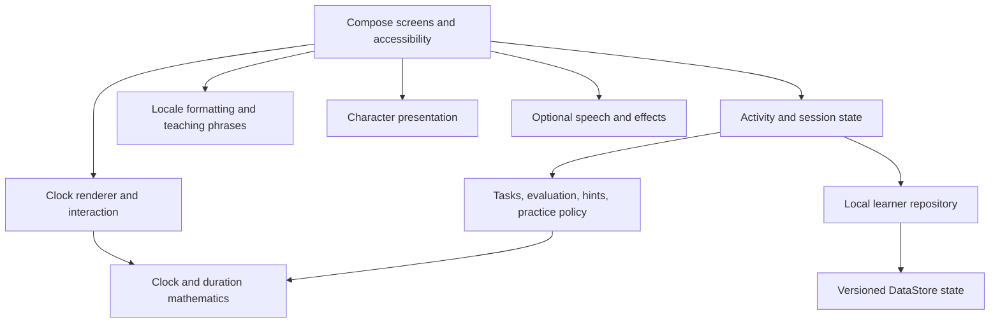
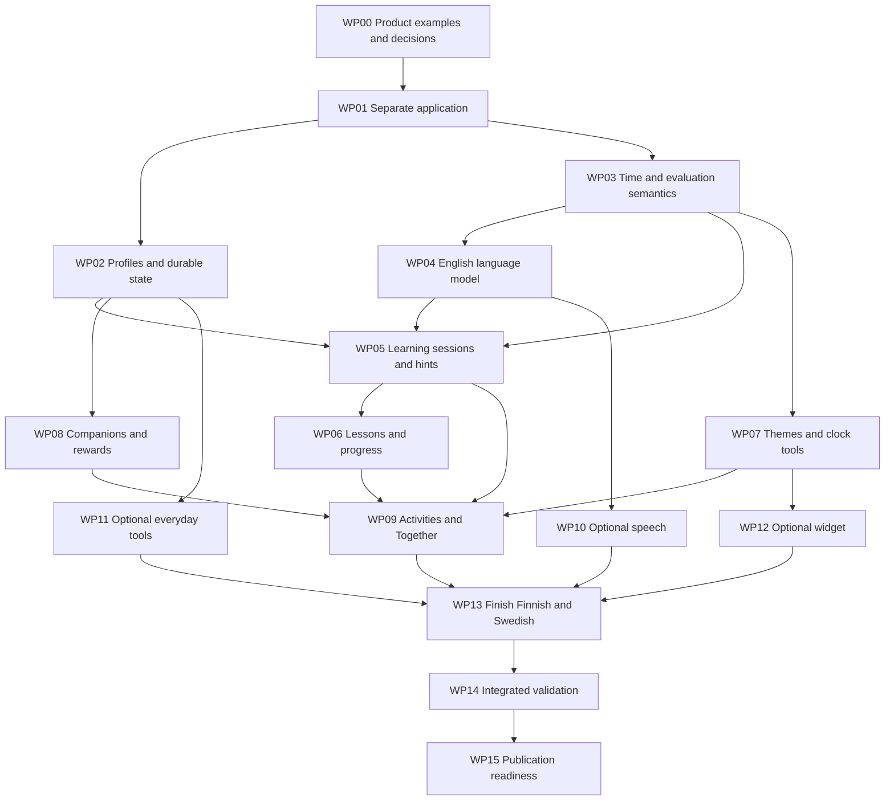

# Clocklings: Product, Content, Implementation, and Release Plan

**Author:** Codex  
**Date:** 20 October 2026  
**Status:** Updated after the owner's scope clarifications and review of both plans. Confirmed requirements are binding; remaining feature proposals are not approved merely by appearing here. This is a documentation update, not authorization to implement or publish.  
**Confirmed app name:** Clocklings. Use this name in the app and as its launcher label.  
**Confirmed Google Play title:** Clocklings: Learn to Tell Time.

**Goal:** Help a child learn to tell the time and have fun. Build a complete Android app in English, Finnish, and one shared Swedish version, using the existing app's successful practical approach while preserving the niece's custom application unchanged.

**How to read:** The product, content, decisions, and release scope come first. Detailed implementation, repository handling, tests, commands, and source evidence are in the technical appendix. Confirmed owner requirements take precedence over proposed defaults throughout.

> **Owner's scope:** No school-curriculum mapping, country-specific school progression, or Teacher Approved objective. One Swedish version is enough. Additional languages are outside this release and may be reconsidered if future revenue makes qualified language review affordable. Prefer a straightforward, enjoyable app over an elaborate learning or localization system.

## Contents

**Product, content, and decisions**

1. [Authority, scope, and fixed requirements](#1-authority-scope-and-fixed-requirements)
2. [Product direction and audience](#2-product-direction-and-audience)
3. [Decision register](#3-decision-register)
4. [Complete user journeys](#4-complete-user-journeys)
5. [Information architecture and interaction rules](#5-information-architecture-and-interaction-rules)
6. [Clock skills, practice, and help](#6-clock-skills-practice-and-help)
7. [Activity specifications](#7-activity-specifications)
8. [Companions, customization, and rewards](#8-companions-customization-and-rewards)
9. [Clock themes and visual teaching tools](#9-clock-themes-and-visual-teaching-tools)
10. [English, Finnish, and one Swedish version](#10-english-finnish-and-one-swedish-version)
11. [Speech, sound, and silent operation](#11-speech-sound-and-silent-operation)
12. [Accessibility and adaptive layouts](#12-accessibility-and-adaptive-layouts)
13. [Everyday time tools and widget](#13-everyday-time-tools-and-widget)
14. [Privacy, adult controls, and commercial choices](#14-privacy-adult-controls-and-commercial-choices)
15. [Content production and asset inventory](#15-content-production-and-asset-inventory)
16. [Google Play preparation and publication gate](#16-google-play-preparation-and-publication-gate)
17. [Complete idea disposition and comparison guide](#17-complete-idea-disposition-and-comparison-guide)

**Technical appendix**

18. [Verified starting point](#18-verified-starting-point)
19. [Architecture, state, and persistence](#19-architecture-state-and-persistence)
20. [Original-app preservation and project separation](#20-original-app-preservation-and-project-separation)
21. [Implementation work packages](#21-implementation-work-packages)
22. [Verification strategy and evidence](#22-verification-strategy-and-evidence)
23. [Sources and planning evidence](#23-sources-and-planning-evidence)

## 1. Authority, scope, and fixed requirements

### 1.1 Confirmed owner requirements

These are requirements, not recommendations:

| ID | Requirement | Consequence |
| --- | --- | --- |
| U01 | Preserve the existing application exactly as the owner's niece's custom application. | No source, behavior, identity, signing, data, or distribution change to that application as part of the new product. |
| U02 | Develop a separate public application for Google Play. | Separate workspace/repository and application identity; both applications must coexist. |
| U03 | Remove the sister-specific section from the public application. | No “Ask your sister,” older-sister/younger-sister role assumptions, or private family-specific instructions. The owner has not yet selected a replacement. |
| U04 | Give children meaningful choices of clock appearance and characters beyond the current doll. | Multiple readable themes and multiple companion options belong in the product concept. Exact inventory remains a decision. |
| U05 | Improve the application substantially and consider creative alternatives. | Evaluate instruction, feedback, play, personalization, and overall usability, not just reskinning. |
| U06 | Release the complete app in English, Finnish, and Swedish. Develop English first, then finish Finnish and Swedish before publication. | Exactly these three languages belong to the present release. No English-only interim public release. |
| U07 | Use correct, clear time expressions in each language, with one shared Swedish version. | No separate Sweden-Swedish and Finland-Swedish product variants or school systems. Ordinary wording differences do not require a new mode. |
| U08 | Publish only when the entire agreed product is complete. | No MVP release, partial language release, “coming soon” feature, beta-language escape hatch, or planned post-launch feature tranche. |
| U09 | Do not make this release depend on paid or presumed volunteer language reviewers. | The owner can assess Finnish and Swedish, including both Swedish varieties; source checking and contextual review support this without assigning every review task to the owner. Other languages may be reconsidered if future income permits paid review. |
| U10 | Produce a very detailed English Markdown plan for comparison. | This document is the current deliverable. It is not a code-change request. |
| U11 | The purpose is learning the clock and having fun, with no curriculum mapping. | No national-curriculum research, grade-by-grade alignment, certification claims, or school-specific learning paths. |
| U12 | Do not pursue Teacher Approved or similar teacher-program objectives. | No eligibility work or feature restrictions for that program. Ordinary applicable Play requirements still apply. |
| U13 | Keep the product and implementation simple; reuse what works. | Existing Finnish logic may be reused and checked. Do not require a full rewrite, generic language framework, or complex mastery system. |

“Entire agreed product” means the product the owner selects after reviewing proposals. It does not automatically mean every idea ever mentioned. Anything selected must be completed before public release; anything rejected is outside this product, not quietly deferred to a later release.

The three-language scope is now confirmed. Possible additional languages funded by future success are a separate future decision, not unfinished content promised for this release. The owner reports that the eight-year-old niece learned well using the existing app without curriculum mapping. This is a useful practical starting point, not a claim of measured effectiveness for every child.

### 1.2 Status vocabulary

- **Confirmed:** explicitly required by the owner.
- **Excluded by owner:** explicitly outside the agreed scope; do not reopen through a work package or release checklist.
- **Recommended:** this plan's preferred design, awaiting owner selection.
- **Investigate:** a real unresolved choice requiring a prototype, evidence, or owner preference.
- **Exclude recommendation:** proposed omission from the finished product, not a future roadmap item.

Detailed specifications below describe what an option must do **if selected**. Their detail does not make that option approved.

### 1.3 Global constraints

1. Original app and its users' data remain untouched.
2. Follow the project instructions and the separate-app boundary. Technical repository precautions are collected in the appendix.
3. A detailed option is still only an option until selected; agreement between assistants does not count as owner approval.
4. Preserve existing work and private data.
5. Prefer direct code and existing patterns over speculative frameworks or unrelated migrations.
6. Keep product source identifiers, filenames, and new code comments in English.
7. Keep development checkpoints internal. No milestone in this plan authorizes public release.
8. Do not assume paid services, volunteer availability, cloud translation, or a proprietary runtime service.
9. Honor existing presentation conventions: centralized design tokens, no decorative colored edge stripes, and no middle-dot separators in product copy.
10. Do not use child testing as unpaid obligatory work. The niece and other children may participate voluntarily; no particular child is a delivery dependency.
11. For each feature, research step, or abstraction, ask whether it helps learning, enjoyment, usability, or necessary correctness. Omit work with no clear contribution to the selected app.

### 1.4 Review focus

The most consequential failure modes are:

| Risk | Expected behavior | Owning verification |
| --- | --- | --- |
| A clock face cannot distinguish 03:30 from 15:30. | Never penalize a child for information the task does not provide. | Task-equivalence and day-context tests, WP03/WP05. |
| A localized phrase is plausible but teaches the wrong hour reference. | Phrase rules and demonstrations agree with the selected language and the shared Swedish content. | Language evidence and boundary tests, WP04/WP13. |
| A process interruption repeats a reward or writes to another profile. | Durable completion is attributed once to the correct learner. | Real DataStore and lifecycle tests, WP02/WP06. |
| A theme or large text makes a task unreadable or inaccessible. | All essential actions remain usable, including at 320 dp and 200% font scale together. | UI matrix, WP07/WP14. |
| A speech service is unavailable, uses another locale, or needs the network. | No silent substitution that contradicts teaching; all essential learning remains accessible without speech. | Device speech tests, WP10. |

## 2. Product direction and audience

### 2.1 Recommended product promise

> Learn clocks and time with a companion you choose. Explore, practise, and solve small everyday adventures at your own pace.

The recommended app builds on the existing clock, short explanations, and playful practice. It combines:

1. Clear explanations.
2. A manipulable clock.
3. Practice with useful feedback.
4. Activities where time has a purpose.
5. Personalization that supports enjoyment without creating obligation.
6. Optional shared play.

Everyday timers, routines, and widgets are separate scope choices. They should be included because they help children use time, not merely because they might increase app retention.

### 2.2 Audience assumptions to validate

- Primary capability range: children beginning analog-clock learning through children practising exact minutes, day context, and elapsed time.
- A provisional design range is roughly ages 5–10, but ability, reading fluency, motor control, and preferences matter more than age.
- Do not treat this provisional range as the final Google Play age declaration.
- Some children practise independently; others use the app with a family member or teacher.
- Some users dislike characters, sound, visual movement, speed challenges, or elaborate rewards.
- The product is educational, not a diagnostic or therapeutic device. Do not make unsupported ADHD, autism, dyslexia, or learning-effectiveness claims.

### 2.3 Success criteria

Success means the child enjoys practising and can increasingly:

- Distinguish hands and read their positions.
- Connect analog, numeric, and selected verbal time expressions.
- Understand that the hour hand moves continuously.
- Apply skills to a plain, unfamiliar clock face.
- Use day context when a question actually provides it.
- Reason about simple before/after and elapsed-time situations.
- Recover from mistakes with progressively useful help.
- Finish or leave a session without losing earned progress or being pressured to return.

These are practical design checks, not school standards or a formal assessment system. Observe whether the child understands, enjoys, and can use the clock. No curriculum mapping or statistical learning study is required for this plan.

## 3. Decision register

Rows explicitly marked Confirmed record the owner's decisions. Other rows remain proposals or open choices. In particular, neither the shared-play replacement, speech, exact asset counts, nor a reward formula has been approved merely through the comparison discussion.

| ID | Decision | Proposed default | Status and dependency |
| --- | --- | --- | --- |
| D01 | Product name, repository path, namespace, application ID | App name: **Clocklings**. Google Play title: **Clocklings: Learn to Tell Time**. | Names confirmed by the owner. Repository path, namespace, and application ID remain open before project creation. |
| D02 | Product boundary | Learn to tell the time and have fun; reuse the working app. Everyday tools remain separate options. | Purpose confirmed; exact feature inventory still open. |
| D03 | Primary audience and Play age groups | Capability-led design; validate provisional age range. | Investigate; before final content/store declarations. |
| D04 | Companions | Human, cat, dog, robot, dragon, dinosaur; plus no companion. | Recommended inventory for comparison, not a three-character early release. |
| D05 | Theme inventory | Classic, rainbow, space, forest, ocean, garden, workshop; constrained custom clock editor. | Recommended; exact assets require visual review. |
| D06 | Replacement for sister mode | Play Together with turn-taking, teach-the-partner, and cooperative tasks. | Recommended; U03 requires removal of private wording either way. |
| D07 | Speech | Optional, on-demand, verified offline system TTS for selected supported voices; no microphone. | Investigate; resolve availability and quality before final promise. |
| D08 | Launch languages | English, Finnish, and one Swedish version; all three complete before release. | Confirmed. No sv-SE/sv-FI split. A proposed shared English style is specified in Section 10.3; separate English variants are not assumed. |
| D09 | Learner profiles | Local profiles with independent progress and preferences; no account. | Recommended. |
| D10 | Reward system | Session stamps, skill stickers, and deterministic cosmetic choices; no spendable currency. | Recommended. |
| D11 | Story inventory | Six short replayable story templates with skill variants. | Recommended; see Section 15. |
| D12 | Visual timer | Real countdown tool, clearly separate from pretend lesson time. | Investigate; background completion is a distinct decision. |
| D13 | Routines | Local visual daily sequence, user-entered times, no default notifications. | Investigate. |
| D14 | Home-screen widget | Read-only real-time clock with selected theme, tap to app. | Investigate through Android prototype. |
| D15 | Monetization | No ads; either free or a single upfront purchase. | Owner decision; no price assumed. |
| D16 | Backup/export | Local-only storage with no automatic backup proposed for the finished product; explicit manual transfer evaluated. | Investigate data-loss expectations before promising anything. |
| D17 | Roman numerals | Optional advanced lesson and face variant. | Investigate; include only with complete instruction and review. |
| D18 | Large shared clock | Enlarge the existing Explore clock and choose tasks manually when useful to a child and companion. | Recommended reuse; no dedicated teacher system or program eligibility work. |
| D19 | Session and adaptation defaults | Five tasks; optional three/ten; transparent local practice suggestions. | Recommended values to validate in prototypes. |
| D20 | Layout/platform support | Keep minimum API 26 initially; support compact phones and usable tablet/resizable layouts. | Recommended; implementation must verify modern platform behavior. |
| D21 | Adult gate design | A tested accessible adult-oriented gate around protected actions. | Investigate mechanism; never claim it verifies legal adulthood. |
| D22 | Bilingual comparison | Omit from the proposed default; ordinary language switching is sufficient. | Exclude recommendation to keep the app focused. This does not remove any of the three confirmed languages. |

Decisions do not need to be answered in one questionnaire. Resolve them when the relevant concrete examples are available. No public release proceeds with an unresolved decision that changes advertised scope, safety, correctness, or essential operation.

## 4. Complete user journeys

### 4.1 J01: Adult and child begin

**Purpose:** Reach useful play without a long setup exercise.

1. The app opens with a clear product identity and a short welcome that can be skipped.
2. It suggests a supported language from device settings and shows a visible change-language action.
3. An adult can change the language or 12/24-hour display with an example clock. There is no school-system or Swedish-region selector.
4. A local learner profile is created without birth date, email, or mandatory real name. A generated label and icon are sufficient.
5. The child chooses a companion or “Just the clock,” then a theme. All base companions and a useful set of themes are immediately available.
6. Home offers “Learn,” “Explore,” and “Play,” with Together and personalization reachable without a crowded menu.
7. A starter activity shows the short and long hands and lets the child move one.

**Failure/recovery:** Unsupported device language falls back clearly to English; no mixed-language unfinished UI. Missing speech does not block startup. Leaving setup retains only completed choices and allows continuation.

**Completion evidence:** A first-time user can reach and complete an introductory interaction without reading a settings manual. Language and clock-format changes do not erase profile choices.

### 4.2 J02: A beginner who does not read fluently

The child chooses Learn. One idea appears at a time: identify the short hand. The hand is highlighted, a simple visual example demonstrates the action, and a brief caption remains available. If speech is enabled and available, a replay control reads the instruction.

The child identifies or moves the hand. A wrong response receives a specific visual cue; no score loss or error siren is necessary. The child tries again. After a few tasks, the app offers a clear finish and an optional cosmetic choice.

**Silent alternative:** Demonstration and direct manipulation remain meaningful. Text-heavy verbal-time activities may need an adult for a nonreader when speech is unavailable; do not promise independent nonreader use for every activity under that condition.

**Completion evidence:** The interaction is understandable without relying only on written instructions or sound. Help does not automatically claim independent mastery.

### 4.3 J03: A returning child practising a difficult concept

Home suggests practice of a recently difficult skill, phrased neutrally: “Try quarter-to times.” The child may choose another skill.

At 2:50 the child reads the hour as 3. The app first draws attention to the short hand and the hour it has passed. If needed, it animates the hand moving from 2:00 toward 3:00 and asks a simpler step. The child then receives a different 2:50-type task, rather than earning mastery by repeating a revealed answer.

**Completion evidence:** Recommendations derive from local evidence, never a diagnosis. A repeated single error is insufficient to label the child as having a persistent misconception.

### 4.4 J04: A child who already knows the basics

The child selects an advanced skill directly or takes an optional short placement activity. No clothing, lesson, or speed gate is required to access learning.

The app offers exact-minute, day-context, duration, and plain-clock tasks as appropriate. Support can be brought back at any time. A plain clock changes presentation without resetting the skill.

**Completion evidence:** Older or more experienced learners are not forced through repetitive elementary content. Speed is not required to demonstrate understanding.

### 4.5 J05: Play with another person

One person sets a time without revealing the numeric answer. They hand over the device. The second person answers aloud, points, or uses an on-screen response. Reveal shows the answer for discussion. Roles switch.

In teach-the-partner mode, the question setter or scripted companion makes an intentional mistake. The learner corrects the clock. In cooperative mode, both turns advance a shared short activity.

**Completion evidence:** No family role is assumed. No microphone is used. Human-judged spoken answers are not logged as objectively correct independent assessments.

### 4.6 J06: Explore, personalize, and leave

The child selects a dinosaur and ocean clock, moves the hands freely, switches between numeric and verbal displays, and optionally unfolds the clock into a minute line. There is no question and no failure condition.

The child changes a decoration, returns home, and closes the app. On a later visit the choices remain; no character is hungry, sad, older against the child's wishes, or missing an earned item.

**Completion evidence:** Exploration cannot reduce progress. Personalization persists independently of current task state.

### 4.7 J07: Understand an everyday wait, if tools are selected

An adult and child set a ten-minute visual timer. The screen clearly indicates real remaining duration, not the time of day or a pretend story clock. The child sees a proportional sector decrease.

Pause, resume, cancel, and completion are explicit. If the app promises background completion, it delivers the selected alert under supported conditions and handles denied permissions honestly. If foreground-only is selected, that limitation is clear before starting.

**Completion evidence:** Closing the screen never silently restarts ten minutes. Manual clock changes do not corrupt an elapsed countdown.

### 4.8 J08: Adult reviews or manages a shared device

The adult opens protected settings, sees skill-level summaries without competitive rankings, and switches or manages learner profiles. Each profile keeps its own theme, character, practice history, and clock-format preferences. The app-wide language is changed deliberately in settings.

Deleting a profile names the target and explains what is removed. Resetting learning does not implicitly delete all earned cosmetics unless the adult deliberately chooses a full reset. The app provides an understandable way back without a purchase or account.

**Completion evidence:** A pending session cannot be saved into the profile selected after that session began.

## 5. Information architecture and interaction rules

### 5.1 Proposed destinations

| Destination | Child purpose | Contents |
| --- | --- | --- |
| Home | Choose what to do | Resume/recommendation, main activities, profile indicator. |
| Learn | Understand a concept | Skill map, short lessons, supported practice. |
| Explore | Experiment freely | Clock, optional displays, teaching tools, real-time/pretend-time switch. |
| Play | Apply learning | Short activities grouped by skill or story. |
| Together | Play with a person | Turn-taking, teaching, cooperation. |
| My Companion | Make it personal | Character, customization, environment, album. |
| Time Tools | Use time in daily life | Timer/routines only if selected; never an empty tab. |
| Adult Area | Configure and review | Learning preferences, profiles, privacy, support, commercial actions if any. |

This is a destination model, not a requirement to show eight permanent navigation buttons. Prototype a compact home with a few large primary choices and secondary access. Avoid nested menus for basic clock exploration.

### 5.2 Universal rules

- Every task has a clear primary action, help action, and exit path.
- Back navigation does not silently submit an answer or reset persistent progress.
- Read-mode content must not accidentally expose the answer through visible labels, speech, or accessibility descriptions.
- Deliberate help may reveal information; record the attempt as assisted rather than treating that as cheating.
- Speech and animations must not trap navigation or block indefinitely.
- Settings that affect evaluation do not change halfway through a question. Apply a language/convention/profile change at a clear boundary or explicitly restart the current task.
- Sessions have a visible endpoint; no automatic endless next round.
- Use role-neutral language: “Your turn,” “Set a time,” “Show the answer.”
- Confirmation is reserved for meaningful data loss or external/commercial actions, not every normal tap.

## 6. Clock skills, practice, and help

### 6.1 Skill map

IDs below are proposed stable content identifiers, not existing classes.

| Skill | Understanding | Example task | Important misconception |
| --- | --- | --- | --- |
| S01 Face structure | Numbers, clockwise order, top/bottom positions. | Place 12, 3, 6, 9, then other numbers. | Treating numbers as arbitrary decorations. |
| S02 Hand roles | Short hour hand and long minute hand. | Identify each hand on varied faces. | Reversing hand roles. |
| S03 Whole hours | Minute hand at top; hour hand indicates hour. | Read and set 4:00. | Reading minute labels as the hour. |
| S04 Connected movement | One minute-hand revolution advances one hour. | Move from 2:00 to 3:00. | Hour hand jumping only at the hour. |
| S05 Half hours | Thirty minutes; hour hand halfway onward. | Set 3:30. | “Half” hour reference differs between languages. |
| S06 Quarter hours | Fifteen and forty-five minutes. | Read 3:15 and 3:45. | Treating both quarter positions as equivalent. |
| S07 Five-minute steps | Each number represents five minutes. | Read 2:20 and 2:50. | Taking the approaching hour too early. |
| S08 Exact minutes | Small ticks complete the minute count. | Read 7:43. | Counting large marks as one minute each. |
| S09 Representation | Same time across analog, numeric, verbal forms. | Match 3:30 and a verified phrase. | Confusing phrase reference with displayed hour. |
| S10 Day context | Same face twice per day; noon/midnight. | Distinguish 07:00 and 19:00 with context. | Inferring AM/PM from hands alone. |
| S11 Twelve/twenty-four hours | Numeric representations across a day. | Match 15:30 to an afternoon analog clock. | Treating 24-hour display as a different hand geometry. |
| S12 Before/after | Ordering explicitly contextualized times. | Put three same-day events in order. | Ambiguous order across midnight. |
| S13 Duration | Difference between time of day and elapsed minutes. | 10:50 plus 20 minutes. | Simple subtraction across the hour boundary. |
| S14 Transfer | Read unfamiliar/plain faces. | Same skill, different readable design. | Dependence on a decorative color cue. |
| S15 Roman numerals | Optional alternate face notation. | Match III and 3, then read a clock. | Introducing unfamiliar symbols without teaching. |

This is a practical sequence of clock skills, not a curriculum map. Use one common path in all three languages. Adapt an explanation when the language describes the time differently, without creating separate national school paths. Manual selection remains available.

### 6.2 Lesson structure

Each lesson contains:

1. One explicit learning objective.
2. A short visual explanation with concise text and optional speech.
3. One controlled demonstration.
4. One guided interaction.
5. One independent check using a different example.
6. A natural completion state and optional next suggestion.

Reuse the existing short-lesson approach. Keep the same skill and activity IDs across languages and change only the wording or demonstration that needs it. For example, half-hour explanations must use the hour named by the language. Existing Finnish lessons and rules need review against the new activities, not an automatic rewrite.

### 6.3 Task evaluation

Define the answer domain before generating a task:

- **Hand-position task:** compare modulo 720 minutes. 03:30 and 15:30 are equivalent.
- **Time-of-day task:** compare within a full 1440-minute day and provide explicit day context.
- **Duration task:** compare a duration, not a wrapped time-of-day value.
- **Ordering task:** specify same-day order or provide a day offset.
- **Language recognition task:** compare semantic answer IDs. Do not mark a valid alternate time expression wrong because it is not the canonical wording.

For choice questions, deduplicate choices **after localization and display formatting**. Distinct semantic values can produce identical labels in a 12-hour display. A question with duplicate-looking answers must be regenerated or redesigned.

### 6.4 Assistance

Proposed help ladder:

1. Direct attention: “Look at the short hand.”
2. Identify a relationship: highlight the hour already passed.
3. Demonstrate a relevant movement.
4. Solve a smaller step together.
5. Show and explain the answer, then offer a different retry task.

Assistance is available on request as well as after an error. Do not require repeated failure to access help. A supported completion earns encouragement but is distinct from an independent success in learning evidence.

The final explanation prevents a child from getting stuck indefinitely. The child may pause, leave, or try a different task. Do not force repeated attempts at a revealed answer or count it as evidence of independent success.

#### 6.4.1 Practical wrong-answer hints

Use small, testable comparisons rather than trying to diagnose a child's thinking. First check whether the answer is correct for the information actually given. Only then select a hint:

| Candidate situation | When it can be observed | Useful response |
| --- | --- | --- |
| Hour read too early | Minutes match; the submitted hour is the next hour while the short hand has not reached it. | Highlight the hour already passed. |
| Minute number confused with dial number | For example, the minute hand at 4 is answered as 4 minutes instead of 20. | Count the five-minute groups. |
| Past/to direction confused | Minutes are mirrored around the hour and the task explicitly practises those expressions. | Show which hour the phrase refers to and the remaining or elapsed minutes. |
| Wrong reference hour in a phrase | The submitted time matches a known alternative interpretation of the displayed phrase. | Explain the named hour. Do not infer this from an unrelated numeric task. |
| Minute tick off by one | The relevant values differ by one minute, accounting for hour crossing. | Show where counting starts and count the ticks. |
| Wrong half of day | The task supplies day context and the answer includes an explicit day-period choice. | Connect the selected time to that context. Never infer AM/PM from hands alone. |
| Hands confused | The activity asks which hand is which, or its authored choices represent an unambiguous swapped interpretation. | Identify the short and long hands. Avoid inventing a general angle-swapping diagnosis. |
| Impossible hour-hand position | Only in deliberately authored broken-clock pictures. | Show coupled hand movement. This cannot be a normal SET input while both hands derive from one time value. |
| Multiple explanations or no clear match | More than one condition fits, or none does. | Give a neutral visual hint; do not record a definite misconception. |

Cover each implemented condition and at least one ambiguous counterexample in focused tests. A small direct rule list is sufficient; no diagnostic engine is required.

### 6.5 Adaptation and review

Use transparent deterministic rules rather than machine learning.

Proposed initial rule, subject to prototype review:

- Keep a bounded history of the most recent 12 assessed outcomes per skill and language used by the task.
- After three recent first-attempt errors within five attempts, suggest a prerequisite or a guided example.
- Suggest increasing challenge after at least four independent successes among the last five assessed attempts, covering at least three distinct times.
- The four-of-five rule only suggests a harder task. It is not a definition of mastery, a certificate, or a hard access lock.
- Offer one previously practised skill in a new session when relevant; use completed-session history rather than calendar streaks.
- Do not count a revealed answer, a memorized immediate retry, or a partner's self-report as independent mastery.
- Speed scores are separate from skill evidence.

No badge, content access, or progress label requires attendance on two different days. Later sessions may offer useful review, but neither a calendar threshold nor a session-count requirement is needed to certify learning. Keep all numerical defaults provisional and use a simpler practice rule if it works as well.

These numeric thresholds are proposed implementation defaults, not research-backed optimal values. Record them in one policy location and validate their behavior before scope approval.

## 7. Activity specifications

### 7.1 A01: Guided practice

**Recommendation:** Include.

Reuse read/set mechanics with better assistance and flexible sessions. Proposed lengths are 3, 5, or 10 tasks, default 5. Alternate task types where that supports the skill; do not force alternation when the lesson needs one specific interaction.

Flow: select skill/support -> generate a session -> show task -> accept answer -> provide help or success -> explicitly continue when needed -> finish -> save once -> offer stop, explore, or another chosen activity.

Acceptance:

- Random tasks obey the skill's minute granularity.
- A session avoids repeated exact questions where the available domain permits it.
- Answer choices remain unique in the current language and numeric format.
- Fast double taps cannot submit twice or skip a task.
- Leaving early preserves completed evidence without inventing a completed session.

### 7.2 A02: Free clock laboratory

**Recommendation:** Include.

Children manipulate the clock with no failure condition. Switchable layers show numeric time, verbal time, minute marks, hour progression, and day context. “Now” copies real local time; “Explore” is explicitly pretend time.

Controls include dragging, hand selection, increment/decrement buttons, reset, and optional listen. A child can make a complete revolution, cross 12, and move backwards without a discontinuous hour jump.

Acceptance: changing theme never changes time. Showing real time does not continue overriding the child's hand manipulation after exploration begins.

### 7.3 A03: Clock puzzle

**Recommendation:** Include.

Stages: place cardinal numbers, complete all hour numbers, identify hands, and connect five-minute labels. Provide tap-select/tap-place as an alternative to dragging.

Wrong placements gently return or remain visibly pending without breaking the board. Already placed numbers are not duplicated. Completion links the constructed face to a working clock.

Acceptance: the assembled clock becomes mathematically correct, and labels remain readable in all supported numeral systems selected for this activity.

### 7.4 A04: Clock repair shop

**Recommendation:** Include.

Separate two task types:

- A mechanically valid clock shows the wrong requested time.
- A deliberately broken drawing has an impossible relationship, such as the hour hand exactly at 3 while the minute hand is at 6.

The second type uses an explicitly identified broken-clock display; normal clock manipulation must never inherit independent, inconsistent hands. Explain what is broken. Let the child correct it, then show ordinary coupled movement.

Acceptance: every deliberate fault has a clear intended correction or clearly accepted alternatives. No ambiguity is scored as a child's mistake.

### 7.5 A05: Teach a companion

**Recommendation:** Include as a presentation of repair/explanation tasks.

A scripted companion offers an incorrect answer. The child picks the relevant clue, fixes the clock, or chooses between explanations. No open-ended AI conversation is needed.

The companion thanks the child without implying disappointment or dependence. Errors are authored examples, not random nonsense.

Acceptance: feedback explains the actual misconception; a correct alternative explanation is never rejected merely because its wording differs.

### 7.6 A06: Time matching and memory

**Recommendation:** Include.

Match analog and numeric cards first; add verbal cards only when appropriate. Memory mode hides cards and is optional; visible matching avoids confusing clock skill with memory performance.

Proposed board sizes: 3, 4, or 6 pairs, chosen to fit the screen with readable clocks. Provide an accessible sequential/list alternative if a grid becomes too dense.

Acceptance: each intended pair has one unambiguous match under the activity's equivalence rule. Do not mix 03:30 and 15:30 without day markers.

### 7.7 A07: Short story adventures

**Recommendation:** Include.

Stories give a reason to use time: catch a train, prepare a picnic, open a café, visit a museum, arrange a garden party, or prepare a space expedition.

Each template contains an introduction, three to five tasks, a small result, and a visible ending. Difficulty changes the times and concepts, not whether the child is allowed to see the ending. Guided assistance allows completion.

Avoid culturally universal assumptions about school, meals, bedtime, climate, or family composition. Example schedules are fictional and described as this character's day.

Acceptance: stories run locally, do not require reading long paragraphs, and do not become impossible after a wrong answer.

### 7.8 A08: Elapsed-time journeys

**Recommendation:** Include.

Start with forward movement within an hour, then cross an hour, compare intervals, and cross midnight with explicit next-day context. Show a minute strip or arc and preserve the number of full revolutions.

Examples for deterministic tests: 10:50 + 20 minutes = 11:10; 23:50 + 20 minutes = 00:10 next day; 09:20 to 10:05 = 45 minutes.

Acceptance: movement preserves the intended direction and elapsed duration. The current code already animates ordinary 60- and 90-minute moves correctly; it measures its shortest path over 720 or 1,440 minutes, not over a 60-minute dial. If selected activities need longer movements, a forward eight-hour interval on a 12-hour clock must not become four hours backwards, and a complete 12-hour interval must not disappear. Do not add a new animation system solely to repair a nonexistent 60-minute bug.

### 7.9 A09: Play Together

**Recommendation:** Replace the private sister mode with this.

Modes:

1. Set, ask, reveal, swap roles.
2. Child sets a challenge for a partner.
3. Cooperative short journey with alternating turns.
4. Optional describe-and-build: one person describes a time; the other sets it.

Hide answer labels during the question. A partner's verbal answer is judged by the people playing. No voice recording or automated speech assessment.

Split-screen tablet racing is an investigate option, not required for these modes. If chosen, specify orientation, fair difficulty, simultaneous touches, accessibility, ties, and whether speed is genuinely desirable.

### 7.10 A10: Minute challenge

**Recommendation:** Retain as optional timed practice.

Keep it outside the default learning path. Explain the timer before starting. Maintain a separate high score per profile and challenge configuration; different support, difficulty, or duration settings are not directly comparable.

Pause or end predictably when backgrounded; proposed default is pause, with no automatic resume countdown until the child is ready. Do not use this score to unlock lessons or core characters.

### 7.11 A11: Teaching tools integrated into Explore and Learn

**Recommendation:** Prototype, then include the tools that communicate clearly.

- Unfold the 60-minute circumference into a straight minute line.
- Demonstrate linked hand motion; a simplified mechanism is explanatory, not a claim about exact gear engineering.
- Compare the same face in morning and evening.
- Reveal half/quarter sectors with a pizza/cake metaphor.
- Hide one hand for reasoning tasks only when the question has enough information.
- Count hour chimes on demand, with a visual equivalent and no background hourly sound.
- Estimate one minute as an optional duration-awareness activity; do not score it as clock-reading mastery.

Each tool must also have a reduced-motion/static explanation. Ambiguous or confusing experiments are redesigned or excluded by explicit scope decision, not shipped as novelty.

## 8. Companions, customization, and rewards

### 8.1 Recommended companion collection

The proposed complete collection is six characters plus a character-free mode:

| Character | Customization direction | Animation personality | Production caution |
| --- | --- | --- | --- |
| Human | Skin tone, hair type/style/color, clothing, glasses, optional assistive accessories. | Wave, think, celebrate. | Inclusive options must look equally finished; avoid gender-locked clothing. |
| Cat | Fur patterns, scarf, collar, headwear. | Ear movement, head tilt, stretch. | Do not force human shoe/dress slots onto a quadruped. |
| Dog | Fur patterns, ears, bandana, backpack. | Tail movement, attentive pose. | Keep tail and ears inside safe composition bounds. |
| Robot | Body colors, antenna, face display, decorative panels. | Small mechanical gestures, expressive display. | Avoid rapid flashing and distracting idle effects. |
| Dragon | Colors, horns, wings, accessories; optional selectable growth appearances. | Friendly wing movement, small star puff. | Growth never creates care obligations or removes an earlier appearance. |
| Dinosaur | Colors, markings, backpack, headwear. | Small stomp, wave, curious pose. | Different body proportions need their own art and fitting. |

Astronaut, knight, mermaid, alien, and build-your-own creature remain alternatives in the idea register. They are not additional mandatory characters merely because they appeared in brainstorming. An astronaut/knight may work as an outfit instead of a separate anatomy; a mermaid does not necessarily fit a walking-body renderer.

### 8.2 Choice and identity

- All base companions are available immediately.
- Choosing “Just the clock” preserves the same educational content and progression.
- Nicknames are optional, stored locally, and never necessary for a task.
- Changing a companion never resets learning.
- Keep equipped items separately for each companion so switching back restores the child's choices.
- Accessories related to identity or accessibility should be available from the start, not treated as rare rewards.
- No gender question is needed to choose hair, clothes, colors, or characters.
- Never send a child's nickname to a speech service merely to personalize narration.

### 8.3 Shared behavior, distinct artwork

Share:

- Stable character ID and metadata.
- Selection and persistence.
- Presentation requests such as idle, greeting, thinking, success, and goodbye.
- Equipped-item lookup and unlock state.
- Bounds and accessibility treatment.

Do not assume shared skeletons, clothing coordinates, body-part lists, or animation curves. Start with the actual chosen artwork. Use common drawing components only when two real assets demonstrably share them.

Decorative characters should not create repetitive TalkBack announcements. If a character communicates essential feedback, expose that feedback as ordinary accessible text.

### 8.4 Rewards

Proposed system:

- Completing a selected short session earns one session stamp, including completion with assistance.
- A new demonstrated skill earns a permanent skill sticker.
- Every three session stamps offers a choice of one not-yet-unlocked cosmetic item from the relevant collection.
- Unlocks are deterministic choices; no loot boxes, paid gems, random rarity, energy, advertisements, or daily streaks.
- Once all cosmetics are available, the completion screen remains satisfying without inventing endless currencies.
- Exiting early keeps saved learning outcomes. It does not subtract stamps or take away an item.
- Completion persistence is idempotent: replaying a finish callback cannot grant another stamp.

These exact thresholds are proposed product decisions. Validate whether they feel rewarding without making practice a long cosmetic grind. The child must never have to earn a favorite base character or readable theme.

### 8.5 Environment and album

Recommend one personal scene with interchangeable backgrounds and a small number of decoration positions. This gives a sense of ownership without building a full simulation.

Proposed scene categories: room, woodland clearing, garden, underwater observation room, workshop, and space cabin. Characters can visit any scene; do not tie personality to gender or theme.

The album displays skills and earned stickers in a stable arrangement. Avoid “you missed yesterday” empty calendar slots. A change to device date must not remove progress.

## 9. Clock themes and visual teaching tools

### 9.1 Complete proposed theme set

| Theme | Visual identity | Invariants |
| --- | --- | --- |
| Classic | Plain familiar wall clock, light and dark high-contrast variants. | Clear 1–12 face; no decorative dependency. |
| Rainbow | The existing product's colorful spirit, redrawn/reviewed for the public product. | Hand roles remain distinguishable without color. |
| Space | Stars, planets, and space frame around a clear dial. | Planets do not replace required numerals. |
| Forest | Wood/leaf frame and restrained natural colors. | Leaves do not cover ticks or hands. |
| Ocean | Blue/green surroundings and optional quiet bubbles outside the dial. | No waving tentacles as ambiguous hands. |
| Garden | Flowers around the frame. | Petals cannot be mistaken for hour marks. |
| Workshop | Blocks or mechanical frame. | Decoration does not imply false hand motion. |
| Custom | Child combines approved colors, frames, numeral styles, and hand pairs. | Combinations are constrained to remain readable. |

Pizza/cake sectors and day/night context are teaching overlays, not necessarily separate complete skins. Roman numerals are an instructional option, not merely a cosmetic choice for a beginner.

### 9.2 Rendering contract

Layer order:

1. Background/environment.
2. Clock frame and dial.
3. Teaching regions underneath marks.
4. Ticks and numbers.
5. Clock hands and center.
6. Required instructional highlights/labels.
7. Non-obscuring feedback.

The time model and interaction hit targets do not change with theme. The hour hand remains shorter and visually distinct; no option may make both hands indistinguishable.

At 3:30, the hour hand is halfway between 3 and 4. At 2:50, it is approaching 3 but still within the hour beginning at 2. Theme code must not snap the hour hand to a numeral.

### 9.3 Instructional support layers

Support can include:

- Minute numerals at five-minute positions.
- Individual minute marks.
- Half and quarter sectors.
- Highlighted hour interval.
- A contextual numeric display.
- Verbal time.
- 24-hour inner labels where useful and readable.
- Locale-specific “past/to” explanations only where they match the selected teaching convention.

Do not use the same left/right color halves as a universal grammar model. In languages using half-hour reference points, teaching overlays must explain that actual convention.

Support reduction is suggested, reversible, and independent of cosmetic choice. Before claiming transfer, practise at least one unfamiliar or plain face.

### 9.4 Motion and sensory settings

- Let users disable decorative idle movement and celebrations separately from sound.
- Respect system reduced-motion settings.
- Replace moving demonstrations with stepped diagrams when motion is disabled.
- Never convey correctness solely through animation, color, haptics, or sound.
- Intro presentation is short, skippable, and does not replay intrusively during activity recreation.
- Do not animate backgrounds continuously while a child is reading a demanding clock task.

### 9.5 Visual prototype decisions

Test before locking assets:

1. Classic versus colorful face readability.
2. Character beside, below, or absent from the clock.
3. Visibility of the hour hand near the next numeral.
4. Custom-clock combinations at actual phone size.
5. Whether the unfolded minute line explains rather than confuses.
6. Whether a shared tablet view works with one task at a time.

Use separate mockups or prototypes. Do not modify the niece's installed application.

## 10. English, Finnish, and one Swedish version

### 10.1 Confirmed release languages and order

Complete the English app first, then Finnish and Swedish, and publish when the whole selected product works in all three. The language list is decided; it is not an outstanding owner question. Other languages are outside this release and do not delay it.

Additional languages may be reconsidered if the app earns enough to pay qualified reviewers. There is no current promise, timetable, recruitment task, or language-research work package for them.

### 10.2 Simple language controls

Offer three language choices: English, Suomi, and Svenska. Use one common activity structure and one shared Swedish content set. Do not ask the child to choose a national school system or Sweden versus Finland.

Keep only distinctions that affect actual behavior:

- **Language:** the interface, instructions, and time expressions change together.
- **12/24-hour display:** an illustrated setting; it does not change analog hand geometry.
- **Speech:** optional and separately dependent on the installed voice, if selected.

A technical locale tag is not a separate product version. Devices using `sv-SE` or `sv-FI` must resolve to the same Swedish app content. Use a shared `sv` resource set where compatible with the chosen Android language-selection implementation. Choose one English resource/copy style unless a real selected use case justifies more; separate UK/US experiences remain unapproved.

Side-by-side language lessons are not part of the recommended default. Do not build a language-learning subsystem to support ordinary translation.

### 10.3 Proposed concrete English wording

Use one consistent set of child-facing expressions. The following is a proposed app style, not a claim that all English speakers use exactly these forms. Familiar numeric readings can be shown alongside clock phrases. Sources for the basic patterns: [L03](https://learnenglishkids.britishcouncil.org/sites/kids/files/attachment/how-to-tell-the-time-worksheet.pdf), [L04](https://dictionaryblog.cambridge.org/2018/02/14/what-time-is-it-how-to-say-the-time/).

Let `h` be the clock hour from 1 to 12, `m` the minute, and `next` the following clock hour, wrapping 12 to 1. Render numbers as words in phrase output.

| Minutes | Proposed clock phrase | Example at hour 3 |
| --- | --- | --- |
| 0 | `<h> o'clock` | three o'clock |
| 1 | `one minute past <h>` | one minute past three |
| 5, 10, 20, 25 | `<m> past <h>` | twenty past three |
| 15 | `quarter past <h>` | quarter past three |
| 2–29 excluding multiples of 5 | `<m> minutes past <h>` | seven minutes past three |
| 30 | `half past <h>` | half past three |
| 35, 40, 50, 55 | `<60-m> to <next>` | twenty to four |
| 45 | `quarter to <next>` | quarter to four |
| 31–58 excluding multiples of 5 | `<60-m> minutes to <next>` | seven minutes to four at 3:53 |
| 59 | `one minute to <next>` | one minute to four |

The ranges are mutually exclusive. In this clock-phrase style, singular `minute` occurs at 1 and 59; plural `minutes` occurs at the remaining non-five-minute values. This is an output convention for this table, not a rule governing every valid spoken expression.

For numeric-style reading, use the actual hour followed by minutes: 3:30 becomes “three thirty”; 3:07 becomes “three oh seven”. At an exact hour, use the whole-hour phrase unless a day-period label is needed. A valid numeric reading must not be presented as an incorrect alternative to a clock phrase for the same time.

Use explicit day context for noon and midnight: 12:00 in a known full-day value is noon, and 00:00 is midnight. An analog-only 12:00 picture does not establish either. Digital labels may use AM/PM when needed; avoid attaching “o'clock” to an AM/PM abbreviation. Handle the following day explicitly when an interval crosses midnight.

Keep expressions such as “quarter after” as valid equivalents if they appear in authored content. Do not claim that “past” or “half past” is the only correct English usage. Do not add free-text parsing or speech recognition just to support alternative wording.

Required fixtures include minutes 0, 1, 2, 14, 15, 16, 29, 30, 31, 44, 45, 46, 58, and 59; 12:45 to the next named hour; noon/midnight with and without day context; and numeric/clock-phrase equivalence. Never use the incorrect invariant that plural `minutes` appears for every `m % 5 != 0`.

### 10.4 Finnish reuse and shared Swedish content

| Language | Practical implementation approach |
| --- | --- |
| Finnish | Reuse the existing `FinnishTime` logic and tests where they fit. Review its output in the new tasks. Add the new instructions, durations, hints, stories, and settings; do not rewrite sound existing code simply to make it new. |
| Swedish | One resource and phrase implementation using clear, ordinary Swedish. Review half-hour references, quarters, exact minutes, durations, and instructions in context. Resolve wording questions within that one content set rather than splitting the product into two variants. |

The owner can assess both Swedish varieties and Finnish. Prepare concrete wording and screens for that review; do not assume a volunteer will appear or that the owner must personally perform every technical and linguistic check.

Retain a common skill progression. Language-specific examples may name a different reference hour, but this does not require country-specific lessons or any curriculum research.

### 10.5 Time wording and formatting

Keep time arithmetic language-neutral. Produce wording from the intended time and context, not by translating Finnish sentence fragments.

For each of the three languages, keep a short rule/example table covering the hour reference, singular/plural forms, boundaries, noon/midnight, and any wording used for durations. Link uncertain rules to suitable language references. Use complete translated sentences and plural resources rather than joining fragments in English or Finnish word order.

Use platform locale formatting for numeric times where appropriate, with an explicit 12/24-hour choice and checked examples. Numeric formatting does not generate the app's spoken clock expressions. [L01](https://cldr.unicode.org/translation/date-time/date-time-patterns)

### 10.6 Practical review without assumed external help

1. Write or adapt the actual content for the three languages.
2. Check the clock rules against suitable sources, especially hour-reference changes and singular/plural boundaries.
3. Make a separate review pass with examples and screen context. Two assistants agreeing is not independent evidence of correctness.
4. Use automated checks for arithmetic, phrase coverage, placeholders, and duplicate-looking answer options.
5. Review unclear wording with the owner in the languages they can assess. Qualified outside help is welcome if available, not a prerequisite or promised resource.

A concise issue list is sufficient. Do not turn this into a curriculum study or a translation-management project. Where a consequential rule is uncertain, seek independent corroboration; there is no requirement to collect two published examples for every minute or every ordinary UI sentence.

### 10.7 Language completion criteria

Each of English, Finnish, and Swedish is complete when:

1. Every selected activity and its instructions, hints, feedback, settings, accessibility labels, and store text are translated and reviewed in context.
2. Time expressions and answers agree with the clock and the information supplied by the task.
3. Important boundary examples have independently checked expected results.
4. Tests cover all 720 analog-minute values and all 1,440 values where day context is used. Coverage loops do not substitute for correct expected values.
5. Distinct text-bearing states fit the UI; a representative set covers dynamic layout differences.
6. Optional speech is checked separately from text.
7. No known error remains in what the app teaches, accepts as correct, or requires the child to do.

Fix known issues within these three languages before release. No unfinished or beta language is advertised. The owner is not required to certify that no possible error exists.

### 10.8 Focused language tests

- Test each actual phrase boundary and its adjacent minute values.
- Explicitly test English 1/59 singular forms and the 29/30/31 transition.
- Check hour wrap, 03:30 versus 15:30, noon/midnight, and next-day intervals.
- Check singular/plural durations and locale-appropriate numeric formatting.
- Review Finnish and Swedish letters, long strings, line breaks, and large fonts.
- Verify the same Swedish content on both Sweden- and Finland-Swedish device locales.
- Verify a clear English fallback for unsupported device languages.

There is no extra-language, non-Latin-script, or RTL localization work package in this release. Do not reverse or mirror clock geometry in any layout.

### 10.9 Android language delivery

Provide one app-wide language selection with English, Finnish, and Swedish. Preserve the chosen language after restart and keep Android's supported app-language settings consistent. Do not change it unexpectedly on a learner-profile switch.

Android 13 supports system per-app language settings; earlier versions need the selected compatible in-app route. The current activity is `ComponentActivity`; verify the narrow implementation against the actual stack rather than automatically migrating to AppCompat. [L02](https://developer.android.com/guide/topics/resources/app-languages)

All three languages must be present in the installed app so switching works offline. Verify App Bundle delivery and disable language splitting if needed for that guarantee; test the actual delivered installation. Expose no extra languages inherited accidentally from dependencies.

Keep direct functions or a small shared contract for these three implementations. A hypothetical future language is not a reason to introduce a plugin system, locale-specific school models, or a generalized grammar engine now.

## 11. Speech, sound, and silent operation

### 11.1 Separate product decisions

Written verbal time, spoken output, and speech recognition are distinct features. Removing spoken output does not remove the need to verify written time phrases.

Recommend optional on-demand speech for time and essential instructions. Exclude microphone-based answer recognition. Ordinary “say the answer aloud, then reveal” works without recording.

### 11.2 Voice selection

If system TTS is selected:

1. Initialize asynchronously.
2. Enumerate available voices and inspect actual language/locale metadata.
3. Reject voices requiring network access for an offline-only speech promise.
4. Use voices whose language and pronunciation fit the selected content. For the single Swedish version, a suitable `sv-SE` or `sv-FI` voice may be used after checking actual pronunciation; it does not create two Swedish app versions. Do not reject a voice solely because its regional tag differs when no regional speech promise was made.
5. Allow a documented equivalent regional voice only after its relevant speech has been reviewed; never silently substitute one that contradicts instruction.
6. Test missing engine, missing voice data, disabled service, initialization failure, and engine changes after installation.
7. Treat reported capability as an initial check, then verify representative output in airplane mode on actual target environments.

Android's language selection may choose a nearby locale; voice metadata exposes network requirements. [S01](https://developer.android.com/reference/android/speech/tts/TextToSpeech), [S02](https://developer.android.com/reference/android/speech/tts/Voice)

### 11.3 Interaction and failure behavior

- Provide replay and stop behavior; flush obsolete narration on navigation or language change.
- Stop speech when leaving the relevant screen or backgrounding the app.
- Do not read a hidden correct answer before the learner submits.
- Coordinate with TalkBack so app narration does not speak over accessibility feedback unnecessarily.
- Keep sound effects and speech settings separate.
- Proposed default: effects enabled at a gentle level; speech invoked by explicit listen controls, not continuous automatic announcements.
- Explain unavailable speech briefly in adult settings. Do not hide the whole activity or repeatedly interrupt the child.
- Do not automatically open a voice-download page or install another service.
- Ensure resource cleanup includes TTS shutdown when its application-owned lifetime ends.

### 11.4 Alternatives

Bundled recordings or pre-generated audio are alternatives only if consistent voice quality, redistribution rights, pronunciation review, package size, and budget can be established. Do not assume all recordings require hiring a human, but do not assume a free generation service grants suitable rights or good pronunciation.

No option is selected simply because speech exists in the original app. If the owner excludes speech, remove speech-specific exercises and revise nonreader independence claims accordingly.

## 12. Accessibility and adaptive layouts

### 12.1 Input

- Provide hand selection plus increment/decrement controls in addition to dragging.
- Proposed step sizes follow the activity: 60, 30, 15, 5, or 1 minute; make the selected step understandable.
- Allow tap-select/tap-place in puzzles.
- Keep interactive targets at least 48 dp where applicable; actual clock hit areas can be larger than drawn hands.
- Resolve overlapping hands with explicit hand selection, rather than relying only on precision touching.
- Support keyboard/focus and accessibility actions where the platform exposes them.

### 12.2 Screen-reader experience

Provide meaningful labels, state descriptions, action names, and reading order. Do not announce every animation frame or every tiny drag change.

Define an accessible equivalent for visually dependent tasks. A blind learner cannot read an analog hand position visually; an equivalent task may use hand-position descriptions or another representation. Do not accidentally expose the numeric answer and then claim the original visual skill was assessed.

Distinguish decorative content from instructional content. Focus should move to new feedback when appropriate without unexpectedly jumping away from controls.

### 12.3 Required display matrix

Test:

- 320 dp width at ordinary font scale.
- 200% font scale at a representative ordinary width.
- **320 dp width and 200% font scale together.**
- A typical larger phone.
- Tablet portrait and landscape.
- Resizable/multi-window layout behavior where supported.
- Long Finnish/Swedish strings, required accented letters, and all three language settings.
- Reduced motion, no sound, unavailable TTS, and TalkBack.

Do not solve narrow layouts by shrinking the clock until it is unusable. Move secondary content below it, allow sensible scrolling, or present instructional steps sequentially.

### 12.4 Typography and contrast

Use clear numerals, short line lengths, and sufficient contrast. Current fonts are candidates, not proof of coverage for every script. Check glyph coverage and choose licensed fallbacks that fit the design.

Do not market a font as dyslexia-treating. Prefer readable forms and user-visible sizing. Theme variation must not remove contrast or distinguish hands only by red/green differences.

### 12.5 Sensory comfort

No forced rapid flashes, perpetual celebrations, loud failure cues, or mandatory timed responses. Essential teaching survives disabled animations and sounds. A calm mode may combine reduced decoration, fewer motions, and quieter feedback, while still allowing individual settings.

## 13. Everyday time tools and widget

All three subsections are investigate options. If selected, they are completed before the same public release.

### 13.1 Visual timer

Recommended capability specification if included:

- Preset and custom durations, with a proposed range of 1–120 minutes.
- Start, pause, resume, cancel, and completed states.
- Clear remaining-duration label and proportional visual representation.
- Real timer state is separate from educational pretend time.
- No pretend “alarm set” confirmation when no background alert will occur.
- An elapsed timer uses monotonic time while the device is running, so manual wall-clock changes do not extend/shorten it.
- Persist enough state to recover after process death. Detect reboot and avoid silently claiming exact continuity without a defined recovery policy.
- Completion is emitted once.

Two implementation choices must be decided before coding:

| Choice | User promise | Consequences |
| --- | --- | --- |
| Foreground learning timer | Visual time aid while using the app; no background alert promise. | Simpler platform behavior, but limitation must be explicit before start. |
| Background completion timer | Countdown completion can alert outside the app under stated supported conditions. | Notification permission, scheduling, device restrictions, reboot, force-stop, and denial behavior require explicit design and tests. |

Do not add exact-alarm or foreground-service permissions merely because the feature is called a timer. Research the minimum compliant mechanism for the chosen promise. Notification permission is a real platform consideration on modern Android. [T01](https://developer.android.com/develop/ui/views/notifications/notification-permission)

### 13.2 Visual routines

If included:

- Adult chooses built-in icons, optional short labels, and local times.
- A child sees a clear ordered sequence and optional “now/next” context.
- Schedules are family-defined, not normative recommendations for meals, school, or sleep.
- Missed events do not produce guilt, lost rewards, or an unhappy character.
- Distinguish scheduled time from a countdown's duration.
- Same-time events, overnight routines, daylight-saving changes, travel/time-zone changes, and manual clock changes have documented behavior.
- Proposed default: follow current device local time; clearly re-evaluate the next item when the zone changes.
- No notifications unless separately selected.
- No calendar integration, location, photographs, or microphone required.

### 13.3 Home-screen widget

If included, propose a read-only real-time clock with selected readable theme and optional small companion. Tapping opens the app. Do not put learner names, mastery summaries, or routine details on a shared home screen by default.

Prototype with native `RemoteViews`/`AnalogClock` where appropriate. API 31 introduced image setters for the face and hands, but `AnalogClock` is also deprecated; this needs an explicit implementation decision and testing. Glance is not directly interchangeable with existing Compose UI. [W01](https://developer.android.com/sdk/api_diff/31/changes/android.widget.AnalogClock), [W02](https://developer.android.com/reference/android/widget/AnalogClock), [W03](https://developer.android.com/develop/ui/compose/glance)

Evaluate:

- Supported behavior on API 26–30 versus API 31+.
- Static predefined XML assets versus runtime-selected images.
- Accurate time after sleep, time-zone/time changes, reboot, resize, and launcher recreation.
- At least two launcher implementations before promising broad support.
- No custom every-minute background worker solely to redraw clock hands.
- Neutral fallback when the chosen profile/theme is deleted.

Do not assume animated companions or the entire interactive Compose clock can run inside the widget. If the feasible design cannot meet the agreed promise, resolve scope explicitly before release.

## 14. Privacy, adult controls, and commercial choices

### 14.1 Recommended privacy design

- Local learner data.
- No account or login.
- No ads or tracking SDKs.
- No cloud synchronization.
- No microphone, camera, location, or contact access.
- No open chat, public profiles, uploaded creations, or child-to-stranger communication.
- No runtime generative-AI service.
- Core educational content packaged with the app.
- No background data fetching for personalization or rewards.

These are recommendations for the new product, not all separately confirmed owner decisions. Any selected feature that changes them must be visible in the scope decision and disclosures.

### 14.2 Permissions and services

Do not turn “no permissions” into an unsupported slogan. Inspect the merged release manifest and actual service behavior. A removed manifest permission entry is different from an active permission. A separate TTS engine can have network access even when the app does not.

If background alerts, purchases, or another selected capability needs permissions/connectivity, document exactly why and how denial behaves. Prefer honest narrow claims such as “Learning activities work offline.”

### 14.3 Adult area and gate

Protected operations should include destructive profile/data actions, purchases if any, external support links, and settings intended only for adults.

Prototype an adult-oriented gate that is understandable and accessible. Do not assume “hold two fingers” or one arithmetic question is an effective age verification mechanism. A gate is a usability boundary, not proof of legal adulthood.

Do not place ordinary exploration, help, or finishing an activity behind the gate. Avoid making adults authenticate repeatedly during one short settings visit.

### 14.4 Commercial choices

| Model | Advantages | Work and trade-offs |
| --- | --- | --- |
| Free | Simplest child experience; no payment integration. | No direct purchase revenue; owner must choose sustainability expectations. |
| Single upfront purchase | Clear transaction outside the child's play flow. | Store pricing and purchase/install testing; do not invent a price without owner choice. |
| Free access with one permanent unlock | Allows trying before purchase. | Billing integration, purchase recovery, interrupted transactions, adult gate, and clear access rules. |

Recommend free or upfront purchase. Exclude subscriptions, rewarded ads, consumable gems, and individual character purchases unless the owner deliberately revises the product philosophy.

### 14.5 Privacy information and support

Prepare an accurate privacy policy and Data safety declaration from the finished app, including libraries and external services. Google requires a privacy-policy link even for applicable apps declaring no collection. [P01](https://support.google.com/googleplay/android-developer/answer/10787469?hl=en), [P02](https://support.google.com/googleplay/android-developer/answer/10144311?hl=en)

If an adult support action opens an email app, prefill only relevant nonpersonal diagnostics such as app version, selected locale, and an optional content ID. Do not attach learner histories or names automatically. Handle absence of an email app with a visible contact address.

Support feedback supplements pre-release checking; it is not the plan for correcting known educational errors after launch.

## 15. Content production and asset inventory

### 15.1 Proposed complete inventory

These quantities make this proposal concrete. They are not approved commitments until the owner selects them.

| Content | Proposed complete package |
| --- | --- |
| Learning objectives | S01–S14; S15 if selected. |
| Lesson units | One or more short units per objective; S10–S13 require separate examples for their distinct concepts. |
| Companions | Six base characters plus no-companion mode. |
| Companion reactions | Idle, greeting, thinking/help, success, completion, goodbye for every character; static equivalents. |
| Cosmetic choices | Proposed minimum eight meaningful options per character, including immediately available choices; equal perceived quality rather than identical anatomy. |
| Themes | Seven authored themes and one constrained custom editor. |
| Story templates | Six settings, each with three to five task beats and an ending. |
| Personal environments | Six background categories with a small shared placement system where visually appropriate. |
| Skill stickers | One per skill or clearly defined achievement; no date streaks. |
| Speech | Selected instruction/time coverage only if D07 is approved; availability limitations documented. |
| Languages | English, Finnish, and one shared Swedish version, all complete before publication. |

Story template proposals:

1. **Train trip:** read a departure, set a departure, compare two clearly contextualized departures.
2. **Picnic:** arrange preparation steps and departure time.
3. **Forest café:** match fictional appointments and opening times.
4. **Museum visit:** follow a short schedule and calculate a simple interval.
5. **Garden party:** order preparations and identify remaining time.
6. **Space expedition:** use a fictional schedule to practise precise minutes without pretending to teach real orbital mechanics.

Difficulty variants should reuse task mechanics and carefully authored sentence templates. Do not create dozens of near-identical bespoke game implementations.

### 15.2 Content record

Each activity/lesson/story record should identify:

- Stable ID.
- Learning objective and prerequisite recommendation.
- Supported task variants and correct-answer semantics.
- Visual demonstration.
- Source-language text and translation context.
- Hint sequence.
- Completion behavior.
- Accessibility/silent alternative.
- Required assets.
- Relevant automated tests and manual evidence.

Use one inventory rather than scattered duplicated spreadsheets and documents. A simple Markdown/CSV table or small repository data file is sufficient; no content-management service is required.

### 15.3 Artwork production

1. Agree on visual style with representative sketches.
2. Produce one complete companion with representative accessories and reactions to estimate effort. Use small anatomy-specific sketches where needed before finalizing the full character count; do not assume one doll renderer fits every body.
3. Produce assets at actual intended display sizes.
4. Check every supported accessory with its character's poses.
5. Check clipping and composition at compact width and large text.
6. Record origin and redistribution rights for fonts, illustrations, sounds, and any generated assets.
7. Avoid copyrighted franchise characters and unlicensed reference artwork.

Do not promise that all characters can reuse the current doll's vector paths. Choose Canvas/vector/bitmap assets based on actual artwork and performance, not a blanket rule.

Artwork may be hand-authored, appropriately licensed, generated, or commissioned if the owner chooses. The absence of a paid language-review budget does not establish an artwork budget or rule out commissioning. Exact production method and cost remain open.

### 15.4 Content review

Review errors and explanations as carefully as happy-path copy. A “wrong answer” sentence can teach an incorrect rule even if the final answer is right.

Check that stories, character roles, colors, and rewards do not create gender restrictions or assume one family structure. Inclusion is a design requirement to review, not an unsupported claim that it guarantees ratings or store visibility.

## 16. Google Play preparation and publication gate

### 16.1 Distribution identity and signing

- Use the confirmed app name **Clocklings** and Google Play title **Clocklings: Learn to Tell Time**. Finalize the separate application ID before store registration.
- Check naming and trademark concerns separately; the owner's name selection is not a completed clearance check.
- Use Android App Bundle delivery and the applicable Play signing workflow for the new listing.
- Separate upload credentials from app-signing identity and store them securely outside Git.
- Inspect release shrinking, resource retention, locale packaging, and installation behavior.
- Version codes increase monotonically for successive private test/release candidates.

Android documents application IDs, bundles, and signing separately. The new app's ID is what separates it from the original on-device and in Play. [R02](https://developer.android.com/build/configure-app-module), [R03](https://developer.android.com/guide/app-bundle), [R04](https://developer.android.com/studio/publish/app-signing)

### 16.2 Target audience, privacy, and store content

Before submission:

- Select target age groups reflecting the actual designed audience.
- Review applicable Families requirements for the final implementation, libraries, content, and monetization.
- Complete content rating and Data safety accurately.
- Provide an accessible privacy policy and support contact.
- Use screenshots of the finished public app, with no private names or unfinished locale content.
- Describe the concrete benefit: learning to tell the time through enjoyable practice and personal choice.
- Do not claim curriculum alignment or Teacher Approved status. Both are excluded objectives; there is no mapping, application, eligibility investigation, or corresponding feature restriction in this plan.
- Avoid unsupported “best,” “unique,” clinical-benefit, or guaranteed-learning claims.

Google's Families policy applies when children are among the target audiences. Compliance must be assessed against the finished product, not inferred from an educational theme. [P03](https://support.google.com/googleplay/android-developer/answer/9893335?hl=en)

### 16.3 Account-specific testing

As checked for this plan, Google's documented closed-test condition applies to personal developer accounts created after 13 November 2023: at least 12 testers opted in continuously for at least 14 days before applying for production access. It is not a universal requirement for every account, and meeting it does not guarantee approval. Verify the owner's actual account conditions without assuming them. [P04](https://support.google.com/googleplay/android-developer/answer/14151465?hl=en)

Testing tracks are private validation, not the incomplete public release the owner rejected. Test participants are not automatically language experts. Do not assume the testing requirement supplies translators or educational reviewers.

### 16.4 Store readiness checklist

- [ ] Scope and all investigate decisions that affect release are resolved.
- [ ] All selected activities, character assets, themes, stories, and settings are complete.
- [ ] English, Finnish, and one Swedish version are complete and pass their language checks.
- [ ] Essential activities work offline and without speech as promised.
- [ ] Optional speech behavior matches its actual capability/limitations.
- [ ] Every selected timer/routine/widget promise has platform evidence.
- [ ] Profile persistence, reset/delete, and reward idempotency are verified.
- [ ] 320 dp, 200% font, their combination, TalkBack, and reduced-motion checks are complete.
- [ ] Release-optimized/bundle-delivered installation is verified.
- [ ] Required lint/security checks are complete, with no unresolved blocking findings.
- [ ] Permissions, service behavior, privacy policy, and Data safety agree.
- [ ] Asset and font rights are documented.
- [ ] New and original applications remain isolated.
- [ ] Store screenshots/text match the release candidate.
- [ ] Account-specific testing and production-access requirements are met.
- [ ] No placeholder content, disabled “coming soon” destination, or beta-language label remains.
- [ ] The owner approves the exact release candidate for publication.

### 16.5 What “complete” does and does not mean

Complete means all agreed functionality and content meet their acceptance criteria before publication. It does not mean claiming zero possible bugs or refusing to maintain compatibility/security after release.

All three confirmed languages belong to that complete release. Other languages are outside it and may be considered separately if future revenue allows paid language review. They are not promised unfinished features. No curriculum study or teacher-program outcome is a completion criterion.

Maintenance is not a justification for knowingly shipping missing selected features. If a selected feature cannot be completed as specified, the owner revises the product decision explicitly or publication waits.

No part of this plan authorizes uploading, submitting, publishing, pricing changes, recruiting testers by sending messages, or contacting reviewers. Those actions require the appropriate later request.

## 17. Complete idea disposition and comparison guide

### 17.1 Consolidated idea register

This register preserves the brainstorming scope without silently making every idea a commitment.

| ID | Idea | Proposed disposition | Specification / decision |
| --- | --- | --- | --- |
| I01 | Separate public app, preserve custom app | Confirmed | U01/U02, Section 20. |
| I02 | Remove sister-specific wording | Confirmed | U03, WP09. |
| I03 | Play Together with neutral roles | Recommended | A09, D06. |
| I04 | Child teaches adult/companion | Recommended | A05/A09. |
| I05 | Cooperative shared goal | Recommended | A09. |
| I06 | Split-screen speed duel | Investigate | D06; not required by ordinary Together. |
| I07 | Describe-and-build/secret time | Recommended as Together variant | A09; the description must specify enough information. |
| I08 | Time hidden in a story | Recommended | A07/A09, authored clue clarity. |
| I09 | Rainbow/classic/space/forest/ocean/garden/workshop clocks | Recommended | D05, Section 9. |
| I10 | Pizza/cake fraction clock | Recommended as teaching overlay | A11; no claim of superior efficacy. |
| I11 | Train as minute movement visualization | Investigate within story/tool prototype | A07/A11; preserve clear hands. |
| I12 | Candy/zoo/jungle/dinosaur themed faces | Alternative theme candidates | D05; choose a coherent inventory. |
| I13 | Day/night presentation | Recommended as explicit day-context layer | S10/S11, Section 9. |
| I14 | Roman numerals | Investigate | D17/S15. |
| I15 | Build your own clock | Recommended constrained editor | Section 9. |
| I16 | Independent teaching support layers | Recommended | Section 9.3. |
| I17 | Human, cat, dog, robot, dragon, dinosaur | Recommended full character set | D04, Section 8. |
| I18 | Alien, mermaid, astronaut, knight, assembled creature | Alternative character/outfit candidates | D04; no automatic extra commitment. |
| I19 | Inclusive appearance/accessory choices | Recommended | Section 8.2/15. |
| I20 | Optional naming and changeable companion | Recommended | Section 8.2. |
| I21 | No-companion mode | Recommended | Section 8.2. |
| I22 | Dragon growth | Investigate as selectable earned appearance | Section 8; no care penalty. |
| I23 | Personal environment, decorations, album | Recommended | Section 8.5. |
| I24 | Reward practice, not only perfect answers | Recommended | Sections 6/8. |
| I25 | Daily streak/rest-day system | Exclude recommendation | Session-based progress instead. |
| I26 | Pet hunger/sadness while away | Exclude recommendation | No absence penalty. |
| I27 | Short clock explanations and read/set practice | Recommended reuse and improvement | S01–S14, A01; no school-program mapping. |
| I28 | Free exploration | Recommended | A02. |
| I29 | Clock-number puzzle | Recommended | A03. |
| I30 | Repair an incorrect/impossible clock | Recommended | A04. |
| I31 | Matching and memory cards | Recommended | A06; memory optional. |
| I32 | Character day and short adventures | Recommended | A07, six proposed templates. |
| I33 | Elapsed time and before/after | Recommended | S12/S13, A08. |
| I34 | Clock unfolds into a timeline | Prototype then scope decision | A11. |
| I35 | Visible hand mechanism | Prototype then scope decision | A11; visual explanation of existing coupling. |
| I36 | Same face morning/evening | Recommended | S10, A11. |
| I37 | Hidden-hand reasoning | Investigate | A11; no underdetermined scored questions. |
| I38 | Estimate one minute | Investigate optional activity | A11; separate from clock-reading evidence. |
| I39 | On-demand cuckoo/chime counting | Investigate | A11; silent equivalent. |
| I40 | Find a physical clock at home | Recommended optional Together prompt | No camera or verified score. |
| I41 | Child creates a task card | Recommended within Together | Local selected icons/time; no public sharing. |
| I42 | Adaptive difficulty/error hints | Recommended simple rules | Section 6. |
| I43 | Spaced review | Recommended session-based review | Section 6.5; no daily obligation. |
| I44 | Short sessions and natural endings | Recommended | A01, Section 5. |
| I45 | Optional minute challenge | Recommended | A10. |
| I46 | Local learner profiles/adult progress | Recommended | D09, Sections 4/19. |
| I47 | Large shared clock | Recommended reuse of Explore | D18; benefit to the child, not a teacher-program goal. |
| I48 | Curriculum mapping, alignment marketing, and Teacher Approved objectives | Excluded by owner | U11/U12; ordinary Play obligations remain. |
| I49 | Visual timer | Investigate | D12, Section 13.1. |
| I50 | Visual routines | Investigate | D13, Section 13.2. |
| I51 | Home-screen widget | Investigate | D14, Section 13.3. |
| I52 | Written verbal times | Recommended | Section 10. |
| I53 | Optional spoken time/instructions | Investigate, recommended if quality promise is feasible | D07, Section 11. |
| I54 | Microphone answer recognition | Exclude recommendation | No reliable-learning benefit established for this scope. |
| I55 | Bilingual side-by-side mode | Exclude recommendation | D22; three ordinary language choices are sufficient. |
| I56 | Native-reviewer requirement | Exclude as mandatory condition | U09, Section 10.6. |
| I57 | Source-based rules, fixtures, separate review | Recommended | Section 10. |
| I58 | Beta languages or deferring selected launch content | Excluded by confirmed requirement | U08; hypothetical future additional languages are outside the current release. |
| I59 | Adult language-feedback email | Investigate support convenience | Section 14.5; not substitute for checking. |
| I60 | Community translation/open-source release | Owner decision, not assumed | Does not authorize publishing private history. |
| I61 | Paid/free/one-time unlock | Owner decision | D15, Section 14.4. |
| I62 | Ads, subscriptions, cosmetic microtransactions | Exclude recommendation | Section 14. |
| I63 | Accounts, analytics, cloud sync, public chat | Exclude recommendation | Section 14. |
| I64 | Manual progress export/transfer | Investigate | D16; requires privacy/recovery design. |
| I65 | Future original-app TTS fix | Outside this task | U01; separate explicit request only. |
| I66 | Original-app developer verification | Separate administrative issue | Section 20.3; current requirements checked when needed. |

### 17.2 Requirements-to-delivery traceability

| Requirement | Main design coverage | Implementation | Proof |
| --- | --- | --- | --- |
| U01 Preserve original | Section 20 | WP01 | File/artifact checks and side-by-side isolation. |
| U02 Separate Play app | Sections 20/16 | WP01/WP15 | Unique identity, separate data/signing, actual delivered build. |
| U03 Remove private mode | A09, I02 | WP09 | Resource/flow review, no sister-specific instructions. |
| U04 Theme/character choice | Sections 8/9 | WP07/WP08 | Full approved inventory works in actual activities. |
| U05 Improve whole experience | Journeys, Sections 6/7 | WP05–WP09 | Assistance, concept, transfer, and usability evidence. |
| U06 English/Finnish/Swedish release | Section 10 | WP04/WP13 | Complete English first, then Finnish and one Swedish version; all three before publication. |
| U07 Clear language, one Swedish | Sections 6/10/11 | WP03/WP04/WP13 | Correct wording and answers; both Swedish device locales use the same app content. |
| U08 Complete release | Sections 1/21/16 | All selected WPs | Final checklist; no selected feature silently deferred. |
| U09 No paid-review dependency | Section 10.6/10.7 | WP13 | Sources, separate review, tests, honest residual uncertainty. |
| U10 Detailed English plan | Entire document | Current documentation task | Structural/content checks, single standalone Markdown artifact. |
| U11 Learn the clock and have fun | Sections 2/6/7 | WP00/WP05/WP06/WP09 | Practical clock use, enjoyable activities, no curriculum mapping or grade alignment. |
| U12 No teacher-program objective | Sections 3/16 | WP00/WP15 | No eligibility work or feature restrictions; ordinary Play requirements assessed separately. |
| U13 Keep it simple and reuse | Sections 10/19/15 | All selected WPs | Reused checked Finnish logic, direct code, proportionate tests, no speculative extra-language machinery. |

### 17.3 Questions for comparing independent plans

Compare substantive choices rather than which document is longer:

1. Do both plans preserve the original app and uncommitted work?
2. Do they distinguish owner requirements from suggestions?
3. Is “complete before publication” respected throughout?
4. Are the chosen learning outcomes and target audience coherent?
5. Do all task types define what constitutes a correct answer?
6. Are analog ambiguity and day context handled correctly?
7. Do hints correspond to real learner responses?
8. Are characters/themes readable and independent of learning access?
9. Are reward rules free of absence penalties and duplicate-award bugs?
10. Does localization cover lessons, grammar, speech, UI context, and resource delivery?
11. Is language verification workable without pretending an unavailable reviewer exists?
12. Are uncertain widget/timer/speech claims clearly identified?
13. Does the technical design reuse the codebase without premature frameworks?
14. Are real persistence, lifecycle, accessibility, and release artifacts tested?
15. Are policy/account requirements verified instead of generalized?
16. Does every selected feature have an implementation owner and acceptance evidence?

When plans disagree, resolve the smallest concrete question with source inspection, a targeted prototype, or the owner's preference. Agreement between assistants is not a substitute for evidence or owner selection.

### 17.4 Decisions needed before implementation

The highest-impact unresolved choices are:

1. Product boundary: learning suite only, or learning plus selected everyday tools.
2. Final character/theme inventory and visual style.
3. Any small wording choice needed for the shared English style; the three languages and single Swedish version are already decided.
4. Speech promise and acceptable availability limits.
5. Monetization and data-transfer expectations.
6. New repository location, namespace, and application ID. The app name **Clocklings** and Google Play title **Clocklings: Learn to Tell Time** are already confirmed.

These are explicitly unresolved choices, not accidental gaps hidden behind “implement appropriately.” The detailed conditional specifications above make them reviewable without forcing premature implementation.

## Technical appendix

The following sections are for implementation and verification after the remaining product choices are resolved. They do not add features or reopen the confirmed three-language scope. Keep the existing application unchanged; perform future code work only in the separate application.

## 18. Verified starting point

### 18.1 Evidence boundary

Source inspection took place in `C:\Dev\Sateenkaarikello-Android` on 20 October 2026. The branch was `feature/splash-intro`, at commit `cfed3a417047255d3930cc005f1785616f6233d8`. `PROJECT.md` was already untracked. It is existing user work and is not part of this plan's edits.

This planning task does not establish that the current build or tests pass. No emulator, unit test, instrumentation suite, release installation, or Play upload was run to produce this plan. Historical project verification statements remain historical.

### 18.2 Existing implementation

Source paths in this document are repository-relative unless identified as future paths.

| Area | Verified current implementation | Implication for the new application |
| --- | --- | --- |
| Identity | One `:app` module; `applicationId` and namespace `fi.sateenkaarikello`. | New identity required. Reusing the original ID is unacceptable. |
| UI | Native Kotlin/Compose; `MainActivity` extends `ComponentActivity`; portrait requested in the manifest. | Retain native UI. Broader layouts and language switching need explicit work. |
| Navigation | Navigation 3, serializable route keys and a local navigator. | Extend the existing navigation approach rather than replace it without need. |
| Learning | Nine catalogued lessons and five practice levels: hours, halves, quarters, five-minute steps, exact minutes. | Reuse reviewed mechanics and expand content deliberately. |
| Games | Alternating read/set tasks; ten questions in a normal round; minute challenge. | New session length and guidance behavior are proposed changes. |
| Shared play | `AskScreen`: set a clock, ask another person, reveal the answer; no recording. | Generalize or replace in the new app only. |
| Clock mathematics | `ClockTime`: angles, snapping, circular movement, hand equivalence, connected hand movement. | Already a useful pure core. Mechanical hand coupling is not a new capability to invent. |
| Language | `FinnishTime` generates Finnish phrases, digital formatting, day parts, and spoken forms. `Hints` also refers to Finnish day-part data. | Audit all Finnish assumptions, not only `strings.xml`. |
| Speech | `Speech` calls `setLanguage(fi-FI)` and accepts language availability. | No current proof of exact regional voice selection or offline voice behavior. |
| Persistence | One `Progress` and one `Settings` record in Preferences DataStore. | Separate learner profiles require a deliberate schema change in the new app. |
| Rewards | A doll, five wardrobe slot categories, an 18-item catalog, star-based unlocks. | Existing anatomy and clothing assumptions cannot simply represent every animal or robot. |
| Accessibility | Clock semantic description/custom actions, reduced-motion handling, and various existing UI tests. | Useful starting point, not evidence that every new flow is accessible. |
| Gallery | `GalleryTest` creates a doll-outfit collage and clock-variant collage. | It does not capture all screens, states, or locales. |
| Platform configuration | `minSdk 26`, `compileSdk 37`, `targetSdk 37`; Java compatibility 17. | Preserve initially; separately verify current publication/toolchain requirements when implementing. |
| Privacy configuration | Backup disabled, RTL disabled, no app network permission declared; TTS service query present. | Review merged release behavior. A TTS service can have its own network behavior. |

Declared versions inspected in the actual configuration:

| Component | Declared version |
| --- | --- |
| Android Gradle Plugin | 9.4.1 |
| Gradle wrapper | 9.8.1 |
| Kotlin | 2.4.21 |
| Compose BOM | 2026.09.00 |
| Navigation 3 | 1.2.0 |
| Lifecycle | 2.11.0 |
| DataStore | 1.2.1 |

These are source observations, not a recommendation to upgrade or a newly verified compatibility claim. Some comments in the version catalog describe an older AGP choice; use the declarations and actual build results as evidence.

### 18.3 Existing tests and tools

- Domain tests already cover clock arithmetic, Finnish time, levels, hints, lessons, rewards, and progress.
- View-model/repository tests cover current game, challenge, lesson, and persistence behavior.
- Instrumentation tests include app flows, challenge behavior, intro, regression checks, and the limited gallery.
- `tools/lc.ps1` and `tools/sc.ps1` delegate to `C:\Dev\Android-check\tools\InvokeProjectCheck.ps1` with the original project ID.
- Project instructions reserve `lc` and `sc` execution to the owner. Carry that boundary forward unless the owner changes it.
- Do not copy wrappers into a new project and accidentally continue writing reports under the original project ID.

## 19. Architecture, state, and persistence

### 19.1 Reuse before redesign

Retain:

- Pure clock math where correct.
- Compose-owned frame animation with domain/view-model commands.
- Route-scoped view models.
- Manual `AppServices`-style dependency injection.
- Resource-based UI text.
- Local DataStore for a bounded amount of learner data.
- Existing targeted tests, adapted to the new application.

Do not add Hilt, a new navigation framework, Room, a backend, a plugin architecture, or a generic game engine merely to make the plan look scalable.

### 19.2 Proposed responsibility boundaries



The diagram describes responsibilities, not required modules or interface classes.

### 19.3 Proposed domain contracts

Choose names after project identity is decided. The following semantics must remain stable:

| Concept | Required fields/meaning |
| --- | --- |
| Time of day | Integer minute in 0–1439; no implicit time zone for a fictional task. |
| Analog position | Integer minute modulo 720; derived from time, not an independently persisted pair of hand angles. |
| Duration | Signed or nonnegative minute count according to operation; never implicitly wrapped at 720/1440. |
| Task | Stable task ID, skill ID, prompt specification, response type, correct semantic value, equivalence rule, support state. |
| Attempt | Task/session/profile IDs, response, assistance level, outcome, configuration relevant to assessment. |
| Feedback | Correct, specific hint, guided step, or explanation; no prelocalized language embedded in clock mathematics. |
| Phrase result | Display text and speech text where different; convention ID; optional structured reference-hour information for teaching. |
| Session result | Completed outcomes and reward event ID; durable commit once. |

Illustrative pure function shapes, to be finalized after scope decisions:

```kotlin
fun evaluate(task: Task, answer: Answer): Evaluation
fun nextHint(task: Task, answer: Answer, helpLevel: Int): Hint
fun phraseTime(minuteOfDay: Int, convention: TimeConvention, style: PhraseStyle): TimePhrase
fun addMinutes(minuteOfDay: Int, deltaMinutes: Int): TimeShift
```

`TimeShift` must preserve the day offset. The exact classes are proposed, not existing APIs. Do not implement a free-text phrase parser unless a selected activity actually accepts typed text.

### 19.4 Clock movement and broken-clock demonstrations

Reuse `ClockTime.hourAngle`/`minuteAngle` semantics. A normal clock is always generated from one time value.

Add explicit animation intent where needed:

- Shortest visual transition for an ordinary changed answer.
- Forward elapsed movement.
- Backward elapsed movement.
- Exact full-turn demonstration.

Verified baseline: `ClockState.animateTo` calls `circularDelta(from, target, period)`, where the normal period is 720 or 1,440 minutes. Moving from 3:00 to 4:00 already produces a full minute-hand turn, and an ordinary 90-minute move does not collapse to 30 minutes. These are preservation checks, not existing bugs.

Only add explicit elapsed-movement handling for selected demonstrations that need it. In a 12-hour period, an intended eight-hour forward journey would otherwise take the four-hour backward shortest route; a complete 12-hour journey normalizes to its starting value. An explicit duration must retain such intent. Apply the equivalent boundary reasoning to 24-hour mode and verify forward/backward behavior only where offered.

Broken-clock illustrations may have independent angles only inside their dedicated explanatory model. They must not corrupt normal clock interaction or stored time.

### 19.5 Learner data

Proposed local schema:

| Record | Contents |
| --- | --- |
| App settings | UI locale policy, active profile ID, global accessibility preferences where appropriate, schema version. |
| Learner profile | Opaque local ID, optional nickname, icon, companion/theme selections, numeric format, teaching convention. |
| Skill evidence | Bounded outcomes per skill/convention, lesson completion, assistance-aware summary. |
| Cosmetics | Unlocked item IDs, per-character equipped items, environment placement, sticker IDs. |
| Session checkpoint | Active profile ID, task list/seed and position, current safe state, completed attempt IDs. |
| Completion journal | Minimal identifiers needed to prevent duplicate current/recent completion awards. |
| Optional tools | Timer state and routines only if selected. |

Do not store birthdays, contact details, voice recordings, advertising IDs, or a full indefinite event log.

Suggested storage implementation: keep Preferences DataStore and serialize one versioned bounded app-state record, or a small set of clearly owned records updated in one `edit` transaction. If JSON is chosen, add the Kotlin serialization JSON runtime matching the existing catalog version; do not assume the existing core dependency supplies JSON.

Use bounded lists and inspect actual size/performance before considering a database migration. If the agreed product truly needs large histories or relational queries, justify that separately.

### 19.6 Durable behavior

- Capture profile ID at session creation and retain it through completion.
- Persist task outcome and corresponding reward atomically.
- Use durable completion IDs; do not rely only on a recomposition-local Boolean.
- A profile switch ends or safely checkpoints the previous session before a new one starts.
- A missing cosmetic ID falls back safely without erasing unrelated profile data.
- A malformed state must not silently overwrite all progress with empty defaults. Preserve recoverable data, fail safely, and provide a clear recovery path.
- Test schema migration, interrupted writes, storage errors, and unknown catalog IDs.
- Distinguish “reset practice history,” “reset this profile,” and “delete all local data.”
- Do not promise cloud recovery when backups are disabled.

### 19.7 State lifetime

| State | Lifetime | Required recovery |
| --- | --- | --- |
| Drag position during a gesture | Screen state | Cancel safely on interruption; no persistent incorrect result. |
| Current question and help level | Session checkpoint | Restore after activity recreation/process loss or explicitly offer resume. |
| Speech queue/celebration | Ephemeral | Do not replay on restoration unless requested. |
| Completed outcomes/rewards | Durable | Never lost or duplicated by callback replay. |
| Character/theme selection | Durable per profile | Survives restart and language change. |
| UI locale | Platform-compatible app setting | Survives restart and agrees with supported system app-language selection. |
| Timer | Separate explicit state | Recovery follows chosen timer promise. |

### 19.8 Proposed file map

All future paths below are relative to the **new** repository. `<package>` means its owner-approved namespace, not a literal directory to create.

| Existing area to reuse/adapt | Proposed new or revised responsibility |
| --- | --- |
| `domain/ClockTime.kt` | Retain geometry; add duration/day-offset behavior only where needed. |
| `domain/FinnishTime.kt` | Preserve as reviewed Finnish-specific implementation; remove its use as a universal formatter. |
| `domain/Levels.kt` | Map existing task generation into agreed skill/session rules. |
| `domain/Hints.kt` | Remove Finnish text/day-part coupling; expose semantic guidance. |
| `domain/Lessons.kt` | Retain lesson model where sufficient; support explicit locale-specific content. |
| Proposed `domain/time/` | Teaching conventions, phrase results, locale-specific rule implementations. |
| Proposed `domain/learning/` | Task evaluation, skill evidence, recommendation policy. |
| `data/ProgressRepository.kt` | Versioned multi-profile state, atomic completion, migration/recovery. |
| `ui/clock/ClockFace.kt`, `ClockSpec.kt`, `ClockState.kt` | Theme data, support overlays, accessible controls, explicit motion intent. |
| `ui/lesson/LessonCatalog.kt` | Approved lesson sequences and examples. |
| `ui/game/` | Shared session behavior, hints, results; avoid duplicating it per story. |
| Proposed `ui/activities/` | Puzzle, repair, matching, and story-specific presentation. |
| `ui/ask/AskScreen.kt` | Replace sister-specific experience with approved Together flows. |
| `ui/doll/` and proposed `ui/companion/` | Keep useful human art; add separate character renderers and common selection/presentation. |
| `audio/Speech.kt` | Voice eligibility, on-demand playback, interruption, offline verification. |
| `Screen.kt`, `Navigator.kt`, app root | Approved destinations and lifecycle behavior. |
| Proposed `ui/adult/`, `ui/profile/` | Adult settings, profile selection, privacy/support views. |
| Proposed `tools/` or `ui/timetools/` package | Timer/routine code only if selected; avoid confusion with root PowerShell `tools/`. |
| Proposed `widget/` | Widget provider/resources only if selected. |
| `res/values*/`, fonts, assets | Complete locale resources and licensed selected assets. |

Do not create empty packages or placeholder screens for excluded features.

## 20. Original-app preservation and project separation

### 20.1 Before copying

Read the current project's instructions first. Inspect the branch and preserve dirty/staged/untracked work. Use a task-specific `codex/` branch if leaving a protected branch is necessary. Do not commit or push without an explicit request; never create or merge a pull request. Keep secrets out of both the plan and copied repository.

1. Record the source commit, branch, dirty/staged/untracked state, and relevant artifact hashes.
2. Identify any uncommitted work the owner wants included in the new starting point. A clone copies committed history, not untracked `PROJECT.md` or other working-tree changes.
3. Select a new destination path and identity. Verify it does not overlap the original workspace.
4. Inspect the intended history before any future public repository upload. Removing a secret from the latest files does not remove it from Git history.
5. Decide whether preserving history is useful and safe. Do not publish inherited history automatically.

Both planning files currently exist as uncommitted files in the original app repository and must be transferred deliberately when the new repository is created:

- `docs/superpowers/plans/2026-10-20-public-clock-learning-app.md` — this updated plan.
- `docs/play-store-app-plan-claude.md` — the comparison plan, preserved as a reference rather than silently rewritten.

Copy their actual working-tree contents, verify the destination contents against the originals, and then complete the planned relocation. Do not delete source copies before verifying the transfer. A clone or branch change alone will not carry these untracked files. Keep the latest owner decisions authoritative if the older comparison document disagrees. The current documentation task does not create a repository or move either file.

### 20.2 New project setup

- Create the new checkout/repository only when implementation is requested.
- Use an independent repository, not a shared live library that makes the private app depend on public-app changes.
- Give the new app its own `applicationId`, namespace, display name, launcher icons, provider authorities, and deep-link identifiers if any.
- Use new signing-property names and an independent release-signing setup. A new signing key is a sensible separation choice, not the mechanism that makes application IDs distinct.
- Keep upload/signing material outside Git and distinguish the Play app-signing key from the upload key.
- Review inherited scripts, project IDs, documentation, screenshots, personal wording, and family-specific assets.
- Do not copy build caches, local machine paths, credentials, private reports, or unnecessary generated artifacts.
- Start with a `codex/` feature branch. No remote repository creation or push is implicit in this plan.

### 20.3 Separation acceptance

- Both apps install side by side on an isolated test device.
- Their data, settings, launcher identities, and package identifiers are separate.
- Installing/updating/uninstalling the new app does not change the original.
- No test runs on the niece's actual device or data unless explicitly requested.
- Original source and previously existing uncommitted files retain their content.
- No production dependency points back into the original checkout.

Any future Android developer-verification work for private sideloading is a separate administrative task. Check current official regional requirements when needed; it does not authorize modifying the private app now. [R01](https://developer.android.com/developer-verification/guides)

## 21. Implementation work packages

### 21.1 How to use this sequence

These are internal construction stages of **one complete public release**. None is an MVP, early-access release, or promise to fill missing functionality later.

Before execution, resolve each package's listed decisions. A conditional package is either selected and completed, or explicitly excluded by the owner. Do not leave an empty placeholder in the shipped app.

For behavior changes, write a focused failing test when practical, confirm it fails for the intended reason, implement the smallest sufficient change, and run the owning tests. Preserve existing useful tests. Do not add tests that simply repeat constant declarations without validating behavior.

No work package includes an automatic commit or push. If the owner later requests Git publication, inspect the staged changes and full outgoing commit set, use the approved feature branch, write concise Finnish commit messages, verify the remote commit, provide a compare link, and stop without creating a pull request.

### 21.2 Dependency overview



An excluded optional package is treated as an explicitly resolved dependency, not an unfinished one. Stabilize the English activities before finishing Finnish and Swedish. If a wording issue reveals an ambiguous task, correct that task in all affected languages. There is no research dependency for additional languages, curricula, or teacher programs.

### 21.3 WP00: Product examples, scope, and experiments

**Decisions:** D02–D22 to the degree needed for agreed scope; D01 before WP01.  
**Files:** This plan and a small approved content/decision inventory in the future repository. No original-app code.

- [ ] Turn J01–J08 into representative screen sequences, keeping conditional journeys visibly conditional.
- [ ] Produce a compact-clock task, feedback sequence, character-selection example, and representative theme examples.
- [ ] Test the uncertain teaching visuals: linked hands, broken-clock correction, and unfolded timeline.
- [ ] Resolve character/theme inventory, learner profiles, speech policy, and everyday-tool choices. Preserve the already confirmed English/Finnish/single-Swedish scope.
- [ ] Define the final age/audience intent and commercial model.
- [ ] Agree on the finished-product scope and the value of each selected activity for the child.
- [ ] Record unresolved technical questions with an owner, evidence needed, and a resolution point.

**Acceptance:** There is one agreed scope; every advertised capability has a defined user behavior and completion condition. No decision is attributed to the owner merely because an assistant proposed it.

### 21.4 WP01: Create and verify the independent application

**Dependencies:** WP00 identity and repository decisions.  
**Files:** New repository build files, manifest, app/activity/application identity, icons, scripts, and copied source/test paths. Do not edit the originals.

- [ ] Record source state and choose the exact committed/uncommitted input to copy.
- [ ] Create the separate checkout with no shared writable dependency on the original.
- [ ] Change application ID, namespace/package organization as approved, label, icons, test package, and signing property names.
- [ ] Review all original-specific paths, private names, scripts, authorities, and documentation.
- [ ] Build the copied application's debug artifact in the new repository.
- [ ] Run its existing domain/view-model tests as a baseline.
- [ ] Install the new package alongside an isolated original build on a designated emulator.
- [ ] Verify original/new package data independence and original file preservation.

**Acceptance:** Side-by-side isolation is proven. Baseline failures are documented rather than described as regressions caused by later work.

### 21.5 WP02: Profiles, schema, and atomic persistence

**Dependencies:** WP01, D09/D10/D16.  
**Files:** `domain/Progress.kt`, `data/ProgressRepository.kt`, proposed `domain/profile/`, profile UI, repository tests, new instrumented persistence tests.

- [ ] Define the versioned schema and bounded history limits from Section 19.
- [ ] Test two profiles updating different skills and cosmetics without cross-contamination.
- [ ] Test completion replay against the same session ID.
- [ ] Implement atomic profile/session/reward writes.
- [ ] Implement reset/delete operations with separate meanings.
- [ ] Add corruption/read/write failure handling that preserves recoverable data.
- [ ] Test real DataStore files across repository recreation, schema migration, and process restart where applicable.
- [ ] Verify changing active profile cannot redirect a pending session's result.

**Required test cases:** `completionIsAppliedOnce`, `sessionWritesToStartingProfile`, `resetLearningPreservesSelectedCosmetics`, `deletingProfileDoesNotDeleteOtherProfiles`, `unknownItemFallsBackWithoutResettingProgress`, `malformedStateDoesNotSilentlyOverwriteRecoverableData`.

**Acceptance:** Storage behavior is proven with real persistence as well as fast fakes. No Room migration is assumed or required.

### 21.6 WP03: Mathematical and task semantics

**Dependencies:** WP01; approved skills/task forms.  
**Files:** `domain/ClockTime.kt`, `domain/Levels.kt`, proposed task/evaluation/duration files, matching JVM tests.

- [ ] Preserve current verified clock-angle and snapping behavior.
- [ ] Specify analog-position, time-of-day, duration, and ordered-event answer domains.
- [ ] Add `TimeShift`-equivalent day-offset handling.
- [ ] Test all hour/minute boundaries and full-turn motion intent.
- [ ] Add deterministic task generation with controlled randomness.
- [ ] Define deliberate broken-clock models separately from valid clock states.

**Required assertions:**

- 210 and 930 minutes are equivalent for analog hands.
- They are not equivalent for a task explicitly asking for afternoon 15:30 versus morning 03:30.
- A task lacking day context cannot require that distinction.
- At 210 minutes, hour angle is 105 degrees and minute angle is 180 degrees.
- 650 + 20 minutes yields 670 with no day change.
- 1430 + 20 yields minute 10 with day offset +1.
- Preserve the current complete minute-hand revolution for a 60-minute move and the current behavior for a 90-minute move.
- If long intervals are selected, an eight-hour forward move in 12-hour mode stays forward, and a complete 12-hour interval is visible rather than normalized away.

**Acceptance:** Correctness does not depend on display labels, language, or character/theme selection.

### 21.7 WP04: Complete English phrase and resource foundation

**Dependencies:** WP03 and the simple English wording decision in Section 10.3.  
**Files:** `domain/time/`, `ui/Texts.kt`, resources, `Hints.kt`, locale/time test fixtures and source notes.

- [ ] Inventory every Finnish-specific call, embedded string, greeting, day-part name, and demo caption.
- [ ] Implement the selected English clock/numeric expressions from Section 10.3, with mutually exclusive minute ranges and correct singular forms at 1 and 59.
- [ ] Separate display and speech wording where needed.
- [ ] Remove Finnish grammar from shared hint logic.
- [ ] Test source-backed examples and full-domain invariants.
- [ ] Test deduplication of localized/displayed answer choices.
- [ ] Review English instructions in real task contexts.

**Required test cases:** `noDuplicateVisibleChoices`, `midnightAndNoonAreExplicit`, `acceptedEquivalentPhraseIsNotWrong`, `unsupportedTeachingConventionFailsClearly`, `hourCycleDoesNotChangeHandGeometry`.

**Acceptance:** The full English semantic model is coherent, with source evidence and no hidden dependence on Finnish phrase construction.

### 21.8 WP05: Sessions, assistance, and learner evidence

**Dependencies:** WP02–WP04, D19.  
**Files:** `ui/game/GameViewModel.kt`, game/result screens, `domain/Hints.kt`, proposed learning-policy files, JVM/view-model tests.

- [ ] Implement the approved session sizes and explicit completion behavior.
- [ ] Implement assistance levels and an accessible help action.
- [ ] Classify only distinguishable errors; use general guidance when several explanations fit.
- [ ] Record independent versus assisted outcomes.
- [ ] Add bounded local practice recommendations and manual override.
- [ ] Handle rapid taps, interruption, restoration, and language/profile changes at safe boundaries.
- [ ] Connect completion to WP02's idempotent persistence.

**Required test cases:** `hintTargetsActualAnswerDifference`, `ambiguousErrorUsesNeutralHint`, `revealedAnswerDoesNotCountAsIndependentSuccess`, `doubleSubmitDoesNotAdvanceTwice`, `languageChangeDoesNotMixPromptAndAnswer`, `manualSkillChoiceOverridesRecommendation`.

**Acceptance:** A child can complete, leave, or resume without losing already committed outcomes or being trapped by repeated failure.

### 21.9 WP06: Clock explanations and practice path

**Dependencies:** WP04/WP05.  
**Files:** `domain/Lessons.kt`, `ui/lesson/LessonCatalog.kt`, lesson screen/view model, resources, lesson catalog tests.

- [ ] Map every selected S01–S15 skill to authored instruction, example, guided task, and independent check.
- [ ] Implement full-turn, half-hour, quarter, day-context, and duration explanations with correct motion intent.
- [ ] Make lessons replayable and advanced content directly selectable.
- [ ] Provide reduced-motion alternatives for each demonstration.
- [ ] Ensure task feedback and lesson explanations use the same verified rules.
- [ ] Validate catalog IDs, references, prerequisite suggestions, and content completeness.

**Required test cases:** `everySelectedSkillHasTeachingAndPractice`, `lessonDemoAndAnswerAgree`, `oneHourMovePreservesFullMinuteTurn`, `selectedLongIntervalPreservesDirectionAndTurns`, `reducedMotionStillExplainsConcept`, `localizedExplanationUsesCorrectHourReference`.

Reuse and improve the existing lessons. No curriculum comparison, grade mapping, country-specific progression, or formal mastery certification belongs to this package.

**Acceptance:** No selected skill is only a menu label or a generated quiz without instruction.

### 21.10 WP07: Themes, clock controls, and visual tools

**Dependencies:** WP03, D05/D17; prototypes from WP00.  
**Files:** `ui/clock/`, `ui/theme/`, free clock screen, theme catalog/assets, geometry and UI tests.

- [ ] Implement selected themes as presentation data/rendering over one correct clock model.
- [ ] Add explicit hand selection and button alternatives to dragging.
- [ ] Separate teaching overlays from cosmetic theme choices.
- [ ] Implement selected timeline/sector/day-context tools.
- [ ] Constrain custom-clock combinations to readable pairs and contrast.
- [ ] Check classic-clock transfer and reduced-motion/static variants.
- [ ] Test compact width and large text before final artwork is multiplied across themes.

**Required test cases:** `themeChangePreservesTime`, `allThemesPreserveHandRoles`, `buttonControlMatchesDragStep`, `layoutPreservesClockGeometry`, `teachingLayerRemainsVisible`, `fullRevolutionPreservesElapsedMeaning`.

**Acceptance:** Every selected theme works in all relevant activities, not only in an isolated gallery.

### 21.11 WP08: Characters, environments, and rewards

**Dependencies:** WP02, D04/D10, approved visual samples.  
**Files:** Existing doll code, proposed companion catalog/renderers, customization/album screens, assets, reward tests.

- [ ] Implement base selection including no-companion mode.
- [ ] Produce every selected character's complete approved reactions and static variants.
- [ ] Implement anatomically appropriate equipment and remember each character's choices.
- [ ] Add deterministic cosmetic choices, environment positions, and skill stickers.
- [ ] Check no time-away decay, hunger, missed-day punishment, or forced growth.
- [ ] Verify a session award is granted once using WP02.
- [ ] Review all selected outfits/poses at actual display sizes.

**Required test cases:** `baseCompanionsAvailableImmediately`, `switchingCompanionKeepsLearning`, `returningAfterLongAbsenceLosesNothing`, `growthAppearanceCanBeReselected`, `noCompanionHasSameLearningAccess`, `rewardReplayDoesNotDuplicateUnlock`.

**Acceptance:** No selected character ships with placeholder art, missing reactions, or a worse-quality wardrobe simply to match an inventory count.

### 21.12 WP09: Complete activities, stories, and Together mode

**Dependencies:** WP05–WP08.  
**Files:** Proposed activity screens/view models, `ui/ask/`, challenge code, story catalog/resources, activity tests.

- [ ] Build selected A01–A11 experiences using shared evaluation and session behavior.
- [ ] Separate visible matching from optional memory play.
- [ ] Implement deliberately broken clocks without changing normal clock validity.
- [ ] Author all selected story beats and assistance paths.
- [ ] Remove sister-specific wording and roles from every public-app resource, icon label, screenshot, and help page.
- [ ] Implement human-judged Together results without falsifying mastery evidence.
- [ ] Keep timed challenge optional and its score separate from learning access.
- [ ] Verify all activity exits, resumes, and result screens.

**Required test cases:** `storyCanFinishWithGuidance`, `matchingPairsAreUnambiguous`, `repairTaskHasValidCorrection`, `togetherRevealDoesNotRecordUnverifiedCorrectness`, `timedScoreDoesNotUnlockLessons`, `privateFamilyCopyAbsent`.

**Acceptance:** Every selected activity has complete instructions, feedback, ending, accessibility behavior, and durable integration.

### 21.13 WP10: Speech and audio, if selected

**Dependencies:** WP04 and final D07.  
**Files:** `audio/Speech.kt`, audio services, settings UI, fake-engine tests where useful, device test instructions/evidence.

- [ ] Implement explicit offline/locale voice eligibility.
- [ ] Add separate speech/effects controls and on-demand replay.
- [ ] Handle initialization failures, missing voices, service changes, and navigation interruption.
- [ ] Prevent answer leakage and duplicate speech after restoration.
- [ ] Run real installed-engine tests with representative phrases in airplane mode.
- [ ] Listen to grammar-sensitive boundaries, numbers, durations, and essential instructions.
- [ ] Verify no free-text child nickname is sent to TTS.

**Acceptance:** Silent operation works throughout; advertised speech behavior is supported by actual device evidence. Fakes prove selection/error handling, not pronunciation or offline operation.

### 21.14 WP11: Everyday timer and routines, if selected

**Dependencies:** WP02, D12/D13 and permission/background decisions.  
**Files:** Dedicated timer/routine state and screens, optional scheduling integration, resources, JVM and instrumented tests.

- [ ] Implement explicit real-time versus pretend-time labeling.
- [ ] Test countdown with an injectable monotonic clock.
- [ ] Implement and test pause, resume, cancellation, process loss, reboot policy, and single completion.
- [ ] Add background scheduling/notification behavior only if promised.
- [ ] Implement routine ordering, overnight/day-boundary behavior, and time-zone response.
- [ ] Test notification denial and system restrictions if applicable.
- [ ] Verify routines do not affect learning rewards or character wellbeing.

**Acceptance:** The real-world promise is met under documented supported conditions. An in-app demo is insufficient evidence for a background timer.

### 21.15 WP12: Home-screen widget, if selected

**Dependencies:** WP07, final D14.  
**Files:** Widget provider/resources, theme asset export/selection, manifest declarations, widget test harness/evidence.

- [ ] Prototype the chosen platform rendering path across API 26–30 and 31+.
- [ ] Resolve deprecated-API use and dynamic-theme feasibility explicitly.
- [ ] Implement resize, tap-to-open, settings change, missing-profile fallback, and restored-widget state.
- [ ] Test actual home-screen hosting, not only a composable preview.
- [ ] Verify time after sleep, manual time change, time-zone change, reboot, and launcher recreation.
- [ ] Check energy behavior without frequent custom redraw workers.

**Acceptance:** Widget evidence covers supported launchers/API ranges and privacy behavior. The widget is not selected solely on the basis of a method existing in API documentation.

### 21.16 WP13: Complete Finnish and one Swedish version

**Dependencies:** Stable complete English content from selected packages; confirmed D08.  
**Files:** Finnish and Swedish resources, reused/adapted Finnish phrase functions, Swedish phrase functions, localized examples, source fixtures, language configuration, translated help/store copy.

- [ ] Keep a short rule/example record for English, Finnish, and Swedish. Reuse checked Finnish code and tests; do not require a rewrite.
- [ ] Translate the entire product, including hints, errors, adult settings, accessibility, and conditional selected tools.
- [ ] Perform separate source-based review.
- [ ] Run boundary and 720/1440 coverage checks where relevant.
- [ ] Review every distinct text-bearing state using a generated evidence matrix.
- [ ] Verify language switching, restart, fallback, long strings, accented letters, and offline delivery of all three languages.
- [ ] Verify that `sv-SE` and `sv-FI` devices use the same Swedish content, with no duplicate Swedish choices.
- [ ] Test speech separately for each advertised voice/locale capability.
- [ ] Resolve known teaching errors and record residual uncertainty.

**Acceptance:** English, Finnish, and the single Swedish version satisfy Section 10.7 before publication. There are no extra-language research tasks, incomplete translations, or beta-language claims.

### 21.17 WP14: Integrated product, device, accessibility, and release validation

**Dependencies:** All selected implementation packages.  
**Files:** Targeted test updates, screen-state capture harness, final assets, documented fixes and evidence.

- [ ] Run the complete appropriate JVM suite and instrumentation flows.
- [ ] Execute the required width/font/TalkBack/reduced-motion matrix.
- [ ] Verify persistence, restart, backgrounding, navigation, profile isolation, and offline operation.
- [ ] Exercise the release-optimized artifact, not only debug.
- [ ] Inspect merged permissions, packaged resources, licenses, and secret exposure.
- [ ] Have the owner run reserved lint/security checks and resolve findings within scope.
- [ ] Run voluntary usability sessions where available; distinguish observations from measured learning efficacy.
- [ ] Stop temporary test processes and restore test-device settings.

**Acceptance:** No unresolved selected-feature correctness, accessibility, data-integrity, or release blocker. Historical receipts or missing reports do not count as passing checks.

### 21.18 WP15: Publication preparation and final decision

**Dependencies:** WP14 and owner choices on identity, distribution, pricing, and regions.  
**Files/artifacts:** Signed AAB, store text/screenshots, privacy policy, content rating/Data safety answers, release checklist.

- [ ] Verify current Google Play requirements and account-specific access conditions.
- [ ] Configure signing and versioning without exposing keys.
- [ ] Verify the actual app-bundle-delivered installation and all supported languages.
- [ ] Prepare accurate localized listing assets and support details.
- [ ] Complete required testing tracks for this account.
- [ ] Complete the Section 16 gate with evidence links.
- [ ] Present the complete release candidate for the owner's publication decision.

**Acceptance:** The entire selected product is ready; no “coming soon,” temporary translation, or planned missing content remains. Publication itself is a separate authorized action.

## 22. Verification strategy and evidence

### 22.1 Test at the lowest useful level

| Level | Proves | Does not prove |
| --- | --- | --- |
| Pure JVM tests | Time math, evaluation, generation, language rules, practice policy, reward rules. | Rendering, device voices, real persistence/process behavior. |
| View-model tests | State transitions, help, duplicate inputs, lifecycle callbacks under controlled conditions. | Actual platform lifecycle or every UI interaction. |
| Real DataStore tests | Serialization, atomic updates, migration, file errors, recreation behavior. | Full user-flow usability. |
| Compose/instrumentation tests | Navigation, input, semantics, UI state, screen capture. | All visual quality or language naturalness automatically. |
| Manual device review | Actual speech, launcher hosting, interaction comfort, visual/a11y behavior. | Universal behavior on untested devices. |
| Voluntary user observation | Whether particular users understand and enjoy representative flows. | Statistical effectiveness, universal preference, or clinical benefit. |
| Release installation | R8/resource/signing/bundle-delivery behavior. | Store approval before review. |

### 22.2 Mathematical invariants

Run exhaustive or property-based loops over the bounded domain:

- Valid time normalization.
- Hand angles and positions.
- Hour hand continuity across minute changes.
- Analog equivalence modulo 720.
- Day-context equivalence modulo 1440 with explicit constraints.
- Task generation at each granularity.
- No duplicate semantic or visible answers.
- Duration/day-offset arithmetic, including negative movement if offered.
- Full revolutions and animations with equal start/end positions.
- Broken-clock illustrations isolated from valid time generation.

Expected values for representative tests must be derived independently, not by calling the same formatter/evaluator being tested.

### 22.3 Language evidence artifacts

For each of English, Finnish, and Swedish, keep one concise record containing:

| Field | Required evidence |
| --- | --- |
| Convention | The shared wording style, relevant accepted alternatives, and formatting choices. One record for Swedish. |
| Sources | Direct URLs, source dates/access dates, rules they support, independence notes where relevant. |
| Fixtures | Examples tied to a rule/source; no unauthorized copying of whole textbooks. |
| Coverage | Minute/day coverage and exact tested boundaries. |
| UI states | Screens and dynamic states reviewed. |
| Speech | Engine/voice/locale/device/API and offline result, if applicable. |
| Review | Author/reviewer pass, found defects, resolution. |
| Uncertainty | Remaining unknowns and whether they affect release. |

Avoid generating thousands of screenshots when a smaller matrix covers the actual distinct text/layout states. Conversely, one screenshot per screen is not sufficient when its error, help, and completion states contain different instructions.

### 22.4 Device matrix

Keep the actual minimum API and latest targeted/supported API in the matrix. At the inspected baseline these are API 26 and 37, but confirm tool availability and release requirements at execution time.

Add API boundaries relevant to selected features:

- API 31 for the proposed native widget image setters.
- API 33 for system app-language and notification-permission behavior.
- At least one real device for TTS, touch interaction, and any selected background alert.
- At least two launchers if a widget is selected.

Do not multiply every test across every possible combination. Use risk-based combinations, while explicitly covering:

1. Small width alone.
2. Large font alone.
3. Small width plus large font.
4. Long-text locale.
5. Finnish/Swedish letters and the same Swedish content under `sv-SE` and `sv-FI` device settings.
6. Reduced motion/silent mode.
7. TalkBack and alternative clock input.
8. Profile switch/process interruption.
9. Release artifact.

### 22.5 Focused usability observations

Participation is voluntary and appropriately supervised. Do not record identifiable child audio/video or distribute personal data as part of the default process.

Observe:

- Can a new child identify the next action?
- Can they tell the hands apart in more than one theme?
- Do they understand a hint and then apply it to another example?
- Does the character distract from the clock?
- Can they leave and return without anxiety or lost choices?
- Does an adult understand language/format settings and local-data limitations?

The niece's familiarity is useful for identifying what should be preserved. A new user's confusion is different evidence. Do not require a specific number of children or treat one child's reaction as representative of all children.

### 22.6 Proposed validation commands

These are future commands for the **new repository**, not commands run during this planning task. Confirm task names against the copied project and use the actual test namespace.

```powershell
.\gradlew.bat --no-daemon :app:testDebugUnitTest
.\gradlew.bat --no-daemon :app:assembleDebug
.\gradlew.bat --no-daemon :app:lintDebug :app:ktlintCheck :app:detekt
.\gradlew.bat --no-daemon :app:bundleRelease
```

Project-level `lc`/`sc` wrapper runs remain owner-run under the current instruction. Direct checks do not replace required wrapper reports; confirm the new project's adopted checking instructions before execution.

For instrumentation, select a dedicated emulator explicitly. Resolve its serial rather than assuming a connected physical device is safe:

```powershell
$previousAndroidSerial = $env:ANDROID_SERIAL
try {
    $env:ANDROID_SERIAL = '<verified-dedicated-emulator-serial>'
    .\gradlew.bat --no-daemon :app:connectedDebugAndroidTest
} finally {
    if ($null -eq $previousAndroidSerial) {
        Remove-Item Env:ANDROID_SERIAL -ErrorAction SilentlyContinue
    } else {
        $env:ANDROID_SERIAL = $previousAndroidSerial
    }
}
```

The angle-bracket serial is a deliberately unresolved environment value and must be replaced before execution. The command is not intended to select a device automatically.

Run Compose stability checks/dumps according to the copied configuration when public stable types change; never accept a changed stability baseline blindly.

For width/font testing, record original emulator settings, apply the targeted test configuration only to the dedicated emulator, and restore afterward. Do not change the user's daily phone configuration.

### 22.7 Evidence receipt

For each release candidate, record:

- Commit and dirty-state status.
- Artifact type and SHA-256.
- Test command/scope.
- Device/API/serial where applicable.
- Locale, theme, accessibility, and input configuration.
- Pass/fail/blocked result.
- Relevant logs/screenshots.
- Known limitation.

No report produced, parser failure, test discovery failure, or scanner startup failure is not a clean result. Do not weaken checks to obtain a green report.

### 22.8 Documentation versus implementation claims

This plan's completeness is checked by requirement coverage, internal consistency, link validity, and clear decision ownership. It does not require running the existing application test suite because no application behavior is changed by authoring it.

Implementation readiness remains conditional on owner scope decisions and the listed prototypes. Runtime and publication readiness require the future evidence above.

## 23. Sources and planning evidence

### 23.1 Local sources inspected

Key current sources include:

- `CLAUDE.md`
- `PROJECT.md` as supporting documentation, with current code taking precedence
- `app/build.gradle.kts`
- `gradle/libs.versions.toml`
- `gradle/wrapper/gradle-wrapper.properties`
- `app/src/main/AndroidManifest.xml`
- `MainActivity.kt`
- `domain/ClockTime.kt`
- `domain/FinnishTime.kt`
- `domain/Levels.kt`
- `domain/Hints.kt`
- `domain/Lessons.kt`
- `domain/Progress.kt`
- `domain/Wardrobe.kt`
- `data/ProgressRepository.kt`
- `audio/Speech.kt`
- `ui/ask/AskScreen.kt`
- `ui/game/GameViewModel.kt`
- `ui/clock/ClockSpec.kt` and relevant `ClockFace.kt` semantics
- `ui/lesson/LessonCatalog.kt`
- `app/src/androidTest/java/fi/sateenkaarikello/GalleryTest.kt`
- `tools/lc.ps1` and `tools/sc.ps1`

Kotlin paths without a repository prefix above are under `app/src/main/java/fi/sateenkaarikello/`.

### 23.2 Official external references

References were consulted in the planning conversation dated 20 October 2026. Recheck policies and platform details at implementation/publication time.

| ID | Source | Use and limitation |
| --- | --- | --- |
| L01 | [Unicode CLDR date/time patterns](https://cldr.unicode.org/translation/date-time/date-time-patterns) | Numeric formatting background; not the app's clock-expression rules. |
| L02 | [Android per-app languages](https://developer.android.com/guide/topics/resources/app-languages) | System support, resource configuration, backward-compatibility considerations. |
| L03 | [British Council telling-time worksheet](https://learnenglishkids.britishcouncil.org/sites/kids/files/attachment/how-to-tell-the-time-worksheet.pdf) | Example English teaching source; insufficient alone for every regional phrase. |
| L04 | [Cambridge: How to say the time](https://dictionaryblog.cambridge.org/2018/02/14/what-time-is-it-how-to-say-the-time/) | English numeric, past/to, half-hour, and regional-alternative patterns. The plan's output style is a product proposal, not a school requirement. |
| S01 | [Android TextToSpeech](https://developer.android.com/reference/android/speech/tts/TextToSpeech) | Language selection and service behavior. |
| S02 | [Android Voice](https://developer.android.com/reference/android/speech/tts/Voice) | Voice locale/network metadata. |
| W01 | [API 31 AnalogClock changes](https://developer.android.com/sdk/api_diff/31/changes/android.widget.AnalogClock) | Introduced image setters. |
| W02 | [AnalogClock reference](https://developer.android.com/reference/android/widget/AnalogClock) | API surface and deprecated status; not runtime proof. |
| W03 | [Jetpack Glance](https://developer.android.com/develop/ui/compose/glance) | Widget UI is not directly interchangeable with existing Compose UI. |
| W04 | [Updating Glance widgets](https://developer.android.com/develop/ui/compose/glance/glance-app-widget) | Update constraints and battery considerations. |
| T01 | [Android notification permission](https://developer.android.com/develop/ui/views/notifications/notification-permission) | Conditional background-alert design. |
| P01 | [Play Data safety](https://support.google.com/googleplay/android-developer/answer/10787469?hl=en) | Disclosure requirements, including applicable no-collection apps. |
| P02 | [Play User Data policy](https://support.google.com/googleplay/android-developer/answer/10144311?hl=en) | Privacy-policy and data-handling review. |
| P03 | [Play Families policies](https://support.google.com/googleplay/android-developer/answer/9893335?hl=en) | Children as target audience and applicable product obligations. |
| P04 | [New personal-account testing requirements](https://support.google.com/googleplay/android-developer/answer/14151465?hl=en) | Account-specific closed testing, not a universal rule. |
| R01 | [Android developer verification](https://developer.android.com/developer-verification/guides) | Separate original-app distribution administration if later needed. |
| R02 | [Configure the app module](https://developer.android.com/build/configure-app-module) | Application identity. |
| R03 | [Android App Bundles](https://developer.android.com/guide/app-bundle) | Delivery model; verify final language packaging. |
| R04 | [App signing](https://developer.android.com/studio/publish/app-signing) | Signing/upload-key separation and release preparation. |

### 23.3 Claims deliberately not made

This plan does not claim:

- That the product concept is unique in Google Play.
- That any particular game produces proven educational gains.
- That a native reviewer or AI reviewer removes all risk.
- That the existing app has passed new tests in this planning task.
- That selecting English, Finnish, and Swedish means their new content has already been implemented or verified.
- That a widget, timer, or speech experience already works as proposed.
- That the owner's developer account has a particular testing obligation.
- That ratings, downloads, revenue, or clinical benefits are guaranteed.

### 23.4 Planning deliverable boundary

The current authorized deliverable is this English Markdown plan. Authoring and checking it do not create the new app, change the existing app, register a store listing, publish a repository, or approve the proposed feature inventory.

Use this document as a complete comparison baseline. After the owner resolves the choices, update the relevant decision entries and affected acceptance criteria together so the approved product remains internally consistent.
