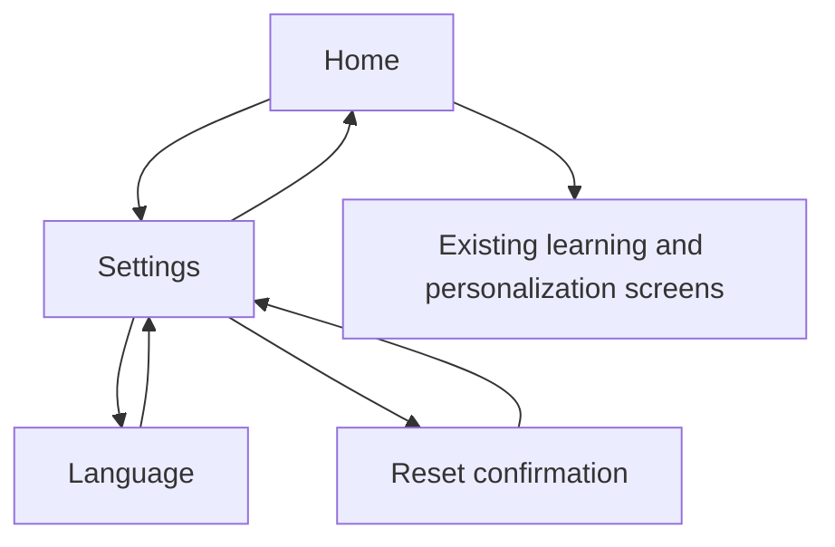

# Clocklings Localization and Settings Implementation Plan

> **For implementation:** Work through the checkboxes in order after an explicit implementation request. The `superpowers:executing-plans` skill can guide execution; delegation is optional and requires the applicable authorization. This document is a planning deliverable, not permission to implement, commit, push, or publish.

**Date:** 24 October 2026

**Status:** Proposed design and implementation plan, grounded in the current repository. No application changes or new runtime verification were performed for this document.

**Goal:** Complete Clocklings in English, Finnish, and one shared Swedish version; add a discoverable Settings screen with reliable language switching; provide a concrete later path for Spanish and French.

**Architecture:** Keep Compose, Navigation 3, manual `AppServices`, Preferences DataStore, and language-neutral clock mathematics. Add a small explicit language model, localized Android resources, language-specific clock wording, and a narrowly scoped Android locale integration.

**Tech stack inspected:** Kotlin 2.4.21, Compose BOM 2026.09.00, Activity Compose 1.13.0, Navigation 3 1.2.0, DataStore 1.3.0, AGP 9.4.1, Gradle 9.8.2, Java target 17, minSdk 26, compileSdk/targetSdk 37. These are repository declarations, not a new compatibility certification.

**Requirements and design:** This document contains the proposed design. Read it alongside [AGENTS.md](../../../AGENTS.md), [current implementation decisions](../../implementation/STATUS.md), and the [original product proposal](2026-10-20-public-clock-learning-app.md). Current owner instructions take precedence.

## Contents

1. [Scope and decision status](#1-scope-and-decision-status)
2. [Verified starting point](#2-verified-starting-point)
3. [Settings placement and contents](#3-settings-placement-and-contents)
4. [Language selection behavior](#4-language-selection-behavior)
5. [Android locale integration](#5-android-locale-integration)
6. [Clock language architecture](#6-clock-language-architecture)
7. [English, Finnish, and Swedish clock rules](#7-english-finnish-and-swedish-clock-rules)
8. [Lessons, hints, answers, and accessibility](#8-lessons-hints-answers-and-accessibility)
9. [Translation and editorial workflow](#9-translation-and-editorial-workflow)
10. [Speech and audio](#10-speech-and-audio)
11. [State, storage, and recreation](#11-state-storage-and-recreation)
12. [Spanish and French later](#12-spanish-and-french-later)
13. [File and interface map](#13-file-and-interface-map)
14. [Implementation work packages](#14-implementation-work-packages)
15. [Validation and acceptance](#15-validation-and-acceptance)
16. [Decisions before dependent implementation](#16-decisions-before-dependent-implementation)
17. [Sources and evidence limits](#17-sources-and-evidence-limits)

## 1. Scope and decision status

### 1.1 Confirmed requirements

| ID | Requirement | Completion meaning |
| --- | --- | --- |
| L01 | Finnish and Swedish must be added to the currently English application. | Every existing user-facing surface, including teaching content and accessibility text, works in all three languages. |
| L02 | UI language must be correct, especially clock-related wording. | Correctness includes grammar, the hour referred to, minute amounts, context, and agreement between words, pictures, answers, and narration. |
| L03 | Plan language switching in Settings and decide where Settings belongs. | Specify a clear entry point, navigation, content, selection behavior, persistence, and failure behavior. |
| L04 | Consider what else belongs in Settings. | Consolidate relevant existing settings; do not use this task to invent unrelated features. |
| L05 | Spanish and French come later. | Describe their implementation and review requirements now, but do not expose incomplete languages or delay the three-language release for them. |
| L06 | Deliver a very comprehensive English Markdown plan. | This file is the deliverable. Implementation requires a subsequent request. |

The established decisions remain: one English content style, one shared Swedish content set, offline learning, optional on-demand offline speech, and no partial public release of the agreed first-release product. This request replaces the older proposal's statement that additional languages are only a hypothetical future possibility: Spanish and French are now named later targets. It does not set their release date, regional style, reviewer budget, or an obligation to implement them immediately.

### 1.2 Global constraints

- Work only in `C:\Dev\Clocklings`. Do not modify or run builds in the original application's repository.
- Keep clock geometry, time arithmetic, scoring, rewards, progress identifiers, companion identities, and existing artwork intact unless a directly relevant verified defect requires a scoped correction.
- Reuse the current toolchain and dependencies. No DI/navigation migration, targetSdk change, backend, remote translation service, or generic grammar engine.
- Put ordinary UI copy and complete instructional sentences in Android resources. Keep language-specific clock rules separate from clock mathematics.
- Preserve all existing progress and settings on update and language change.
- Use existing theme tokens. No decorative colored edge stripes or middle-dot separators.
- Validate changed UI at 320 dp width, 200% font scale, and their combination.
- Use only explicitly identified dedicated test emulators; no physical-device or unrelated-emulator testing without new authorization.
- Run repository Gradle commands with `--no-daemon`. Track and stop temporary processes created for the task.
- `lc` and `sc` are owner-run. Their results are unknown unless reports are supplied.
- Work on a `codex/` feature branch. No commits, pushes, pull requests, signing changes, or publication are included.

### 1.3 Scope exclusions

Do not add profiles, bilingual exercises, independent teaching/UI languages, voice recognition, recordings, translation downloads, accounts, analytics, purchases, timers, widgets, curriculum mappings, or Teacher Approved work. Do not build empty settings for possible future features. Store-listing localization is a later publication dependency, not an authorization to access or change Play Console.

### 1.4 Review focus

| Risk | Required proof | Owning work package |
| --- | --- | --- |
| A translated half-hour phrase names the wrong hour. | Independent fixtures and actual lesson/demo assertions for the same time in each language. | WP03–WP05 |
| Resources switch but time words, Canvas labels, or speech stay English. | Cross-surface tests and language changes with pending speech initialization. | WP02–WP06 |
| A system language change recreates an active activity and loses work or awards twice. | Recreation/state tests covering games, lessons, Together, results, and challenge state. | WP02, WP04, WP07 |
| A missing resource silently falls back to English and looks complete. | Resource parity plus contextual inspection; resource resolution alone is insufficient. | WP01, WP05, WP07 |
| A long clock phrase is clipped, split badly, or read as a hidden answer. | Narrow/large-font rendered checks and accessibility assertions. | WP04, WP07 |

## 2. Verified starting point

Inspection snapshot: branch `codex/fix-deepsec-security-alerts`, HEAD `46687a5`; worktree clean before creating this document. The branch and dependency statements in older status entries are historical. Recheck live state when implementation begins.

### 2.1 Resource inventory

Only default English content resources exist. There are no `values-fi` or `values-sv` content directories.

| File under `app/src/main/res/values/` | Strings | Plural groups | String arrays | Total resource entries |
| --- | ---: | ---: | ---: | ---: |
| `strings.xml` | 286 | 8 | 1 | 295 |
| `personalization.xml` | 41 | 0 | 0 | 41 |
| `companion_items.xml` | 80 | 0 | 0 | 80 |
| **Total** | **407** | **8** | **1** | **416** |

These counts came from parsing the current XML. They are not 416 independent sentences: a plural group or array contains multiple texts. They also exclude Kotlin-generated clock wording and all new Settings copy. Recount at execution time; do not use the old status document's inherited-resource count as the current translation inventory.

### 2.2 Existing behavior and implications

| Area | Verified implementation | Planning consequence |
| --- | --- | --- |
| Activity | `MainActivity` extends `ComponentActivity`. | Do not assume an AppCompat locale API works unchanged here. |
| Navigation | Serializable `Screen` keys, explicit `ScreenSavedState` registration, `rememberNavBackStack`, per-entry ViewModels. | Add Settings routes to both the graph and serializer registry. |
| Home | Hero, current-time card, companion card, activity buttons, then 12/24 mode, sound, reset, and clock-style controls. | Settings can consolidate global controls without replacing learning navigation. |
| Existing settings | `Settings(sound = true, help = true, h24 = false, personalization = ...)`. | Preserve existing values/defaults. Language does not automatically change clock mode. |
| Help | Shared setting toggled inside Explore, Together, and practice. | A Settings control can use the same value while contextual shortcuts remain. |
| Reset | Home uses a second tap within five seconds. Repository writes `Progress()` while leaving Settings intact. | If moved, clearly describe all affected data and use an accessible confirmation. |
| Progress | Stars, challenge best, outfits, companion names, lesson completion, automatic-intro markers. | All are language-independent and must survive switching. Reset currently clears all of these. |
| English clock wording | `EnglishTime` is integrated throughout the UI. | Resources alone cannot localize the app. |
| Finnish clock wording | `FinnishTime` and its tests remain, but are not the active UI path. | Reuse and review; their existence does not mean Finnish is complete. |
| Swedish | No Swedish formatter or translated UI resources. | Author both wording rules and full content. |
| Lessons | Nine lessons, 27 teaching pages, nine quizzes in one static `LessonCatalog`. | Audit all pages, captions, hints, choices, and demo highlights. |
| Speech | One application-owned `Speech`, constructed with `Locale.ENGLISH`; offline voice filtering already exists. | Changing resources must also reconfigure the long-lived speech instance. |
| Accessibility/Canvas | Clock descriptions and the painted day-period label call `EnglishTime`. | Test Canvas text and semantics separately from ordinary Compose text. |
| Casing | `Eyebrow` explicitly uppercases with `fi-FI`. | Use the active language for casing; avoid modifying user-entered names. |
| Delivery | No application locale configuration is declared; no language-split override is present in the inspected app configuration. | Declare supported locales and ensure installed language resources are available offline. |

### 2.3 Exact English integration points

Replace or route the direct calls in:

- `ui/Texts.kt`: `Text.Time`, `timeLabel`, `digitalLabel`, `spokenTime`, `Hint.HandsRight`.
- `ui/game/GameScreen.kt`: answer choices, numeric labels, feedback/reveal wording.
- `ui/challenge/ChallengeScreen.kt`: numeric option labels and shared time labels.
- `ui/levels/LevelsScreen.kt`: level examples.
- `ui/clock/ClockFace.kt`: semantic description and painted day-period label.
- `ui/intro/IntroScreen.kt`: greeting selection.
- `audio/Speech.kt` and `ClocklingsApplication.kt`: voice language and long-lived service configuration.

Also inspect every caller of `timeLabel`, `digitalLabel`, `spokenTime`, `Text.resolve`, and `Hint.text`, including Home, Explore, Together, and lessons. A search for the word English will not find every dependent surface.

### 2.4 Concrete content risks found by inspection

1. `l_puoli_p3a`, `l_puoli_p4a`, and the half-hour quiz hint explicitly teach naming the hour already passed. Finnish and Swedish must instead explain the next named hour.
2. `l_viisi_p3b` teaches English 25-past/25-to wording. Finnish and Swedish need half-hour-relative examples that match their chosen style.
3. The third half-hour teaching page shows 3:30 and its demo highlights `num(4)` while its English text explains “half past three.” The intended emphasis needs reconciliation. This is a verified source combination, not a claim that a new device test reproduced a visual defect.
4. `FinnishTime.fullWords` concatenates the analog phrase and day part even at exact noon/midnight; English special-cases those moments. Select explicit Finnish/Swedish contextual wording and test it rather than inheriting inconsistent behavior accidentally.
5. Existing `EnglishContentTest` resolves resources from a context assumed to be English. Locale-aware tests must create or drive an explicit locale so test results do not depend on the emulator's current language.

No app build, emulator session, pronunciation test, or new linguistic certification was performed in this planning task. Historical passing tests are useful leads, not proof of the planned feature.

## 3. Settings placement and contents

### 3.1 Placement alternatives

| Approach | Advantages | Costs | Recommendation |
| --- | --- | --- | --- |
| A named Settings button near the top of Home | Easy to find; does not compete with learning cards; reachable before long content | Adds one small navigation row | **Recommended** |
| Settings as another large activity card | Reuses the card grid | Makes configuration look like a learning activity and lengthens Home | Do not choose |
| Settings only at the bottom or in an overflow menu | Small visible change | Language recovery is harder, especially at large fonts or in an unfamiliar language | Do not choose |

Proposed entry: a trailing, text-labeled Settings button in a separate row above the existing hero. A small gear may accompany the label if it fits existing icon patterns; the word must remain visible. Use a minimum 48 dp touch target. At 320 dp/200%, let the row grow rather than squeezing the hero or hiding the label. The row may scroll with Home; no new permanent bottom navigation is needed.

Keep the existing hero, clock, companion, and learning cards. Do not overlay a control on the rainbow, clock, or companion. Do not add Settings to active exercise screens: return to Home to make an in-app change. External Android app-language changes must still be handled while an exercise is active.

### 3.2 Proposed navigation



Use `Screen.Settings` and `Screen.Language`. A separate language page fits four initial rows and six later rows without a cramped dropdown or scrolling modal. Back returns to Settings; back from Settings returns to Home. System Back and the visible Back control behave the same way.

### 3.3 Proposed screen structure

```text
HOME
                                      [Settings]
                 Clocklings hero
                 Current-time card
                 Companion card, if enabled
                 Existing learning menu
                 [Clock styles]

SETTINGS
[Back]
Settings

Language                              Svenska >
Changes the app, lessons, and clock words.

Clock display
[12-hour] [24-hour]
Example: 3.30 / 15.30, in the selected language

Clock guides                           [On/Off]
Show extra numbers and day/night information.

Sound effects                          [On/Off]
Sounds for taps, answers, and celebrations.

Read aloud
Available / Not available for this language
Speech starts only when you tap a Listen button.

Learning progress
[Reset progress]

LANGUAGE
[Back]
Language
( ) Device language
( ) English
( ) Suomi
( ) Svenska
```

This is a content/layout sketch, not approved pixel artwork. The clock-guide description must be reconciled with every actual effect of `help` before final copy is adopted. Do not promise that it controls something it does not.

### 3.4 What belongs in the first Settings implementation

| Item | Proposed behavior | Existing/new | Scope decision |
| --- | --- | --- | --- |
| Language | Opens language page; changes all app/teaching wording together | New | Include |
| Clock display | Same existing 12/24 setting; show localized examples | Existing | Move Home control here |
| Clock guides | Same `help` preference; preserve contextual help buttons | Existing | Add global access here |
| Sound effects | Same `sound` preference; does not mute on-demand speech | Existing | Move Home control here; rename clearly |
| Read aloud availability | Short localized status and explanation | New presentation of existing capability | Include; no new speech-enable preference |
| Reset progress | Clear summary and explicit confirmation | Existing operation | Move out of Home |
| Clock styles/companions | Keep existing personalization entry points | Existing | Do not duplicate all customization controls here |

Keep the Home clock-style shortcut unless a later owner decision changes it. Existing personalization is a child activity, not an administrative setting.

Do not add independent volume, voice selection, speech-rate, notification, account, theme-mode, animation, or regional-language settings. They have no current requirement. Continue respecting system reduced motion and font scaling. An About/version/license area can be planned with publication requirements later; it is not required to make language selection correct.

### 3.5 Reset behavior

Recommend replacing the timed second-tap confirmation with a normal confirmation dialog. This is a proposed interaction change, not yet an approved product change.

Proposed English copy:

- Title: **Reset learning progress?**
- Body: **This clears stars, best scores, completed lessons, companion names, and outfits. Your language, clock display, sound effects, clock guides, and appearance settings stay the same.**
- Buttons: **Cancel** and **Reset progress**.

The existing repository also clears automatic lesson-intro markers. Include that in technical acceptance; “completed lessons” is the concise user-facing explanation. Colors, chosen companion, clock style, and custom-clock appearance remain settings. Resetting outfits means restoring defaults, not deleting artwork.

Cancel, outside dismissal, and Back perform no write. Disable repeated submission while the operation is pending. On failure, keep the data and show a short localized error; do not claim completion. Do not change the actual data scope of `resetProgress()` in this localization task.

No new parental PIN or age puzzle is proposed for ordinary language/settings access. Broader adult controls remain a separate product decision.

## 4. Language selection behavior

### 4.1 One language for the whole experience

The selected language controls UI labels, lesson content, time phrases, hints, feedback, accessible descriptions, day-period labels, and requested TTS language. It does not translate a companion's user-entered name or change scoring, difficulty, progress, clock appearance, or 12/24 mode.

Initial choices: **Device language**, **English**, **Suomi**, **Svenska**. Proposed default: **Device language**, falling back to English when no supported device language matches. The default and the additional Device language row are proposals; the requirement for English/Finnish/Swedish is confirmed.

Use autonyms for explicit languages in every UI locale. No flags, country selectors, or machine language tags in the UI. Keep a stable row order: Device language, English, Suomi, Svenska; append Español and Français when each is actually ready. A selected radio indicator must have accessible selected-state semantics.

Selecting a language applies immediately and keeps the user on the language page, now translated. Back returns to translated Settings. No app restart instructions, save button, or confirmation dialog are needed. Selecting the current value is a no-op. The stable autonyms make recovery from an accidental selection possible.

### 4.2 Resolution examples

| Stored/platform selection | Device preference | Effective content |
| --- | --- | --- |
| Device language | Finnish | Finnish |
| Device language | `sv-SE` or `sv-FI` | The same Swedish content |
| Device language | English regional variant | Shared English content |
| Device language | German, then Swedish in the preferred-language list | Swedish, provided Android resource resolution and the app resolver agree |
| Device language | Only unsupported languages | English |
| English | Finnish | English |
| Finnish | Swedish | Finnish |
| Swedish | English | Swedish |
| Device language, first release | Spanish or French only | English; these are not yet shipped |

The active formatter must use the language of the resources actually selected, not blindly the first system locale. Test the unsupported-primary/supported-secondary case explicitly. Switching from explicit Finnish to Device language must restore following the device; it must not save Finnish as a new fixed preference.

### 4.3 Feedback and errors

- The selected row and translated heading confirm success. Avoid a transient success message that would add noise or be missed during recreation.
- During a pending legacy-platform preference write, prevent conflicting taps. Render a new language only after the selected persistence policy has succeeded.
- On write/application failure, keep the previous committed choice and present a localizable retry message. Do not report a false persisted selection.
- A language change must stop ongoing narration before another utterance can start. Repeated rapid switches must leave UI, formatter, and speech in the final selected language.
- Language resources are bundled; language selection never requires a network connection.

## 5. Android locale integration

### 5.1 Alternatives and selected technical proposal

| Approach | Fit with this repository | Tradeoff |
| --- | --- | --- |
| **Keep `ComponentActivity`; framework locales on API 33+, localized Compose resource context on API 26–32** | Preserves the current activity, theme, and dependencies | Requires focused tests for the pre-33 resource boundary and one-time OS-upgrade handoff |
| Use `AppCompatActivity` plus AppCompat locale management on all supported versions | Official backward-compatibility path | Adds a dependency and changes the activity/window-theme baseline; not an automatic migration |
| Store a locale and replace only some strings manually | Small initial patch | Unacceptable mixed resources, wrong TTS, weak system integration, and duplicated formatting |

**Recommendation:** use the first approach, prove it early in WP02, and keep all legacy compatibility code in one small boundary. This is an engineering proposal tailored to an entirely Compose app, not a claim that Android officially endorses this exact custom combination. Android documents framework locale APIs for API 33+ and recommends AppCompat for earlier versions; its compatibility API requires an AppCompat activity. [Android app languages](https://developer.android.com/guide/topics/resources/app-languages)

If the small legacy boundary cannot pass the specified resource/dialog/accessibility tests without spreading workarounds through screens, stop that approach and present the narrowly scoped AppCompat alternative with its concrete impact. Do not silently introduce an activity migration or maintain two implementations indefinitely.

### 5.2 API 33 and newer

- Use `LocaleManager.applicationLocales` as the source of truth for the explicit app-language selection.
- Set one supported tag (`en`, `fi`, or `sv`); use an empty locale list for Device language.
- Let Android perform configuration changes/recreation. Do not add `android:configChanges` merely to suppress recreation.
- Derive the current UI/formatter language from the effective resource configuration, including supported-language fallback.
- On returning from Android Settings, read the platform state again. Never overwrite an external change with a stale DataStore value.
- Do not store a competing selected-language preference for routine API 33+ operation.

The framework persists the selection; an empty list means follow system, and changing it can trigger an activity lifecycle event. These API properties do not prove that this app's saved state survives. [LocaleManager API](https://developer.android.com/reference/android/app/LocaleManager)

### 5.3 API 26–32

Persist a nullable language tag in the existing Preferences DataStore. Missing/null means Device language. Valid explicit values are `en`, `fi`, `sv`; unknown values resolve to the default safely. Use a dedicated key such as `app_language`, without renaming any existing key.

At the Compose root, wait for the initial stored preference before presenting localized interactive content, as the app already waits for settings/progress. Do not block the main thread with a synchronous DataStore read.

For the selected effective language:

1. Copy the current configuration, preserving density, font scale, orientation, and other qualifiers.
2. Create a configuration context with the selected locale.
3. Supply coherent `LocalContext`, `LocalConfiguration`, and `LocalResources` to the application content; verify the exact APIs against the pinned Compose version before implementing.
4. Keep activity/lifecycle/ViewModel/saved-state owners unchanged.
5. Recreate the localized context when the underlying configuration or selected language changes. Never cache an English `Resources` object indefinitely.
6. Route non-composable resource calls through the effective resources already passed by the UI, not application-global resources.

`createConfigurationContext` provides resources for a configuration without mutating global application resources. The complete Compose integration still requires project-specific tests. [Android Context API](https://developer.android.com/reference/android/content/Context#createConfigurationContext(android.content.res.Configuration))

Do not call deprecated global `Resources.updateConfiguration`, mutate the process-wide default locale as a substitute for this boundary, or wrap each screen separately. Compose `stringResource`, plural resources, dialogs, error copy, and non-composable adapters must resolve consistently. [Resources in Compose](https://developer.android.com/develop/ui/compose/resources)

### 5.4 Upgrade from an older Android version

Handle the legacy explicit preference once after a device upgrades to API 33+:

- If Android already has an explicit app locale, respect it.
- Otherwise, if the legacy key contains a supported explicit choice, hand that choice to `LocaleManager` before showing content.
- If the legacy preference follows the device, leave the platform selection empty.
- Remove the legacy key after successful handoff so later system changes are never re-imported over.
- A failed handoff/cleanup must be retryable and idempotent; it must not erase learning data.

The platform cannot distinguish every pre-first-launch empty-locale history. Document this one-time migration policy and test it; ordinary operation must have only one authority. No old app-language migration exists today because Clocklings has no language preference yet.

### 5.5 Supported locales and offline packaging

Create `app/src/main/res/xml/locales_config.xml` with exactly `en`, `fi`, and `sv`, and reference it with `android:localeConfig` in the application manifest. Use this explicit list rather than accidentally advertising library-only translations. Do not simultaneously enable automatic locale-config generation.

Add complete `values-fi` and `values-sv` versions of all three current text files and the new settings resource file. Keep the full English fallback in unqualified `values`. Mark only genuine non-translatable values, such as the brand name, accordingly. Do not mark educational phrases non-translatable to silence checks.

Disable App Bundle language splitting for this application so every installed package set includes all shipped languages. Verify the syntax with the existing AGP version, and inspect/install a debug bundle's generated device APK set offline. A normal debug APK alone does not prove bundle delivery. [Base-module language splitting](https://developer.android.com/guide/app-bundle/configure-base)

Do not configure release signing or upload a bundle. Final production delivery evidence belongs to separately authorized release work.

## 6. Clock language architecture

### 6.1 Three different kinds of text

| Kind | Owner | Example |
| --- | --- | --- |
| UI/instructional sentence | Android localized resources | “Move the long hand.” |
| Algorithmic time wording | Small pure Kotlin implementation per language | `03:30` → `half past three` / `puoli neljä` / `halv fyra` |
| Clock mathematics and answers | Existing language-neutral domain code | Integer minutes, hand angles, answer equality, question generation |

Do not translate a completed English clock phrase. Generate the selected language's wording from the same numeric time and context. Do not feed visible text back into scoring. Existing game answers are numeric and should stay that way.

### 6.2 Proposed small contract

Create a supported-language enum and a simple wording interface; do not create a plugin registry, parsing system, or configurable grammar DSL.

```kotlin
enum class AppLanguage(val tag: String) {
    ENGLISH("en"), FINNISH("fi"), SWEDISH("sv")
}

interface TimeLanguage {
    fun timeWords(total: Int): String
    fun digital(total: Int, h24: Boolean = false): String
    fun numericWords(total: Int, h24: Boolean = false): String
    fun dayPart(total: Int): DayPart
    fun fullWords(total: Int, h24: Boolean): String
    fun greeting(total: Int): Greeting
}

fun timeLanguage(language: AppLanguage): TimeLanguage
```

`EnglishTime` and `FinnishTime` implement this contract; add `SwedishTime`. Preserve `FinnishTime.spoken24` as a delegating compatibility entry if existing tests/callers still need it. Do not retain duplicate algorithms. Move only the shared `DayPart`/`Greeting` declarations out of the Finnish file if needed to avoid misleading ownership.

Resolve language once from the current resource environment and pass it to pure wording functions. One `LocalAppLanguage` can make the active enum available to composables, following the existing personalization provider pattern. It must be derived state, not a second mutable preference store.

Recommended adapter changes in `ui/Texts.kt`:

- `timeLabel(language: AppLanguage, t: Int, h24: Boolean): String`.
- Keep `digitalLabel(res: Resources, t: Int, h24: Boolean)` and `spokenTime(res: Resources, t: Int, h24: Boolean)`; resolve the effective language through one shared resource resolver.
- Keep `Text.resolve(res)` and `Hint.text(res)` but dispatch time/day wording through that resolver.
- Keep lower-case phrase output for insertion into sentences; sentence-initial capitalization belongs to the localized presentation. Do not uppercase every word.

### 6.3 Context contract

`timeWords` describes a 12-hour analog reading. It never infers morning/evening, noon, or midnight from hand position alone.

`fullWords(total, h24 = true)` receives a known time within the day and disambiguates the day period. In this current application, `h24` affects both numeric display and known day context; preserve that behavior. Do not rename it conceptually to a formatting-only preference and accidentally drop context from answer choices.

Normalize values with existing `ClockTime.mod`. Preserve all-minute precision. Test negative/overflow inputs supported by existing formatters; do not round unusual minutes to the nearest five for easier language generation.

### 6.4 Numeric style proposal

| Language | Analog-context numeric example | Full-day numeric example | Proposed policy |
| --- | --- | --- | --- |
| English | `3:05` | `03:05`, `15:30` | Preserve existing English output. |
| Finnish | `3.05` | `3.05`, `15.30`, `0.05` | Preserve existing Finnish formatter convention. |
| Swedish | `3.05` | `03.05`, `15.30`, `00.05` | One explicit app style: dot separator, two-digit hours in 24-hour display. |

Finnish prose normally uses a dot and no hour-leading zero, while colon notation is also used in digital contexts. Swedish guidance permits dot or colon. These do not require a universal identical separator. [Finnish numeric notation](https://kielitoimistonohjepankki.fi/ohje/ajanilmaukset-kellonajat-merkinta-ja-taivutus/), [Swedish numeric notation](https://frageladan.isof.se/faqs/22011)

Choose the Swedish padding convention as an app design decision, not as the only correct Swedish spelling. If platform numeric formatting is selected instead during implementation, verify all approved examples on the supported API range and keep lesson resources synchronized. Do not let platform defaults override the explicit 12/24 teaching mode.

## 7. English, Finnish, and Swedish clock rules

### 7.1 Editorial status

The tables below specify proposed app output and test targets. They are not a claim that every possible phrase has received final linguistic review. Source-backed conventions, existing output, and new editorial choices must remain distinguishable in the language review record.

Preserve the established English past/to style. Reuse the Finnish convention where correct. Propose ordinary Swedish `över`, `i`, `halv`, and `kvart`, with the next hour after `halv`. Do not create separate Sweden and Finland variants. Regional alternatives are not incorrect answers merely because Clocklings presents one consistent style.

### 7.2 Core examples at hour three

These are phrase labels without the introductory sentence “It is / Kello on / Klockan är.”

| Time | English | Finnish reuse target | Shared Swedish proposal |
| --- | --- | --- | --- |
| 3:00 | three o'clock | tasan kolme | tre |
| 3:05 | five past three | viittä yli kolme | fem över tre |
| 3:10 | ten past three | kymmentä yli kolme | tio över tre |
| 3:15 | quarter past three | varttia yli kolme | kvart över tre |
| 3:20 | twenty past three | kahtakymmentä yli kolme | tjugo över tre |
| 3:25 | twenty-five past three | viittä vaille puoli neljä | fem i halv fyra |
| 3:30 | half past three | puoli neljä | halv fyra |
| 3:35 | twenty-five to four | viittä yli puoli neljä | fem över halv fyra |
| 3:40 | twenty to four | kahtakymmentä vaille neljä | tjugo i fyra |
| 3:45 | quarter to four | varttia vaille neljä | kvart i fyra |
| 3:50 | ten to four | kymmentä vaille neljä | tio i fyra |
| 3:55 | five to four | viittä vaille neljä | fem i fyra |

The English relationship is supported by [Cambridge's time-expression guidance](https://dictionaryblog.cambridge.org/2018/02/14/what-time-is-it-how-to-say-the-time/). Finnish permits nominative and partitive minute expressions; `viittä yli` is not a defect merely because an editor prefers `viisi yli`. [Kielitoimisto on accepted variants](https://kielitoimistonohjepankki.fi/ohje/ajanilmaukset-kellonajat-viisi-vaille-tai-vailla-viitta-vaille-tai-vailla/)

Swedish five-minute half-hour expressions are attested in the original teaching material hosted by the University of Gothenburg's NCM; use it as evidence for the language contrast, not as curriculum requirements. [NCM material, slide 14](https://ncm.gu.se/media/nywebb/matematikutvecklare/forelasare/eva_n061201ppt.pdf)

### 7.3 Exact-minute rules

For each language, `h` means the displayed hour 1–12, `next` wraps from 12 to 1, and `m` is 0–59.

**English — retain the current implementation:**

- 0: whole-hour wording; 15/30/45: quarter/half special forms.
- Before 30: refer to the current hour with past; after 30: refer to the next hour with to.
- At 1 and 59, use singular minute.
- Other non-five-minute amounts use plural minutes; five-minute amounts omit the unit in the selected app style.
- Keep English number hyphenation, such as twenty-one.

**Finnish — retain the existing interval structure, subject to contextual review:**

- 0: `tasan` + current hour; 30: `puoli` + next hour.
- 1–20: minute amount + `yli` + current hour.
- 21–29: `30-m` minutes + `vaille puoli` + next hour.
- 31–39: `m-30` minutes + `yli puoli` + next hour.
- 40–59: `60-m` minutes + `vaille` + next hour.
- Keep the approved special forms for 5, 10, 15, and 20. For ordinary exact-minute amounts, distinguish `yksi minuutti` and `kaksi minuuttia`, etc.
- Review full sentence inflection separately from a standalone time label. A phrase answering “what time is it?” is not automatically suitable after “until” or “at.”

**Swedish — proposed interval structure:**

- 0: current hour; 15: `kvart över` current hour; 30: `halv` next hour; 45: `kvart i` next hour.
- 1–20 excluding 15: amount + `över` current hour.
- 21–29: `30-m` + `i halv` next hour.
- 31–39: `m-30` + `över halv` next hour.
- 40–59 excluding 45: `60-m` + `i` next hour.
- Five-minute amounts may omit the unit. Other exact amounts use `en minut` or `<number> minuter` in the proposed clear instructional style.
- The hour one is `ett`; one minute is `en minut`. Do not share one context-free translation of “one.”

The uncommon exact-minute forms around half an hour require focused Swedish review before becoming frozen test expectations. Do not claim the five-minute source establishes every generated exact-minute sentence.

| Time | English exact target | Finnish reuse target | Swedish review target |
| --- | --- | --- | --- |
| 3:01 | one minute past three | yksi minuutti yli kolme | en minut över tre |
| 3:02 | two minutes past three | kaksi minuuttia yli kolme | två minuter över tre |
| 3:21 | twenty-one minutes past three | yhdeksän minuuttia vaille puoli neljä | nio minuter i halv fyra |
| 3:29 | twenty-nine minutes past three | yksi minuutti vaille puoli neljä | en minut i halv fyra |
| 3:31 | twenty-nine minutes to four | yksi minuutti yli puoli neljä | en minut över halv fyra |
| 3:39 | twenty-one minutes to four | yhdeksän minuuttia yli puoli neljä | nio minuter över halv fyra |
| 3:59 | one minute to four | yksi minuutti vaille neljä | en minut i fyra |

### 7.4 Hour wrap and full-day context

Required independent examples include:

| Situation | Required distinction |
| --- | --- |
| 11:30 analog | English references eleven; Finnish/Swedish reference twelve. |
| 12:30 analog | English references twelve; Finnish/Swedish reference one. |
| 12:45 analog | Quarter to one; never quarter to thirteen. |
| 03:30 versus 15:30 | Same hand positions, different numeric/full-day labels. |
| 00:00 with day context | midnight / keskiyö / midnatt. |
| 12:00 with day context | noon / keskipäivä / middag, with final Swedish sentence reviewed for clarity. |
| Analog-only 12:00 | A twelve-o'clock reading; do not infer noon or midnight. |
| 23:59 → 00:00 | Hour wrap and explicit day context remain correct. No new date/interval feature is implied. |

Keep the existing day/night visual convention (sun for 06:00–17:59) unless a separate design decision changes it. It is a teaching indicator, not actual local sunrise/sunset. Day-part wording and greeting categories can differ by language; do not force the Finnish `aamupäivä` category into an unnatural English or Swedish translation. Test every chosen category boundary and the minutes immediately adjacent to it.

### 7.5 Numeric narration and durations

Written clock phrases and numeric readings are distinct outputs. For 15:30, a language can teach its analog phrase and then read its 24-hour numeric equivalent. Do not let TTS guess how to pronounce a colon/dot string.

Retain the current English numeric-reading convention unless the content review identifies a problem. Review Finnish `spoken24`, including 00:00 and leading-zero minutes; a passing test of “nolla nolla nolla” establishes existing behavior, not ideal instructional speech. Define Swedish numeric readings explicitly, including zero, one, and minutes below ten.

Use plural resources for durations and counts already present, including minute captions, stars, and scores. A minute count is not a clock phrase, and a numbered player is not a quantity. Do not add duration lessons or a duration grammar system as part of this task.

## 8. Lessons, hints, answers, and accessibility

### 8.1 Audit all nine lessons

| Stable ID | Content to review | Language-sensitive implementation concern |
| --- | --- | --- |
| `viisarit` | Hour/minute hand names, short/long, colors, numbers | Terminology must match visible hands and accessibility controls. |
| `kierros` | One revolution, 60 minutes, moving hour hand | Plural captions and numeric minute bubbles must remain distinct from time-of-day phrases. |
| `tasan` | Whole hours, long hand at 12 | Do not confuse clock hour 12 with midnight/noon. |
| `puoli` | Half hour, 3:30 demonstration, 7:30 example, 5:30 quiz | English names elapsed hour; Finnish/Swedish name next hour. Align highlights and explanation. |
| `vartti` | Quarter past/to, four quarters | Refer to the correct hour; avoid translating “quarter” without time context. |
| `ylivaille` | Past/to relationships and colored sectors | Do not imply every minute on a side uses the same preposition in Finnish/Swedish half-hour-relative wording. |
| `viisi` | Five-minute counting, :25 and :35 | Explain `vaille puoli` / `yli puoli` and `i halv` / `över halv` consistently with generated labels. |
| `minuutit` | Tick counting, exact minutes, 3:07 quiz | Singular/plural, number spelling, no rounding. |
| `vrk` | Two turns per day, 03:00/15:00, 19:00 quiz | Day periods, numeric format, and full-day context. |

Preserve stable IDs and completion records. Do not translate stored lesson IDs, item IDs, enum keys, or route serialization identifiers.

### 8.2 Minimal catalog adaptation

Most lesson structure can stay shared because text already uses resource references. Change only the demonstrations whose highlighted reference hour or explanation differs by language.

Proposed API: `LessonCatalog.all(language: AppLanguage): List<Lesson>` and `LessonCatalog.lesson(id: String, language: AppLanguage): Lesson`. Keep one shared authoring structure, with an explicit small branch for the affected half-hour reference highlight and any source-confirmed language-sensitive demo steps. Do not copy the entire catalog three times.

For the 3:30 reference explanation, the proposed emphasis is number 3 in English and number 4 in Finnish/Swedish. Retain the page that shows both 3 and 4 to teach the physical position. The :25/:35 examples keep the same numeric target times and minute-hand markers; their translated captions explain the appropriate reference.

A locale change while a lesson ViewModel survives recreation must replace its language-sensitive lesson data. Re-run only the current page's demonstration from its initial state, without re-awarding completion, advancing the queue, or resetting prior quiz results. See state behavior in section 11.

### 8.3 Hints and sentence composition

- Keep `Hint`, `HourPosition`, and `MinutePosition` language-neutral.
- Review `nearHalf` hint copy across its whole current range 21–39. Text that says exactly “at half past” must not misdescribe :21 or :39.
- Prefer complete grammatical resource sentences. Existing `withTip` may join complete sentences with a space; do not build sentences by combining translated fragments with English order.
- Review the inserted `dayPart.name` in `hint_hands_right` for required case/preposition in each language. If the wrapper requires an inflected form, provide the correct complete resource wording or a narrowly named form; do not insert a nominative noun blindly.
- Feedback must describe the actual submitted/target time. A translation must never change which answer is correct.

### 8.4 Answer identity and valid alternatives

Keep time-valued practice answers numeric. For authored lesson quizzes, ensure one correct choice, distinct visible labels, and correspondence with the independently recorded intended time.

Do not make an accepted alternative for the same time a wrong distractor. Examples: a numeric reading and a past/to phrase for the same English time; different accepted Finnish minute inflections; Swedish equivalent regional wording. No free-text or voice-answer parser is required.

Test distinctness of the complete visible option (clock phrase plus numeric/day context). Also test phrase distinctions where a phrase is shown alone. Do not require all analog phrases to be unique across 24 hours: 03:30 and 15:30 intentionally share analog wording.

### 8.5 Accessibility text is content

Translate Back/Listen/Reveal controls, selected/locked/unlocked states, stars and scores, dialog actions, clock descriptions, adjustable hand actions, and custom-art descriptions. Inspect the actual semantic tree.

Before Together reveals the answer, neither text semantics, a content description, a custom action, nor the Listen path may expose it. Apply the same protection to any existing hidden-answer practice state. After language switching, the hidden state must remain hidden.

The Canvas day-period label must receive already-resolved localized text; drawing code should not decide language. Long Swedish/Finnish day words must not collide with hands, numerals, or the sun/moon. Verify glyph coverage and legibility in bundled fonts, including å/ä/ö now and é/è/ê/ç/ñ later.

## 9. Translation and editorial workflow

### 9.1 Create a complete, useful review inventory

At implementation time, create one `docs/localization/language-review.md` containing the glossary, chosen clock rules, disputed phrases, source links, review status, and evidence references. Avoid a translation-management platform or duplicate full copies of every resource in Markdown.

Inventory each resource with its key, screen/state, placeholders, plural branches, and whether it teaches a clock concept. Include arrays and Kotlin-generated language output. Record non-translatable exceptions explicitly. Existing identifiers may remain Finnish; new identifiers and code comments must be English.

### 9.2 Proposed terminology seed

These are starting editorial choices, to be checked in full UI context:

| Concept | English | Finnish | Swedish |
| --- | --- | --- | --- |
| Settings | Settings | Asetukset | Inställningar |
| Language | Language | Kieli | Språk |
| Device language | Device language | Laitteen kieli | Enhetens språk |
| Hour hand | hour hand | tuntiviisari | timvisare |
| Minute hand | minute hand | minuuttiviisari | minutvisare |
| Clock face | clock face | kellotaulu | urtavla |
| Half an hour, duration | half an hour | puoli tuntia | en halvtimme |
| A quarter of an hour | a quarter of an hour | vartti | en kvart |
| Sound effects | Sound effects | Äänitehosteet | Ljudeffekter |
| Back | Back | Takaisin | Tillbaka |
| Cancel | Cancel | Peruuta | Avbryt |

Do not choose all lesson titles by translating these nouns mechanically. For example, the English title “Half past” names a language-specific clock expression; its Finnish/Swedish title must fit the lesson's actual local explanation.

### 9.3 Review passes

1. **English baseline:** check ambiguous source copy before translating. Verify all clock examples against current numeric targets and demos. Keep intentional established wording.
2. **Finnish authoring:** write complete natural instructions, reusing formatter rules and checking all inherited/new phrases. Do not copy private/original-project files as a shortcut.
3. **Swedish authoring:** write one consistent content set. Compare half-hour references and exact-minute forms with sources and the owner only where an unresolved choice matters.
4. **Meaning review:** compare each instructional sentence with the clock/demo, not just with the English text. Check that a child is asked to perform the right action.
5. **Language review:** spelling, compounds, grammar, inflection, punctuation, tone, terminology, and natural brevity. Review praise and item names in context too.
6. **Rendered review:** long strings, wrapping, resource substitutions, button labels, and accessibility descriptions on real rendered screens.
7. **Regression review:** changed English wording remains correct; switching languages does not corrupt state or mix resources.

AI may draft and perform structured checks. Two models agreeing, back-translation, a spellchecker, or a passed build does not establish educational correctness. Use language authorities and checked numeric examples; bring only consequential unresolved wording to the owner with concrete alternatives and their meanings. The earlier project decisions do not require paid reviewers or assumed volunteers for Finnish/Swedish.

### 9.4 Resource rules

- Keep resource keys stable. Use positional placeholders (`%1$s`, `%2$d`) so word order can differ.
- Check argument types and multiplicity, not just the number of percent signs. Intentional differences must be documented and supported by call sites.
- Use Android plural selection for actual quantities; provide the language's required forms and `other`. Do not assume English's categories suffice for later languages.
- Translate the complete `praise` array and preserve index behavior; an entry must not become an unrelated response.
- Escape XML entities and Android apostrophes correctly; inspect rendered punctuation. Avoid literal backslashes or broken formatting.
- Check all 80 non-human item names and the existing human-item names against their artwork. Do not translate user names or persistence IDs.
- Preserve accents, capitalization, ellipses, and intended line breaks. Do not shorten correct time phrases into ambiguous wording to make a button fit.
- Keep brand `Clocklings` unchanged. No national flags or geographic identity assumptions.

Android resources support formatted strings and quantity-specific text, but these APIs do not validate grammar. [Android string and plural resources](https://developer.android.com/guide/topics/resources/string-resource)

### 9.5 Completion classification

| Status | Meaning |
| --- | --- |
| Draft | Authored, not yet independently checked against the intended meaning. |
| Source checked | Relevant linguistic convention checked; implementation/rendering may remain unverified. |
| Functionally verified | Text, clock value, answer, and language routing agree in tests. |
| Context reviewed | Actual rendered state checked for language and layout. |
| Ready for inclusion | All applicable checks complete, no unresolved teaching error. |

Track status by content group and specific exceptions, not hundreds of bureaucratic per-string approvals. Missing/uncertain core clock wording blocks completion of that language. Do not advertise a partially translated language as complete because Android supplies English fallbacks.

## 10. Speech and audio

### 10.1 Preserve the product contract

Speech remains optional and on demand. Learning, answers, and navigation work without any TTS engine or voice. Sound effects remain a separate setting. Do not add automatic narration or a global speech switch simply because a Settings screen now exists.

A voice's locale, offline requirement, and installed-data metadata support candidate selection; actual pronunciation still needs listening evidence. [Android Voice](https://developer.android.com/reference/android/speech/tts/Voice)

### 10.2 Reconfigure the existing service

Add an explicit `setLanguage(language: AppLanguage)` operation through `AppServices` to the application-owned speech service, and bind it to the effective content language. Update `FakeServices` accordingly. Keep one TTS instance where possible; do not create an engine on each recomposition.

On language change:

1. Stop/flush the old utterance.
2. Set availability false until the new language has been configured successfully.
3. Record the latest requested language, including when engine initialization is still pending.
4. Select an installed offline voice in that language using the existing filter.
5. Apply the voice and the existing rate; restore availability only for successful current-language configuration.
6. Guard against a late callback restoring an earlier requested language. Require a new user tap to speak; never replay stale queued text automatically.

Allow appropriate regional English voices and both Swedish regional tags as the current filter already does. A voice from another language is never a fallback. If a regional voice demonstrably contradicts the chosen teaching text, record the engine-specific issue and keep speech unavailable for that case rather than changing visible content unpredictably.

### 10.3 Lifecycle and failure cases

Retain stopping on navigation, page/replay change, Together role swap, and backgrounding. Refresh voice availability on relevant return from background so installing/removing voice data does not require reinstalling Clocklings. Any explicit engine replacement or test-owned instance must call `shutdown()` when finished. Do not shut down the application-owned engine on every configuration recreation. [TextToSpeech lifecycle API](https://developer.android.com/reference/android/speech/tts/TextToSpeech)

Test missing engine, initialization failure, no matching voice, network-only voice, missing data, failure to set voice/rate, speak failure, and switching before initialization finishes. Do not launch downloads or external TTS settings automatically.

Settings shows a short availability explanation. It must not imply that all supported languages have offline voices installed. If no usable Swedish voice is available on the dedicated emulator, record text/selection tests as verified and Swedish audio pronunciation as unverified. Do not use a physical phone without authorization to fill that gap.

## 11. State, storage, and recreation

### 11.1 Preserved state

Language switching must not reset stars, personal best, outfits, names, colors, themes, selected companion, completed lessons, automatic-intro markers, sound/help preferences, or 12/24 mode. Do not create per-language progress stores. A lesson remains completed across languages and remains manually replayable.

Existing users have no language key; proposed first behavior follows the device. This can make an existing English-only installation appear in Finnish after update on a Finnish device. It is an intentional proposal requiring confirmation, not a hidden migration side effect.

### 11.2 Active-screen contract

| Screen/state during external language change | Required outcome |
| --- | --- |
| Home/Settings/Language | Same destination; updated labels; no intro replay caused solely by recreation. |
| Explore | Same numeric time, mode, and help value. |
| Together before reveal | Same setter, time, and phase; answer still hidden. |
| Together after reveal | Same revealed time and player; newly localized answer. |
| Practice | Same round, question, options' time identities/order, selected answer, mistake count, and awarded state. |
| Lesson teaching page | Same lesson/page/queue; current demo restarts coherently in new language, with no extra completion award. |
| Lesson quiz | Same choice identities/order and selected/completed state; localized labels. |
| Result | Same result and rewards; no duplicate award or celebration triggered by language alone. |
| Challenge | Preserve existing timing semantics, score, question, and remaining deadline; language change must not grant a fresh minute. |
| Companion name editing | Preserve the draft and selection where existing saveable state supports it; do not translate or normalize entered content. |
| Reset confirmation | Dismiss safely on locale change; no implicit reset. |

Use existing saveable state and ViewModel retention first. Add only the saved fields needed to satisfy this contract. Do not serialize localized sentences. Use values, IDs, and structured feedback and resolve at display time.

Differentiate ordinary locale-triggered activity recreation from process death. Durable preferences/progress must survive both. Preserve the current navigation restoration behavior; verify any newly introduced state. If active-round process-death recovery is incomplete today, report it separately rather than asserting that locale work proves comprehensive recovery. A new locale path must not make ordinary recreation lose an active round.

### 11.3 Settings consistency

Use explicit setters such as `setSound(enabled)` and `setHelp(enabled)` for Settings switches; retain existing toggle actions for contextual buttons if useful. They update the same stored values. A second copy of a preference for Settings would cause drift.

Render storage errors in the selected language. A failed settings write must not reset unrelated keys or falsely indicate completion. Extend only the affected settings/reset action state needed for clear success/failure; do not redesign the whole repository error model.

## 12. Spanish and French later

### 12.1 Prepare extension points, not unfinished UI

The initial enum contains only English, Finnish, and Swedish. When ready, add `SPANISH("es")` and `FRENCH("fr")`, complete corresponding resources and formatters, and add them to the locale configuration and picker in the same completed change. No disabled “coming soon” rows, empty resource folders, placeholder English translations, or speculative language framework.

The same clock mathematics, persistence IDs, activities, and progress continue to apply. Future language additions must not require a database migration or duplicate lesson catalog.

### 12.2 Decisions and linguistic work

| Area | Spanish | French |
| --- | --- | --- |
| Content variety | Select one intended shared style and acceptable regional vocabulary before authoring. Do not silently assume Spain-only wording is universal. | Select the intended shared variety and numeric notation; do not silently equate French with one country. |
| Half hour | Proposed examples use `y media` with the current hour, unlike Finnish/Swedish next-hour wording. | Proposed examples use `et demie` after an hour expression; agreement changes with midi/minuit. |
| Quarter/to | Review `y cuarto`, `menos cuarto`, and regional alternatives. | Review `et quart`, `moins le quart`, and the reference hour. |
| Sentence grammar | `Es la una` versus `Son las ...`; articles and agreement must depend on the named hour. | `une heure` versus `deux heures`; distinguish `midi et demi` from `trois heures et demie`. |
| Numeric/time-of-day | Check 12/24 display, midnight/noon, day-period suffixes, and spoken leading-zero minutes. | Check numeric display versus prose such as `15 h 30`, spaces, hour labels, day periods, midnight/noon. |
| Editorial review | Owner/reviewer capability and acceptable evidence route must be established before release. | Same; do not claim French is verified because it compiles or back-translates correctly. |

Spanish has both 12- and 24-hour conventions and grammatical distinctions in full time sentences. [RAE/ASALE, hora](https://www.rae.es/dpd/hora) French half-unit agreement depends on the noun and differs for midi/minuit. [OQLF on demi](https://vitrinelinguistique.oqlf.gouv.qc.ca/21752/la-grammaire/ladjectif/accord-de-ladjectif/cas-particuliers-daccord-de-ladjectif/emploi-adjectival-et-adverbial-de-demi)

These are research starting points and representative risks, not completed Spanish/French copy specifications. Do not make the initial Finnish/Swedish work depend on resolving future regional or reviewer decisions. Do not assume a paid reviewer is already funded.

When Spanish is implemented, a universal translated prefix for English `It is %1$s` will be insufficient. Choose the complete Spanish sentence from the hour named by the phrase, including next-hour expressions such as 12:45. Keep that small grammatical choice in the Spanish wording/presentation path and add an independent test. French numeric/prose rendering likewise needs its own reviewed templates rather than replacing separators in an English sentence.

### 12.3 Later-language work sequence

1. Confirm the language's editorial variety, reviewer/evidence approach, numeric convention, and speech expectations.
2. Draft its glossary and independent clock fixtures, covering whole/half/quarter/exact minutes, 1/12 wraps, and all-day context.
3. Add its pure formatter and numeric narration with focused boundary tests.
4. Translate every resource group and adapt only genuinely language-sensitive lesson demonstrations.
5. Run resource/placeholder/plural checks and cross-surface functional tests.
6. Review rendered text at the same four size/font combinations and perform the same speech checks.
7. Re-run English/Finnish/Swedish routing and state-preservation regressions.
8. Add the language to both picker and Android locale list only when complete; verify offline bundle delivery again.

Spanish and French can be completed in separate later changes. Neither is allowed to ship as an incomplete fallback-heavy option.

## 13. File and interface map

Paths below are relative to `C:\Dev\Clocklings`; proposed new paths do not exist yet. Do not create all files mechanically if an existing file can own the responsibility clearly.

### 13.1 Production files

| Action | Path | Responsibility |
| --- | --- | --- |
| Create | `app/src/main/java/fi/clocklings/domain/AppLanguage.kt` | Supported content languages and pure selection/fallback helpers. |
| Create | `app/src/main/java/fi/clocklings/domain/TimeLanguage.kt` | Small formatter contract, shared types, explicit dispatcher. |
| Modify | `app/src/main/java/fi/clocklings/domain/EnglishTime.kt` | Implement contract; preserve approved behavior. |
| Modify | `app/src/main/java/fi/clocklings/domain/FinnishTime.kt` | Implement contract; contextual review fixes, numeric compatibility. |
| Create | `app/src/main/java/fi/clocklings/domain/SwedishTime.kt` | Shared Swedish clock wording and numeric narration. |
| Create | `app/src/main/java/fi/clocklings/ui/locale/AppLocale.kt` | Platform/legacy locale boundary, effective resource environment, `LocalAppLanguage`. |
| Modify | `app/src/main/java/fi/clocklings/data/ProgressRepository.kt` | Legacy language key/handoff operations; preserve progress/settings. |
| Modify | `app/src/main/java/fi/clocklings/MainActivity.kt` | Lifecycle/configuration integration if required by the chosen boundary. |
| Modify | `app/src/main/java/fi/clocklings/ClocklingsApp.kt` | Root locale provider, Settings routes, language-to-speech binding. |
| Modify | `app/src/main/java/fi/clocklings/Screen.kt` | Serializable Settings/Language keys and registrations. |
| Modify | `app/src/main/java/fi/clocklings/ui/home/HomeDestination.kt` | New `SETTINGS` destination. |
| Modify | `app/src/main/java/fi/clocklings/ui/home/HomeScreen.kt` | Entry point; relocate agreed global controls. |
| Create | `app/src/main/java/fi/clocklings/ui/settings/SettingsScreen.kt` | Settings screen, language page, reset confirmation using existing UI components. Split only if necessary. |
| Modify | `app/src/main/java/fi/clocklings/ui/AppViewModel.kt` | Explicit setting actions and scoped pending/error state as needed. |
| Modify | `app/src/main/java/fi/clocklings/ui/Texts.kt` | Central localized time/resource adapters. |
| Modify | `app/src/main/java/fi/clocklings/ui/lesson/LessonCatalog.kt` | Language-sensitive reference emphasis while retaining shared content/IDs. |
| Modify | `app/src/main/java/fi/clocklings/ui/lesson/LessonViewModel.kt` | Rebind language-sensitive lesson data without changing lesson progress. |
| Modify | `app/src/main/java/fi/clocklings/ui/lesson/LessonScreens.kt` | Use active language/catalog and current resources. |
| Modify | `app/src/main/java/fi/clocklings/ui/clock/ClockFace.kt` | Localized descriptions and Canvas day label. |
| Modify | `app/src/main/java/fi/clocklings/ui/game/GameScreen.kt` | Localized options and feedback. |
| Modify | `app/src/main/java/fi/clocklings/ui/challenge/ChallengeScreen.kt` | Localized option labels. |
| Modify | `app/src/main/java/fi/clocklings/ui/levels/LevelsScreen.kt` | Localized examples. |
| Modify | `app/src/main/java/fi/clocklings/ui/home/HomeScreen.kt`, `ui/freeclock/FreeClockScreen.kt`, `ui/ask/AskScreen.kt` | Update time-label adapter calls; preserve state. The latter paths share `app/src/main/java/fi/clocklings/`. |
| Modify | `app/src/main/java/fi/clocklings/ui/intro/IntroScreen.kt` | Active-language greeting. |
| Modify | `app/src/main/java/fi/clocklings/ui/components/Display.kt` | Locale-correct casing. |
| Modify | `app/src/main/java/fi/clocklings/audio/Speech.kt`, `ClocklingsApplication.kt` | Last-request-wins language configuration and availability. The latter is under the same `fi/clocklings/` root. |
| Create/modify | `app/src/main/res/values{,-fi,-sv}/{strings,personalization,companion_items,settings}.xml` | Full translations and new Settings copy; brace notation denotes twelve concrete files. |
| Create | `app/src/main/res/xml/locales_config.xml` | Exact published language list. |
| Modify | `app/src/main/AndroidManifest.xml`, `app/build.gradle.kts` | Locale declaration and bundled language delivery only. |

No changes are planned for dependency versions, signing properties, clock geometry, reward inventory, source-app files, or stored IDs. `Navigator.kt` needs changes only if the existing push/pop API cannot express the two new routes.

### 13.2 Tests and evidence

| Create/update | Responsibility |
| --- | --- |
| `app/src/test/java/fi/clocklings/domain/AppLanguageTest.kt` | Supported tags, fallback ordering, regional mapping. |
| `app/src/test/java/fi/clocklings/domain/{EnglishTimeTest,FinnishTimeTest,SwedishTimeTest}.kt` | Independent boundary expectations and exhaustive invariants. |
| `app/src/test/java/fi/clocklings/domain/TimeLanguageTest.kt` | Dispatcher and numeric-answer/phrase consistency across languages. |
| `app/src/test/java/fi/clocklings/ui/lesson/{LessonCatalogTest,LessonViewModelTest}.kt` | Correct highlight reference, stable IDs, locale rebinding. |
| `app/src/test/java/fi/clocklings/data/ProgressRepositoryTest.kt` | Legacy preference persistence, reset preservation, migration/error cases. |
| `app/src/test/java/fi/clocklings/ui/FakeServices.kt` | Test speech-language requests without a real engine. |
| `app/src/androidTest/java/fi/clocklings/LocalizationContentTest.kt` | Explicit-locale resources, placeholders/arrays/plurals, actual lesson answers. |
| `app/src/androidTest/java/fi/clocklings/LanguageSettingsTest.kt` | Picker, system integration, recreation, progress, and visible errors. |
| Existing `AppFlowTest`, `ChallengeScreenTest`, personalization tests | Relevant state/UI regressions without duplicating complete suites. |
| `app/src/androidTest/java/fi/clocklings/audio/OfflineVoiceTest.kt` | All-language offline voice filtering; async service-state tests at the cheapest appropriate layer. |
| `tools/check-localization.ps1` | One-shot source-resource parity/placeholder check, including missing keys that runtime fallback conceals. |
| `docs/localization/language-review.md` | Compact editorial decisions, exceptions, source evidence, test/run references. |

Keep English-specific regression tests useful. Either make their English context explicit or fold them into the cross-language content test without losing assertions. Do not assert correctness by computing the expected string with the same formatter being tested.

## 14. Implementation work packages

These are development checkpoints, not partial public releases. All applicable first-release packages must be complete before claiming this localization work complete.

### WP01 — Freeze the content contract and detect missing resources

**Inputs:** this plan, current resources, current lesson targets.

**Output:** a checked glossary/fixture seed and a repeatable completeness check.

**Files:** `docs/localization/language-review.md`, `tools/check-localization.ps1`, existing resource files as inventory inputs.

- [ ] Recheck branch, dirty state, toolchain declarations, resource counts, and current source paths.
- [ ] Resolve only the owner-level decisions in section 16 that affect the immediate implementation.
- [ ] Record the three numeric conventions, Finnish reuse choices, Swedish exact-minute choices, and noon/midnight sentence forms.
- [ ] Define independent expected examples for all clock boundaries and every lesson's correct answer before wiring new formatters.
- [ ] Add a resource check for key/type parity, missing plural `other`, placeholders, array entries, duplicates, and allowed non-translatable exceptions.
- [ ] Prove the check reports a deliberately missing key/placeholder mismatch in an isolated test fixture; do not alter production translations to demonstrate failure.

**Pass:** all current text groups are accounted for, high-risk wording has concrete review targets, and missing translations cannot pass silently through resource fallback.

### WP02 — Prove the language boundary and persistence

**Inputs:** `AppLanguage` values and section 4 selection policy.

**Output:** effective locale state and resources consumed by all later packages.

**Files:** `AppLanguage.kt`, `AppLocale.kt`, `MainActivity.kt`, `ClocklingsApp.kt`, `ProgressRepository.kt`, locale XML/manifest, focused locale tests.

**Interfaces:** expose selected choice (`null` for Device language), effective `AppLanguage`, and one selection action. Platform code owns application; pure helper `resolveLanguage(tags: List<String>): AppLanguage` chooses the first supported language or English. Verify it agrees with resource selection.

- [ ] Write resolver tests for `sv-SE`, `sv-FI`, regional English, unsupported-only, unsupported-first/supported-second, and empty lists.
- [ ] Add instrumented tests for the pre-33 Compose resource boundary and API 33+ framework selection before integrating all copy.
- [ ] Implement the single-root context/resource provider and platform source-of-truth rules.
- [ ] Test default startup, explicit persistence, return to Device language, current-language no-op, external system changes, and rapid selections.
- [ ] Test legacy write failure: previous language remains committed and progress is untouched.
- [ ] Test one-time legacy-to-framework handoff, existing platform choice winning, and no stale re-import after cleanup.
- [ ] Verify ordinary `stringResource`, `Text.resolve`, plural selection, dialogs, accessibility labels, and font-scale changes all use coherent resources.

**Pass:** proven on one dedicated API 26–32 emulator and one API 33+ emulator. Keep minSdk 26 and validate the floor; do not claim the modern emulator proves old-platform behavior.

### WP03 — Implement and verify the three time languages

**Inputs:** frozen language rules/fixtures.

**Output:** `TimeLanguage` contract and `timeLanguage(AppLanguage)` dispatcher.

**Files:** three formatters, shared types, `Texts.kt`, formatter tests.

- [ ] Add failing focused Swedish boundary tests and any missing Finnish contextual cases.
- [ ] Implement the contract with direct language-specific functions and the existing arithmetic.
- [ ] Add explicit time-label/resource adapter language selection.
- [ ] Verify singular/plural, half-hour references, quarter cases, :20/:21, :29/:30/:31, :39/:40, :59, and hour wrapping.
- [ ] Verify analog-only versus known full-day noon/midnight behavior, numeric display, and numeric narration.
- [ ] Run all 720 analog-minute and 1,440 full-day values for normalization, non-empty output, and consistency; keep independently written fixtures as the language oracle.
- [ ] Preserve current approved English outputs; document and test any intentional correction separately.

**Pass:** formatter tests prove the agreed rules; disputed exact-minute wording remains a named blocker, not a guessed final expectation.

### WP04 — Localize every clock surface and lesson demonstration

**Inputs:** effective language and the formatter contract.

**Output:** coherent visible, drawn, spoken-source, and accessible clock content.

**Files:** all integration points in section 2.3, `LessonCatalog`, `LessonViewModel`, lesson/clock tests.

- [ ] Replace direct UI calls to `EnglishTime` with the common adapter/dispatcher.
- [ ] Pass localized day-period text to Canvas drawing and update semantic descriptions from the same numeric time.
- [ ] Adapt the half-hour reference highlight and audit :25/:35 explanations and sector meanings.
- [ ] Rebind locale-sensitive lesson data in a retained ViewModel while preserving IDs, queue/page, and quiz identity.
- [ ] Test every actual quiz answer against independent intended times in each language; verify no duplicate or equivalent wrong distractor.
- [ ] Test generated practice choices with 12/24 mode and day-context mirror answers.
- [ ] Test hidden-answer semantics across language switches and Together phases.
- [ ] Verify all remaining direct formatter references are intentional implementation/test references, not UI bypasses.

**Pass:** Home, Explore, lessons, levels, practice, feedback/results, Together, challenge, intro, and clock semantics use the selected language with unchanged numeric behavior.

### WP05 — Complete Finnish and Swedish resources and review English

**Inputs:** inventory, glossary, numeric targets, adapted lessons.

**Output:** full three-language content.

**Files:** all localized XML groups, content tests, language review record.

- [ ] Author Finnish and Swedish resources, including every plural branch, praise entry, companion/item label, and accessibility string.
- [ ] Review English source ambiguities and update only relevant copy with tests for any teaching correction.
- [ ] Review all nine lessons page by page against their numeric demos, choices, feedback, and narration source text.
- [ ] Check long dynamic names, compound words, case/preposition insertion, and no-companion/locked/unlocked states.
- [ ] Run source completeness and compiled-resource tests using explicit language contexts.
- [ ] Record unresolved wording as concrete resource/time examples and resolve before marking the language ready.

**Pass:** no known missing translation or teaching error; no language declared complete merely because fallback works.

### WP06 — Add Settings and synchronize speech

**Inputs:** confirmed placement/content decisions, locale action, shared settings, complete copy.

**Output:** working Settings and language pages with language-correct optional speech.

**Files:** routes, Home, new Settings UI/resources, `AppViewModel`, `AppServices`/speech, test fakes and UI/audio tests.

- [ ] Register both routes and test Back/save-state restoration.
- [ ] Add the named Home entry and move only the agreed global controls; keep contextual help and personalization access.
- [ ] Implement the radio list with autonyms and immediate application, including Device language behavior.
- [ ] Implement explicit setting setters using current persisted values and localized failure feedback.
- [ ] Implement the agreed reset confirmation, asserting cancel/no-write and exact reset/preservation scope.
- [ ] Add speech language reconfiguration with last-request-wins behavior and false availability until ready.
- [ ] Verify switching while speaking/initializing, wrong-language/network-only voices, absent data, and recovery after available voices change.
- [ ] Verify sound effects off does not prevent explicitly requested speech and no speech begins automatically.

**Pass:** the language can be discovered, changed, recovered from, and retained; speech matches it or is clearly unavailable; no progress is lost.

### WP07 — Validate complete flows, layouts, and offline delivery

**Inputs:** complete three-language implementation.

**Output:** bounded evidence and an updated status report.

**Files:** relevant existing/new tests, `app/build.gradle.kts`, review record, `docs/implementation/STATUS.md`.

- [ ] Run required JVM/build checks and focused static checks in section 15.
- [ ] Run the four width/font cells for English, Finnish, and Swedish on the identified dedicated modern emulator.
- [ ] Run older-platform language/startup/dialog/recreation smoke tests, including 320 dp/200%.
- [ ] Exercise external locale changes during the active states in section 11; verify no duplicate rewards or timer reset.
- [ ] Perform visual and TalkBack review of high-risk translated teaching and Settings states.
- [ ] Verify installed language resources from a generated debug bundle device APK set while offline.
- [ ] Record actual speech listening results or specific missing-voice gaps.
- [ ] Update status with performed checks, locale/API/display cells, failures, and remaining publication dependencies.
- [ ] Restore dedicated-emulator settings and stop temporary processes started for the work.

**Pass:** all required localization checks pass or remaining gaps are explicitly reported without claiming completion. Spanish/French remain later work; signing and publication remain separately authorized.

## 15. Validation and acceptance

### 15.1 Smallest sufficient automated checks

During formatter work, use focused existing/new JVM test classes. At the completed feature checkpoint, run from `C:\Dev\Clocklings`:

```powershell
.\gradlew.bat --no-daemon :app:testDebugUnitTest :app:assembleDebug :app:assembleDebugAndroidTest
.\gradlew.bat --no-daemon :app:ktlintCheck :app:detekt :app:stabilityCheck :app:lintDebug
```

Verify the task names still exist in the live checkout before execution. Do not replace the owner's `lc`/`sc` workflow or claim these commands are equivalent to those reports. Do not update baselines to hide actual regressions; inspect any generated Compose stability change.

The source-resource checker should exit nonzero for missing translations or placeholder errors. XML parsing and build success are not linguistic approval. A hardcoded-text search is a review aid, with allowed technical strings and numeric labels distinguished from human prose.

### 15.2 Independent semantic fixtures

For each of the three languages, cover minutes:

`0, 1, 2, 4, 5, 6, 14, 15, 16, 19, 20, 21, 24, 25, 26, 29, 30, 31, 34, 35, 36, 39, 40, 41, 44, 45, 46, 54, 55, 56, 58, 59`.

Apply reference-hour checks at hours 1, 3, 11, and 12. Add 00:00, 00:01, 11:59, 12:00, 12:01, 23:59, and every selected day-part boundary. Include negative/overflow normalization and 03:30/15:30 equivalence of hand positions.

Exhaustive loops prove total coverage and mathematical invariants. Independently authored fixtures prove intended wording. Neither is a substitute for contextual language review.

### 15.3 UI matrix

| Cell | Logical width | Font scale | Languages |
| --- | ---: | ---: | --- |
| A | 360 dp | 100% | English, Finnish, Swedish |
| B | **320 dp** | 100% | English, Finnish, Swedish |
| C | 360 dp | **200%** | English, Finnish, Swedish |
| D | **320 dp** | **200%** | English, Finnish, Swedish |

These are 12 language/display combinations, not a requirement to repeat every unchanged test in every cell. In each cell inspect Settings, the language page, Home entry, reset confirmation, a long exact-minute label/answer set, half-hour/five-minute lessons, and Canvas day-period text. Run full functional flows in normal size per language and the relevant layout subset in the other cells.

Verify no clipped actions, inaccessible off-screen confirmation buttons, ellipsized teaching answers, unintended word splitting, overlapping clock labels, or text shrinkage that defeats the user's font preference. Scrolling is acceptable; hiding essential content is not. Existing `WordSafeText` auto-sizing is not automatic proof of accessibility at 200%.

Test selected state, focus order, headings, Switch/RadioButton semantics, and minimum touch targets. Use actual TextLayoutResult/visual evidence where useful; node existence alone does not prove readability. Inspect dialog behavior with the keyboard open in name editing and large text where relevant.

### 15.4 Platform and locale matrix

- API 26: startup, legacy persistence/resources, explicit/follow-device switching, dialogs, and recreation at the supported floor.
- API 32, if API 26 cannot reproduce a compatibility edge: targeted legacy check only; do not add a full redundant matrix without a reason.
- API 33: Android system app-language selection and agreement with the in-app picker.
- Current dedicated emulator API (historically API 37): full three-language UI matrix and bundle-install checks.
- `sv-SE` and `sv-FI`: identical app content; a matching regional TTS voice may differ.
- Regional English, Finnish, unsupported-only device locales, and unsupported-primary/supported-secondary language lists.
- Airplane mode for content switching; actual matching offline voice output if installed.

The historical AVD name `ClocklingsFoundation20261020` and serial `emulator-5590` are leads, not current authorization evidence by themselves. Verify the emulator's AVD identity, ownership, API, and serial before installation or settings changes. Do not use a currently running emulator solely because its serial resembles the historical one. Target every adb command with the verified serial and limit instrumentation to the dedicated target.

### 15.5 Bundle and speech evidence

Build a debug bundle using `:app:bundleDebug` with `--no-daemon`, then use an available compatible bundletool to generate/install its device-specific APK set on the dedicated emulator. Verify English/Finnish/Swedish resources are present and all language switches work offline. Record the artifact and configuration. Do not infer release-signing or production Play delivery from this result.

For actual speech, record engine/package/version, voice name/tag, API, selected content language, representative texts, and offline playback result. Include :25/:30/:35, exact-minute singular/plural, numeric 24-hour readings, and noon/midnight. Metadata filtering tests and listening tests must be reported separately. Lack of a usable voice does not block silent learning; it remains an explicit audio-evidence gap.

### 15.6 First-release localization acceptance checklist

- [ ] Settings is discoverable on Home in every display cell, with an intelligible label.
- [ ] English, Finnish, Swedish, and the agreed device-default option behave as specified.
- [ ] UI, lessons, generated clock words, Canvas labels, accessibility text, and requested voice language agree.
- [ ] Every translated resource group is complete; no known English leakage in Finnish/Swedish except approved brand/user text.
- [ ] Clock examples are grammatically correct and mathematically match hands, choices, hints, and narration.
- [ ] All nine lesson quizzes have one correct answer and their demos teach the selected language's reference-hour rule.
- [ ] Locale changes preserve progress, settings, active numeric values, answer identities, and hidden-answer state.
- [ ] Ordinary recreation causes no duplicate rewards, reset challenge minute, or repeated intro.
- [ ] Settings/reset errors and cancellation do not lose unrelated data.
- [ ] Same shared Swedish content works for both Swedish regional device locales.
- [ ] All shipped languages are installed and usable offline, including from bundle-derived APKs.
- [ ] Required automated checks pass; actual layout/accessibility/audio evidence and gaps are recorded separately.
- [ ] No Spanish/French placeholder options, unrelated feature expansion, signing changes, or publication actions were introduced.

Passing this list completes the planned localization/settings feature. It does not certify completion of other selected product features, owner-run checks, release signing, store materials, or public-release readiness.

## 16. Decisions before dependent implementation

The owner requested a plan, so these are concrete recommendations for review rather than questions that block writing the plan. Do not silently convert recommendations into historical approvals.

| Decision | Recommendation | Why it matters | Needed before |
| --- | --- | --- | --- |
| Settings entry and relocation | Named button above Home hero; move 12/24, sound, and reset to Settings; keep contextual help and clock-style shortcut | Changes Home interaction structure | WP06 |
| Default language | Follow device, with English fallback | Existing installations on Finnish/Swedish devices change language after update | WP02 |
| Device language option | Include it alongside the three explicit autonyms | Allows returning to system behavior and aligns with Android settings | WP02 |
| Reset confirmation | Replace timed double-tap with explicit dialog; preserve exact reset scope | Destructive operation discoverability and accessibility | WP06 |
| Swedish authored style | Shared `över/i/halv/kvart`, including :25/:35 half-hour expressions; review uncommon exact-minute forms | Defines what the child is taught | WP03/WP05 |
| Numeric style | Preserve English/Finnish; Swedish dot with padded 24-hour hours | Affects all examples, options, and narration alignment | WP03/WP05 |
| Spanish/French variety and review route | Decide when their phase starts | Avoids unreviewed regional assumptions | Later phase only |

Ordinary implementation details—file placement within the current architecture, state-flow wiring, exact test helper design, and compatible platform APIs—are engineering decisions. The proposed no-dependency locale route is not a product-choice questionnaire. If implementation proves that an AppCompat migration is necessary, explain its concrete scope before departing from this plan.

## 17. Sources and evidence limits

### 17.1 Local evidence inspected

The current instructions, status document, relevant language/speech portions of the product proposal, Gradle configuration, manifest, application/services/activity, navigation keys/root, settings/progress repository, Home/layout components, English/Finnish formatters, clock/hint/lesson models, lesson catalog/ViewModel/screens, direct English UI call sites, text resources, formatter/catalog tests, `EnglishContentTest`, and `OfflineVoiceTest` informed this plan.

The most consequential local facts are the 416 resource entries, unintegrated Finnish formatter, absent Swedish resources, fixed English speech locale, language-sensitive lesson explanations/highlights, and the existing `ComponentActivity` host. These were inspected, not inferred from old task summaries.

### 17.2 External sources checked on 24 October 2026

| Source | Used for | Limit |
| --- | --- | --- |
| [Android per-app languages](https://developer.android.com/guide/topics/resources/app-languages) | Framework/AppCompat distinction and supported-language configuration | Does not prove this project's custom pre-33 Compose boundary. |
| [LocaleManager](https://developer.android.com/reference/android/app/LocaleManager) | Platform storage, configuration change, follow-system selection | Does not prove ViewModel or navigation retention. |
| [Context configuration contexts](https://developer.android.com/reference/android/content/Context#createConfigurationContext(android.content.res.Configuration)) | Scoped resources for legacy Compose integration | Integration must be tested with the pinned Compose libraries. |
| [Compose resources](https://developer.android.com/develop/ui/compose/resources) | Resource/quantity use in Compose | Resource selection is not linguistic review. |
| [String resources](https://developer.android.com/guide/topics/resources/string-resource) | Formatting/plural resource mechanics | Does not supply translations. |
| [App Bundle base-module configuration](https://developer.android.com/guide/app-bundle/configure-base) | Language splitting configuration | Must verify generated installed APK set. |
| [Voice](https://developer.android.com/reference/android/speech/tts/Voice), [TextToSpeech](https://developer.android.com/reference/android/speech/tts/TextToSpeech) | Voice metadata, configuration, lifecycle | Metadata does not prove pronunciation or offline engine behavior. |
| [Cambridge time expressions](https://dictionaryblog.cambridge.org/2018/02/14/what-time-is-it-how-to-say-the-time/) | English past/to and half-hour convention | App-specific exact-minute style still needs explicit fixtures. |
| [Kielitoimisto: minute-expression variants](https://kielitoimistonohjepankki.fi/ohje/ajanilmaukset-kellonajat-viisi-vaille-tai-vailla-viitta-vaille-tai-vailla/) | Accepted Finnish nominative/partitive alternatives | A valid construction may still need child-friendly contextual wording. |
| [Kielitoimisto: numeric notation](https://kielitoimistonohjepankki.fi/ohje/ajanilmaukset-kellonajat-merkinta-ja-taivutus/) | Finnish separators and inflection | Digital UI convention remains an explicit app choice. |
| [Isof: klockslag](https://frageladan.isof.se/faqs/22011) | Swedish numeric punctuation and contextual 12-hour wording | Does not establish every generated exact-minute phrase. |
| [NCM: language contrasts, slide 14](https://ncm.gu.se/media/nywebb/matematikutvecklare/forelasare/eva_n061201ppt.pdf) | Swedish half-hour-relative examples | Language evidence only; no curriculum mapping is proposed. |
| [RAE/ASALE: hora](https://www.rae.es/dpd/hora) | Later Spanish time-expression research | No Spanish resource set has been reviewed. |
| [OQLF: demi](https://vitrinelinguistique.oqlf.gouv.qc.ca/21752/la-grammaire/ladjectif/accord-de-ladjectif/cas-particuliers-daccord-de-ladjectif/emploi-adjectival-et-adverbial-de-demi) | Later French grammatical agreement | No French resource set has been reviewed. |

The Compose platform package-reference page could not be retrieved because of response size. Do not treat its exact provider APIs as browser-verified in this task; WP02 must check the pinned library source/API and run the boundary tests. Existing `LocalResources` use in the repository is verified.

### 17.3 Evidence for this planning deliverable

- Repository/source inspection and XML resource counting: performed.
- Authoritative Android and language-reference research: performed, with limits above.
- Documentation checks: all three relative file links resolve, all 17 table-of-contents anchors resolve, and the eight fenced-code delimiters are balanced. The new file is checked directly with `git diff --no-index --check`; a plain `git diff --check` alone would not inspect an untracked file.
- Product implementation, Gradle tests/builds, emulator UI checks, TalkBack, and speech listening: not performed for this documentation-only request.
- Commits, pushes, pull requests, original-app changes, signing changes, and publication: not part of this task.
