# Clocklings Modern Android UI Implementation Plan

> **For implementation:** Work through the work packages in section 10 in order after an explicit implementation request from the owner. This document is a planning deliverable. It is not permission to commit, push, open a pull request, or publish.

**Date:** 14 November 2026

**Status:** Implemented locally on 14 November 2026. The full 522-test JVM suite, the final focused follow-up, build/static/stability checks and documented emulator matrix passed. All 154 protected artwork/rendering files remain unchanged. Human TalkBack listening and full manual accessibility acceptance remain unverified. See [the execution report](../../../reports/modern-android-ui/VERIFICATION.md) for the exact checks, consolidated work-package gating, scrolling behavior and remaining limits. No commit or push was made.

**Review correction (14 November 2026):** The owner explicitly requires the Blender characters and accessories to remain unchanged. The corrections below clarify that boundary, layout measurements and validation. That review correction itself did not implement the UI; the implementation is recorded in the status above.

**Goal:** Remove the last traces of the HTML origin (3D ledge buttons, gradient page backgrounds, translucent panels, dotted path trails, centred titles) and give Clocklings the look of a current Android app, while keeping it cheerful for children and keeping its fonts, companions, clock face and pedagogy.

**Architecture:** Presentation layer only. Theme tokens in `ui/theme/`, shared components in `ui/components/`, and screen layouts. No new dependencies, no data or domain changes, one small navigation addition (section 7.1).

**Tech stack inspected:** Kotlin 2.4.21, AGP 9.5.1, Compose BOM 2026.09.00, Activity Compose 1.13.0, Navigation 3 1.2.0. A web check on 14 November 2026 found Compose Material 3 1.4.0 as the stable release and the Material 3 Expressive APIs still in 1.5.0 beta. This plan therefore does **not** use `MaterialExpressiveTheme`, `ButtonGroup`, `MaterialShapes` or any other Expressive API. Everything is built with the existing custom components and stable Material 3. Do not add or upgrade dependencies for this work.

**Related documents:** [AGENTS.md](../../../AGENTS.md), [implementation status](../../implementation/STATUS.md), [native-feel UI plan of 26 October](2026-10-26-native-feel-ui.md) (partly superseded, see section 3.2). Owner instructions take precedence over every document.

## Contents

1. [Summary](#1-summary)
2. [Reference mockups](#2-reference-mockups)
3. [Approved decisions](#3-approved-decisions)
4. [Scope and constraints](#4-scope-and-constraints)
5. [Design tokens](#5-design-tokens)
6. [Shared components](#6-shared-components)
7. [Screens](#7-screens)
8. [Strings](#8-strings)
9. [File and interface map](#9-file-and-interface-map)
10. [Work packages](#10-work-packages)
11. [Validation and acceptance](#11-validation-and-acceptance)
12. [Deviations from the mockups](#12-deviations-from-the-mockups)
13. [Risks](#13-risks)
14. [Sources and evidence limits](#14-sources-and-evidence-limits)

## 1. Summary

| Area | Today | Target |
| --- | --- | --- |
| Pressable surfaces | `DepthSurface`: fill plus a darker ledge below, pressed state moves the surface down | Flat `PressSurface`: fill only, ripple plus the existing spring scale on press |
| Primary action colour | Pink `BtnPrimaryFill` with ink text | Violet `Primary` `#6741D9` with white text. Pink and blue are reserved for the hour and minute hands |
| Page background | Vertical gradient per section | One flat tint per section |
| Panels | `FlatSurface` white at 72 % alpha, radius 24 | Opaque white, radius 28, padding 20 |
| Buttons | Rounded rectangle 18 dp, ledge | Pill, min height 64 dp (primary) or 56 dp (secondary) |
| Top bar | Title centred between two round buttons | Title start-aligned after the back button |
| Progress | Row of dots | Segmented bar with a numeric counter |
| Learn list and Levels | Winding path of circular nodes joined by a pebble trail | List of full-width rows with number badges |
| Home tiles | Centred icon and label on a ledge tile | Icon badge top-start, label bottom-start, radius 32, min height 132 dp |
| Answer options | White with a lilac border and ledge | Tonal fill, no border; correct and retry states use fill, border and a leading icon |
| Typography | 30 tokens with many one-off sizes | Same fonts and token names, sizes moved onto the scale in section 5.4 |

## 2. Reference mockups

The mockups are the visual specification. They live next to this plan:

- `2026-11-14-modern-android-ui/png/` holds one PNG per screen, rendered at 2x (a 412 dp wide screen is 824 px wide).
- `2026-11-14-modern-android-ui/html/` holds the HTML source of each PNG. Every element carries its measurements as inline styles. **One CSS pixel equals one dp, and a font size in px equals the same number of sp.** Read the HTML when a value is not stated in this plan. The fonts load from `app/src/main/res/font/`, so the files open correctly from the repository checkout.
- The owner also has the same boards on a private design canvas. It is not needed for implementation.

How to treat them:

- Mockups are in Finnish and use the doll and the cat. All copy comes from existing string resources unless section 8 says otherwise.
- The clock face and the companion artwork are screenshots of the real app pasted into the mockups. **The clock face, its guides and minute labels, and the companion rendering are out of scope and must not change.**
- Where this plan and a mockup disagree, this plan wins. Section 12 lists every known difference and the reason.
- The mockups show a 412 x 915 dp phone. They do not show 200 % font scale, landscape, tablets or side-by-side layouts. The existing adaptive behaviour (section 4.3) covers those and must keep working.

| No. | Screen | PNG | HTML | Code entry point |
| --- | --- | --- | --- | --- |
| 01 | Home | [png](2026-11-14-modern-android-ui/png/01-home.png) | [html](2026-11-14-modern-android-ui/html/01-home.html) | `ui/home/HomeScreen.kt`, `ui/home/HomeStage.kt` |
| 02 | Learn list | [png](2026-11-14-modern-android-ui/png/02-learn-path.png) | [html](2026-11-14-modern-android-ui/html/02-learn-path.html) | `LessonListScreen` in `ui/lesson/LessonScreens.kt` |
| 03 | Lesson page | [png](2026-11-14-modern-android-ui/png/03-lesson-page.png) | [html](2026-11-14-modern-android-ui/html/03-lesson-page.html) | `LessonScreen` in `ui/lesson/LessonScreens.kt` |
| 04 | Game, read the clock | [png](2026-11-14-modern-android-ui/png/04-game-read.png) | [html](2026-11-14-modern-android-ui/html/04-game-read.html) | `ui/game/GameScreen.kt` |
| 05 | Game, hint after a wrong answer | [png](2026-11-14-modern-android-ui/png/05-game-hint.png) | [html](2026-11-14-modern-android-ui/html/05-game-hint.html) | `ui/game/GameScreen.kt`, `ui/components/OptionButton.kt` |
| 06 | Result and reward | [png](2026-11-14-modern-android-ui/png/06-result.png) | [html](2026-11-14-modern-android-ui/html/06-result.html) | `ui/game/ResultScreen.kt` |
| 07 | Explore | [png](2026-11-14-modern-android-ui/png/07-explore.png) | [html](2026-11-14-modern-android-ui/html/07-explore.html) | `ui/freeclock/FreeClockScreen.kt` |
| 08 | Wardrobe | [png](2026-11-14-modern-android-ui/png/08-wardrobe.png) | [html](2026-11-14-modern-android-ui/html/08-wardrobe.html) | `ui/companion/WardrobeScreen.kt` |
| 09 | Settings | [png](2026-11-14-modern-android-ui/png/09-settings.png) | [html](2026-11-14-modern-android-ui/html/09-settings.html) | `ui/settings/SettingsScreen.kt`, `ui/settings/SettingsRows.kt` |
| 10 | Game at 320 dp width | [png](2026-11-14-modern-android-ui/png/10-game-read-320dp.png) | [html](2026-11-14-modern-android-ui/html/10-game-read-320dp.html) | `ui/game/GameScreen.kt` |
| 11 | Style foundation | [png](2026-11-14-modern-android-ui/png/11-style-foundation.png) | [html](2026-11-14-modern-android-ui/html/11-style-foundation.html) | `ui/theme/` |

### 01 Home

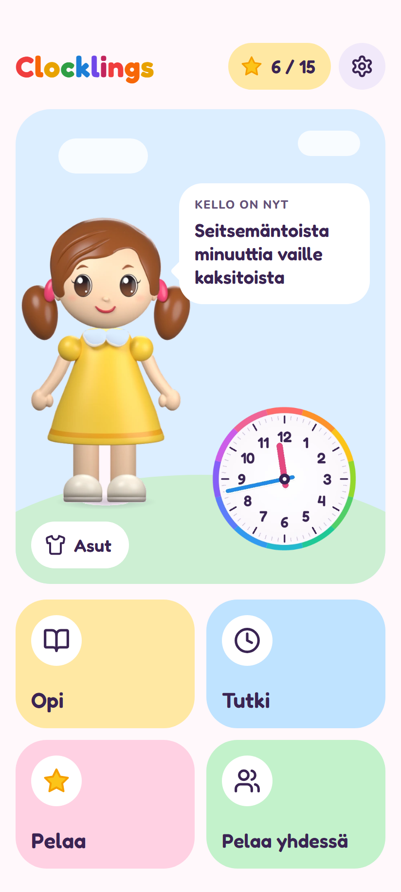

### 02 Learn list

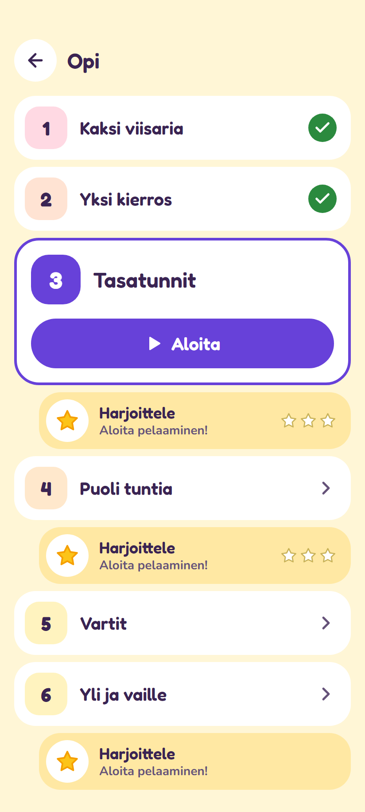

### 03 Lesson page

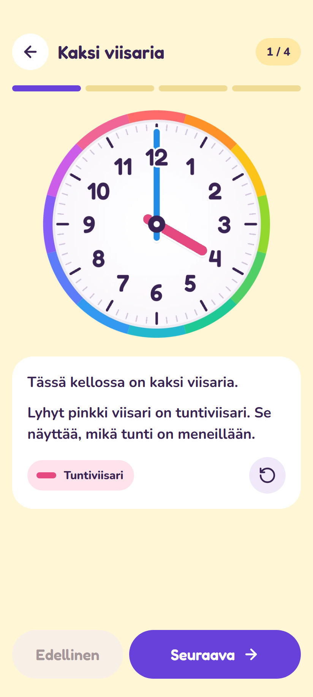

### 04 Game, read the clock

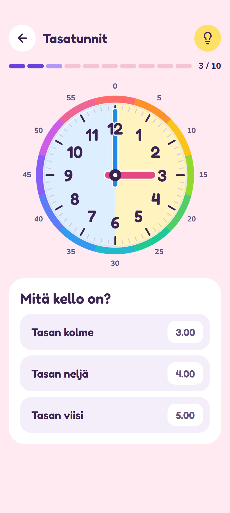

### 05 Game, hint after a wrong answer

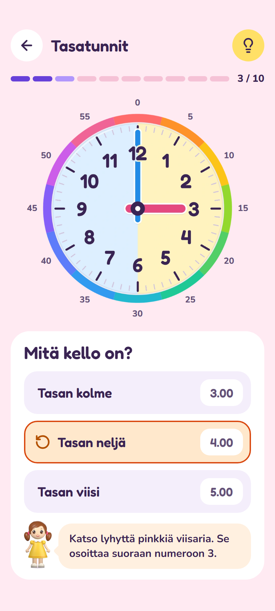

### 06 Result and reward

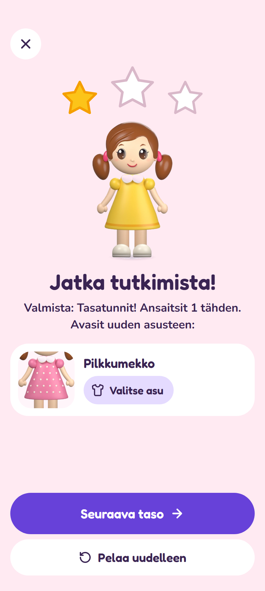

### 07 Explore

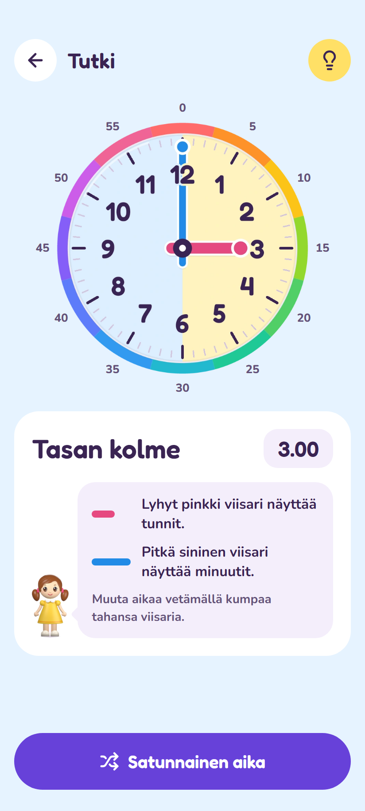

### 08 Wardrobe

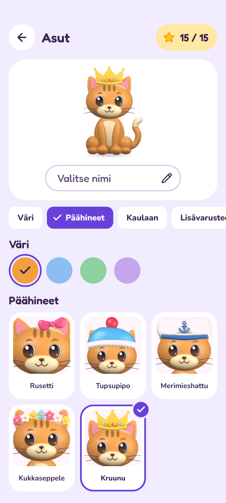

### 09 Settings

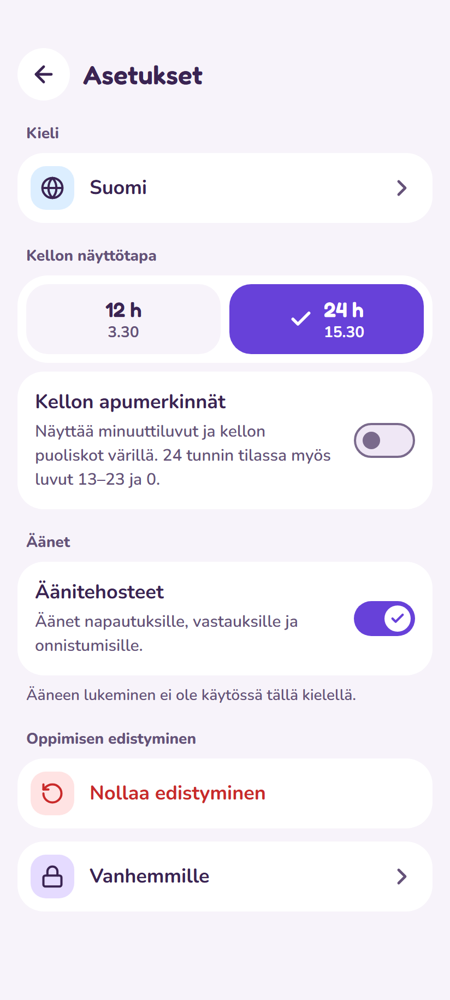

### 10 Game at 320 dp width

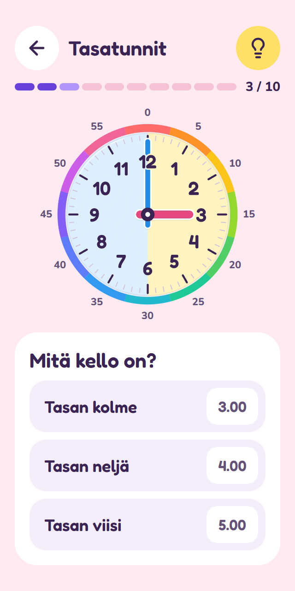

### 11 Style foundation

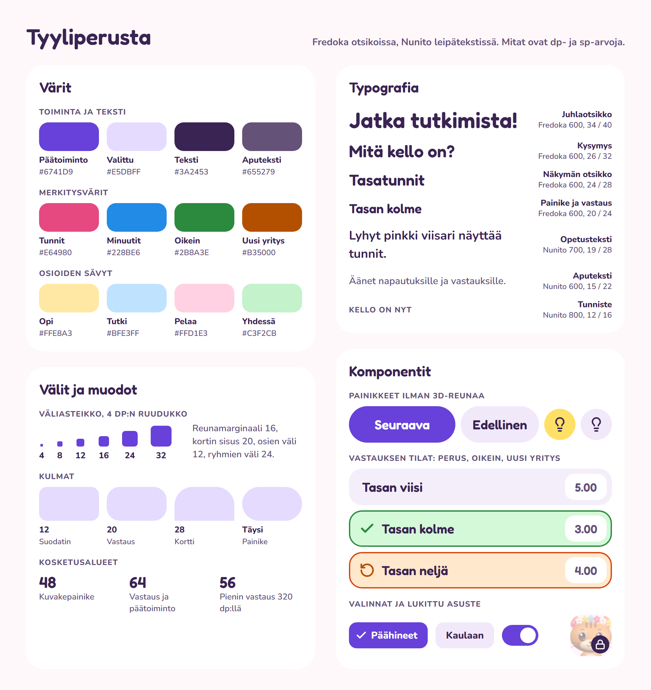

Screens without a mockup (Levels, Personalize, Together, Minute challenge, Parents, Language, Intro, Loading, dialogs) follow the same tokens and components. Section 7 specifies each of them in words.

## 3. Approved decisions

### 3.1 Approved by the owner on 14 November 2026

1. **Violet is the primary action colour.** `#6741D9` with white text. Pink `Hour` and blue `Minute` are used only where they mean the hour hand and the minute hand.
2. **The Learn list is a list of rows**, not a winding path. The same row component is used on the Levels screen.
3. **The Wardrobe has group chips** (colour and one chip per item slot) that jump to a group.
4. **On the Result screen "Back" is a close icon** in the top-start corner, and "Choose outfit" sits with the unlocked item instead of in the button cluster.
5. **The hanger icon on Home becomes a labelled button** that reads "Outfits" (`doll_title`).
6. The overall look in the mockups: flat pill buttons, flat section tints, opaque cards, start-aligned top bar titles, segmented progress, the spacing and type scale of section 5.

### 3.2 Earlier decisions this replaces

Update `docs/implementation/STATUS.md` when the work is done (section 10, WP13):

- The decision table row "Primary actions: Pink `ButtonKind.PRIMARY` remains the single app-wide primary action colour" becomes violet `Primary`.
- The native-feel plan's rule "depth is reserved for pressable controls" (ledges) is withdrawn. Pressable surfaces are now recognised by fill, shape and size.
- The native-feel plan's section 4.7 "Learn list and Levels as paths" is replaced by rows.

Everything else in the earlier plans stays: icon-only navigation where it exists today, edge to edge, haptics, navigation transitions, shared elements, reduced-motion handling, and the trimmed copy.

### 3.3 Consequence of decision 5 that needs no further approval

The hanger icon currently opens the Personalize screen (`Screen.Personalize`), the same destination as tapping the companion. A button labelled "Outfits" must open the outfits. The new button therefore navigates straight to `Screen.Wardrobe`. Tapping the companion stage still opens `Screen.Personalize`. Section 7.1 has the details. If the owner prefers the old destination, only the navigation target and the label change.

## 4. Scope and constraints

### 4.1 In scope

- Theme tokens: colours, shapes, dimensions, type sizes, the Material colour scheme, section backgrounds.
- Shared components listed in section 6.
- Layout and styling of every screen listed in section 7.
- Two new string resources in all seven languages (section 8).
- One new home destination that opens the Wardrobe (section 7.1).
- Updating tests, the Compose stability baseline and the status documents.

### 4.2 Out of scope

- The clock face (`ui/clock/`), its guides, numerals, hands and themes, including their current colour values when shared tokens change elsewhere.
- Blender characters and accessories: `art/blender/`, `tools/blender/`, their packaged images in `app/src/main/res/drawable-nodpi/`, and their rendering code (`ui/companion/Blender*`, `ui/doll/`, `CompanionView`, `CompanionRig`, `CompanionPose`, `ui/art/GroundShadow.kt`). Do not regenerate or edit models, atlases, materials, colours, accessory attachment points, layer ordering, animation, shadows or item crop definitions.
- Confetti, sounds, speech, haptics, navigation transitions.
- Domain, data, billing, access policy, lesson content, level rules.
- Dark theme, dynamic colour, new dependencies, Material 3 Expressive APIs.
- The "Hour hand" legend chip visible in mockup 03 and the "The time is now" eyebrow in mockup 01 (section 12).

### 4.3 Constraints carried over

- Run Gradle only from this repository, with `--no-daemon` for validation runs.
- Work on a `codex/` feature branch. No commit, push or pull request without a separate explicit request.
- Identifiers, file names and code comments in English. UI copy only in Android resources.
- Never hardcode a colour, size or text style in a screen. Every value comes from `SkColors`, `SkDimens`, `SkShapes` or `SkType`.
- No coloured stripe on the start edge of a card, row or panel. No middle dot, bullet or vertical bar as a separator in UI text.
- All sizes in this plan are **minimums**. Use `heightIn(min = …)` and `widthIn(…)`, never a fixed height on anything that contains text, so that 200 % font scale keeps working.
- Touch targets are at least 48 dp. Child-facing main actions and answers are at least 64 dp, or 56 dp in the compact cases named below.
- Keep the existing adaptive logic: `ScreenScaffold`, `ClockTaskScaffold`, `AdaptiveContent`, `ActionPair`, `adaptiveGridColumns`, `hasSideBySideRoom`, the compact task layout, `WordSafeText`, and the `SkDimens.GridBreakpoint` and `MAX_ROW_FONT_SCALE` switches. Restyle inside them. Do not replace them.
- Keep every existing `testTag`, content description, heading, state description, live region and role unless this plan says otherwise.
- Keep `rememberReduceMotion()` handling on every animation that is touched.
- The owner runs `lc` and `sc`. Do not run them and do not claim they passed.
- Character and accessory views may be positioned and uniformly scaled by their surrounding layout as specified in section 7, preserving aspect ratio and the existing thumbnail crops. New card shapes, clipping and selection decoration must not hide artwork or cut off existing idle, greeting or celebration motion. `ItemArtWindow` changes are limited to its surrounding UI frame and requested display size; `cropItem` and the rendering pipeline stay unchanged.

## 5. Design tokens

Apply these first (WP1). Delete a token only after a repository-wide search shows no remaining use.

### 5.1 Colours (`ui/theme/SkColors.kt`)

New tokens:

| Token | Value | Use |
| --- | --- | --- |
| `Primary` | `0xFF6741D9` | Filled primary buttons, selected chip and segment, selection borders, switch track, progress |
| `UiInkSoft` | `0xFF655279` | Supporting UI text and control accents; replaces UI uses of `InkSoft` outside the protected artwork and clock rendering |
| `OnPrimary` | `0xFFFFFFFF` | Text and icons on `Primary` (contrast 6.3 to 1) |
| `PrimaryContainer` | `0xFFE5DBFF` | "Choose outfit" button, parents row badge |
| `PrimarySoft` | `0xFFB197FC` | The current segment of a progress bar |
| `TonalFill` | `0xFFF1E9FA` | Tonal buttons and tonal icon buttons on white cards and on Home |
| `SurfaceContainer` | `0xFFF4EEFB` | Normal answer option, digital time pill, speech bubble |
| `LearnSurface` | `0xFFFFF6D6` | Flat page tint, Learn |
| `ExploreSurface` | `0xFFE6F3FF` | Flat page tint, Explore |
| `PlaySurface` | `0xFFFFEAF2` | Flat page tint, Play |
| `TogetherSurface` | `0xFFE7F8EA` | Flat page tint, Together |
| `CompanionSurface` | `0xFFF2ECFF` | Flat page tint, Personalize and Wardrobe |
| `LearnTrack` | `0xFFF0DB94` | Empty progress segments on `LearnSurface` |
| `PlayTrack` | `0xFFF5C2D6` | Empty progress segments on `PlaySurface` |
| `FieldOutline` | `0xFFD9C8EA` | Name field border |
| `OptCorrectFill` | `0xFFD3F9D8` | Correct answer fill |
| `OptWrongFill` | `0xFFFFE8CC` | Retry answer fill |
| `DangerContainer` | `0xFFFFE3E3` | Reset row badge, destructive dialog button |

Changed tokens:

| Token | Old | New | Reason |
| --- | --- | --- | --- |
| `HomeSky` | `0xFFE4F1FF` | `0xFFDCEEFF` | Flat stage sky |
| `HomeGround` | `0xFFD7F2DC` | `0xFFCDEFD3` | Stage hill |
| `SettingsBackground` | `0xFFF5F3F7` | `0xFFF7F3FA` | Flat page tint, Settings |
| `Bubble` | `0xFFF6F0FD` | `SurfaceContainer` | One tonal surface |
| `OptCorrectBorder` | `0xFF51CF66` | `Good` (`0xFF2B8A3E`) | 3 to 1 against the fill and the card |
| `OptWrongBorder` | `0xFFFFA94D` | `0xFFD9480F` | 3 to 1 against the fill and the card |
| `FlatSurface` | `Surface` at 72 % | `Surface` (opaque) | Opaque cards |
| `IconSurface` | `Surface` at 80 % | `Surface` (opaque) | Opaque icon buttons |

Tokens to delete once unused: `BtnFill`, `BtnShadow`, `BtnPrimaryFill`, `BtnPrimaryShadow`, `BtnGreenFill`, `BtnGreenShadow`, `KouluShadow`, `VapaaShadow`, `PelaaShadow`, `KysyShadow`, `OptCorrectShadow`, `OptWrongShadow`, `SegmentShadow`, `SegmentTrack`, `Trail`, `HomeBlush`, `DollStageTop`, `DollStageBottom`, `ItemOnBg`, `ItemOnBorder`, `DigitalBg`, `OptDigitalBg`, `SECTION_TINT`. Delete `ui/theme/LedgeColor.kt` and `LedgeColorTest.kt` with them.

Unchanged and still required: `Ink`, `InkSoft` (`0xFF76638C`), `Bg`, `Surface`, `Line`, `Hour`, `Minute`, `Gold`, `GoldDeep`, `HelpOnFill`, `Good`, `GoodBg`, `Try`, `TryBg`, `Danger`, `KouluFill`, `VapaaFill`, `PelaaFill`, `KysyFill`, `NukkeFill`, `LevelCards`, `ChallengeCard`, the rainbow lists, the logo colours, star and lock colours, `ItemWindow`, `ItemLockedBg`, every clock-face colour.

Keep `InkSoft` unchanged because `ClockFace.kt` uses it for minute labels and zone text. Use the new `UiInkSoft` for supporting UI styles in `Type.kt` and the UI controls specified below. Inspect remaining `InkSoft` consumers before migrating UI text; do not replace references in `ui/clock/` or protected artwork code, or change artwork colours indirectly through aliases.

`SkColors.Hour` as a generic accent: replace it with `Primary` in `Theme.kt` (colour scheme), `SettingsRows.kt` (switch), `NameField.kt` (cursor), `Type.kt` (`BigNumber`) and the progress component. Keep `Hour` in `ui/clock/`, in the icons that draw a clock or a book, and in the hand legend of `FreeClockScreen.kt`.

### 5.2 Theme (`ui/theme/Theme.kt`)

- Colour scheme: `primary = Primary`, `onPrimary = OnPrimary`, `primaryContainer = PrimaryContainer`, `onPrimaryContainer = Ink`, `secondary = Minute`, `background = Bg`, `onBackground = Ink`, `surface = Surface`, `onSurface = Ink`, `surfaceVariant = SurfaceContainer`, `onSurfaceVariant = UiInkSoft`, `surfaceContainerHigh = Surface` (dialog container), `outline = Line`, `error = Danger`.
- `Section` keeps its seven entries. Each gets one flat colour: `HOME = Bg`, `LEARN = LearnSurface`, `EXPLORE = ExploreSurface`, `PLAY = PlaySurface`, `TOGETHER = TogetherSurface`, `COMPANION = CompanionSurface`, `SETTINGS = SettingsBackground`. Remove the second constructor parameter. `bottomColor` returns `color` (or remove it and replace its uses with `color`).
- Add `val track: Color` to `Section`: `LEARN = LearnTrack`, `PLAY = PlayTrack`, every other entry `Line`.
- `Modifier.sectionBackground(section)` draws `drawRect(section.color)`. No gradient.
- The fades in `Layout.kt` (`ScaffoldTopFade`, `ScaffoldBottomFade`) keep working because they already fade from the section colour to transparent.

### 5.3 Shapes (`ui/theme/SkShapes.kt`)

| Token | Old | New |
| --- | --- | --- |
| `Card` | 24 | 28 |
| `Button` | 18 | `CircleShape` |
| `Option` | 20 | 20 |
| `Feedback` | 18 | 20 |
| `Caption` | 16 | 16 |
| `Digital` | 14 | 16 |
| `OptDigital` | 10 | 14 |
| `Item` | 20 | 24 |
| `Field` | 16 | 16 (parents code field), see `NameField` in 6.9 |
| `Timer` | 8 | 8 |
| `Bubble` | 20 | 20 |
| `Node` | circle | delete with `PathNode` |

New: `Tile = RoundedCornerShape(32.dp)` (home tiles, wardrobe stage), `Stage = RoundedCornerShape(36.dp)` (home stage), `Row = RoundedCornerShape(24.dp)` (list rows, settings rows), `Badge = RoundedCornerShape(16.dp)`, `BadgeLarge = RoundedCornerShape(20.dp)`, `IconBadge = RoundedCornerShape(14.dp)`, `Chip = RoundedCornerShape(12.dp)`, `ArtWindow = RoundedCornerShape(16.dp)`, `ProgressSegment = RoundedCornerShape(4.dp)`.

### 5.4 Type (`ui/theme/Type.kt`)

Fonts and weights do not change (Fredoka for display, Nunito for body, the six bundled TTF files). Token names stay. Line heights stay in `em` with the existing trim.

| Token | Old size | New size | New line height (em) | Notes |
| --- | --- | --- | --- | --- |
| `HomeLogo` | 28 Bold | 30 Bold | 1.2 | Auto-size logic stays |
| `Body` / `BodySoft` | 17 | 18 | 1.45 | Settings row titles, bubble text |
| `Small` / `SmallSoft` | 15 | 15 | 1.45 | Supporting text |
| `Eyebrow` | 13 | 12 ExtraBold | 1.33 | Letter spacing 0.06 em |
| `Title` | 22 | 24 | 1.17 | Top bar |
| `Words` | 28 | 30 | 1.2 | Time in words |
| `Question` | 26 | 26 | 1.23 | |
| `Digital` | 26 | 24 | 1.2 | |
| `OptWords` | 19 | 20 | 1.2 | |
| `OptDigital` | 18 | 18 | 1.2 | |
| `Button` | 21 | 20 | 1.2 | |
| `ButtonSmall` | 18 | 19 | 1.2 | Secondary 56 dp buttons, pill buttons |
| `Chip` | 15 Bold | 15 ExtraBold | 1.2 | Wardrobe chips |
| `Segment` | 15 ExtraBold | 15 ExtraBold | 1.2 | |
| `Pill` | 13 ExtraBold | 13 ExtraBold | 1.2 | |
| `PillLarge` | 19 | 19 | 1.1 | |
| `NowWords` | 20 | 19 | 1.26 | Home bubble |
| `BigButton` | 22 | 22 | 1.18 | Home tile label |
| `LessonTitle` | 22 | 20 | 1.2 | List row title |
| `LessonNumber` | 22 Bold | 22 Bold | 1.0 | Row badge number |
| `LessonText` | 19 | 19 | 1.47 | |
| `ResultTitle` | 34 | 34 | 1.18 | |
| `ResultText` | 19 | 18 | 1.45 | |
| `SectionTitle` | 20 | 20 | 1.2 | |
| `SettingsHeading` | 15 ExtraBold | 14 ExtraBold | 1.43 | |
| `BigNumber` | 64 Bold, `Hour` | 64 Bold, `Primary` | 1.0 | |

Unchanged: `Logo`, `Tagline`, `FeedbackOk`, `FeedbackHint`, `ItemName` and its minimum and step, `NameField`, `NameFieldPlaceholder`.

New: `LessonTitleCurrent = display(24, lineHeight = 1.17f)`, `LessonNumberCurrent = display(26, FontWeight.Bold, 1f)`, `PracticeTitle = display(18, lineHeight = 1.22f)`, `Counter = body(15, FontWeight.ExtraBold, 1.33f)`.

`SkTypography` in `Theme.kt` keeps mapping `bodyLarge`, `bodyMedium`, `titleLarge` and `labelLarge` to the same tokens.

### 5.5 Dimensions (`ui/theme/SkDimens.kt`)

Changed:

| Token | Old | New |
| --- | --- | --- |
| `PanelPadding` | 16 | 20 (the narrow game panel explicitly uses `Gutter`, 16; section 7.5) |
| `GapScreen` | 10 | 12 |
| `MenuTileHeight` | 92 | 132 |
| `MenuIcon` | 44 | 28 |
| `DollResult` | 110 | 128 |
| `MiniClockLevel` | 76 | 56 |

New:

| Token | Value | Use |
| --- | --- | --- |
| `ButtonHeight` | 64 | Primary buttons and every button in a bottom bar |
| `ButtonHeightSmall` | 56 | `small = true` buttons |
| `ButtonPadX` | 24 | Horizontal padding inside buttons |
| `OptionMinHeight` | 64 | Answer option |
| `OptionMinHeightCompact` | 56 | Answer option when the option is narrower than 300 dp or the task layout is compact |
| `OptionTimeMinHeight` | 40 | Time pill inside an option |
| `OptionTimeMinWidth` | 64 | Time pill inside an option |
| `RowMinHeight` | 72 | List row |
| `PracticeRowMinHeight` | 64 | Practice row |
| `PracticeIndent` | 28 | Start indent of a practice row |
| `RowBadge` | 48 | Minimum leading badge size; a level clock and its padding expand it to 64 |
| `RowBadgeCurrent` | 56 | Minimum current-row badge size; a level clock and its padding expand it to 64 |
| `RowStateIcon` | 32 | Completed check badge |
| `IconBadge` | 40 | Leading badge of a settings row |
| `TileIconBadge` | 52 | White circle behind a home tile icon |
| `ProgressSegmentHeight` | 8 | |
| `ProgressSegmentGap` | 4 | 6 when there are five segments or fewer |
| `ChipHeight` | 40 | Visual height; the touch target is 48 |
| `WardrobeButtonHeight` | 48 | "Outfits" pill on Home |
| `StageInset` | 16 | Inset of content from the home stage edge |
| `SelectionBorder` | 3 | Selected tile, current row |
| `StarResultSide` | 64 | Outer result stars |
| `StarResultMiddle` | 80 | Middle result star, raised 8 dp |

Delete once unused: `ButtonDepth`, `ButtonDepthPressed`, `BigButtonDepth`, `OptionDepth`, `PathNode`, `PathLead`, `PathGap`, `PathStroke`, `PathDash`, `PathDashGap`, `SegmentLift`, `SegmentInset`, `ProgressDot`, `ProgressDotIcon`, `StarResult`, `OptionTimePadY`.

Spacing rule for new layout code: use the 4 dp grid through the existing tokens `GapS` (8), `GapM` (12), `Gap` (16) and `Gutter` (16), plus `PanelPadding` (20). Page gutter 16, card padding 20, gap between parts of a card 12, gap between cards on a page 12, gap between groups 24.

## 6. Shared components

### 6.1 `PressSurface` (replaces `DepthSurface`, `ui/components/Buttons.kt`)

```kotlin
@Composable
fun PressSurface(
    onClick: () -> Unit,
    fill: Color,
    shape: Shape,
    modifier: Modifier = Modifier,
    border: BorderStroke? = null,
    enabled: Boolean = true,
    dimWhenDisabled: Boolean = true,
    role: Role = Role.Button,
    pressScale: Float = SkMotion.PRESS_SCALE,
    decorativeContent: Boolean = false,
    content: @Composable () -> Unit,
)
```

- Removed parameters: `shadow`, `depth`, `pressedDepth`. Remove the `offset` and the `drawBehind` that drew the ledge.
- Modifier order: `graphicsLayer` scale, disabled alpha, `clip(shape)`, `background(fill)`, optional border, `clickable`, optional `clearAndSetSemantics`.
- Press feedback: keep the spring scale to `pressScale` (skipped under reduced motion). Add `indication = ripple(color = SkColors.Ink)` from `androidx.compose.material3`. The clip keeps the ripple inside the shape.
- Focus: keep the 3 dp `Ink` border while focused and enabled.
- Disabled: alpha `SkColors.DISABLED_CONTROL_ALPHA` (0.45). Delete the private `DISABLED_ALPHA`.
- Keep `propagateMinConstraints = true`.
- Migrate the existing call sites in `AppearanceScreen.kt` (twice), `WardrobeScreen.kt`, `Buttons.kt` (twice), `IconButtons.kt`, `OptionButton.kt`, `PathNode.kt` until it is deleted, and `SwatchTile.kt`. `HomeStage.kt` uses the stage-specific treatment in section 7.1 so the character is not inside a newly clipped pressable surface.
- `PressSurface` clips ordinary control content to its shape. Selection badges stay inside the tile (section 6.8), without covering the accessory. Preserve existing artwork crops in thumbnails and keep animated full-character views outside newly clipped control layers.

### 6.2 `SkButton`

```kotlin
enum class ButtonKind { PRIMARY, SECONDARY, TONAL, CONTAINER, DANGER }

@Composable
fun SkButton(
    text: String,
    onClick: () -> Unit,
    modifier: Modifier = Modifier,
    kind: ButtonKind = ButtonKind.SECONDARY,
    small: Boolean = false,
    enabled: Boolean = true,
    icon: SvgIcon? = null,
    trailingIcon: SvgIcon? = null,
)
```

| Kind | Fill | Content | Where |
| --- | --- | --- | --- |
| `PRIMARY` | `Primary` | `OnPrimary` | The one main action of a screen or panel |
| `SECONDARY` | `Surface` | `Ink` | Other actions placed directly on a section tint |
| `TONAL` | `TonalFill` | `Ink` | Other actions inside a white card or a dialog |
| `CONTAINER` | `PrimaryContainer` | `Ink` | "Choose outfit" on the Result screen |
| `DANGER` | `DangerContainer` | `Danger` | Destructive confirmation in the reset dialog |

- Shape `SkShapes.Button` (pill). Min height `ButtonHeight`, or `ButtonHeightSmall` when `small`. Padding `ButtonPadX` horizontal, 12 vertical.
- Label `SkType.Button` (or `ButtonSmall`), colour from the table, through `WordSafeText` as today. Icon 22 dp, gap 10 dp, tinted with the content colour (section 6.11).
- Migration of the existing kinds: `PRIMARY` stays `PRIMARY`. `GREEN` becomes `CONTAINER`. `NORMAL` becomes `SECONDARY` when the button sits on a section tint and `TONAL` when it sits inside a white card or an `AlertDialog`. Each screen in section 7 names the kind where it matters.
- Exactly one `PRIMARY` button may be visible in a bottom bar or panel at a time.

### 6.3 `RoundIconButton` (`ui/components/IconButtons.kt`)

- Add `tonal: Boolean = false`.
- Fill: `HelpOnFill` when `selected == true`; else `TonalFill` when `tonal` or `large`; else `Surface`.
- Size 48 dp, or 64 dp when `large`. Shape pill. No ledge. Icon 24 dp, or 32 dp when `large`.
- Pass `tonal = true` wherever the button sits on a white card or on Home: the Home settings button, the lesson playback buttons, the lesson shortcut on a Levels row, the listen button in `TimeReadout`.

### 6.4 `TopBar` (`ui/components/Layout.kt`)

- Wide form: `Row` with the back button, then the title with `Modifier.weight(1f)` and `textAlign = TextAlign.Start`, then the optional trailing content. Gap `GapM`. Min height 56 dp. Remove the empty 48 dp placeholder that centred the title.
- Narrow form (below `GridBreakpoint` after font scale): unchanged structure, title start-aligned.
- Title style `SkType.Title`. Heading semantics unchanged.
- `ScreenScaffold` keeps drawing `section.color` behind the top bar.

### 6.5 `FlatPanel`, pills and bubbles

- `FlatPanel`: colour `SkColors.Surface` (opaque through the changed `FlatSurface`), shape `Card` (28), padding `PanelPadding` (20). Callers that pass `GapS` padding for compact layouts keep doing so.
- `Pill`, kind `GOLD`: background `KouluFill` instead of `Pressed`. Large form unchanged in size (min height 48).
- `DigitalPill`: background `SurfaceContainer`, shape `Digital` (16), padding 16 horizontal and 6 vertical, style `SkType.Digital`.
- `SpeechBubbleBox` and `SpeechBubble`: default colour `SkColors.Bubble` (now `SurfaceContainer`). Tail drawing unchanged.
- `CompanionTip(text, …)`: add `color: Color = SkColors.Bubble` and pass it to the bubble. Only two callers override it with `SkColors.TryBg`: the hint branch of `GameFeedbackMessage` in `GameScreen.kt` and the `state.showHint` branch of `LessonQuiz`. Lesson captions and praise keep the default.
- `FeedbackBox`: shape `Feedback` (20). Colours unchanged.

### 6.6 `OptionButton` (`ui/components/OptionButton.kt`)

- Container: `PressSurface`, shape `Option` (20), `fillMaxWidth`, min height `OptionMinHeight`, or `OptionMinHeightCompact` when the label area is narrower than 300 dp.
- States:

| State | Fill | Border | Leading icon |
| --- | --- | --- | --- |
| `NORMAL` | `SurfaceContainer` | none | none |
| `CORRECT` | `OptCorrectFill` | 2 dp `OptCorrectBorder` | `SkIcons.Check`, 24 dp, tint `Good` |
| `WRONG` | `OptWrongFill` | 2 dp `OptWrongBorder` | `SkIcons.Replay`, 24 dp, tint `Try` |

- Padding: start 20 (14 when a leading icon is shown), end 12, vertical 8. Gap between icon and words 10, between words and time `GapM`.
- Words: `SkType.OptWords`, start-aligned, `weight(1f)`.
- Time pill: background `Surface`, shape `OptDigital` (14), min size `OptionTimeMinWidth` by `OptionTimeMinHeight`, horizontal padding `OptionTimePadX` (12, was 10), text `SkType.OptDigital` centred.
- Keep the shake animation for `WRONG`. Remove `WRONG_ALPHA`: the retry state is no longer dimmed.
- Keep the stacked layout chosen by `optionTimeBelow` and keep all semantics (`stateDescription`, polite live region, `dimWhenDisabled = false`).
- Update `TextMeasurer.optionWordsHeight` so that it uses the new paddings, the new time pill width and the icon width for non-normal states. `ui/challenge/AnswerRoom.kt` ranks answers with it; `AnswerRoomCostTest` and `RunOptionReservationTest` must pass with updated expectations where heights changed.

### 6.7 `ProgressSegments` (replaces `ProgressDots`, `ui/components/Display.kt`)

```kotlin
@Composable
fun ProgressSegments(
    count: Int,
    current: Int,
    track: Color,
    modifier: Modifier = Modifier,
    currentDone: Boolean = false,
    fillDelayMs: Long = 0L,
    onSegmentCenter: ((Int, Offset) -> Unit)? = null,
    outcomes: List<DotOutcome>? = null,
)
```

- Layout: a `Row`, vertically centred, gap `GapM`. First child: a row of `count` boxes with `weight(1f)` each, height `ProgressSegmentHeight`, shape `ProgressSegment`, gap `ProgressSegmentGap` (6 dp when `count <= 5`). Second child: `Text` with `stringResource(R.string.task_position, current + 1, count)` in `SkType.Counter`.
- Segment colours: finished without outcome data `Primary`; finished with outcome `FIRST_TRY` `Good`, `WITH_HINT` `GoldDeep`, `SHOWN` `UiInkSoft`; current `PrimarySoft`; not reached `track`.
- `currentDone`: after `fillDelayMs` the current segment fills from its start edge with its finished colour (150 ms, snap under reduced motion). This replaces `PoppingDot`.
- `onSegmentCenter` reports each segment centre through `confettiAnchor`, exactly as `onDotCenter` did, so the flying star in `GameScreen` still lands on the current segment.
- Semantics: the segment row stays cleared. The counter text is read by TalkBack as plain text.
- Callers: `LessonScreen` passes `Section.LEARN.track`; `GameScreen` passes `Section.PLAY.track` and its existing `outcomes`, `currentDone` and `fillDelayMs`.
- Delete `ProgressDots`, `OutcomeDot`, `PoppingDot` and their constants. Keep `DotOutcome` and `dotOutcomes`.

### 6.8 `SelectionBadge`

- Add `color: Color = SkColors.Primary`. The check is drawn in `OnPrimary` (section 6.11).
- Size 24 dp, pop animation unchanged.
- Place it inside its tile at the art window's top-end corner, keeping the visible accessory unobstructed. If necessary, reserve space in the surrounding frame without changing the artwork crop (section 12).

### 6.9 `NameField` (`ui/companion/NameField.kt`)

- Shape pill (`CircleShape`), border 2 dp `FieldOutline`, fill `Surface`, min height 48 dp, horizontal padding 20 start and 14 end, max width `NameFieldMaxWidth`.
- Cursor colour `Primary`.
- Text styles, pencil icon, error semantics, `keepEditorVisible` and `boundedName` unchanged.

### 6.10 `PathRow` (new file `ui/components/PathRow.kt`, replaces `PathNode.kt`)

One component draws every row of the Learn list and the Levels screen.

```kotlin
enum class PathRowStyle { STEP, CURRENT, PRACTICE }

@Composable
fun PathRow(
    title: String,
    description: String,
    onClick: () -> Unit,
    modifier: Modifier = Modifier,
    style: PathRowStyle = PathRowStyle.STEP,
    badgeColor: Color = if (style == PathRowStyle.CURRENT) SkColors.Primary else SkColors.KouluFill,
    completed: Boolean = false,
    locked: Boolean = false,
    isHeading: Boolean = false,
    enabled: Boolean = true,
    startLabel: String? = null,
    supporting: (@Composable ColumnScope.() -> Unit)? = null,
    trailing: (@Composable () -> Unit)? = null,
    leading: @Composable () -> Unit,
)
```

Structure, the same for all styles: an outer container that draws the row background and shape, holding a `Row` of two parts. Part one is a `PressSurface` with a transparent fill and `weight(1f)` that contains the leading badge, the title and the supporting slot and carries the click, the description and the states. Part two is the trailing slot, outside the clickable, so that an interactive trailing control (the lesson shortcut on Levels) stays a separate focusable node. When `trailing` is null the default state icon is drawn inside part one.

| Property | `STEP` | `CURRENT` | `PRACTICE` |
| --- | --- | --- | --- |
| Background | `Surface` | `Surface` | `KouluFill` |
| Shape | `Row` (24) | `Card` (28) | `Row` (24) |
| Border | none | `SelectionBorder` `Primary` | none |
| Min height | `RowMinHeight` | content | `PracticeRowMinHeight` |
| Padding | 12, end 16 | 16 | 8, end 16 |
| Start indent | 0 | 0 | `PracticeIndent` |
| Leading box | Minimum `RowBadge`, shape `Badge`, fill `badgeColor` | Minimum `RowBadgeCurrent`, shape `BadgeLarge`, fill `badgeColor`, number colour `OnPrimary` | Minimum `RowBadge`, circle, fill `Surface` |
| Title style | `LessonTitle` | `LessonTitleCurrent` | `PracticeTitle` |
| Gap badge to text | 14 | 14 | 12 |
| Default trailing | completed: 32 dp `Good` circle with a white check; locked: `SkIcons.Lock` 24 dp; else `SkIcons.Chevron` 24 dp tinted `UiInkSoft` | none | none |
| Extra | | Below the header, 16 dp gap: a full-width pill, min height 56, fill `Primary`, label `startLabel` in `SkType.Button` `OnPrimary` with a leading `SkIcons.Play` | |

- Measure the leading slot at its natural size with the table's minimum badge size, rather than constraining it to 48 or 56 dp. A 56 dp level clock with 4 dp padding on each edge requires a 64 dp badge in both `STEP` and `CURRENT` rows. The row grows with that content; do not shrink or crop the clock to fit the numbered-lesson badge.
- Semantics on the clickable part, identical to `PathNode`: `contentDescription = description`, `heading()` when `isHeading`, `stateDescription = stringResource(R.string.path_current)` for `CURRENT`, `decorativeContent = true`. The start pill inside a `CURRENT` row is decoration of the same click target, not a second button.
- `enabled = false` dims the row through `PressSurface`, as `PathNode` did.
- No pulse animation and no trail. Delete `nodePulse`, `pathTrail`, `PathNodeLabel`, `AHEAD_FADE`. Delete `SkMotion.PULSE_DURATION` and `PULSE_SCALE` if nothing else uses them.
- Rows are separated by `GapS` (8 dp). The caller wraps consecutive rows in a `Column(verticalArrangement = Arrangement.spacedBy(SkDimens.GapS))`.

### 6.11 Icons (`ui/components/Icons.kt`)

- `SkIcon` gets `tint: Color? = null`. When set, every layer's fill and stroke is drawn in that colour. Use it only for the single-colour `inkIcon` icons.
- New ink icons, 24-unit view box, stroke style matching the existing ones: `Close` (`M6 6l12 12M18 6L6 18`), `Play` (a filled triangle `M8 5l11 7-11 7z`), `Globe` (a circle with one meridian and the equator).
- No emoji and no icon font.

### 6.12 `SectionChips` (new, `ui/components/SectionChips.kt`)

```kotlin
@Composable
fun SectionChips(
    labels: List<String>,
    selectedIndex: Int,
    onSelect: (Int) -> Unit,
    modifier: Modifier = Modifier,
)
```

- A horizontally scrollable `Row` (`horizontalScroll`), gap `GapS`, content padding equal to the page gutter so the first chip aligns with the page content and the last chip can scroll fully into view.
- Chip: visual height `ChipHeight`, touch target 48 dp (`minimumInteractiveComponentSize`), shape `Chip`, horizontal padding 16. Unselected: fill `Surface`, text `SkType.Chip` in `Ink`. Selected: fill `Primary`, text in `OnPrimary`, a leading 18 dp check tinted `OnPrimary`, start padding 10.
- Semantics: the row is a `selectableGroup`; each chip is `selectable` with `Role.Tab`.
- When the selected chip changes, scroll it into view.

### 6.13 `SegmentedControl` and `ChoiceSegments`

- `SegmentedControl` (used by the Personalize tabs): track `Surface`, shape pill, inset 4 dp. Selected segment: fill `Primary`, text `SkType.Segment` in `OnPrimary`. Unselected: no fill, text in `Ink`. Min height 48 dp. Remove `cardLift`. Semantics unchanged.
- New `ChoiceSegments` in `ui/settings/SettingsRows.kt` for the clock display setting (section 7.9).

### 6.14 `SwatchTile`

- `PressSurface` with the swatch colour, shape pill, size `ChildTarget` (64 dp).
- Selected: a 3 dp `Primary` ring separated from the swatch by a 3 dp ring in the page colour, and a centred `SkIcons.Check` (24 dp, tint `Ink`). No white inner ring and no corner badge.
- Keep the thin `SwatchOutline` for pale swatches (`swatchNeedsOutline`), the label, `Role.RadioButton` and the selected semantics.

## 7. Screens

Every screen uses `ScreenScaffold` or `ClockTaskScaffold` as today. Unless a subsection says otherwise, a screen changes only through the tokens and components above.

### 7.1 Home (mockup 01)

Files: `ui/home/HomeScreen.kt`, `ui/home/HomeStage.kt`, `ui/home/HomeStageMath.kt`, `ui/home/HomeDestination.kt`, `ClocklingsApp.kt`.

Header (`HomeHeader`): logo in `SkType.HomeLogo`; star pill large with `KouluFill`; settings `RoundIconButton` with `tonal = true`. Gap `GapS`. Min height 56 dp.

Stage:

- The stage box keeps `testTag("home_stage")`. Clip only its scenery layer to `SkShapes.Stage`, with `HomeSky` behind the clouds and hill. The ground no longer continues behind the menu. Keep the character, accessories and existing ground shadow outside this clipped subtree, with room for their current animation bounds.
- Hill: keep `drawSkyAndGround`, colour `HomeGround`. Its top stays roughly 110 dp above the stage bottom at 412 dp width. Clouds keep `Cloud`.
- Companion: bottom-start, as today, with its ground shadow.
- Bubble and clock column: top-end and bottom-end, as today. Bubble fill `Surface`, text `SkType.NowWords`. Clock unchanged (`mini = true`, shared element key `"clock"`).
- **Wardrobe button** replaces `HangerButton`: a pill `PressSurface`, fill `Surface`, min height `WardrobeButtonHeight`, padding 14 start and 18 end, `SkIcons.Dress` 22 dp plus `stringResource(R.string.doll_title)` in `SkType.ButtonSmall`. It sits at the bottom-start of the stage, inset `StageInset` from both edges, drawn above the hill.
- The companion must not overlap the wardrobe button. In `companionStageLayout` reserve the button's measured height plus `GapM` above the stage bottom inset (`WardrobeButtonHeight` is only its minimum), and reduce the space available to the companion accordingly. Keep its aspect ratio and room for the existing motion. Remove the `hanger` position from `CompanionStageLayout`. Update `HomeStageMathTest` with the new expected values and keep its existing invariants (companion inside the stage, no overlap with the bubble column, clock not smaller than before at 360 dp width). Resolve any overlap in the surrounding layout without changing the rig, accessories or animation.
- Compact stage (`CompactCompanionStage`): the row holds the companion and the clock only. The wardrobe button moves to its own row below, start-aligned.
- Clock-only stage (no companion): unchanged content, no wardrobe button, same clipped scenery layer.
- Tapping the stage still calls `onOpen(HomeDestination.NUKKE)` through `StageSurface`. Use a stage-local clickable container with the existing semantics, focus indication and no press scale; clip its ripple/background layer only. The character remains outside that clipped layer, and the separate wardrobe button keeps its own click target. Do not wrap the animated character in the clipped `PressSurface`.

Navigation: add `HomeDestination.ASUT`. In `ClocklingsApp.kt` map it to `Screen.Wardrobe` in the same `go(Screen.Home, …)` call as the other destinations. Back from the Wardrobe returns to Home through the existing `back(Screen.Wardrobe)`.

Menu (`Menu`, `BigMenuButton`): rename the composable to `MenuTile`.

- `PressSurface`, fill from the existing list (`KouluFill`, `VapaaFill`, `PelaaFill`, `KysyFill`), shape `Tile`, min height `MenuTileHeight`, padding 16.
- Content: a `Column` with `Arrangement.SpaceBetween` and start alignment. Top: a `TileIconBadge` white circle with the icon at `MenuIcon`. Bottom: the title in `SkType.BigButton`, start-aligned, through `WordSafeText`.
- Semantics unchanged (`contentDescription = "$title. $subtitle"`).
- Grid: unchanged (`adaptiveGridColumns`, gap `GapM`, `IntrinsicSize.Max` rows).
- Remove the `shadows` list. In `FillHeightLayout` remove the `BigButtonDepth` reservation from `footerHeight`.

### 7.2 Learn list (mockup 02)

File: `LessonListScreen` and `LessonPracticeNode` in `ui/lesson/LessonScreens.kt`.

- Top bar: `TopBar(koulu_title)`.
- Body: one `Column` spaced by `GapS` with a `PathRow` per lesson and one per practice entry, in the existing order from `Lessons.levelLessons` (plus the 24-hour lesson when `h24`).
- Lesson row: `style = CURRENT` when `id == current`, else `STEP`. `leading` is the lesson number (`ids.indexOf(id) + 1`) in `LessonNumber` (or `LessonNumberCurrent`). `badgeColor` is `Primary` for the current lesson; otherwise `LevelCards[level]`, or `ChallengeCard` for the 24-hour lesson. `completed`, `isHeading`, `enabled` and `description` exactly as passed to `PathNode` today. `locked = !access.lesson(id)`; a locked row shows `full_version_label` in `SkType.Small` in the supporting slot. `startLabel = stringResource(R.string.lesson_start)` for the current row.
- Practice row (`LessonPracticeNode`): `style = PRACTICE`, `leading` is `SkIcons.Star` at 28 dp, title `lesson_practise`, supporting is the existing action text in `SkType.SmallSoft`, trailing is the existing `StarRow` at `StarSmall`. Description, enabled state and click unchanged.
- The "For parents" button at the end (free version only): `SkButton`, `SECONDARY`, full width.

### 7.3 Levels (no mockup)

File: `ui/levels/LevelsScreen.kt`.

- Same `Column` of `PathRow`s on `Section.PLAY`.
- Level row: `style = CURRENT` when `i == current && access.level(i)` with `startLabel = stringResource(R.string.lesson_start)`, else `STEP`. `leading` is the existing mini `ClockFace` at `MiniClockLevel` (56 dp), with its shared element key `"level-clock-$i"`, padded on every edge by `GapS / 2` (4 dp). The content therefore measures 64 x 64 dp and expands the badge to that size in both styles. Pass `badgeColor = LevelCards[i]` for both styles; the current lesson's violet number-badge rule does not override a level clock's background.
- Supporting slot: the existing `StarRow` at `StarSmall`, and the locked label when locked.
- Trailing slot: the existing lesson shortcut `RoundIconButton(SkIcons.Book, …)` with `tonal = true`, enabled as today.
- Challenge row: `STEP`, `badgeColor = ChallengeCard`, `leading` is `SkIcons.Star` at 32 dp, supporting shows the record and the locked label as today.
- Descriptions, click handlers and the parents button unchanged.

### 7.4 Lesson page (mockup 03)

File: `LessonScreen` and helpers in `ui/lesson/LessonScreens.kt`.

- Top bar: unchanged content (the back label switches to `lesson_skip` when `skipToGame`).
- Status: `ProgressSegments(state.pageCount, state.page, track = Section.LEARN.track)`.
- Clock: unchanged.
- Text panel: `FlatPanel` (opaque, padding 20, or `GapS` when compact). Paragraphs in `SkType.LessonText`, gap 12. Caption through `CompanionTip` as today.
- Playback row (`LessonPlayback`): the listen and replay buttons are `RoundIconButton(…, tonal = true)`, aligned to the end of the panel in the normal layout.
- Quiz (`LessonQuiz`): `Eyebrow`, question in `SkType.Question`, `OptionButton`s, tips as today. The hint tip passes `color = SkColors.TryBg`.
- Bottom actions (`LessonActions`, `LessonNavigation`): keep `ActionPair`. "Previous" is `SECONDARY`, the next action is `PRIMARY` with `trailingIcon = SkIcons.Chevron` for `NEXT_PAGE` and `NEXT_LESSON` only. Both buttons use `ButtonHeight`.

### 7.5 Game (mockups 04, 05, 10)

File: `ui/game/GameScreen.kt`.

- Top bar: level name plus `HelpToggle` (selected fill `HelpOnFill`).
- Progress: `ProgressSegments` with `Section.PLAY.track`, `outcomes`, `currentDone`, `fillDelayMs` and `onSegmentCenter` wired exactly as the dots were.
- Clock: unchanged, including `GAME_CLOCK_HEIGHT_SHARE`.
- Answer panel (`GameAnswerPanel`): `FlatPanel`. Question in `SkType.Question`. Options spaced by `GapOptions` (10). For set-the-time tasks: target words and `DigitalPill`, then the "Done" button as `PRIMARY`, full width. The "Next" button after a shown answer is `PRIMARY`.
- Feedback (`GameFeedbackMessage`): `CompanionTip` as today; the hint case passes `color = SkColors.TryBg`.
- At 320 dp width the options use `OptionMinHeightCompact` and the panel padding is 16 (mockup 10). This requires an explicit change in `GameAnswerPanel`: measure its incoming width before internal padding and pass `SkDimens.Gutter` (16) to `FlatPanel` when that width is below the existing `SkDimens.GridBreakpoint` (320); otherwise pass `SkDimens.PanelPadding` (20). At a 320 dp window with the normal page gutters the panel receives 288 dp. The current unconditional `FlatPanel` call does not apply this rule automatically. Keep the existing scaffold and option-layout rules; do not add a breakpoint. Test 320 dp and a wider phone at 100 % and 200 % font scale.

### 7.6 Result (mockup 06)

File: `ui/game/ResultScreen.kt`. The outer `FlatPanel` is removed; content sits on the section tint.

- Top bar: a `Row` with one `RoundIconButton(SkIcons.Close, stringResource(R.string.back_description), onLevels)`, start-aligned, min height 56 dp. Pass it as `ScreenScaffold(topBar = …)`.
- Body, centred horizontally, in this order:
  1. `ResultStars`: outer stars `StarResultSide`, middle star `StarResultMiddle` raised by 8 dp, gap 10. Pop animation, sounds and the confetti anchor unchanged.
  2. `CompanionView` at width `DollResult`.
  3. `ResultTitle` in `SkType.ResultTitle`.
  4. The message in `SkType.ResultText`, centred.
  5. Reward card, only when `newItems` is not empty: `Surface`, shape `Card`, padding 12.
     - One item: a `Row` with an `ItemArtWindow` (88 dp, shape `ArtWindow`), then a `Column` with the item name in `SkType.SectionTitle` and `SkButton(dress_doll, onDress, kind = CONTAINER, small = true, icon = SkIcons.Dress)`.
     - Two or more items: a `FlowRow` of the existing non-clickable `ItemTile`s, then the same `CONTAINER` button centred below.
- Bottom bar (`ScreenScaffold(bottomBar = …)`), a `Column` spaced by `GapS`, full-width buttons:
  - "Next level" (`PRIMARY`, `trailingIcon = SkIcons.Chevron`) when `canContinue && result.level < Levels.all.lastIndex`.
  - "Play again" when `canReplay`: `SECONDARY` with `icon = SkIcons.Replay` if "Next level" is shown, otherwise `PRIMARY`.
  - If neither is available: one `SECONDARY` button with `back_description` that calls `onLevels`.
- The text button "Back" is gone. Tests that tap it by text must tap the close button by content description instead.

### 7.7 Explore (mockup 07)

File: `ui/freeclock/FreeClockScreen.kt`, `TimeReadout` in `ui/components/Display.kt`.

- Top bar: `HelpTopBar`.
- Panel (`ExplorePanel`): `FlatPanel`.
  - `TimeReadout`: a `FlowRow` with `Arrangement.SpaceBetween` holding the words (`SkType.Words`) and the `DigitalPill`, so the pill drops below the words when they do not fit on one line. The listen button, when speech is available, stays at the end as `RoundIconButton(…, large = true)` (tonal by default).
  - Legend (`HandLegend`): keep the `CompanionTip` structure. The inner legend panel uses `SkColors.Bubble` instead of `Legend`. Legend rows and swatch sizes unchanged.
- "Random time" moves from the panel to `ScreenScaffold(bottomBar = …)`: `SkButton(random_time, onRandom, Modifier.fillMaxWidth(), kind = PRIMARY, icon = SkIcons.Shuffle)`.

### 7.8 Wardrobe (mockup 08) and Personalize (no mockup)

Wardrobe, `ui/companion/WardrobeScreen.kt`:

- Top bar: `TopBar(doll_title, onBack, trailing = star pill)`. The star `Pill` (large, gold) moves here from the stage and keeps `testTag("wardrobe_star_balance")` and its `starInfo` content description.
- Group chips: `SectionChips` placed in the scaffold's `topBar` slot, directly under the `TopBar` (a `Column` of both), so the chips stay pinned in normal-height windows. Preserve the scaffold's existing scrolling-header fallback in short windows and with the keyboard open. Labels in order: `companion_color` (omitted for `CompanionKind.HUMAN`), then one label per slot of `kind.slots` using the existing `slot_*` strings, in the order the sections are rendered.
- Chip navigation: pass an explicitly remembered `ScrollState` to the existing `ScreenScaffold(scrollState = ...)` parameter. Measure each `headingTop` and the active scroll area's `viewportTop` in the same coordinate system and pixel units. On a tap, scroll to `currentScroll + headingTop - viewportTop`, clamped to `0..maxValue`. This aligns the heading at the viewport top when reachable, or scrolls to the end when the last group is too short. `BringIntoViewRequester` alone only ensures visibility and is not the top-alignment implementation. Respect reduced motion and cancel an earlier pending navigation scroll when another chip is tapped.
- Selected chip follows measured scroll position: at offset zero select the first chip; at the scroll end with `maxValue > 0` select the last chip; otherwise select the last heading at or above the viewport top, falling back to the first chip. A page with no scroll range selects the first chip. Recompute coordinates after resizing, font changes and keyboard/header-layout changes; preserve the scaffold's scroll restoration. The tapped chip is not kept selected independently of the resulting position.
- Stage (`WardrobeStage`): background `Surface`, shape `Tile` (32), padding `Gap`. No gradient. Content: `CompanionView` at `DollBigMax`, then `NameField`. The star pill is no longer inside.
- Hints (`WardrobeHints`) and the full-version note: unchanged text, `SkType.BodySoft`.
- Section heading: `SkType.SectionTitle`, heading semantics as today.
- Colour swatches: `SwatchTile` (section 6.14) in the existing `FlowRow`.
- Item tile (`ItemTile`, clickable form): `PressSurface`, fill `Surface`, shape `Item` (24), padding 8. Selected: border `SelectionBorder` `Primary` and `SelectionBadge()` placed according to section 6.8 without obscuring the accessory. `ItemArtWindow` gets shape `ArtWindow` (16), preserving its current crop and aspect ratio. Name style and auto-size logic unchanged. Grid logic (`rememberItemGridLayout`, three or two columns) unchanged.
- `ItemTile` non-clickable form (used on the Result screen): `FlatPanel` with padding `GapS`, unchanged.
- `LockedTile`: unchanged structure and semantics, shape `Item` (24).
- Failure bar and parents button: "Retry" `PRIMARY`, "For parents" `SECONDARY`.

Personalize, `ui/appearance/AppearanceScreen.kt`:

- `SegmentedControl` per section 6.13.
- Companion preview (`CompanionPager`): `FlatPanel` with shape `Tile` (pass the shape or wrap accordingly), opaque white.
- Companion thumbnails (`CompanionThumbnails`): `PressSurface` circles, fill `Surface`; the selected one gets a `SelectionBorder` `Primary` border.
- "Choose outfit" button: `PRIMARY`, full width, existing icon.
- Clock style cards (`ChoiceCard`): `PressSurface`, fill `Surface`, shape `Item` (24); selected: `SelectionBorder` `Primary` border and `SelectionBadge()`.
- Custom clock controls (`ClockOptions`, `ChoiceGrid`, `ClockColors`): same card and swatch rules.
- All test tags (`companion_pager`, `companion_preview`, `choose_clock_*`, `choose_companion_*`, `color_*`, `companion_*`, `selected_clock`) unchanged.

### 7.9 Settings and Language (mockup 09)

Files: `ui/settings/SettingsScreen.kt`, `ui/settings/SettingsRows.kt`.

- Group heading (`SettingsGroup`): `SkType.SettingsHeading`, start padding 8, heading semantics. The group no longer wraps all its rows in one card: each row below is its own white card, separated by `GapS`.
- New `SettingsNavRow(icon, badgeColor, title, onClick, titleColor = SkColors.Ink, showChevron = true)`: `PressSurface`, fill `Surface`, shape `Row` (24), min height 64, padding 12 start and 16 end. Leading `IconBadge` box (40 dp, shape `IconBadge`) with a 22 dp icon. Title in `SkType.Body`. Trailing `SkIcons.Chevron` tinted `UiInkSoft` when `showChevron`.
  - Language: `SkIcons.Globe`, badge `HomeSky`, title is the current language name.
  - Reset progress: `SkIcons.Replay` tinted `Danger`, badge `DangerContainer`, title colour `Danger`, no chevron. Opens the existing dialog.
  - For parents: `SkIcons.Lock`, badge `PrimaryContainer`, chevron. Replaces the full-width `SkButton`.
- Clock display (`ClockDisplayGroup`): replace the two `RadioRow`s with `ChoiceSegments`:
  - A white card, shape `Card`, padding 8, containing two equal segments with gap 8. They sit side by side, and stack vertically when the font scale is above `MAX_ROW_FONT_SCALE` or the width is below `GridBreakpoint`.
  - Segment: min height 64, shape `Option` (20). Unselected: fill `SettingsBackground`, label in `SkType.ButtonSmall`, example time in `SkType.SmallSoft`. Selected: fill `Primary`, both texts `OnPrimary`, a leading 22 dp check tinted `OnPrimary`.
  - The label and example come from the same strings the radio rows use today.
  - Semantics: `selectableGroup` on the container, `selectable(role = Role.RadioButton)` on each segment.
- Switch rows (`SettingsSwitch`): each in its own white card, shape `Row` (24), padding 16. Title `SkType.Body`, supporting `SkType.SmallSoft`, the existing below-the-row fallback for large fonts. Switch colours: checked track `Primary`, checked thumb `Surface`, unchecked track `Surface`, unchecked border and thumb `UiInkSoft`, disabled variants at `DISABLED_CONTROL_ALPHA`. Add `thumbContent`: a 14 dp check tinted `Primary` when checked.
- `SpeechAvailabilityInfo`: unchanged, `SkType.SmallSoft`.
- `RadioRow` stays for the Language screen. Delete `SettingsCard` and `SettingsDivider` only if nothing uses them afterwards.
- Reset dialog (`ResetProgressDialog`): `AlertDialog` with `containerColor = SkColors.Surface`, `shape = SkShapes.Card`, title in `SkType.Title`, text in `SkType.Body`. Buttons in the existing `FlowRow`: "Cancel" `TONAL`, "Reset progress" `DANGER`, both `small = true`.
- Language screen (`LanguageScreen`): one white card, shape `Card`, rows min height 56 with the existing `RadioButton` (it picks up `Primary` from the colour scheme) and dividers in `Line`.

### 7.10 Together, Minute challenge, Parents, Intro, Loading (no mockups)

- Together (`ui/ask/AskScreen.kt`): `Section.TOGETHER` flat tint. Panels opaque. "Pass to partner", "Show answer" and "Swap turns" are `PRIMARY`; "Random time" is `SECONDARY` with the shuffle icon. Everything else through tokens.
- Minute challenge (`ui/challenge/ChallengeScreen.kt`): score `Pill` unchanged apart from the gold fill. `TimerBar` unchanged. `RunOption` uses the new `OptionButton`. "Start" and "Play again" are `PRIMARY`; "Back" is `SECONDARY`. `ChallengePanel` opaque. Verify the answer-room reservation logic after the option height change (section 6.6).
- Parents (`ui/parent/ParentScreen.kt`): the code field keeps `SkShapes.Field` with a 2 dp `FieldOutline` border. "Continue" and the purchase button are `PRIMARY`; "Cancel", "Retry" and "Restore" are `SECONDARY`.
- Intro (`ui/intro/IntroScreen.kt`) and `LoadingScreen`: they pick up the flat `Section.HOME` colour. The loading spinner picks up `Primary`. No other change.

## 8. Strings

Add to `res/values/strings.xml` and to all six translated files (`values-fi`, `values-sv`, `values-de`, `values-fr`, `values-es`, `values-pt-rBR`). Run `tools/check-localization.ps1` afterwards.

| Key | en | fi | sv | de | fr | es | pt-BR |
| --- | --- | --- | --- | --- | --- | --- | --- |
| `lesson_start` | Start | Aloita | Börja | Starten | Commencer | Empezar | Começar |
| `task_position` | `%1$d / %2$d` | same | same | same | same | same | same |

- `lesson_start` is the label of the start pill on the current row of the Learn list and the Levels screen. Finnish is the approved mockup text. The other six are proposals and go through the same language review as the rest of the copy (`docs/localization/`).
- `task_position` follows the pattern of the existing `home_star_total`.
- No other new copy. In particular, do not add strings for the items in section 12.

## 9. File and interface map

| File | Change |
| --- | --- |
| `ui/theme/SkColors.kt` | Section 5.1 |
| `ui/theme/Theme.kt` | Section 5.2 |
| `ui/theme/SkShapes.kt` | Section 5.3 |
| `ui/theme/Type.kt` | Section 5.4 |
| `ui/theme/SkDimens.kt` | Section 5.5 |
| `ui/theme/LedgeColor.kt` | Delete |
| `ui/Motion.kt` | Remove pulse constants if unused |
| `ui/components/Buttons.kt` | `PressSurface`, `SkButton`, `SegmentedControl`, `MenuTile`; `ActionPair` unchanged |
| `ui/components/IconButtons.kt` | `RoundIconButton`, `SelectionBadge` |
| `ui/components/Icons.kt` | `SkIcon` tint, `Close`, `Play`, `Globe` |
| `ui/components/Layout.kt` | `TopBar`; scaffold unchanged apart from flat colours |
| `ui/components/Panels.kt` | `FlatPanel` defaults |
| `ui/components/Display.kt` | `Pill`, `DigitalPill`, `TimeReadout`, `ProgressSegments`, `FeedbackBox` |
| `ui/components/CompanionTip.kt` | `color` parameter |
| `ui/components/OptionButton.kt` | Section 6.6 |
| `ui/components/PathNode.kt` | Delete |
| `ui/components/PathRow.kt` | New, section 6.10 |
| `ui/components/SectionChips.kt` | New, section 6.12 |
| `ui/components/SwatchTile.kt` | Section 6.14 |
| `ui/companion/NameField.kt` | Section 6.9 |
| `ui/companion/WardrobeScreen.kt`, `ui/companion/ItemArtWindow.kt` | Section 7.8 |
| `ui/appearance/AppearanceScreen.kt` | Section 7.8 |
| `ui/home/HomeScreen.kt`, `HomeStage.kt`, `HomeStageMath.kt`, `HomeDestination.kt` | Section 7.1 |
| `ClocklingsApp.kt` | `HomeDestination.ASUT` to `Screen.Wardrobe` |
| `ui/lesson/LessonScreens.kt` | Sections 7.2 and 7.4 |
| `ui/levels/LevelsScreen.kt` | Section 7.3 |
| `ui/game/GameScreen.kt`, `ui/game/ResultScreen.kt` | Sections 7.5 and 7.6 |
| `ui/freeclock/FreeClockScreen.kt` | Section 7.7 |
| `ui/settings/SettingsScreen.kt`, `SettingsRows.kt` | Section 7.9 |
| `ui/ask/AskScreen.kt`, `ui/challenge/ChallengeScreen.kt`, `ui/challenge/AnswerRoom.kt`, `ui/parent/ParentScreen.kt` | Section 7.10 |
| `res/values*/strings.xml` | Section 8 |
| `app/stability/*.stability` | Regenerate (WP13) |
| `docs/implementation/STATUS.md` | New dated section and decision table (WP13) |

Tests known to be affected (search for more before each work package):

| Test | Why |
| --- | --- |
| `test/.../ui/theme/LedgeColorTest.kt` | Delete with `LedgeColor.kt` |
| `test/.../ui/ScreenInteractionTest.kt` | Asserts tile plus ledge visibility with `BigButtonDepth` (about line 214); assert the tile bounds only |
| `test/.../ui/home/HomeStageMathTest.kt` | New companion and wardrobe button geometry |
| `test/.../ui/components/OptionSemanticsTest.kt` | Must stay green without changes to its expectations |
| `test/.../ui/challenge/AnswerRoomCostTest.kt`, `RunOptionReservationTest.kt` | Option heights |
| `test/.../ui/components/SurfaceAccessibilityTest.kt`, `KeyboardFocusTest.kt` | `PressSurface` must keep roles, focus border and semantics |
| `test/.../ui/components/ActionPairTest.kt` | Button paddings changed; the stacking rule measures label width against `Gutter * 2`, update it to `ButtonPadX * 2` in both the code and the test |
| `test/.../ui/NavigationFlowTest.kt`, `LocalAppFlowTest.kt`, `androidTest/.../AppFlowTest.kt` | Result "Back" is now an icon button; Home has a new destination |
| `test/.../ui/SettingsSpeechLayoutTest.kt`, `androidTest/.../LanguageSettingsTest.kt`, `SettingsErrorTest.kt` | Settings rows and the clock display control |
| `test/.../ui/ScreenshotReviewUiTest.kt`, `ReviewRegressionTest.kt`, `androidTest/.../NativeFeelUiTest.kt` | May assert path nodes, ledges or centred titles |
| `androidTest/.../GalleryTest.kt`, `PersonalizationGalleryTest.kt`, `ScreenshotReview*GalleryTest.kt`, `LocalizationScreenshots.kt` | Regenerate galleries (WP14) |
| `androidTest/.../ComposeStabilityRegressionTest.kt` | New composables must have stable parameters |

Rule for tests: change an assertion only when the behaviour it checks was changed on purpose by this plan. Never weaken a semantics, accessibility, localisation or layout-fit assertion to make it pass.

## 10. Work packages

The proposed sequence below called for a separate unit-test/build gate after each package. In execution, shared component migrations were validated together, followed by full-suite and focused final checks; see the execution report. Run checks from the repository root:

```powershell
.\gradlew.bat --no-daemon :app:testDebugUnitTest :app:assembleDebug
```

### WP0: Baseline

- [x] Created `codex/modern-android-ui` from the existing working baseline `codex/hono-security` at `3d35876`, preserving the owner's uncommitted plan/reference files. No commit was made.
- [x] Run `:app:testDebugUnitTest :app:assembleDebug :app:ktlintCheck :app:detekt :app:lintDebug :app:stabilityCheck` and record the result (test count, failures) as the baseline.
- [x] Confirm the "before" gallery exists at `reports/ui-gallery-2026-11-14/` (132 screens, Finnish, Android 16 emulator). It is the visual baseline.
- [x] Record the protected artwork/rendering file inventory from section 4.2 and its SHA-256 hashes in the implementation evidence before editing. Compare the same paths at completion, including added or removed files. Do not regenerate artwork or replace its test references.

### WP1: Tokens

- [x] Add and change the colour tokens of section 5.1. Add `UiInkSoft` for supporting UI text while preserving `InkSoft` and every clock/artwork colour and consumer. Do not delete old tokens yet.
- [x] Update the colour scheme and `Section` (section 5.2). Make `sectionBackground` flat.
- [x] Update `SkShapes` (5.3), `SkType` (5.4) and `SkDimens` (5.5). Keep the tokens marked for deletion until their users are migrated.
- [x] Replace `SkColors.Hour` as an accent in `Theme.kt`, `SettingsRows.kt`, `NameField.kt` and `Type.kt`.
- [x] Done when the app builds, every page has a flat tint and the unit tests pass.

### WP2: Strings and icons

- [x] Add `lesson_start` and `task_position` in seven languages (section 8). Run `tools/check-localization.ps1`.
- [x] Add `SkIcon` tint and the icons `Close`, `Play`, `Globe` (section 6.11).

### WP3: Surfaces and buttons

- [x] Replace `DepthSurface` with `PressSurface` (6.1) and update the control call sites. Migrate `StageSurface` using section 7.1's separate clipped background/ripple and unclipped character content; verify that no new ancestor clip affects the artwork.
- [x] `SkButton` kinds and sizes (6.2). Migrate every call site; use the per-screen kinds in section 7.
- [x] `RoundIconButton` and `SelectionBadge` (6.3, 6.8).
- [x] `SwatchTile` (6.14), `SegmentedControl` (6.13).
- [x] Update `ActionPair` label width and its test.
- [x] Delete `LedgeColor.kt`, `LedgeColorTest.kt` and ledge tokens only after their last consumers are migrated. Keep `BigButtonDepth` until WP7 removes the Home footer reservation and updates its layout assertion.
- [x] Done when no production call uses `ledgeColor` or `DepthSurface` and no control draws a ledge. Remaining obsolete layout reservations are removed in WP7 and unused tokens in WP12.

### WP4: Top bar, panels, pills, bubbles

- [x] `TopBar` (6.4).
- [x] `FlatPanel`, `Pill`, `DigitalPill`, `SpeechBubbleBox`, `CompanionTip` colour parameter, `FeedbackBox` (6.5).

### WP5: Options and progress

- [x] `OptionButton` and `optionWordsHeight` (6.6). Update the answer-room tests.
- [x] `ProgressSegments` (6.7). Migrate `LessonScreen` and `GameScreen`. Verify the flying star still lands on the current segment.

### WP6: Rows

- [x] Add `PathRow` (6.10).
- [x] Migrate `LessonListScreen` and `LessonPracticeNode` (7.2).
- [x] Migrate `LevelsScreen` and `ChallengeNode` (7.3).
- [x] Check that normal and current level rows both fit the 56 dp mini clock plus 4 dp padding on each side in a 64 dp badge, without shrinking or clipping the clock; verify row fit at 320 dp and 200 % text.
- [x] Delete `PathNode.kt` and the path tokens.
- [x] Add or adapt a unit test that checks, for the Learn list: one node per lesson with the same content description as before, the current row has the state description `path_current`, the first row of each chapter is a heading, and locked rows are disabled.

### WP7: Home

- [x] `MenuTile`, header, clipped scenery layer and unclipped character content (7.1). Keep room for existing animation and accessories without changing their rendering.
- [x] Wardrobe button, `HomeDestination.ASUT`, navigation in `ClocklingsApp.kt`.
- [x] `HomeStageMath` and `HomeStageMathTest`.
- [x] Remove the `BigButtonDepth` footer reservation, update the affected layout assertion, then delete the token if unused.
- [x] A navigation test: the wardrobe button opens `Screen.Wardrobe` and back returns to Home; tapping the companion still opens `Screen.Personalize`.

### WP8: Lesson page, Game, Explore, Together, Challenge

- [x] Sections 7.4, 7.5, 7.7 and 7.10 (Together, Challenge).
- [x] Implement and test `GameAnswerPanel`'s explicit 16 dp narrow-panel padding and 20 dp normal padding using the existing width threshold. Verify the 320 dp view with three answers and with 200 % text, without changing the clock renderer.

### WP9: Result

- [x] Section 7.6, including the three bottom-bar cases and the one-item and many-item reward cards.
- [x] Update the flow tests that used the "Back" text button.

### WP10: Wardrobe and Personalize

- [x] `NameField` (6.9), `SectionChips` (6.12), section 7.8.
- [x] Unit-test the chip selection rule at the top, between headings, at the end with a short final section, and with no scroll range. Add a focused UI check for taps on already visible and offscreen headings, clamped last-section scrolling, rapid chip changes, and coordinate updates after resizing or keyboard/header changes. Verify snap scrolling under reduced motion.

### WP11: Settings, Language, Parents

- [x] Section 7.9 and the Parents part of 7.10.
- [x] Tests: the clock display control exposes two radio buttons with the same labels as before and changes the setting; the reset row opens the dialog; the parents row opens the gate.

### WP12: Cleanup

- [x] Delete every token listed for deletion in sections 5.1 and 5.5 that has no remaining use. Repository-wide search for each name.
- [x] Remove KDoc references to the web origin that no longer describe the code (`web: .btn`, `3D-nappi`, `ledge`, `trail`, `pebble`).
- [x] Search `app/src/main` for literal `Color(0x`, `.dp` paddings and `sp` sizes inside the files this plan touched. Each must be a named token or a named private constant with a KDoc line.
- [x] No unused imports, functions or parameters remain. `ktlintCheck` and `detekt` pass.

### WP13: Stability baseline and documents

- [x] Run `:app:stabilityDump`, review the diff of `app/stability/app-debug.stability` and `app-release.stability` (no new unstable parameters in the new composables), then run `:app:stabilityCheck`.
- [x] Add a dated section to `docs/implementation/STATUS.md`: what was implemented, the checks actually run with their numbers, and what was not verified. Update the decision table rows named in section 3.2.
- [x] Record the completed code checks without marking device validation as complete; the final status is updated after WP14.

### WP14: Device validation and gallery

- [ ] Section 11.2: automated emulator, keyboard, layout and platform-semantics coverage is complete as recorded in the execution report; human TalkBack listening remains unverified.
- [x] Regenerate the UI gallery into a new dated folder under `reports/` with the existing gallery tests, and compare each screen with the mockups of section 2.
- [x] Compare the protected file inventory and hashes with WP0, and visually verify unchanged character/accessory appearance and motion without new clipping. Record any blocked runtime checks explicitly.
- [x] Implementation status retains the manual TalkBack/accessibility qualification and the documented scrolling limits; it does not claim complete manual acceptance.

## 11. Validation and acceptance

### 11.1 Required checks (all from this repository, `--no-daemon`)

```powershell
.\gradlew.bat --no-daemon :app:testDebugUnitTest :app:assembleDebug :app:assembleDebugAndroidTest :app:ktlintCheck :app:detekt :app:lintDebug :app:stabilityCheck
```

```powershell
.\tools\check-localization.ps1
```

Report the JVM test count and the number of failures, errors and skips. Do not run `lc` or `sc`.

### 11.2 Device checks

Use only the explicitly identified dedicated test emulator recorded in `docs/implementation/STATUS.md`. Never a physical device or an unrelated running emulator. Report device evidence separately from source inspection.

Matrix for every screen in section 7: widths 360 dp and 320 dp, font scale 100 % and 200 %, and the combination 320 dp with 200 % (`TestViewports`). Languages: Finnish and English on every screen; German on Home, the Learn list, Levels, Wardrobe and Settings because it has the longest labels; all seven on the screens the existing localisation suites already cover.

Also exercise the existing adaptive-window flows at 800 x 900 dp (tablet), 1200 x 600 dp (wide landscape) and 1000 x 360 dp (short wide window), at 100 % and 200 % font scale. Cover Home, Learn/Levels, Lesson, Game, Result, Explore, Together, Minute challenge, Wardrobe/Personalize and Settings. Check portrait-to-landscape rotation and live resizing across layout thresholds, retaining selection, scroll position and keyboard focus. In short windows and with the name keyboard open, preserve the scrolling-header fallback and reachable actions. Use the existing `AdaptiveWindowDeviceTest` and compact-layout checks where they cover these behaviours; report actual exercised cases separately from planned ones.

Check on each:

- No clipped or overlapping text, no word split mid-word, no control narrower or shorter than 48 dp.
- The main action is reachable without scrolling at 360 dp and 100 %.
- TalkBack order and announcements for the Learn list, a game question (normal, retry, correct), the Result screen, the Wardrobe chips and the Settings clock display control.
- Keyboard focus shows the 3 dp ink border on every `PressSurface`.
- With "Remove animations" enabled: no scale, fill or pop animation plays.
- Inspect every companion kind with its existing accessories on Home and in Wardrobe/Personalize, plus representative reward and hint views, at 320 and 360 dp and at 200 % text. Check idle motion, Home greeting and outfit celebration for new clipping or obstruction; fix only the surrounding layout. Verify item thumbnails keep their existing crops. Retain the existing Blender asset-integrity and rendering checks without changing their expected artwork.
- Confirm visible back arrows in Wardrobe and Settings; the missing arrows in PNGs 08 and 09 are mockup defects, not the implementation target.

### 11.3 Acceptance criteria

1. UI buttons, rows and panels have no ledges or decorative drop shadows; page and panel backgrounds use the specified flat fills. Preserve character/accessory shading and ground shadows, clock artwork, and the existing functional scroll fades. This rule does not authorise removing artwork effects.
2. Every filled primary action is `Primary` with `OnPrimary` content, and no screen or panel shows two primary buttons at once.
3. Outside the protected artwork, `Hour` pink and `Minute` blue are used only on clock hands, the hand legend, lesson highlights and the two icons that draw a clock or a book. Character/accessory colours remain unchanged.
4. Top bar titles are start-aligned on every screen.
5. Home, the Learn list, the lesson page, the game, the result, Explore, the Wardrobe and Settings match mockups 01 to 09 at 412 dp width in layout, colours, radii and type sizes, apart from the differences in section 12.
6. The game at 320 dp matches mockup 10: three answers of at least 56 dp fully visible below the clock at 100 % font scale.
7. Levels, Personalize, Together, the Minute challenge, Parents and Language use the same components and tokens with no leftover old styling.
8. Changed UI text contrast is at least 4.5 to 1 (3 to 1 for text of 24 sp or larger and for the borders that mark a state). `UiInkSoft` supplies the new supporting-text colour; the protected clock text continues to use its unchanged colours.
9. Every state that is shown by colour is also shown by an icon, a border or text: correct and retry answers, completed and locked rows, the selected chip, the selected segment, the selected tile and swatch.
10. All existing test tags, content descriptions, headings, state descriptions and roles are preserved, except the Result "Back" button, which is now an icon button with the same label as its content description.
11. The checks in 11.1 pass, and the stability check passes with a regenerated baseline that contains no new unstable composable parameters.
12. The protected file inventory and hashes match WP0. Character and accessory appearance, animation, attachment points and thumbnail crops remain unchanged, with no new clipping or obstruction from the surrounding UI. Clock-face colours also remain unchanged.
13. The phone, tablet, wide and short-window cases in 11.2 pass, including 320 dp at 200 % text, rotation, resizing and keyboard use. Wardrobe chip taps align headings when possible, clamp correctly at the end and select the first chip when no scrolling is possible.

## 12. Deviations from the mockups

Implement the right-hand column. Each row is a deliberate difference.

| Mockup | Shows | Implement | Reason |
| --- | --- | --- | --- |
| 01 | Eyebrow "KELLO ON NYT" above the time in the bubble | No eyebrow; the bubble contains only the time in words | The 26 October plan removed this eyebrow as unnecessary reading for children. Reintroducing it needs a separate owner decision and seven translations |
| 03 | A pink "Tuntiviisari" chip under the lesson text | Not implemented | It would need new per-page content in every lesson and language |
| 03 | Page counter as a pill in the top bar | Counter at the end of the progress row, as in the game | One progress component for lessons and games |
| 03 | "Previous" narrower than "Next" (1 to 1.6) | Equal halves through the existing `ActionPair` | Keeps the tested stacking behaviour for long labels |
| 03 | Disabled "Previous" in lilac | `SECONDARY` (white) at disabled alpha | One rule for secondary buttons on a section tint |
| 04, 05 | Finished progress segments all violet | Game segments keep the outcome colours (green first try, gold with a hint, grey when shown); lessons use violet | Outcome feedback is an existing feature |
| 06 | "Choose outfit" pill 44 dp high | `ButtonHeightSmall` (56 dp) | Minimum touch target |
| 06 | Empty stars white with a pink outline | Existing `StarOff` artwork | Star artwork is out of scope |
| 02 | Empty practice stars white with a gold outline | Existing `StarOff` artwork | Same |
| 02 | Lesson badges in slightly different pastel tones | `LevelCards[level]` per chapter | Existing chapter identity decision |
| 01 | Rounded stage containing a static character cut-out | Clip the scenery/ripple layers only; keep animated artwork outside them | Preserve existing character and accessory motion without clipping |
| 08 | Chips between the stage and the first section | Chips under the top bar, pinned in normal-height windows with the existing scrolling-header fallback in short windows | Preserve navigation and usable content space |
| 08 | Star pill in the top bar and none on the stage | As shown | Listed here because the test tag moves with it |
| 08 | Selection check badge overlapping the tile corner | Badge inside the tile at the art window corner, kept clear of the visible accessory; reserve space in the surrounding frame if needed | `PressSurface` clips to its shape; artwork crops must remain unchanged |
| 08 | Swatches 48 dp | `ChildTarget` (64 dp) | Existing child touch target |
| 08 | Item names 13 sp | Existing `ItemName` (14 sp with auto-size) | Existing fit logic for long names |
| 08 | Name field text 19 sp | Existing `NameField` (22 sp) | Readability while typing |
| 08, 09 | Back-button circles with missing or effectively invisible arrows in the PNG | Existing visible `SkIcons.Back` arrow and back-button semantics | Mockup rendering defect; retain working navigation |
| 11 | Locked item with a dark lock badge | Existing `LockedTile` | Not part of the approved changes |
| All | A fixed 40 dp empty band at the top | Real system bar insets from the scaffold | The mockups have no status bar |
| All | Finnish copy typed into the mockup | Existing string resources | Copy is not changed by this plan |
| Clock-containing mockups | Static clock cut-outs beside the new UI colours | Keep existing clock-face colours, including `InkSoft`; apply `UiInkSoft` only to surrounding UI | Shared-token changes must not recolour protected clock artwork |

## 13. Risks

| Risk | Mitigation |
| --- | --- |
| Option height changes break the Minute challenge answer-room reservation | Update `optionWordsHeight` in the same change as `OptionButton`; run `AnswerRoomCostTest` and `RunOptionReservationTest`; check the challenge at 320 dp and 200 % on the emulator |
| The Home stage math is intricate and tested | Change `companionStageLayout` in one step with its test; check every companion kind (the car is the widest) at 320 and 360 dp |
| New clipping or decoration hides an accessory or animation frame | Clip scenery and control layers only; preserve artwork files/crops and verify motion and thumbnails as specified in 11.2 |
| Changing a shared colour silently recolours the clock | Preserve `InkSoft`; introduce `UiInkSoft` for UI consumers and verify the clock's original colour references |
| Rows are taller in total than the path at large font | Rows have no fixed height and scroll inside `ScreenScaffold`; verify 320 dp with 200 % in German |
| Flat white buttons are hard to see on the pale Settings tint | Settings uses white cards and tonal buttons; the back button there is white on `#F7F3FA`, the same as mockup 09. If the owner finds it too faint, switch that single button to `tonal = true` |
| Ripple plus scale feels heavy on large tiles | `pressScale` stays configurable per control; the stage has no press scale |
| Chip selection and navigation disagree near the end or after resizing | Use measured viewport-relative headings with clamped scroll targets and the explicit top/end/no-scroll rules in 7.8; test selection separately from actual UI scrolling |
| Larger cards or pinned chips break tablet or short-window layouts | Run the extended matrix, rotation/resizing and keyboard checks in 11.2; preserve the scaffold's short-window fallback |
| Shared element transitions (`sharedClocklingsElement`) on the level clocks and the companion | Keep every key and keep the keyed composables at the same place in the tree per screen; check the Levels to Game and Home to Personalize transitions on the emulator |
| Compose stability regressions from the new slot parameters | Regenerate and review the stability baseline in WP13 |
| A translation of `lesson_start` is wrong or too long | The label is one word in every language; the pill is full width; language review before release |

## 14. Sources and evidence limits

- The mockups were made on 14 November 2026 from the 132-screen Finnish gallery `reports/ui-gallery-2026-11-14/` and the theme files in `ui/theme/`. The companions and clocks in them are cut-outs from that gallery.
- The code facts in this plan (file names, function names, parameters, token values, call sites, test names) were read from the working tree on branch `codex/hono-security` at commit `3d35876` on 14 November 2026. Re-check them before editing; other work may have landed since.
- Compose Material 3 release status was checked on the web on 14 November 2026: [Compose Material 3 releases](https://developer.android.com/jetpack/androidx/releases/compose-material3) and [the December 2025 Compose release post](https://developer.android.com/blog/posts/whats-new-in-the-jetpack-compose-december-release). The exact Material 3 version pinned by Compose BOM 2026.09.00 was not verified. Confirm that `androidx.compose.material3.ripple` and `Switch(thumbContent = …)` resolve in this project before relying on them; both exist in Material 3 1.3 and later.
- Contrast figures were calculated from the hex values with the WCAG formula, not measured on a device.
- The mockups were rendered with headless Chrome using the app's own font files. They were not checked on a physical phone.
- The 14 November review inspected all 11 mockup PNGs, relevant HTML measurements, current source and the Home/Wardrobe/Settings baseline images. It confirmed the missing narrow-panel padding rule, conflicting level-badge sizes and shared `InkSoft` use in `ClockFace.kt`. The corrections above are planning changes, not runtime verification.
- [BringIntoViewRequester API reference](https://developer.android.com/reference/kotlin/androidx/compose/foundation/relocation/BringIntoViewRequester): the visibility request does not specify top alignment; section 7.8 defines measured, clamped scroll targets instead.
- The original plan was not runtime evidence. Implementation and actual validation are recorded separately in `reports/modern-android-ui/VERIFICATION.md`.
