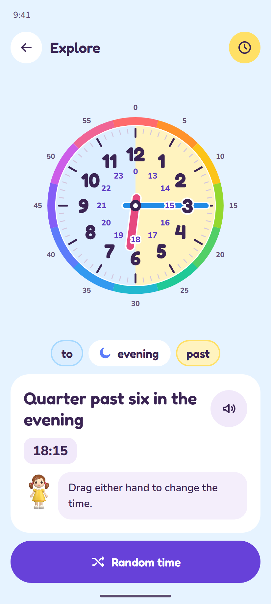

# Clocklings visual follow-up, round 2 (17 November 2026)

> **For implementation:** Work through section 5 in the order given in section 8, after an explicit implementation request from the owner. This document is a planning deliverable. It is not permission to commit, push, open a pull request, or publish.

**Date:** 17 November 2026

**Status:** Planned. Nothing in this document is implemented.

**Context:** This plan follows the [first visual follow-up plan](2026-11-17-visual-follow-up.md) (tasks V1 to V11). Codex implemented V1 to V11 on the branch `codex/visual-follow-up-2026-11-17`. The work is uncommitted in the working tree. Its report is `reports/clocklings-emulator-screenshots-2026-11-17-after/REPORT.md`.

**Source of this plan:** a review of two capture sets made after V1 to V11:

- `reports/clocklings-emulator-screenshots-2026-11-17-after/` (called **AFTER** below): default size, 320 dp, 200 % font and the combination, English UI.
- `reports/clocklings-kuvagalleria-2026-11-17/` (called **GALLERY** below): the full app tour at default size, mostly in Finnish.

Both folders are in `.gitignore` and exist only in the local checkout. A path such as `AFTER/screens/practice/result-3-stars.png` means `reports/clocklings-emulator-screenshots-2026-11-17-after/screens/practice/result-3-stars.png`.

**Goal:** Fix the visual defects and inconsistencies that remain after V1 to V11. Appearance only, plus the capture fixtures that produced misleading screenshots.

## Contents

1. [Rules](#1-rules)
2. [Accepted deviations from round 1](#2-accepted-deviations-from-round-1)
3. [Verified non-issues](#3-verified-non-issues)
4. [Owner decisions](#4-owner-decisions)
5. [Tasks](#5-tasks)
6. [Capture fixture corrections](#6-capture-fixture-corrections)
7. [Tokens and strings](#7-tokens-and-strings)
8. [Order of work](#8-order-of-work)
9. [Validation and acceptance](#9-validation-and-acceptance)
10. [Out of scope](#10-out-of-scope)
11. [Final report template](#11-final-report-template)

## 1. Rules

Read `AGENTS.md`, `docs/implementation/STATUS.md` and the first follow-up plan first. All repository rules apply. The key rules are repeated here.

- Continue on the existing branch `codex/visual-follow-up-2026-11-17`. Keep all uncommitted V1 to V11 work. Do not commit, push or open a pull request unless the owner asks for it separately.
- The app ships seven languages: English (`values`), Finnish (`values-fi`), Swedish (`values-sv`), German (`values-de`), French (`values-fr`), Spain Spanish (`values-es`) and Brazilian Portuguese (`values-pt-rBR`). Every new or changed string needs all seven.
- Keep identifiers, filenames and code comments in English. Put UI copy in Android resources.
- Use existing theme tokens (`SkColors`, `SkDimens`, `SkType`, `SkShapes`). Add a token instead of an inline value.
- Do not use middle-dot or pipe separators in UI. Do not add coloured edge stripes.
- Delete code and tokens that become unused in the same change. Grep all callers before you rename or remove anything.
- Do not edit companion artwork, accessory artwork, the Blender rigs or their rendering files.
- Never hide, collapse or remove answer options. The owner withdrew that idea (D2 in the first plan).
- Report in Finnish at the end (section 11).

## 2. Accepted deviations from round 1

The owner's reviewer accepted these deviations from the first plan. Do not rework them.

- **V1 and V2.** The READ reveal clock box is 220 dp at the default size instead of 250 dp. The clock is fully visible and all three options stay. Task R2 changes how the clock size behaves between states, not this floor.
- **V8.** The home stage became about 59 dp shorter instead of 32 dp. All four tiles show without scrolling and the stage still reads well.

The third deviation (V6, the reward card's "Choose an outfit" button under the bottom fade) is **not** accepted. Task R1 fixes it.

## 3. Verified non-issues

Do not "fix" these.

- **Blank or faint status bar icons in AFTER and GALLERY captures.** `MainActivity.kt` uses `SystemBarStyle.light`, and the live captures show normal dark icons: `GALLERY/startup/01-android-splash.png`, `GALLERY/startup/03-intro.png`, `GALLERY/startup/04-live-home.png` and `GALLERY/screens/settings-reset-dialog.png`. The blank bars come from the gallery capture method.
- **Clock style thumbnails look alike.** This is art task A14 from the 16 November plan and stays an owner decision.
- **Wardrobe item names cut at the bottom edge** of `GALLERY/screens/wardrobe-human-p0.png` and `wardrobe-name-entry.png`. That is the bottom scroll fade at the end of the viewport, not clipping inside a tile.

## 4. Owner decisions

**D4 is approved (owner, 17 November 2026).** In 24-hour mode the "to" and "past" zone words move out of the dial into two coloured pills on the same row as the day-part chip. The words stay visible to the child. Only their place changes. Task R3 has the details.

An earlier draft proposed removing the words in 24-hour mode. That is rejected: the app phrases 24-hour times with "past" and "to" as well ("Quarter past six in the evening"), and a child can switch to the 24-hour clock before lesson 6 has taught the words. Do not remove the words.

There are no open owner decisions in this plan.

## 5. Tasks

### R1. Level result: the reward card must fit, items must be evenly spaced, names must not break mid-word

Completes V6 of the first plan.

**Problem.**

- With a tall companion (the doll), two or three unlocked items and the default size, the "Choose an outfit" button inside the reward card sits under the bottom fade and is cut in half. With the shorter cat the same screen fits, so the problem is the vertical budget, not the card itself.
- With two items, the items sit at the far left and far right edges of the card with a wide empty gap between them.
- At 320 dp with 200 % font, the name "Polka-dot dress" breaks inside a word ("Polka-do" and "t dress").
- The "Choose an outfit" button uses `SkIcons.Dress`, which reads as a lab flask at this size. The companion picker uses the T-shirt `SkIcons.Outfit` for the same action and the same words.

**Evidence.**

- Cut button with the doll: `AFTER/screens/practice/result-3-stars.png`, `AFTER/screens/practice/result-2-stars.png`.
- Fits with the cat: `GALLERY/screens/result-2-stars-p0.png`, `GALLERY/screens/result-3-stars-p0.png`.
- Two items at the card edges: `AFTER/screens/practice/result-2-stars-end.png`, `GALLERY/screens/result-2-stars-p0.png`.
- Broken word: `AFTER/layouts/320dp-font-200/practice/result-3-stars-end.png`.
- Flask icon: `AFTER/screens/practice/result-1-stars.png`, `GALLERY/screens/result-2-stars-p0.png`. T-shirt for the same action: `AFTER/screens/appearance/00-choose-companion.png`.

**Change.** File: `ui/game/ResultScreen.kt`, plus `ui/components/Icons.kt` and `ui/theme/SkDimens.kt`.

1. **Vertical budget.** The space between the close button and the stars, between the stars and the companion, and between the companion and the title is each about 50 dp at the default size. Reduce these three gaps so that at the default size, with the doll and three unlocked items, the whole reward card including its "Choose an outfit" button is visible above the pinned bottom buttons, with at least `SkDimens.GapS` (8 dp) between the card and the fade. Use `SkDimens.GapM` (12 dp) for the stars-to-companion gap and `SkDimens.Gap` (16 dp) for the other two as the starting point. Do not change the companion's size. Do not change the star sizes.
2. **Item row.** Lay the items out as equal cells centred as a group: `Arrangement.spacedBy(SkDimens.GapM, Alignment.CenterHorizontally)`. Cell width is `SkDimens.RewardItemWidth` (new, 104 dp) when the row has room, otherwise `(rowWidth - gaps) / count`. With one item keep today's separate one-item layout.
3. **No mid-word breaks.** Render item names with the existing `WordSafeText` (used by `MenuTile` in `ui/components/Buttons.kt`), centred, `maxLines = 2`. When even one word does not fit a cell (320 dp with 200 % font), switch the row to a `FlowRow` with at most two items per row instead of breaking the word.
4. **Icon.** Replace both `SkIcons.Dress` uses (`ResultScreen.kt` lines 214 and 240) with `SkIcons.Outfit`. `SkIcons.Dress` then has no users. Delete it from `Icons.kt`.

**Acceptance.**

- Default size, doll, two and three items: the "Choose an outfit" button is fully visible without scrolling and not covered by the fade.
- Two items sit next to each other in the middle of the card.
- In all four configurations no item name breaks inside a word.
- The same action shows the T-shirt icon everywhere.

### R2. The practice clock must not grow during a task

Refines V1 of the first plan.

**Problem.** Within one practice task the clock box changes size three times at the default size: about 302 dp before answering, 330 dp after a wrong pick (hint), then 220 dp on reveal. Growing right after a mistake and shrinking right after that looks restless. The child should see one steady clock that only gives way when more content arrives.

**Evidence.** `AFTER/screens/practice/level-1-read.png`, `AFTER/screens/practice/level-1-read-hint.png`, `AFTER/screens/practice/level-1-read-reveal.png`, and the measurement table in `AFTER/REPORT.md` and `AFTER/device-measurements.txt`.

**Change.** Files: `ui/components/ScaffoldClockSizing.kt`, `ui/game/GameScreen.kt` (and the shared task scaffold if the size is held there).

- Within one task (the same `state.taskIndex`), the clock size may shrink but never grow. Keep the size reached so far and use `min(held, computed)` as the target. Reset the held size when the task index changes, so a new task starts at its full size again.
- Animate a shrink with `SkMotion.RESIZE_DURATION`. With reduced motion, snap.
- Apply the same rule to the Minute Challenge while running and to the lesson quiz, which use the same scaffold.
- Do not change the floors from V1 (`FeedbackClockMin`, `FitClockMin`).

**Acceptance.** For READ and SET tasks in all four configurations, the clock box size measured before answering, at hint and at reveal never increases from one state to the next. A new task starts at full size.

### R3. 24-hour clock: zone words as pills beside the day-part chip (D4, approved)

**Problem.** In 24-hour mode the words "to" and "past" sit between the 13 to 23 ring and the centre. "past" touches "14", "to" touches "22", and at midnight the hour hand cuts "past" into "ast". There is no room for them anywhere inside the dial.

**Evidence.** `AFTER/screens/main/03-explore-24h-0000.png`, `AFTER/screens/main/03-explore-24h.png`, `AFTER/screens/main/03-explore-24h-2345.png`, `GALLERY/screens/main-explore-24h-p0.png`.

**Target.** Board 12 of the first plan's mockups: [png](2026-11-17-visual-follow-up/png/12-explore-24h-zone-pills.png), source `2026-11-17-visual-follow-up/html/boards.html?b=b12`.

**Change.** Files: `ui/clock/ClockFace.kt`, `ui/clock/ClockSpec.kt`, `ui/clock/DayPartChip.kt` (from V4), `ui/theme/SkColors.kt`.

1. **Dial.** When the clock is in 24-hour mode, do not draw the zone words inside the dial. The blue and yellow half fills stay. Remove `ZONE_LABEL_ANGLE_24`, `ZONE_RADIUS_24` and the `is24` branch of `zoneLabelAngle` if nothing else uses them. The 12-hour mode is unchanged.
2. **Pill row.** Extend the V4 chip row under the clock into one centred row of three pills, `SkDimens.GapS` (8 dp) apart: the "to" pill, the existing day-part chip, the "past" pill.
   - Zone pill: same height, shape and text style as the day-part chip (40 dp, `SkShapes.Pill`, `SkType.DayPart`), horizontal padding 16 dp, no icon, text in `SkColors.Ink`.
   - "to" pill: fill `SkColors.Vaille`, 2 dp border `SkColors.MarkBlue`, text from the existing `clock_zone_vaille` string.
   - "past" pill: fill `SkColors.Yli`, 2 dp border `SkColors.HelpOnFill`, text from the existing `clock_zone_yli` string.
   - The border keeps the "to" pill visible on the light blue Explore background. Add role tokens `SkColors.ZoneToBorder = MarkBlue` and `SkColors.ZonePastBorder = HelpOnFill` instead of reusing the mark tokens by name in the component.
   - The order follows the dial, not the layout direction: "to" (blue half) on the left, "past" (yellow half) on the right. All seven app languages are left-to-right, so a plain `Row` is enough. Do not mirror it.
3. **When the pills show.** The zone pills show exactly when the dial would have shown the zone words in 24-hour mode: 24-hour mode with clock guides on. The day-part chip keeps its V4 rule (24-hour mode, also without guides). Without guides, the row holds only the day-part chip.
4. **Narrow widths.** When the three pills do not fit on one line (320 dp with 200 % font, or a long translation), put the day-part chip on its own centred line and the two zone pills on a second centred line below it, "to" left and "past" right, `SkDimens.GapS` between the lines. Never wrap text inside a pill.
5. **Fit.** The pill row counts as content below the clock for `ClockFit.FIT`, as the V4 chip does, so the clock makes room for a second line.
6. **Accessibility.** Each zone pill is one text node. Do not add new strings. The clock's own content description does not change.
7. Update the clock geometry tests that cover the 24-hour zone labels, and add a test that 24-hour mode with guides draws no zone words.

**Acceptance.**

- In 24-hour mode at 0:00, 6:30, 15:30, 18:15, 19:00 and 23:45 there is no zone word in the dial and no inner number touches another glyph.
- With guides on, the row under the clock reads "to", day-part, "past" in all seven languages, with the blue pill on the left and the yellow pill on the right.
- With guides off, only the day-part chip shows.
- At 320 dp with 200 % font the pills wrap onto two lines and no pill text is cut or wrapped.
- In 12-hour mode the dial and the area under the clock are unchanged.

### R4. Minute Challenge: no score pill before the game starts

**Problem.** The intro screen shows the score pill in the top bar before the first question: "0 correct" in Finnish, and in English the previous game's "7 correct". A score that is not running yet, or belongs to the last game, has no meaning on the intro.

**Evidence.** `AFTER/screens/play/04-challenge-intro.png` ("7 correct"), `GALLERY/screens/challenge-intro-p0.png` ("0 oikein").

**Change.** File: `ui/challenge/ChallengeScreen.kt` line 161. Pass `trailing` only when `state.phase == ChallengePhase.RUN`. The result screen already has no pill.

**Acceptance.** The intro top bar has only the back button and the title. The pill shows while running.

### R5. Home tiles: titles line up across a row

**Problem.** `MenuTile` (`ui/components/Buttons.kt` around line 236) uses `Arrangement.SpaceBetween`, so the title and description are pushed to the bottom of the tile. When the two tiles in a row have descriptions of different lengths, their titles sit at different heights. "Play" sits about 20 dp lower than "Play Together" in English, and "Pelaa" lower than "Pelaa yhdessä" in Finnish.

**Evidence.** `AFTER/screens/main/01-home.png`, `GALLERY/screens/main-home-p0.png`, `GALLERY/startup/04-live-home.png`.

**Change.** File: `ui/components/Buttons.kt`.

- Use `Arrangement.Top` in the tile column: icon badge, `SkDimens.GapM` (12 dp), title, `SkDimens.GapXS` (4 dp), description.
- Keep `MenuTileHeight` (160 dp) as the minimum height, the 16 dp padding from V8, and equal tile heights within a row. Leftover space goes below the description.

**Acceptance.** In English and Finnish at the default size and at 320 dp, the two titles in each row have the same top position (difference at most 1 dp). At 200 % font no text is clipped.

### R6. Purchase states: one pattern for every failure

Extends 16 November T18, which fixed only the "unavailable" state.

**Problem.** The "unavailable" state shows its message in a tinted inline panel with "Try again" as the primary button. The "failed" and "acknowledgement pending" states still show the message as plain body text, a large disabled pale purchase button as the most visible element, and "Try again" as a white secondary button. The "pending" state also shows a disabled purchase button. A parent sees a button they cannot press, and the action they can take looks secondary.

**Evidence.**

- Target pattern: `GALLERY/screens/parent-store-unavailable-p0.png`.
- Inconsistent: `GALLERY/screens/parent-store-failed-p0.png`, `GALLERY/screens/parent-store-acknowledgement_pending-p0.png`, `GALLERY/screens/parent-store-pending-p0.png`.

**Change.** Files: `ui/parent/ParentScreen.kt` (around lines 195 to 230), `billing/PurchaseUiState.kt` for reference only.

- `FAILED` and `ACKNOWLEDGEMENT_PENDING`: show the status message in the same inline panel as `UNAVAILABLE`, with the same tone token. Do not render the purchase button. "Try again" is the primary button, "Restore purchases" the secondary button.
- `PENDING`: show the status message in an inline panel with a neutral tone (`SkColors.SurfaceContainer` fill, `SkColors.Ink` text). Do not render the purchase button. "Restore purchases" stays.
- `READY`, `NOT_OWNED` and `CANCELLED`: unchanged. The purchase button shows and is enabled when `state.canPurchase` is true. It may be disabled only while `state.busy`.
- `VERIFYING`: unchanged. It is transient.
- `OWNED` and `RESTORED`: unchanged.
- Do not change billing logic.

**Acceptance.** No purchase state renders a disabled purchase button except during a busy moment. Every failure or waiting state shows its message in an inline panel. The available action is always the primary button.

### R7. Startup language error screen

**Problem.** When the saved language cannot be loaded at startup, `AppLocale.kt` (lines 103 to 113) shows a bare `ScreenScaffold` with one line of body text and a small button in the top-left corner. It is the only screen without a title, a picture or centred content, and it looks unfinished.

**Evidence.** `GALLERY/startup/05-locale-retry.png`.

**Change.** File: `ui/locale/AppLocale.kt`.

- Centre the content vertically and horizontally, width at most `SkDimens.ReadingWidth`.
- Top to bottom: the intro mascot used by `ui/intro/IntroScreen.kt`, at 160 dp; `SkDimens.Gap`; the existing `language_save_error` text in `SkType.Body`, centred; `SkDimens.Gap`; the existing "Try again" button as a primary `SkButton` at full content width.
- Reuse the mascot composable. Do not copy its drawing code.
- No new strings.

**Acceptance.** The screen looks like part of the app at the default size, 320 dp and 200 % font. The button is fully visible.

### R8. Minute Challenge save failure matches the practice save failure

**Problem.** When the challenge result cannot be saved, the error is a loose line of text between the card and the buttons, and the two buttons are stacked. The practice screen shows the same error in the companion's bubble with one primary "Try again" button. The two screens handle the same situation differently.

**Evidence.** `GALLERY/screens/challenge-save-failure-p0.png` compared with `GALLERY/screens/practice-save-failure-p0.png`.

**Change.** File: `ui/challenge/ChallengeScreen.kt` (the result layout from V7).

- Show the save error inside the result card, under the score, using the same companion tip and `SkColors.HintFill` bubble that practice uses (`ui/components/CompanionTip.kt`). Without a companion, show the bubble without the avatar.
- Bottom buttons: "Back" (secondary) and "Try again" (primary) side by side, like the normal result's "Back" and "Play again".

**Acceptance.** The challenge save failure and the practice save failure use the same bubble style. The challenge buttons sit side by side in all configurations where the normal result shows them side by side.

### R9. Play list: the "next up" level row

**Problem.** In the Play list the first unfinished level is drawn as a highlighted card with a Start button. The Start button stops short of the right edge to leave room for the book button, and the book button floats between the title row and the Start button. The Learn list's matching card has a full-width Start button and looks tidier.

**Evidence.** `GALLERY/screens/play-levels-locked-p0.png` compared with `GALLERY/screens/lesson-path-p0.png`.

**Change.** File: `ui/levels/LevelsScreen.kt` (`LevelRow`) and `ui/components/PathRow.kt` if the highlighted state is shared.

- Top row: level thumbnail, title and stars, and the book button, all vertically centred on the thumbnail.
- Below it: the Start button at full card content width, the same as the Learn list's start card.

**Acceptance.** The book button is centred on the thumbnail row. The Start button spans the card at the default size and at 320 dp.

## 6. Capture fixture corrections

These screenshots were produced by the capture setup, not by the app. Fix the fixtures so the next gallery is truthful. Do not change app behaviour for them.

| Capture | What it shows | Why it is a fixture problem | Fix |
| --- | --- | --- | --- |
| `GALLERY/screens/lesson-save-failure-p0.png` | The startup language error screen | It should show a lesson whose progress could not be saved | Drive the lesson save failure state and capture it again |
| `GALLERY/screens/settings-main-p0.png`, `settings-speech-available.png` | Finnish UI with the language row set to "English" | In `AppLocale.kt` the UI language is `selection.choice ?: device language`, so in the app the row and the UI language always match. The fixture stores English and renders Finnish resources | Store Finnish as the choice when capturing the Finnish UI, or capture in English |
| `GALLERY/screens/parent-store-cancelled-p0.png`, `parent-store-not_owned-p0.png` | A disabled purchase button | In `LocalPurchases.kt`, `PURCHASE_STATUSES` includes `CANCELLED` and `NOT_OWNED`, so the app enables purchase in these states | Set `canPurchase = true` in these fixture states |
| `GALLERY/screens/practice-no-guides-p0.png` | A set task starting at 12:00 with the hands on top of each other | `Levels.setTaskStart` starts at 3:00 or 9:00 | Build the fixture task start with `Levels.setTaskStart` |
| `GALLERY/screens/settings-speech-available.png` | No "For parents" row | Check whether the fixture state hides it on purpose. If the app can hide it, say so in the report | Report what you find |

## 7. Tokens and strings

| Token | Value | Task |
| --- | --- | --- |
| `SkDimens.RewardItemWidth` (new) | 104 dp | R1 |
| `SkIcons.Dress` | removed | R1 |
| `ClockSpec.ZONE_LABEL_ANGLE_24`, `ClockSpec.ZONE_RADIUS_24` | removed if unused | R3 |
| `SkColors.ZoneToBorder` (new) | `MarkBlue` (`#A5D8FF`) | R3 |
| `SkColors.ZonePastBorder` (new) | `HelpOnFill` (`#FFE066`) | R3 |

No new or changed strings. R3 reuses `clock_zone_vaille` and `clock_zone_yli`, which exist in all seven languages.

## 8. Order of work

1. R2 (clock sizing), then R1 (result screen).
2. R3 (clock face and the pill row under the clock).
3. R4, R8 (Minute Challenge).
4. R5, R9 (home and lists).
5. R6, R7 (parent and startup screens).
6. Section 6 (capture fixtures), then the captures in section 9.

Run `./gradlew --no-daemon :app:testDebugUnitTest` after each numbered step. Do not continue while tests fail.

## 9. Validation and acceptance

1. Run `./gradlew --no-daemon :app:testDebugUnitTest` and `./gradlew --no-daemon :app:assembleDebug` from the repository root.
2. Run `tools/check-localization.ps1`. Update `:app:stabilityDump` and `:app:stabilityCheck` if composable signatures changed.
3. Use the dedicated test emulator only and name it in the report.
4. Capture every screen changed in this round at the default size, 320 dp, 200 % font, and 320 dp with 200 % font. Save them to `reports/clocklings-emulator-screenshots-<date>-round2/` with the same file names as AFTER.
5. For R1 capture the result screen with the doll and with the cat, with one, two and three items.
6. For R2 record the clock box size before answering, at hint and at reveal for READ and SET in all four configurations.
7. For R5 capture the home screen in English and in Finnish.
8. For R3 capture Explore in 24-hour mode with and without guides at the times listed in R3, at the default size and at 320 dp with 200 % font. Capture the guides-on row once in each of the seven languages at the default size.
9. Regenerate the gallery after the section 6 fixes into `reports/clocklings-kuvagalleria-<date>/`.
10. Update `docs/implementation/STATUS.md`.
11. Report device evidence separately from source inspection. Do not claim that `lc` or `sc` passed. The owner runs them.
12. Stop every emulator or Gradle process you started. Leave other processes alone.

## 10. Out of scope

- Companion artwork, accessories and art tasks A6 to A14 of the 16 November plan.
- The header star total "15 / 15" (16 November T8) and English spelling consistency (T30). Both remain owner decisions.
- Raising the READ reveal clock above 220 dp (accepted in section 2).

## 11. Final report template

Write the report in Finnish.

- Toteutetut tehtävät (R-tunnisteet) ja muutetut tiedostot
- Korjatut kuvausfixturet (kohta 6) ja mitä ne paljastivat
- Ajetut tarkistukset ja niiden tulokset
- Laitteella todennetut näkymät ja konfiguraatiot, erikseen lähdekoodin tarkastelusta
- R2:n kellokoot tiloittain neljässä konfiguraatiossa
- Avoimet omistajan päätökset: T8 ja T30
- Todentamatta jääneet kohdat
