# Clocklings visual follow-up (17 November 2026)

> **For implementation:** Work through section 6 in the order given in section 9, after an explicit implementation request from the owner. This document is a planning deliverable. It is not permission to commit, push, open a pull request, or publish.

**Date:** 17 November 2026

**Status:** Planned. Nothing in this document is implemented.

**Source:** critical visual review of the emulator captures in `reports/clocklings-emulator-screenshots-2026-11-17/`. These captures were taken after the [16 November review fixes](2026-11-16-screenshot-ux-review-fixes.md). The review covered appearance only: typography, spacing, buttons, colour and visual logic. Companion artwork and accessories were not reviewed and must not change.

**Goal:** Fix six visual defects and five polish items that remain after the 16 November round. The app must stay cheerful for children and clear to read. The clock must stay large and fully visible whenever a child is asked to look at it.

**Architecture:** Presentation layer only: `ui/theme/`, `ui/components/`, `ui/clock/` and the screen files named in each task. No new dependencies, no data or domain changes, no navigation changes.

**Related documents:** [AGENTS.md](../../../AGENTS.md), [implementation status](../../implementation/STATUS.md), [16 November plan](2026-11-16-screenshot-ux-review-fixes.md), [14 November UI plan](2026-11-14-modern-android-ui.md). Owner instructions take precedence over every document.

## Contents

1. [Rules](#1-rules)
2. [Evidence and mockups](#2-evidence-and-mockups)
3. [What the 17 November captures say about the 16 November plan](#3-what-the-17-november-captures-say-about-the-16-november-plan)
4. [Verified non-issues](#4-verified-non-issues)
5. [Owner decisions](#5-owner-decisions)
6. [Tasks](#6-tasks)
7. [New and changed tokens](#7-new-and-changed-tokens)
8. [Strings](#8-strings)
9. [Order of work](#9-order-of-work)
10. [Validation and acceptance](#10-validation-and-acceptance)
11. [Out of scope](#11-out-of-scope)
12. [Final report template](#12-final-report-template)

## 1. Rules

Read `AGENTS.md` and `docs/implementation/STATUS.md` first. All repository rules apply. The key rules are repeated here.

- Work on a new branch `codex/visual-follow-up-2026-11-17`, created from the current branch. Do not commit, push or open a pull request unless the owner asks for it separately.
- Keep identifiers, filenames and code comments in English. Put UI copy in Android resources. Every new or changed string needs all seven locales: `values`, `values-fi`, `values-sv`, `values-de`, `values-fr`, `values-es`, `values-pt-rBR`.
- Use existing theme tokens (`SkColors`, `SkDimens`, `SkType`, `SkShapes`). Add a token instead of an inline value. Section 7 lists the new tokens.
- Do not use middle-dot or pipe separators in UI. Do not add coloured edge stripes.
- Delete code and tokens that become unused in the same change. Grep all callers before you rename or remove anything.
- Do not edit companion artwork, accessory artwork, the Blender rigs or their rendering files.
- Tasks marked **OWNER DECISION** depend on section 5. Implement them only if the owner has confirmed the decision in the implementation request. Otherwise skip them and list them in the final report.
- Report in Finnish at the end (section 12).

## 2. Evidence and mockups

### 2.1 Evidence captures

Paths in this plan that start with `screens/` or `layouts/` are relative to `reports/clocklings-emulator-screenshots-2026-11-17/`. That folder is in `.gitignore` and exists only in the local checkout. Each task links its evidence directly.

The captures are 1080 x 2400 px at density 2.625, so the default screen is 411 x 914 dp. Sizes quoted as "measured" in this plan were measured from those captures.

### 2.2 Target mockups

The mockups are the visual specification for the target state. They live next to this plan.

- `2026-11-17-visual-follow-up/png/` holds one PNG per board, rendered at 2x (a 412 dp wide screen is 824 px wide).
- `2026-11-17-visual-follow-up/html/boards.html` is the source of every PNG. Open `boards.html` to see all boards, or `boards.html?b=b01` for a single board. **One CSS pixel equals one dp, and a font size in px equals the same number of sp.** Read the HTML when a value is not stated in this plan. The fonts load from `app/src/main/res/font/`, so the file opens correctly from the repository checkout.
- `2026-11-17-visual-follow-up/html/assets/` holds crops of the real app (companion, reward items, thumbnails). They are reference pictures, not new artwork.

How to treat them:

- The clock in the mockups is an SVG drawn from the `ClockSpec.kt` numbers. It is a schematic. Only the clock changes described in task V4 are intended. Every other difference between the SVG and the real `ClockFace` (numeral size, shadows, knobs) is unintended and must be ignored.
- Mockups are in English and use the doll. All copy comes from existing string resources unless section 8 says otherwise.
- Where this plan and a mockup disagree, this plan wins.
- The mockups show a 412 x 915 dp phone, except board 03 (200 % font scale) and board 11 (two components, not a full screen). Landscape, tablets and side-by-side layouts are not drawn. The existing adaptive behaviour must keep working.

| Board | Screen and state | PNG | Section in `boards.html` | Task |
| --- | --- | --- | --- | --- |
| 01 | Practice, read task, answer revealed | [png](2026-11-17-visual-follow-up/png/01-practice-read-reveal.png) | `data-b="b01"` | V1, V2 |
| 02 | Practice, read task, hint after a wrong pick | [png](2026-11-17-visual-follow-up/png/02-practice-read-hint.png) | `data-b="b02"` | V1, V3 |
| 03 | Practice at 200 % font, answer revealed | [png](2026-11-17-visual-follow-up/png/03-practice-font-200.png) | `data-b="b03"` | V1 |
| 04 | Explore, 24-hour clock with guides | [png](2026-11-17-visual-follow-up/png/04-explore-24h.png) | `data-b="b04"` | V4 |
| 05 | Lesson page 1 | [png](2026-11-17-visual-follow-up/png/05-lesson-page.png) | `data-b="b05"` | V5 |
| 06 | Lesson quiz with a three-line question | [png](2026-11-17-visual-follow-up/png/06-lesson-quiz.png) | `data-b="b06"` | V5 |
| 07 | Level result, three stars | [png](2026-11-17-visual-follow-up/png/07-level-result.png) | `data-b="b07"` | V6 |
| 08 | Minute Challenge result, new best | [png](2026-11-17-visual-follow-up/png/08-challenge-record.png) | `data-b="b08"` | V7 |
| 09 | Home | [png](2026-11-17-visual-follow-up/png/09-home.png) | `data-b="b09"` | V8 |
| 10 | Companion picker | [png](2026-11-17-visual-follow-up/png/10-companion-picker.png) | `data-b="b10"` | V9 |
| 11 | Locked level row and locked outfit tile | [png](2026-11-17-visual-follow-up/png/11-locked-states.png) | `data-b="b11"` | V10 |

## 3. What the 17 November captures say about the 16 November plan

Most of the 16 November tasks are visible as done in the new captures. Five of them need another look. This plan replaces or completes them.

| 16 Nov task | What the 17 Nov captures show | What to do now |
| --- | --- | --- |
| T3, day-part label readable | Not effective. The hands still cut the word: "ev ing" in [main/03-explore-24h.png](../../../reports/clocklings-emulator-screenshots-2026-11-17/screens/main/03-explore-24h.png), "afte oon" in [practice/24h-1530.png](../../../reports/clocklings-emulator-screenshots-2026-11-17/screens/practice/24h-1530.png), "vening" in [lessons/09-vrk-quiz.png](../../../reports/clocklings-emulator-screenshots-2026-11-17/screens/lessons/09-vrk-quiz.png). In `ClockFace.kt` line 171 `drawDayPart` still runs before the hands. | Replaced by V4. T3 said "do not move the label". That was wrong: a label on the 6 o'clock axis is crossed by a hand at every half hour, and drawing it above the hands would hide the hands instead. |
| T4, 24-hour inner numbers | Still colliding. "23" touches "11", "0" touches "12", "22" touches "10", "14" touches "2" in the same captures. `INNER_24_FONT` is 15.6 and `INNER_24_RADIUS` is 88. | Completed by V4. |
| T5, feedback never below the screen edge | Done as written, with a bad side effect. T5 asked for the clock to shrink until the feedback fits. The clock now drops from about 302 dp to 160 dp exactly when the companion tells the child to look at the hands, and at large font sizes it is scrolled out of view. | Replaced by V1. |
| T6, lesson quiz options under the bottom bar | Meets the T6 acceptance ("after scrolling at most once") but the first view still hides the third answer: [lessons/02-kierros-quiz.png](../../../reports/clocklings-emulator-screenshots-2026-11-17/screens/lessons/02-kierros-quiz.png). | Completed by V5. |
| T23, "Read aloud" sentence inside the Sound card | Not visible as done. The sentence still sits between cards in [main/08-settings.png](../../../reports/clocklings-emulator-screenshots-2026-11-17/screens/main/08-settings.png). | V11. |

## 4. Verified non-issues

Do not "fix" these.

- **Grey stars on the level result screen** ([practice/result-1-stars.png](../../../reports/clocklings-emulator-screenshots-2026-11-17/screens/practice/result-1-stars.png), `result-2-stars.png`, `result-3-stars.png`). `PoppingStar` in `ui/game/ResultScreen.kt` shows the outline first and pops the gold star after `STAR_DELAY_MS` plus `STAR_STAGGER_MS` per star. The captures were taken before the pop. The logic is correct. Section 10 changes how these screens are captured.
- **Contrast of soft text.** Measured from the captures: home tile descriptions 5.1:1 to 5.7:1 (`#655279` on the four tile fills), Explore drag instruction 6.3:1, eyebrow and caption text on white 6.9:1. All pass 4.5:1.
- **Three dimmed stars on locked levels** in `screens/free/*.png` come from synthetic test progress.
- **Clock styles, Settings, Language, parent gate and store screens** need no visual change in this round, apart from V11.

## 5. Owner decisions

Two tasks change behaviour or copy, so they need the owner's confirmation. The recommendation for each is "yes".

| ID | Decision | Affects | If the owner says no |
| --- | --- | --- | --- |
| D1 | Move the 24-hour day-part label out of the dial into a chip under the clock. This edits clock drawing code and two English strings in seven locales. | V4 | Skip V4 step 1 and the string changes. Still do V4 steps 2 and 3. Report the label as an open defect. |
| D3 | Rebuild the Minute Challenge result screen without the clock, with the companion and one new plural string in seven locales. | V7 | Skip V7. |

**D2 is withdrawn (owner, 17 November 2026).** An earlier draft proposed hiding the wrong options when the answer is revealed. The owner wants the child to keep seeing what they picked. All three options therefore stay on screen in every feedback state. Do not hide, collapse or remove options.

## 6. Tasks

Each task lists the problem, the evidence, the target and the change. Acceptance criteria are checked on the four validation configurations in section 10.

### V1. Practice feedback must keep the clock large and visible

Replaces 16 November T5.

**Problem.** `GameScreen.kt` passes `clockFit = if (state.feedback != null) ClockFit.FIT else ClockFit.NONE`, and `scaffoldClockSize` then shrinks the clock down to `SkDimens.FitClockMin` (160 dp) so the panel fits. The panel is tall because it holds three options, the companion bubble and the Next button. At 200 % font or 320 dp width the content still does not fit, the scaffold scrolls to the feedback, and the clock leaves the viewport.

**Evidence.**

- Default size, clock at full size before feedback: [practice/level-1-read.png](../../../reports/clocklings-emulator-screenshots-2026-11-17/screens/practice/level-1-read.png) (ring about 302 dp).
- Default size, reveal: [practice/level-1-read-reveal.png](../../../reports/clocklings-emulator-screenshots-2026-11-17/screens/practice/level-1-read-reveal.png) (ring about 160 dp).
- 200 % font: [layouts/font-200/practice/level-1-read-hint.png](../../../reports/clocklings-emulator-screenshots-2026-11-17/layouts/font-200/practice/level-1-read-hint.png) and [level-1-read-reveal.png](../../../reports/clocklings-emulator-screenshots-2026-11-17/layouts/font-200/practice/level-1-read-reveal.png) (only the bottom of the dial shows under the title).
- 320 dp: [layouts/320dp/practice/level-1-read-reveal.png](../../../reports/clocklings-emulator-screenshots-2026-11-17/layouts/320dp/practice/level-1-read-reveal.png) (dial cut in half).
- 320 dp with 200 % font: [layouts/320dp-font-200/practice/level-1-read-hint.png](../../../reports/clocklings-emulator-screenshots-2026-11-17/layouts/320dp-font-200/practice/level-1-read-hint.png) (no clock at all).

**Target.** Boards 01, 02 and 03.

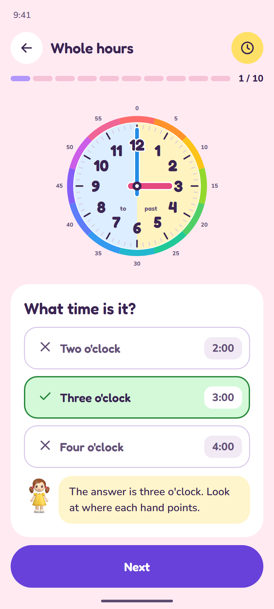
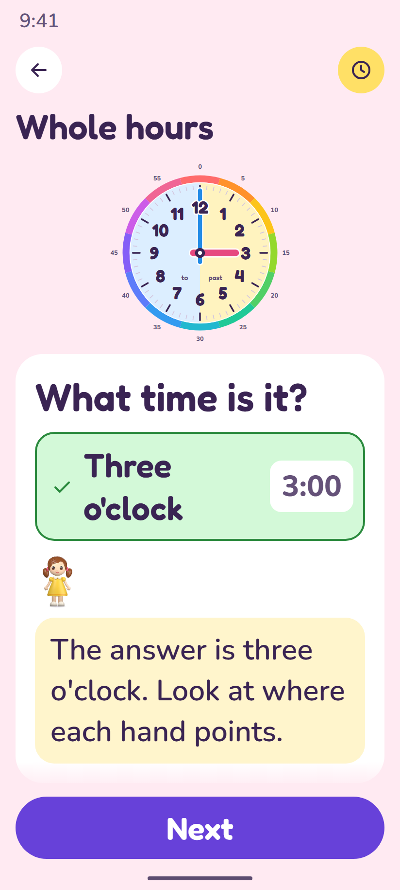

**Change.** Files: `ui/game/GameScreen.kt`, `ui/components/Layout.kt`, `ui/components/ScaffoldClockSizing.kt`, `ui/components/ClockTaskScaffold.kt`, `ui/theme/SkDimens.kt`.

1. **Move the task action into the pinned bottom bar.** In `GameScreen.kt`, `GameAnswerPanel` (lines 181 to 222) currently renders the Done button (`state.showDone`) and the Next or Retry button (`state.showNext`) inside the panel. Render them through `ScreenScaffold(bottomBar = …)` instead, the way `FreeClockScreen.kt` and `ResultScreen.kt` already do. Keep `Modifier.confettiAnchor { anchors[DONE_ANCHOR] = it }` on Done. Pass `bottomBar = null` when neither button shows, so no empty bar is reserved. The label logic (`R.string.settings_retry` for `GameFeedback.SaveFailed`, else `R.string.next`) does not change.
2. **Keep all three options in every feedback state.** The child must still see which options they picked wrong next to the correct one. Do not hide or collapse options on reveal. The room for the clock comes from step 1 (the button leaves the panel), not from removing content.
3. **Raise the clock floor on normal phones.** Add `SkDimens.FeedbackClockMin = 220.dp` and `SkDimens.TallTaskHeight = 760.dp`. Give `ScreenScaffold` and `scaffoldClockSize` a `fitMin: Dp = SkDimens.FitClockMin` parameter and use it in place of the hard-coded `SkDimens.FitClockMin` in the `ClockFit.FIT` branch. `GameScreen` passes `FeedbackClockMin` when the viewport height is at least `TallTaskHeight` and `LocalDensity.current.fontScale <= 1.3f`. In every other case it passes `FitClockMin`.
4. **Never scroll or clip the clock during a task.** When the content does not fit even at the floor, the clock stays pinned and only the panel scrolls. In the stacked (portrait) layout the order is: top bar, progress row, clock at the floor size, then a scroll container that takes the remaining height and holds the panel, then the bottom bar. The existing top and bottom fades (`ScaffoldFades`) apply to that scroll container only. The automatic scroll to the feedback (`FocusScroll.kt`, `BringIntoViewRequester` from T5) scrolls that container only.
   - `ClockTaskScaffold` already separates `visual`, `status`, `actions` and `content`. Prefer moving `GameScreen` onto it, or add the same separation to `ScreenScaffold`. Keep one sizing system. Do not add a second one.
   - The side-by-side layouts (`CompactClockTask`, `AdaptiveContent` in wide windows) already keep the clock outside the scrolling column. Do not change them.
5. Apply steps 3 and 4 to every screen that shows a task with feedback through the same scaffold: practice READ and SET, Minute Challenge while playing, lesson quiz (see V5) and Play Together.

**Acceptance.**

- Default emulator (411 x 914 dp, font 100 %): the `task_clock` bounds are at least 250 dp wide in READ reveal (today about 190 dp), at least 340 dp in SET reveal, and at least 220 dp in READ hint and SET hint.
- All three options are present in READ hint and READ reveal.
- All four configurations, for READ hint, READ reveal, SET hint and SET reveal: the whole dial including the minute labels is inside the viewport and not covered by the top bar, the fades or the bottom bar. Its size is at least 160 dp.
- The feedback bubble is fully visible without manual scrolling at the default size. At 200 % font it may need scrolling inside the panel container, but the clock does not move while it scrolls.
- The Done and Next buttons are always visible at the bottom of the screen and never scroll.

### V2. Reveal layout in practice (visual details)

**Target.** Board 01. This task only fixes the measurements of the state that V1 creates.

- Panel content, top to bottom, with `SkDimens.GapM` (12 dp) between items: question title, the three options in their original order with `SkDimens.GapOptions` (10 dp) between them, then the companion row (avatar 40 dp wide, bubble with `SkColors.HintFill`).
- The correct option uses `OptionState.CORRECT` (unchanged look). The options the child picked wrong use the quiet `OptionState.WRONG` from V3.
- Bottom bar: one primary button, full content width, `SkDimens.ButtonHeight` (64 dp).
- Gap between the clock box and the panel: `SkDimens.Gap` (16 dp).

**Acceptance.** A default-size capture of READ reveal matches board 01 in order and spacing. The clock box is about 264 dp.

### V3. Wrong answers must be quieter than the right answer

Supersedes the wrong-answer colours kept by 16 November T12 and T27. The icon from T12 (`SkIcons.Close`) stays.

**Problem.** `OptionState.WRONG` uses `SkColors.OptWrongFill` (`#FFE8CC`) with a `SkColors.OptWrongBorder` (`#D9480F`) border. It is the loudest element on the screen. After a reveal the screen shows two red-orange boxes and one green box, so the mistakes dominate the answer.

**Evidence.** [practice/level-1-read-hint.png](../../../reports/clocklings-emulator-screenshots-2026-11-17/screens/practice/level-1-read-hint.png), [practice/level-1-read-reveal.png](../../../reports/clocklings-emulator-screenshots-2026-11-17/screens/practice/level-1-read-reveal.png), [lessons/01-viisarit-completed.png](../../../reports/clocklings-emulator-screenshots-2026-11-17/screens/lessons/01-viisarit-completed.png).

**Target.** Board 02.

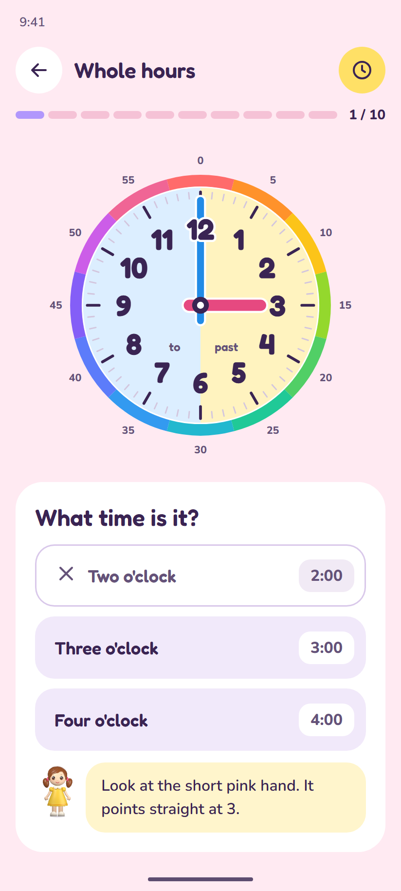

**Change.** File: `ui/components/OptionButton.kt` (lines 67 and 73), `ui/theme/SkColors.kt`.

- `OptionState.WRONG` container colour: transparent (the panel surface shows through).
- Border: `BorderStroke(SkDimens.BorderThin, SkColors.FieldOutline)` (`#D9C8EA`). If `BorderThin` is not 1.5 dp, add `SkDimens.BorderQuiet = 1.5.dp`.
- Label and the leading `SkIcons.Close` icon: `SkColors.UiInkSoft` (`#655279`).
- Time chip inside a wrong option: fill `SkColors.PillMuted`.
- `OptionState.CORRECT` and `OptionState.NORMAL` do not change.
- Remove `SkColors.OptWrongFill` and `SkColors.OptWrongBorder` if nothing else uses them after this change.
- The content description of a wrong option does not change.

**Acceptance.** In a hint capture the wrong option reads as used up, and the green correct option (when shown) is the only option with a saturated fill and border. The wrong state is still distinguishable without colour through its icon and outline. Contrast of the wrong label on the panel is at least 4.5:1 (expected 6.9:1).

### V4. 24-hour clock: day-part chip under the dial and a clean 13 to 23 ring

Replaces 16 November T3 and completes T4. Step 1 is **OWNER DECISION D1**.

**Problem.** In 24-hour mode the word for the part of the day (with its sun or moon) is drawn inside the dial at `DAY_TEXT_Y = 260` on the 6 o'clock axis, under the hands. A hand covers part of it at many times of day. Lesson 9 and one hint tell the child to read exactly this word. The small numbers 13 to 23 and 0 sit at `INNER_24_RADIUS = 88`, directly against the inner edge of the 1 to 12 numerals (`NUMBER_RADIUS = 110`, `NUMBER_FONT = 39`), and they touch them.

**Evidence.** [main/03-explore-24h.png](../../../reports/clocklings-emulator-screenshots-2026-11-17/screens/main/03-explore-24h.png), [main/04-explore-without-guides.png](../../../reports/clocklings-emulator-screenshots-2026-11-17/screens/main/04-explore-without-guides.png), [practice/24h-1530.png](../../../reports/clocklings-emulator-screenshots-2026-11-17/screens/practice/24h-1530.png), [lessons/09-vrk-page-1.png](../../../reports/clocklings-emulator-screenshots-2026-11-17/screens/lessons/09-vrk-page-1.png), [lessons/09-vrk-quiz.png](../../../reports/clocklings-emulator-screenshots-2026-11-17/screens/lessons/09-vrk-quiz.png).

**Target.** Board 04.

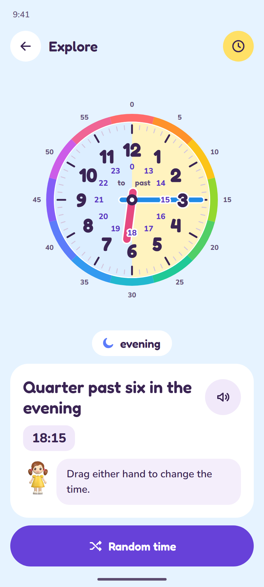

**Change.** Files: `ui/clock/ClockFace.kt`, `ui/clock/ClockSpec.kt`, `ui/components/Panels.kt` (`ClockBox`), `ui/theme/Type.kt`, string resources.

1. **OWNER DECISION D1. Day-part chip.**
   - Remove the `if (is24) drawDayPart(dayPart, textMeasurer, styles)` call (`ClockFace.kt` line 171) and the `drawDayPart` function (line 490). Remove the `ClockSpec` constants that only it used (`SUN_CY`, `SUN_RADIUS`, `SUN_RAY_FROM`, `SUN_RAY_TO`, `SUN_RAY_WIDTH`, `DAY_TEXT_Y`, `DAY_FONT`) unless the chip icon reuses them.
   - Add a `DayPartChip` composable in `ui/clock/`. It shows the sun or moon and the word from `timeLanguage(LocalAppLanguage.current).dayPart(time)`, the same source `ClockFace.kt` line 134 uses today.
   - Measurements: height 40 dp, `SkShapes.Pill`, fill `SkColors.Surface`, padding start 14 dp and end 18 dp, icon 22 dp, 8 dp between icon and word, word in a new `SkType.DayPart` (Fredoka SemiBold 18 sp, `SkColors.Ink`). Sun colours `SkColors.Sun` and `SkColors.SunRay`, moon colour `SkColors.Moon`.
   - Placement: centred horizontally, directly under the clock square, `SkDimens.GapS` (8 dp) below it. Put it in the shared clock container so every full-size 24-hour clock gets it: Explore, practice, Minute Challenge, Play Together and lessons. The chip shows exactly when the in-dial label showed (24-hour mode). Mini clocks (`mini = true`) never showed the label and do not get a chip.
   - The chip counts as part of the content below the clock for `ClockFit.FIT`, so the clock makes room for it.
   - The chip is one accessibility node with the word as its text. The clock's own content description does not change.
   - Change the two strings that mention the centre (section 8).
2. **13 to 23 ring.** In `ClockSpec.kt` set `INNER_24_RADIUS = 72f` and `INNER_24_FONT = 17f`. With `NUMBER_RADIUS = 110` and `NUMBER_FONT = 39` this leaves every inner number clear of the 1 to 12 numerals. Keep `SkColors.Hour24`. Check its contrast against `SkColors.Yli` and `SkColors.Vaille` and darken it only if it is below 4.5:1.
   - The hour hand (`HOUR_LENGTH = 86`) now crosses the inner number of the current hour. Extend `drawCoveredNumerals` (`ClockFace.kt` line 447) to the inner ring: an inner number within 14 degrees of the hour hand or 12 degrees of the minute hand is redrawn above the hands with the `SkColors.Face` halo, exactly like the 1 to 12 numerals.
3. **Zone labels in 24-hour mode.** Keep `ZONE_LABEL_ANGLE_24 = 32f` and set `ZONE_RADIUS_24 = 44f`, so "to" and "past" sit inside the new ring instead of on it. `ZONE_HIDE_ANGLE` and `ZONE_FADE_ANGLE` keep working as today.
4. These numbers are the starting point from the geometry. If a capture shows any overlap, adjust `INNER_24_RADIUS` or `ZONE_RADIUS_24` by up to 4 units and report the final values.

**Acceptance.** In 24-hour mode at 0:00, 6:30, 15:30, 18:15, 19:00 and 23:45, at the default size and at 320 dp:

- No glyph of 13 to 23 or 0 touches a 1 to 12 numeral, a zone label or the centre cap.
- The day-part word is complete and readable in every capture.
- Both hands are identifiable.
- With D1 declined: the label stays in the dial, steps 2 to 4 are done, and the report lists the cut label as open.

### V5. Lesson screens: larger clock, all answers visible, balanced bottom bar

Completes 16 November T6.

**Problem.**

- The lesson clock ring measures about 239 dp while the practice clock measures about 302 dp. A band of about 150 dp between the card and the bottom bar stays empty.
- On page 1 the disabled Previous button is a near-invisible ghost (fill contrast about 1.0:1 against the page).
- On a quiz with a three-line question the third answer is hidden behind the bottom bar in the first view.
- On the quiz step the bottom bar holds one half-width Previous button and an empty right half.

**Evidence.** [lessons/01-viisarit-page-1.png](../../../reports/clocklings-emulator-screenshots-2026-11-17/screens/lessons/01-viisarit-page-1.png), [lessons/02-kierros-quiz.png](../../../reports/clocklings-emulator-screenshots-2026-11-17/screens/lessons/02-kierros-quiz.png), [lessons/01-viisarit-quiz.png](../../../reports/clocklings-emulator-screenshots-2026-11-17/screens/lessons/01-viisarit-quiz.png).

**Target.** Boards 05 and 06.

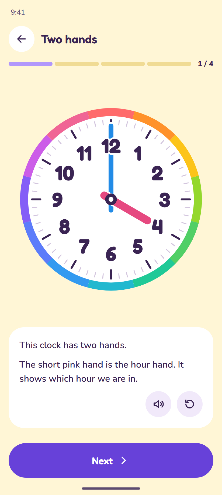
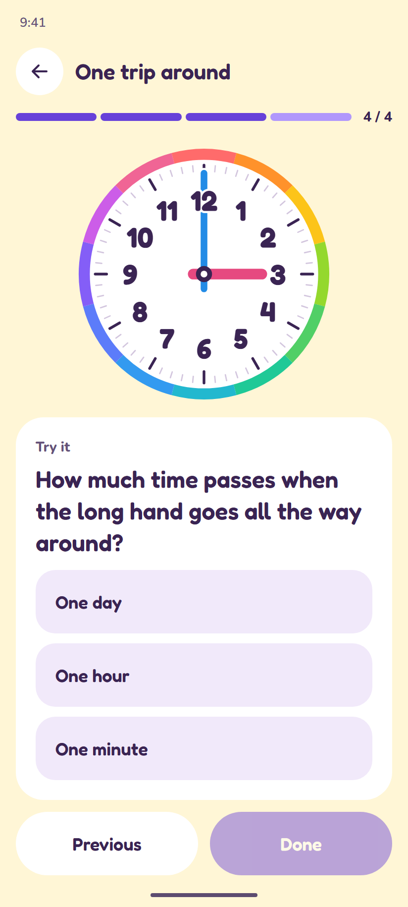

**Change.** Files: `ui/lesson/LessonScreens.kt`, `ui/components/ClockTaskScaffold.kt`, `ui/theme/SkDimens.kt`.

1. **Clock size on lesson pages.** Let the lesson clock use the free height. On the default emulator the clock box must be 340 dp (never above `SkDimens.ClockMax`, never wider than the content width). Centre the clock and the card as a group between the progress row and the bottom bar, so leftover space is split above and below.
2. **Quiz step.** Use `ClockFit.FIT` with `fitMin = SkDimens.QuizClockMin` (new, 200 dp) on tall screens, by the same rule as V1 step 3. The clock gives way until the eyebrow, the question and all options fit. If they still do not fit, the pinned-clock rule from V1 step 4 applies.
3. **Bottom bar rule.**
   - When only one action is available, the button spans the full content width. Page 1 shows only Next. Do not render a disabled Previous.
   - Pages 2 and later show Previous (secondary) and Next or Try it (primary) as two equal halves, as today.
   - The quiz step shows Previous (secondary) and Done (primary) as two equal halves. Done is disabled until the quiz is answered correctly: same fill with `SkColors.DISABLED_CONTROL_ALPHA`, not clickable, and exposed as disabled to accessibility. Today the right half is empty until then (`showNext` in `LessonScreens.kt` line 300).

**Acceptance.**

- Default emulator: lesson page clock box 340 dp. Every lesson quiz shows the question and all options without scrolling, with a clock of at least 200 dp. Check `02-kierros-quiz` specifically.
- No lesson capture contains a disabled Previous button.
- At 320 dp and 200 % font no button label is clipped. A full-width button may grow in height.

### V6. Level result: the reward card must not be clipped

**Problem.** With two or three unlocked items the reward card has about 50 dp of empty space above the item pictures, and the item names are cut by the bottom fade and the pinned buttons ("Polka-dot dress" loses its second line). The one-item layout is fine.

**Evidence.** [practice/result-2-stars.png](../../../reports/clocklings-emulator-screenshots-2026-11-17/screens/practice/result-2-stars.png), [practice/result-3-stars.png](../../../reports/clocklings-emulator-screenshots-2026-11-17/screens/practice/result-3-stars.png). Good reference for one item: [practice/result-1-stars.png](../../../reports/clocklings-emulator-screenshots-2026-11-17/screens/practice/result-1-stars.png).

**Target.** Board 07.

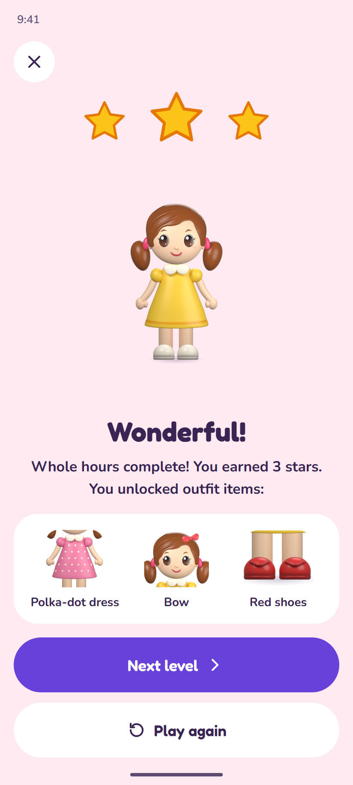

**Change.** File: `ui/game/ResultScreen.kt` (the unlocked-items block that follows `ResultTitle`).

- The card wraps its content. Remove whatever gives it extra height or centres the items in a taller box (a weight, a fixed or minimum height, or a nested scroll viewport).
- Card padding `SkDimens.Gap` (16 dp). Items in one row, evenly spaced. Each item: picture 72 dp high, 6 dp gap, name in the existing small label style, centred, `maxLines = 2`.
- The companion keeps its current size. Board 07 shows it at 200 dp, close to the current capture.
- When the content does not fit (320 dp with 200 % font), the whole content column scrolls above the pinned buttons. At rest the fade must not cut a line of text in half: add bottom content padding equal to the fade height.

**Acceptance.** `result-2-stars` and `result-3-stars` at the default size show every item name in full and no empty band inside the card. In the other three configurations every name is readable after scrolling to the end.

### V7. Minute Challenge result should feel like a result (OWNER DECISION D3)

**Problem.** The result screen keeps the last task's clock and an empty time bar on screen. The card shows a small caption, a number, and a sentence that repeats the caption ("New best!" twice). A new record looks the same as any other result. There is no companion and nothing celebratory on a screen that exists to reward the child.

**Evidence.** [play/06-challenge-result.png](../../../reports/clocklings-emulator-screenshots-2026-11-17/screens/play/06-challenge-result.png), [play/07-challenge-record.png](../../../reports/clocklings-emulator-screenshots-2026-11-17/screens/play/07-challenge-record.png).

**Target.** Board 08 (new best). The ordinary result is described below.

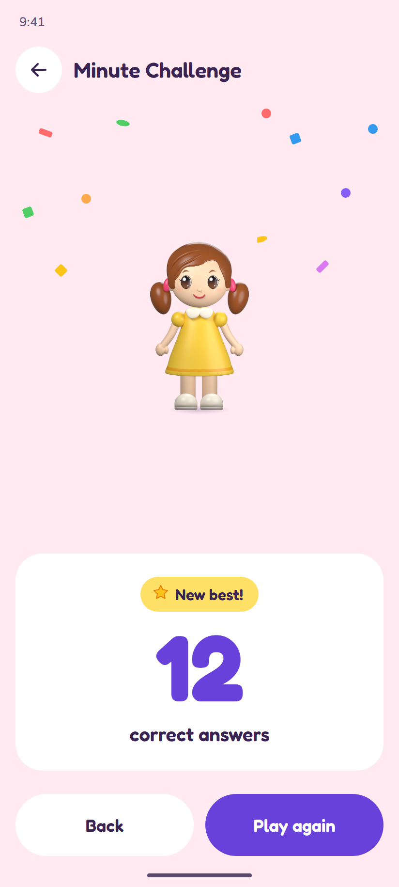

**Change.** File: `ui/challenge/ChallengeScreen.kt`, strings.

- In the result state do not show the clock or the time bar.
- Top bar unchanged (back button and title).
- Companion: the current companion, centred, at most 190 dp high, in the space between the top bar and the card. Reuse the celebration pose that `ResultScreen.kt` uses if it can be shared without duplication. With "Just the clock" selected, show no companion and centre the card vertically.
- Card (`FlatPanel`, padding 24 dp, content centred, 6 dp between items):
  1. Status pill, 36 dp high, `SkShapes.Pill`. New best: fill `SkColors.HelpOnFill`, an 18 dp `StarIcon` and `challenge_new_best` in Fredoka SemiBold 16 sp `SkColors.Ink`. Ordinary result: fill `SkColors.PillMuted`, no icon, `challenge_over` in `SkColors.UiInkSoft`.
  2. The score as a number: new `SkType.ScoreHuge` (Fredoka Bold 96 sp, line height 100 sp, `SkColors.Primary`).
  3. The new plural `challenge_correct_label` ("correct answer" or "correct answers") in Fredoka SemiBold 20 sp.
  4. Ordinary result only: `challenge_best` ("Best score: 9 correct") in `SkType.SmallSoft`.
- Accessibility: the card is one node. Its content description is the existing sentence: `challenge_new_record` for a new best, `challenge_result` otherwise. Both strings therefore stay in use.
- Confetti plays only for a new best and stays below the card (16 November T10).
- Buttons unchanged: Back (secondary) and Play again (primary).

**Acceptance.** No clock or time bar on the result. A new best is recognisable at a glance from the gold pill. The score sentence is not printed twice. TalkBack reads one sentence for the card.

### V8. Home tiles need even inner padding

**Problem.** `MenuTile` (`ui/components/Buttons.kt` line 238) uses `padding(horizontal = SkDimens.Gap, vertical = SkDimens.GapS)`: 16 dp at the sides and 8 dp at the top and bottom. Since the 16 November round added the descriptions, the icon badge and the last text line sit against the tile edges.

**Evidence.** [main/01-home.png](../../../reports/clocklings-emulator-screenshots-2026-11-17/screens/main/01-home.png).

**Target.** Board 09.

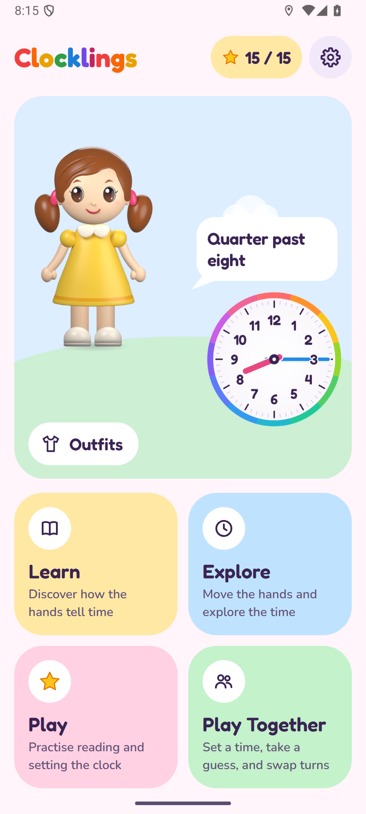

**Change.** Files: `ui/components/Buttons.kt`, `ui/theme/SkDimens.kt`, `ui/home/HomeStage.kt` (and `HomeStageMath.kt` if the height is computed there).

- `MenuTile` padding: `padding(SkDimens.Gap)` on all four sides.
- `SkDimens.MenuTileHeight`: 132 dp to 160 dp.
- `SkDimens.TileIconBadge`: 52 dp to 48 dp. `MenuTile` is its only user.
- The two tile rows grow by about 38 dp in total. Take that from the home stage: reduce the stage height by 32 dp on screens at least 800 dp high by trimming the empty sky above the companion. The companion, the speech bubble, the stage clock and the Outfits button keep their sizes and their positions relative to the stage bottom.

**Acceptance.** Default emulator: all four tiles are fully visible without scrolling, with at least 16 dp between the last row and the gesture bar. Inside every tile the distance from the badge to the top edge equals the distance to the start edge (16 dp). At 320 dp and 200 % font no tile text is clipped and tiles in a row keep equal height.

### V9. Companion picker: show every choice, with child-sized targets

**Problem.** `CompanionThumbnails` (`ui/appearance/AppearanceScreen.kt` line 403) puts all ten choices on one row. On a 411 dp screen that gives 30 dp each, which is clamped to `SkDimens.ThumbnailMin` (44 dp), so the row scrolls sideways and three choices are hidden. The targets are small for a child, and about 200 dp below the button stays empty.

**Evidence.** [appearance/00-choose-companion.png](../../../reports/clocklings-emulator-screenshots-2026-11-17/screens/appearance/00-choose-companion.png), [appearance/01-no-companion.png](../../../reports/clocklings-emulator-screenshots-2026-11-17/screens/appearance/01-no-companion.png).

**Target.** Board 10.

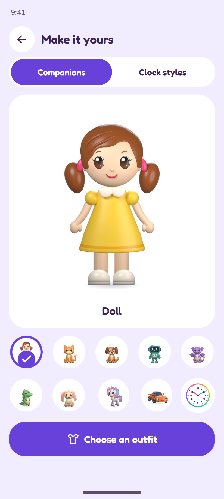

**Change.** Files: `ui/appearance/AppearanceScreen.kt`, `ui/theme/SkDimens.kt`.

- Compute `perRow`: all choices on one row if each can be `SkDimens.CompanionThumbnail` (64 dp) with `SkDimens.GapS` gaps. Otherwise two rows of `ceil(count / 2)`.
- Thumbnail size: `((maxWidth - SkDimens.GapS * (perRow - 1)) / perRow).coerceIn(SkDimens.ThumbnailMin, SkDimens.CompanionThumbnail)`.
- Lay the thumbnails out with a `FlowRow` (`maxItemsInEachRow = perRow`, `Arrangement.SpaceBetween` horizontally, `SkDimens.GapM` between rows). Remove `horizontalScroll` for this case.
- `SkDimens.ThumbnailMin`: 44 dp to 48 dp. `AppearanceScreen.kt` is its only user.
- Keep today's single scrolling row only when the viewport height is below `SkDimens.CompactTaskHeight`, where two rows would push the button off screen.
- Selection ring, check badge, lock handling, semantics and test tags do not change.

**Acceptance.** Default emulator: ten thumbnails of 64 dp in two rows of five, none hidden, no sideways scroll. At 320 dp: two rows of five at 48 dp or more. On a tablet width all ten sit on one row.

### V10. Locked content must stay readable

Refines 16 November T11 and T29.

**Problem.** In the free version, locked rows dim the title and the "Full version" line together to `#A79DB2` on white, which is 2.6:1. The whole list reads as greyed out and the text a parent needs is the hardest to read. In the wardrobe, a locked tile shows the item name in a lighter colour than the "Full version" line below it, so the hierarchy is upside down.

**Evidence.** [free/01-levels.png](../../../reports/clocklings-emulator-screenshots-2026-11-17/screens/free/01-levels.png), [free/02-lessons.png](../../../reports/clocklings-emulator-screenshots-2026-11-17/screens/free/02-lessons.png), [free/04-wardrobe-p2.png](../../../reports/clocklings-emulator-screenshots-2026-11-17/screens/free/04-wardrobe-p2.png).

**Target.** Board 11.

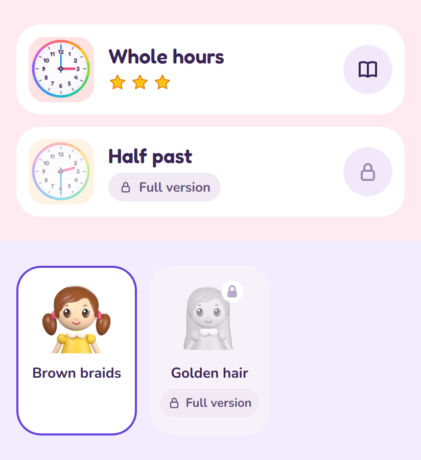

**Change.** Files: `ui/components/PathRow.kt`, `ui/levels/LevelsScreen.kt` (`LevelRow`), the lesson list in `ui/lesson/LessonScreens.kt`, `ui/companion/WardrobeScreen.kt` (`LockedTile`, line 349), `ui/components/Display.kt`.

- Add a shared `LockPill` composable: height 28 dp, `SkShapes.Pill`, fill `SkColors.PillMuted`, padding 10 dp at the sides, a 14 dp lock icon, 6 dp gap, the existing "Full version" string in Nunito Bold 13 sp `SkColors.UiInkSoft`, single line. Inside an outfit tile use 7 dp side padding and 12 sp so it fits a 118 dp tile.
- Locked list rows (levels, lessons and practice rows):
  - Title in `SkColors.Ink` at full opacity.
  - The "Full version" supporting text becomes the `LockPill`.
  - The thumbnail or number badge is drawn at 50 % opacity.
  - Stars are not shown on a locked row. The pill takes their place.
  - The trailing control is a lock icon in a 48 dp tonal circle (`SkColors.TonalFill`, icon `SkColors.Lock`). It replaces the book button or chevron. The row keeps today's click behaviour.
- Locked outfit tile: item name in the same style and colour as an unlocked tile's name. The `LockPill` sits under it. The grey picture and its lock badge do not change. The star-requirement pill from 16 November T7 keeps its rules.

**Acceptance.** Locked titles and item names reach at least 4.5:1 (report the measured ratio). A locked row is still clearly different from an unlocked one through the pill, the dimmed picture and the lock icon. Nothing depends on colour alone.

### V11. Settings: "Read aloud" sentence inside the Sound card

Carry-over of 16 November T23. In [main/08-settings.png](../../../reports/clocklings-emulator-screenshots-2026-11-17/screens/main/08-settings.png) the sentence "Read aloud is available for this language. Speech starts only when you tap the speaker." still sits between the Sound card and the next section label. Move it into the Sound card as supporting text under the sound-effects row, as T23 describes (`ui/settings/SettingsScreen.kt`, `SettingsRows.kt`). If the code already does this and the capture is stale, say so in the report and attach a new capture.

## 7. New and changed tokens

| Token | Value | Used by |
| --- | --- | --- |
| `SkDimens.FeedbackClockMin` (new) | 220 dp | V1 |
| `SkDimens.TallTaskHeight` (new) | 760 dp | V1, V5 |
| `SkDimens.QuizClockMin` (new) | 200 dp | V5 |
| `SkDimens.BorderQuiet` (new, only if `BorderThin` is not 1.5 dp) | 1.5 dp | V3 |
| `SkDimens.MenuTileHeight` | 132 dp to 160 dp | V8 |
| `SkDimens.TileIconBadge` | 52 dp to 48 dp | V8 |
| `SkDimens.ThumbnailMin` | 44 dp to 48 dp | V9 |
| `SkType.DayPart` (new) | Fredoka SemiBold 18 sp | V4 |
| `SkType.ScoreHuge` (new) | Fredoka Bold 96 sp, line height 100 sp | V7 |
| `ClockSpec.INNER_24_RADIUS` | 88 to 72 | V4 |
| `ClockSpec.INNER_24_FONT` | 15.6 to 17 | V4 |
| `ClockSpec.ZONE_RADIUS_24` | 60 to 44 | V4 |
| `SkColors.OptWrongFill`, `SkColors.OptWrongBorder` | removed if unused | V3 |
| `ClockSpec.SUN_*`, `DAY_TEXT_Y`, `DAY_FONT` | removed if unused | V4 |

## 8. Strings

Every row needs all seven locales. Keep the British spelling the English file already uses in these strings.

| Key | Today (English) | New (English) | Task |
| --- | --- | --- | --- |
| `l_vrk_p3b` | Read the label in the centre to find the part of the day. The hands alone cannot tell you. | Read the label under the clock to find the part of the day. The hands alone cannot tell you. | V4, D1 |
| `hint_hands_right` | The hands match! Look at the %1$s and the label in the centre: %2$s. | The hands match! Look at the %1$s and the label under the clock: %2$s. | V4, D1 |
| `challenge_correct_label` (new plural) | none | one: "correct answer", other: "correct answers" | V7, D3 |

In the other six locales change only the phrase that says where the label is. `challenge_new_record` and `challenge_result` stay unchanged and are used as content descriptions (V7).

## 9. Order of work

1. V1, then V2 and V3 (practice screens share the same files).
2. V4 (clock face). Run the clock unit tests and any screenshot tests after it.
3. V5 (lessons), which reuses the scaffold work from V1.
4. V6 and V7 (result screens).
5. V8, V9, V10, V11.

Run `:app:testDebugUnitTest` after each numbered step. Do not start the next step while tests fail. Update `docs/implementation/STATUS.md` and the stability baseline (`:app:stabilityDump`, `stabilityCheck`) when composable signatures change.

## 10. Validation and acceptance

1. Run `./gradlew --no-daemon :app:testDebugUnitTest` from the repository root.
2. Run `./gradlew --no-daemon :app:assembleDebug`.
3. Use the dedicated test emulator only and name it in the report. Capture every changed screen in four configurations:
   - default size (411 x 914 dp, font 100 %)
   - 320 dp width
   - 200 % font scale
   - 320 dp width with 200 % font scale
4. Capture rules for this round:
   - Wait until animations have settled before each capture. On the level result screen wait at least 1500 ms, or enable reduced motion for those captures, so the stars show as earned.
   - For V1 capture READ hint, READ reveal, SET hint and SET reveal in all four configurations.
   - For V4 capture 24-hour mode at 0:00, 6:30, 15:30, 18:15, 19:00 and 23:45, at the default size and at 320 dp.
   - For V5 capture `02-kierros-quiz` in its first, unscrolled view.
5. Save the captures under `reports/clocklings-emulator-screenshots-<date>-after/` with the same file names as the 17 November folder, so before and after can be compared.
6. Compare each changed screen with its board in section 2.2 and list every intended difference in the report.
7. Report device evidence separately from source inspection. Do not claim that `lc` or `sc` passed. The owner runs them.
8. Stop every emulator or Gradle process you started. Leave other processes alone.

## 11. Out of scope

These were noticed in the review and are deliberately left alone. Do not implement them.

- Companion artwork, accessories, and the art tasks A6 to A14 of the 16 November plan.
- The guides toggle in the top bar is an icon-only yellow button. A labelled chip would be clearer, but it needs a new short string in seven locales and an owner decision.
- The book button on the Play level rows has no label, and the rows have no visible "start" affordance.
- Lesson pages show the companion only on some pages. Making the companion "speak" every lesson text would be a larger redesign.
- The header star total "15 / 15" (16 November T8, still an owner decision).
- English spelling consistency (16 November T30, still an owner decision).

## 12. Final report template

Write the report in Finnish.

- Toteutetut tehtävät (V-tunnisteet) ja muutetut tiedostot
- Ajetut tarkistukset ja niiden tulokset
- Laitteella todennetut näkymät ja konfiguraatiot, erikseen lähdekoodin tarkastelusta
- Lopulliset arvot: `INNER_24_RADIUS`, `INNER_24_FONT`, `ZONE_RADIUS_24`, mitatut kontrastit (V3, V4, V10)
- Tarkoitukselliset erot malleihin
- Avoimet omistajan päätökset: D1 ja D3 (jos ei kuitattu) sekä T8 ja T30
- Todentamatta jääneet kohdat
